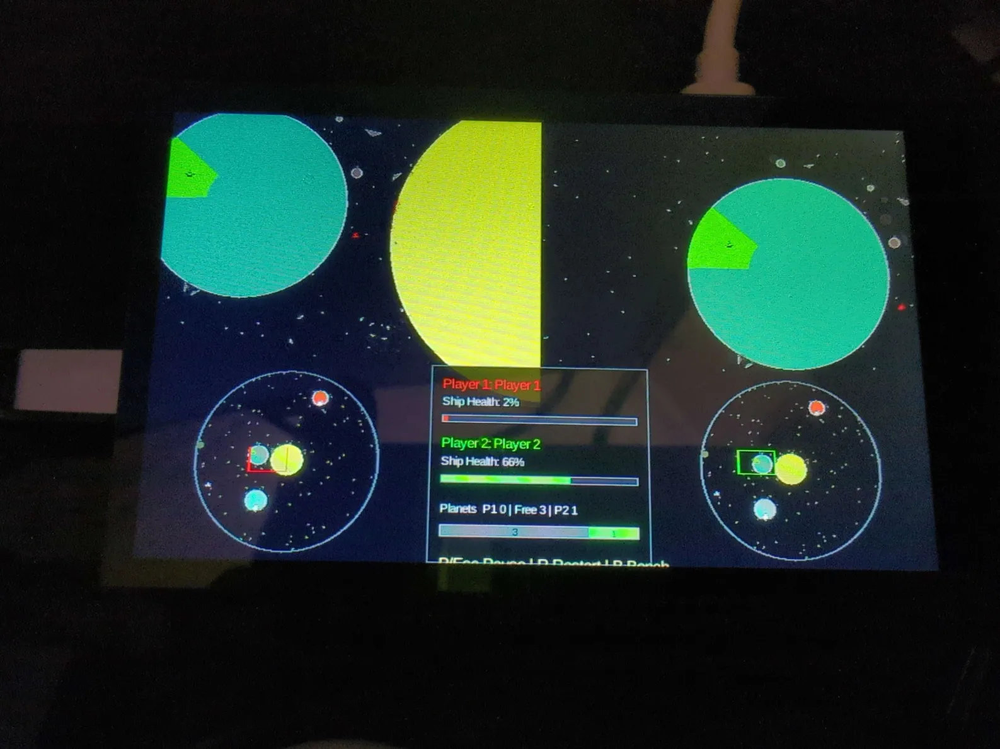

# Space Wars

This is my vision for a 2d physics-based game and AI playground. It will soon
be a playground for evolving and training neural nets to play various scenarios
within it, including a "Space Wars" scenario, in which 2 players compete, at the
most direct level, this involves controlling a small ship to destroy your opponent
so you will rule the galaxy.

It also contains a very fancy clock mode. Beyond just showing the correct time, the
clock contains an event system and various organisms. Currently we have nice things
like rain, a drain, exploding letters, melting letters, a parkour rubber ducky, a
cautious crow... etc. Some events can overlap.

Clock grass has an opt-in [root and runner cutaway](docs/clock-grass-inspection.md)
for watching actual underground development without obscuring the digits.

## Why is it Called Space Wars?
Being able to support my vision of the old 1985 Spacewar DOS game is a primary goal
of this project. I can only hope to emulate the glory of this game's combat.

## Other Fancy Features

# On target hardware
Below is a zoomed out view of a CTF game mode. This picture definitely needs updating.


## Status

The local launcher includes the following scenarios and presets:

- **Spacewars** —
- a complete round on three generated destructible planets:
  natural landing, on-foot flags, mining, combat, escape pods and rebuilding.
  Each player can be human or a mission bot, including bot versus bot. A living
  pilot can recover after losing every ship and flag; pilot death ends the round.
  See [Spacewars match](docs/spacewars-match.md) for controls and settings.
  [Ship visuals](docs/ship-thrusters.md) covers the directional ion jets,
  low-speed wake, slim yellow-tipped missiles and repeatable capture galleries.
  Planets now use round terrain boundaries; the
  [before/after measurements](docs/rounder-planets-matches.md) track their cost.
  The [fresh-world survey](docs/fresh-world-survey.md) records current match
  reliability and the remaining AI follow-ups before merging.
- **Spacewars Classic** — the previous berth-based game and historical visual
  benchmark, under `spacewars-classic`. Its world presets, legacy bot and
  no-ship/no-planets defeat rules remain available for comparison.
  This is supposed to be a reboot of a 2008 UW Bothell CSS 450 school project (Allan + CK, JOGL/Java)
  as a cross-platform (Linux / Windows / Raspberry Pi) AI testbed in Rust + Slint.
- **Pizza** — a seeded interactive gravity-and-collision ball simulation.
  Rapier owns rigid-body motion and contacts while the scenario supplies mutual
  gravity and gameplay damage. Click empty space to make a ball, or grab and
  fling an existing one.
- **Clock** — a responsive low-resolution local-time display built from stable
  seven-segment square cells. The deterministic scenario receives versioned
  clock readings from its client adapter. Lit segments occasionally fall as
  rigid bars, collide with the floor, and reform with the latest time. Choose
  Off, Calm, or Demo in Settings and enable Falling, Color Cycle, Meltdown, Duck, Crow,
  Marquee, Digit Slide, and Rain individually. Rain has Light/Medium/Heavy/Varied
  amounts and a passive rubber duck that floats with the current into the drain.
  Events share a deterministic, non-overlapping schedule; Color Cycle changes
  the readable face palette without physics. Meltdown turns individual cells into
  a bounded pool that drains through the floor before the face reforms.
  Duck runs and jumps a tiny seeded obstacle course beneath the readable clock,
  using one dynamic body and guaranteed arena cleanup.
  A lightweight crow flies in, perches and hops on lit digit tops, then leaves;
  it takes flight when its support disappears and adds no physics bodies.
  **D** / gamepad **North (Y)** / Picade **bottom-right blue** starts or dismisses
  a player duck. Use arrows/joystick to move, Shift/South (bottom face button)
  to run, and Space/Z/East (right face button) to jump or swim. Holding Jump
  repeats bounded swim strokes; hold Down for a shallow dive, release to float.
  On Picade 2, bottom-left pink runs and bottom-middle yellow jumps/swims.
  Falling, Meltdown, Color Cycle, Marquee, Digit Slide and Rain
  continue alongside the player. Rain shares the stable course, or join a live
  shower on its moving floor without clearing the water. The duck walks/jumps
  on panels, floats, drifts and paddles with the joystick. Falling bars share
  the duck's physics world: they can push it and provide jump surfaces. Meltdown's
  individual blocks collide too, then become water on floor contact. Only the
  automatic AI Duck course (and developer water labs) waits for the visit.
  Spawning during Rain, Falling or Meltdown joins the live scene without resetting
  its event, moving objects, water or floor. The existing arena remains afterward.
  If the automatic course duck is already present, the same button takes control
  of it in place—even mid-jump—without restarting its course or motion. Press
  again to dismiss; release movement/jump inputs before steering after takeover.
  **N** / right shoulder / Picade upper-right blue starts the next compatible
  event without dismissing your duck.
  Marquee combines chasing lights, scrolling, waves, and whole-content or
  per-letter spins using clock digits or short bitmap text, without physics.
  Digit Slide rolls changed digits on minute boundaries without physics.
  Save custom text through `clock message` in the CLI or the Clock settings file.
  Tap the clock face or press Start/P/Esc to pause. **Pause → Clock Controls**
  changes live settings and offers **Preview & Resume**.
  See [Clock](docs/clock.md) for
  timing, the event catalog, and synchronized preview controls; the
  [performance lab](docs/clock-performance-lab.md) provides repeatable CPU
  benchmarks and live host timings.
- **Garden Lab** — a reproducible grass lifecycle testbed with underground
  inspection, shade, light/resource controls, cutting and bounded playback.
  See [Garden Lab](docs/garden-lab.md).
- **Material Lab** — a slow-motion sandbox for impact, material yielding,
  support and rebound. Five falling-platen cases have load/release controls;
  two free-pair collisions (wood on wood, wood on armor) show both bodies'
  recoil, each material's deformation, damage and capacity, and one shared
  energy ledger. Pause, single step and exact save/load replay.
  Enable **Show all scenarios** in the launcher. See [Material Lab](docs/design/material-lab.md).
- **Rover Lab** — a Rapier 2D feasibility scenario for a three-body rover with
  independently driven pin-slot suspension wheels on a rotating circular planet.
- **Spaceling Lab** — a single-body character walking and jumping on a rotating
  planet, with gravity-relative upright control and visible contact diagnostics.
  See [Spaceling Lab](docs/spaceling-lab.md).
- **Surface Sortie** — an opt-in Spacewars pilot/vehicle experiment: land
  rear-first with flight assistance, walk to capture an outpost, repair your
  nearby landed ship, and reboard to depart. Includes a translucent minimap,
  ownership flag, and landing/capture diagnostics. Choose **surface-sortie-orbit**
  for the same loop on a moving, spinning planet, with drift/support-loss telemetry.
  See [Surface Sortie](docs/surface-sortie.md) for controls and scope.
  The untuned **surface-sortie-generated** preset and
  [headless compatibility matrix](docs/surface-compatibility.md) measure the
  gravity/motion gaps before ordinary-game integration. **surface-sortie-world**
  tries an explicit Surface V1 gravity/spin/orbit profile on those generated
  layouts. These historical diagnostic presets remain available independently.
  **surface-expedition** enables planet-to-planet travel and flag-based planet
  claiming: land, disembark and wait 3 seconds; enemy flags must first be lowered
  up close. After ship loss, land and exit the escape pod (or continue with the
  existing on-foot pilot), then stand on owned terrain for 8 seconds to rebuild.
  Hold A+B+Down for 3 seconds for a deliberate loss drill.
  Outposts/repair remain in the older lab fixtures. Choose **Settings →
  Players: 1 or 2** for solo or split-screen play using the same scenario. See
  [Surface Expedition](docs/surface-expedition.md).
- **Terrain Lab** — an editable material planet with a walking spaceling. Switch
  between a precision laser, drill, and excavator to collect rock and ore, preview
  each cut, and zoom in to mine individual cells. Cut pieces free to make moving,
  collidable fragments that retain their ore and can be mined again. Hold the debug modifier to carve
  craters and tunnels, inspect chunk colliders, and watch ray queries and physical
  support follow the remaining terrain. See [Terrain Lab](docs/terrain-lab.md).
- **terrain-grains** — the live loose-dirt sandbox: blast terrain into conserved
  grains, drop a physical box onto the pile, and blast it again. Compare round,
  grippy and angular grains on flat, sloped and moving planetary ground. See
  [Live granular terrain](docs/granular-terrain-lab.md).
- **Scorched Earth** — two physical tanks on seeded hills, with adjustable
  elevation/power and a returning-fire opponent. Shells displace conserved dirt
  through the same release and deposition layer as Spacewars. Compare Round and
  Angular dirt or run a repeatable CPU duel. See [Scorched Earth](docs/scorched-earth.md).
- **Spacewars Terrain** — the Expedition loop on destructible ground: land, exit,
  claim with a surface flag, mine material, and rebuild after ship loss. Destroyed
  flag footing makes the planet neutral. See [Spacewars Terrain](docs/spacewars-terrain.md).
  The [terrain endurance test bed](docs/terrain-endurance.md) runs seeded workloads
  up to three minutes each and produces an offline report with world snapshots.
  **spacewars-terrain-combat** adds a human-versus-bot dogfight with the shared
  laser/cannon and physical ship recovery. **spacewars-terrain-duel** lets both
  bots run the same loop. See [Material combat](docs/material-combat-ai.md).
  **spacewars-terrain-learned-flight** flies P2 with the composed learned flight
  stack between stops around a gravity-free practice planet; see
  [Learned flight stack integration](docs/flight-stack-integration-v1.md).
- **Surface comparison** — `spacewars-surface-blocks` and
  `spacewars-surface-contour` compare steps and slopes on the same destructible
  planet, with collision outlines and the real landing, mining and recovery loop.
  `spacewars-surface-round` retains finer boundary positions to follow the circle
  and mining cuts more closely; see [Interpolated surfaces](docs/rounder-planets-interpolated.md).
  See [Rounder planets](docs/rounder-planets.md) for controls and measured results.
- **Falling** — the pinned MIT-licensed NES homebrew running on this repository's
  Rust-native mapper-0 emulator, with pixel-perfect native video, exact-rational
  realtime pacing, and bounded 48 kHz device audio.
- **NES Library** — user-supplied NROM (mapper 0), MMC1 (mapper 1), UxROM
  (mapper 2), CNROM (mapper 3), MMC3 (mapper 4), and AxROM (mapper 7) `.nes`
  cartridges running through the same emulator, realtime worker, native-video,
  audio, input, and host lifecycle as Falling. Unsupported cartridges remain
  visible with a compatibility reason.

Textures and sounds for Spacewars have yet to be done. Pizza retains its
Classic collision implementation as a benchmark reference. Mutual gravity is
shared by both mechanics backends and can use the exact oracle or deterministic
Barnes-Hut `full`/`fast` presets.

See [`docs/design/reboot-rust-slint.md`](docs/design/reboot-rust-slint.md).
The deterministic Classic/Rapier Pizza benchmark is documented in
[`docs/pizza-performance-lab.md`](docs/pizza-performance-lab.md).
The accepted physics ownership and lifecycle design is documented in
[`docs/design/physics-architecture.md`](docs/design/physics-architecture.md).

A Rust-native NES engine is also under development. Its
NROM/MMC1/UxROM/CNROM/MMC3/AxROM cartridge, cycle-oriented RP2A03 CPU, scalar
2C02 PPU, complete five-channel APU,
deterministic 48 kHz sample/frame/state API, checkpoints, portable savestates,
reference captures, and generated test tools live in `crates/engine-nes`.
Falling now exercises that core through a dedicated realtime worker, bounded
input/video/audio handoffs, and the ordinary launcher, pause, restart, and
relaunch lifecycle. See
[`docs/design/rust-nes-engine.md`](docs/design/rust-nes-engine.md) and
[`crates/engine-nes/REFERENCE.md`](crates/engine-nes/REFERENCE.md). The mapper
and additional-scenario workflow is in
[`docs/nes-extension-guide.md`](docs/nes-extension-guide.md), and desktop/Pi
milestone results are recorded in
[`docs/nes-validation.md`](docs/nes-validation.md).
The user-cartridge workflow and current compatibility boundary are documented
in [`docs/nes-rom-library.md`](docs/nes-rom-library.md).

## Run locally

Start the launcher:

```sh
cargo run -p engine-client
```

Or start a scenario directly:

```sh
cargo run -p engine-client -- --scenario pizza
cargo run -p engine-client -- --scenario clock
cargo run -p engine-client -- --scenario material-lab
cargo run -p engine-client -- --scenario rover-lab
cargo run -p engine-client -- --scenario spaceling-lab
cargo run -p engine-client -- --scenario surface-sortie
cargo run -p engine-client -- --scenario surface-sortie-orbit
cargo run -p engine-client -- --scenario terrain-lab
cargo run -p engine-client -- --scenario spacewars
cargo run -p engine-client -- --scenario falling
```

To run your own cartridge directly:

```sh
cargo run -p engine-client -- --rom /path/to/game.nes
```

**App Settings** in the launcher or pause menu controls master volume, mute,
and the **FPS Counter** across all scenarios. **Scenario Settings** retains the
selected scenario's renderer and gameplay options. Left/right (or the touch
arrows) adjusts volume in 1% steps up to 20%, then 5% steps; A/Enter toggles mute
or the counter. B/Esc returns to the previous menu without resuming a paused
game. Changes apply live and save in the background. New volume settings default
to 25%; existing saved levels are preserved.
A failed save leaves the controls usable and offers **Retry Save**.

**App Settings → Device Info** shows the running build, hostname, network
addresses, CPU/memory/storage information, and connected controller assignments.
D-pad/arrow keys scroll; A/Enter or B/Esc returns one level to App Settings.
It is read-only and samples in the background only while open. See
[Device Info and menu navigation](docs/device-info.md) for the boundary between
read-only information and Network/Controllers configuration.

**App Settings → Auto-start** can run Clock or repeated two-bot Spacewars
matches whenever the launcher is idle. Choose a delay; the preference stays
enabled across restarts until switched Off. Any deliberate input during an
automatic activity returns to the launcher. **Spacewars → Settings → Match
length** controls the match's own timer: most planets wins at expiry, with
equal ownership drawing. See [automatic activities](docs/auto-start.md).

**App Settings → Controllers** provides player assignment, device identification,
button/direction mapping, and a live input tester. **Use as Player 1/2** swaps
occupied slots and remembers distinguishable device models. Button mappings use
a timed trial before saving, with automatic rollback and a restore-defaults
option. Profiles are local to each machine and shared by identical controller
models. See [controller setup and cabinet layouts](docs/controller-profiles.md).

**App Settings → Network** selects nearby Wi-Fi networks on Linux with
NetworkManager. Use saved settings or the controller/touch-friendly password
keyboard, then explicitly keep the trial connection. Cancel or timeout restores
the previous configuration. Credentials stay with NetworkManager, not app
settings. **Saved networks** also manages out-of-range profiles, automatic
connection, preferred-network fallback, and confirmed removal. Preferences do
not switch the current connection. See [Wi-Fi setup and safety checks](docs/network-setup.md).

The FPS counter is off by default and saved as `video.show_fps`. When enabled,
a small translucent, non-interactive overlay shows **FPS** (new scenario frames
submitted to Slint) and **UPS** (simulation updates, or emulated NES frames).
It works with raster, vector, and native-video scenarios, refreshes once per
second, shows `Paused`/`Round over` when appropriate, and hides in the launcher.
It replaces Spacewars' always-visible performance line. Turning it off removes
the overlay item tree; existing host statistics remain available through
`spacewars-cli status` without enabling the more detailed renderer profiler.
These are application submission rates, not physical display refresh/page-flip
measurements; duplicate native-video polls and frames dropped before submission
do not inflate the count. See [the presentation lab](docs/presentation-performance-lab.md)
for the separate KMS measurements.

For launcher selection, copy `.nes` files into the `roms` directory beside
`settings.toml` (normally `~/.config/spacewars/roms` on Linux), then reopen the
launcher. `--config-dir /path/to/config` makes the library location explicit.
Only use ROM images that you have the right to use; Space-Wars does not bundle
or download commercial games.

For the kiosk, keep user-owned cartridges in the gitignored local
`data/roms/` directory and sync them to its persistent data partition:

```sh
mkdir -p data/roms
./sync-data.sh --dry-run
./sync-data.sh
```

The default target is `spacewars@spacewars.local`. Run
`./sync-data.sh --help` for host, user, data-directory, and explicit mirror
options.

Rover Lab uses d-pad left/right to drive, `B` or d-pad down to brake, and a
hold/release of `A` to charge and jump. Keyboard equivalents are `W` forward,
`S` brake, `X` reverse, `Space` jump, and `R` reset.

Spaceling Lab uses d-pad/left-stick left/right to walk and a press of gamepad `A`
to jump. Keyboard equivalents are `A`/`D` or left/right arrows, `Space` to
jump, and `R` to restart. Gamepad `B` or keyboard `X` applies an off-center
test shove: the spaceling tumbles, settles, and recovers on physical support.
Holding jump/shove does not repeat it; jump is not buffered during knockdown.

In **Spacewars → Settings**, set **Player 1** and **Player 2** independently to
**human** or **rule bot**. Bots use the same landing, on-foot capture, weapons,
jetpack and recovery actions as humans. Both choices persist through Rematch
and relaunching. The default remains two human players; choose two bots to watch
a match. Bot combat breaks and asteroid arrivals/strength are configurable.

The [powered planning checkpoint](docs/bot-planning-checkpoint.md) describes
experimental v11 capture planning and bounded site acquisition, their headless
comparison options, and the shared physical fixes. Launcher Planner remains v10.

**New Match** generates a fresh world with the same player and gameplay settings.
**Rematch** resets the current world, and **Play World** starts the seed shown
in the launcher. Seeds are visible in the launcher, pause and result menus and
persist after New Match. See [new worlds and rematches](docs/match-worlds.md)
for controller behavior and reproducing a world with `--seed`.

The previous port-seeking AI and **Small Duel** preset are available in
**spacewars-classic**. Historical benchmark commands should select that scenario;
`--benchmark` without an explicit scenario also selects Classic.

On Unix, query the running client through its control socket:

```sh
spacewars-cli status
```

The snapshot is refreshed once per second and includes a monotonic scenario
revision, pause state, renderer and raster scale, FPS/UPS, and frame/update
counters. Performance counters reset for each revision. When a rule bot is
active, it also includes the world seed, persistent strategic objective and
utility scores, current brain maneuver and intent, ship form and life fraction,
motion, target planet, actual docked planet, and surface/port clearance. During
body avoidance it identifies the sun or planet being avoided and reports signed
surface clearance, outward speed, whether the maneuver is predictive, predicted
closest time/clearance, maneuver age, time without clearance progress, and
whether normal or emergency escape assist has engaged. This keeps diagnostic
formatting out of the simulation hot path.

Pause the game before querying a suspicious encounter. A paused or game-over
status also contains each rule bot's bounded flight recorder: periodic 10 Hz
samples, immediate maneuver/contact/form transitions, current controls, world
motion, body clearance, and a five-second linear closest-approach/impact
prediction.
The recorder retains the recent 18-second window. On a mechanical body contact
or escape-assist transition it separately preserves roughly six seconds of
lead-in and continues the encounter capture for roughly twelve seconds, so a
long-running scrape cannot erase how it began. Mechanical contact must remain
absent for 30 ticks before a new incident can trigger, so a flickering Rapier
manifold cannot replace that original lead-in. Episode seed and the relevant
world settings are included in the capture. No per-sample strings are built
until the game is paused.

The paused response can be long; saving it makes inspection easier:

```sh
printf 'status\n' | socat - UNIX-CONNECT:/tmp/spacewars-control.sock \
  > /tmp/spacewars-bot-status.txt
```

Inspect the visible UI screen and its selected and active scenarios separately:

```sh
spacewars-cli ui state
spacewars-cli ui state --json
```

The JSON form is a versioned automation contract. It reports the exact launcher,
gameplay, pause, controls, touch-test, or game-over screen; a monotonic UI
revision; the active scenario instance revision; and pause and benchmark state.
Each screen also reports its accepted menu actions, selected control, visible
controls with stable IDs, labels and enabled state, and any visible error. Choice
arrows include their current displayed value so settings changes advance the UI
revision.
Returning to the launcher clears active-scenario state while preserving the
launcher selection. The existing `status` command remains the detailed
performance and scenario diagnostics interface.

Starting a scenario first returns `launcher.busy`: the menu shows the current
launch stage, an animated activity indicator, and elapsed time. Settings saves
and NES cartridge loading run off the UI thread. Input is temporarily disabled
to prevent duplicate launches; automation should wait for `gameplay` or a
launcher error instead of assuming the start request completed the launch.
`ui state` exposes `launcher.busy.stage` and `launcher.busy.elapsed`, and `status`
retains the last launch's outcome and `launch_*_ms` timings after it finishes.

Route the same actions used by keyboards and gamepads through the visible menu:

```sh
spacewars-cli ui press down --expect-screen launcher.main
spacewars-cli ui press confirm --expect-screen launcher.main --expect-revision 12
```

Every successful press prints the resulting UI state. Screen and revision
preconditions make an observe-then-act sequence fail safely if the UI changed in
between. A rejected action reports the current state and distinguishes a wrong
screen, stale revision, and an action unavailable on that screen. Add `--json`
for a structured success or failure. `spacewars-cli ui press --help` lists all
action and screen values, while `ui state` lists the actions accepted by the
current screen.

For actual controller-style holds through application input routing, use:

```sh
spacewars-cli input press right-shoulder --hold-ms 1200 --expect-screen gameplay
spacewars-cli input press west --profile picade --expect-screen gameplay
spacewars-cli input press start --expect-screen gameplay
spacewars-cli input press south --expect-screen pause.main --json
```

`input press` creates a virtual controller press for `--player 1` or `2`, without
requiring a physical gamepad. Named buttons are up/down/left/right,
south/east/north/west, left/right-shoulder, start and select. Standard and Picade
profiles share the normal button routing; their Clock Next Event bindings differ.
Continuous controls go through each scenario's existing gamepad mapping. Bot
players stay bots; input does not change player ownership or pilot selection.

The app owns the **50–2000 ms hold** (default 120 ms), so killing/disconnecting
the CLI cannot leave a button stuck. The command waits for release and reports
`elapsed`, `context-changed`, or `input-cleared`; screen/scenario changes and host
input clearing cancel the hold early. Directions repeat in menus, while button
actions fire once. A fresh UI revision/screen/instance guard is captured before
each request. Busy/benchmark states, overlapping simulated presses, and a held
physical controller on the selected player are rejected. Physical input is not
overwritten or disconnected. There is no unbounded key-down mode or power key.

This tests the app's normalized input path, **not** OS controller recognition or
physical switches. `tools/picade_input.py` remains the separate Linux evdev
diagnostic for the latter software layer. All control-socket commands currently
require a Unix host; this does not introduce a privileged device or remote daemon.

Activate a visible control directly by the stable ID reported by `ui state`:

```sh
spacewars-cli ui activate launcher.settings \
  --expect-screen launcher.main --expect-revision 12
spacewars-cli ui activate launcher.settings.renderer.next --json
```

Semantic activation uses the same menu-action and host callback paths as the
visible controls without depending on focus order. Unknown, hidden, or disabled
controls return structured failures with the current state; screen and revision
guards behave the same as `ui press`.

Wait for one or more state conditions without guessing at a delay:

```sh
spacewars-cli ui wait --screen launcher.settings --timeout 2s
spacewars-cli ui wait --screen gameplay --scenario spacewars \
  --revision-after 12 --timeout 10s --json
```

Multiple conditions are combined. Waiting happens in the CLI by polling with a
deadline, so it never blocks the Slint event loop; a timeout includes the last
observed state.

The public control API is exercised by black-box integration tests that launch
the real client with isolated settings and socket paths:

```sh
xvfb-run -a cargo test --profile ci -p engine-client --test ui_control_functional -- \
  --ignored --test-threads=1
```

The dedicated CI step runs these tests under the software renderer. See
[Functional UI tests](docs/functional-tests.md) for local display options,
current workflow coverage, and failure artifacts.
To check an already-running cabinet, use `spacewars-cli functional settings
--settings-file /var/lib/spacewars/settings.toml --artifacts /tmp/device-check-01`.
The shared `settings` and `clock-pause` workflows retain reports/screenshots and
verify session/settings preservation; see [device workflow usage and limits](docs/functional-tests.md#run-against-the-current-app-or-a-picade).
The [CI performance guide](docs/ci-performance.md) covers the optimized test
profile, matching headless/UI commands, caching, and per-test timing reports.

Pause active gameplay and wait until the pause menu is observable:

```sh
spacewars-cli host pause --timeout 3s
```

The command observes the current UI revision, submits a guarded host request,
and polls with the same overall deadline. From Spacewars Classic, the visible Benchmark
menu item can then be activated by ID:

```sh
spacewars-cli ui activate pause.benchmark --expect-screen pause.main
```

The other pause-menu lifecycle choices use the same semantic API. Restart is an
asynchronous host transition, so scripts can wait for gameplay before taking
their next action:

```sh
spacewars-cli host pause --timeout 3s
spacewars-cli ui activate pause.restart --expect-screen pause.main
spacewars-cli ui wait --screen gameplay --scenario spacewars-classic --timeout 3s

spacewars-cli host pause --timeout 3s
spacewars-cli ui activate pause.return-to-launcher --expect-screen pause.main
spacewars-cli ui wait --screen launcher.main --timeout 3s
```

Start or restart the selected scenario's visual benchmark and wait until the
host confirms a new scenario instance:

```sh
spacewars-cli host benchmark --timeout 3s
```

The command polls observable status with a deadline, so a following sampler or
screenshot starts inside the benchmark window without a fixed delay. Its
successful response includes the new scenario revision.

## Run headless AI episodes

New learned-flight work follows the
[flight-controller plan](docs/design/learned-flight-controller-v1.md): a
goal-conditioned skill trained with PPO and evaluated on physical outcomes,
with no native takeover. The [PPO integration smoke](docs/flight-ppo-smoke-v1.md)
now verifies training, Rust inference and exact checkpoint continuation; flight
competence is not yet demonstrated. The first [bounded clear-space learning test](docs/flight-clear-control-v1.md)
completed three seeds with failed arrival gates. A subsequent
[matched persistence comparison](docs/flight-persistent-exploration-v1.md) produced
longer thrust bursts but no successful final arrivals in either arm.
A [velocity-shaping comparison](docs/flight-velocity-shaping-v1.md) then increased
sampled thrust by removing the speed term, but both arms again had zero final arrivals.
A [credit-assignment comparison](docs/flight-credit-assignment-v1.md) increased
GAE lambda to 1.0 within unchanged rollouts; sampled thrust rose but final arrivals
remained zero in both arms.
The [learning-signal audit](docs/flight-learning-signal-audit-v1.md) then verified
that surviving timeouts from the same state receive equal complete reward despite
different partial progress. It reconstructed training signals without updating models.
A [graded-deadline comparison](docs/flight-graded-deadline-v1.md) then added lasting
value for finishing closer. It broke that reward tie, but both arms still had zero
final arrivals; graded policies braked near their starting positions without thrust.
An [aligned-approach diagnostic](docs/flight-aligned-approach-v1.md) simplified starts
to stationary ships facing nearby goals. Sampled training often reached the radius,
but all final deterministic policies still suppressed thrust and had zero arrivals.
A [frozen action-execution comparison](docs/flight-action-execution-v1.md) then
produced 20/192 arrivals by sampling those same models, versus 0/48 deterministic
arrivals. Low-probability thrust survives sampling; settling is still unreliable.
A [steering-noise ablation](docs/flight-steering-ablation-v1.md) then kept steering
at the network mean while sampling buttons. With unchanged weights and paired random
draws, arrivals rose to 137/192; broader qualification remains pending.
A [learning-gain comparison](docs/flight-learning-gain-v1.md) then tested the original
untrained checkpoints under the same mixed decoder: 0/192 arrivals versus 137/192
trained arrivals, confirming a scoped contribution from training. The decoder now has
an explicit [candidate execution contract](docs/design/learned-flight-execution-v1.md).
It is available through the routine evaluator and training configuration; see
[usage and output records](docs/design/learned-flight-execution-v1.md#routine-evaluation-use)
and the [integration verification](docs/flight-evaluation-integration-v1.md).
Evaluation sampling preserves training's random state. A subsequent
[256-update duration experiment](docs/flight-mixed-duration-v1.md) used frozen repeated
trial criteria and regressed from 137/192 to 84/192 arrivals. The subsequent
[saved-policy execution comparison](docs/flight-duration-execution-v1.md) found
fully sampled arrivals nearly unchanged overall (20/192 to 21/192), with two models
declining under both modes. An [exact PPO-update audit](docs/flight-update-attribution-v1.md)
found that seed 43's selected thrust declines persisted without immediate value loss.
The subsequent [continuous-control change](docs/flight-continuous-controls-v2.md)
adds real fractional throttle/braking to the game API and learner, preserving full-power
keyboard inputs. New v2 policies use continuous action densities; old binary exports
and traces remain in their archives. The [first continuous training experiment](docs/flight-continuous-approach-v1.md)
produced 0/48 mean and 0/192 sampled arrivals: most trials reached the goal area but
never slowed enough, despite eliminating final-evaluation collisions. Progression
remains unqualified. A [frozen response probe](docs/flight-goal-response-v1.md) found
almost no goal-distance/speed conditioning in all three policies. The
[paired input-scaling experiment](docs/flight-input-scaling-v1.md) has now completed
six fresh runs. Input scaling increased response magnitudes but produced 0/48 arrivals, matching the control.
The [stationary hold diagnostic](docs/flight-hold-position-v1.md) then tested learning
from already-settled starts. The stationary hold diagnostic produced 0/48 final holds or later arrivals; both learning gates failed.
An [exact hold-update audit](docs/flight-hold-update-audit-v1.md) found small immediate
entropy effects and very sparse coverage of states still within holding tolerances.
The [paired early-hold experiment](docs/flight-early-hold-v1.md) tested terminating
failed holds immediately during training. Early failure concentrates training on holding and lowers throttle, but both arms still produce 0/48 final holds or later arrivals at 32 updates.
The [128-update hold comparison](docs/flight-extended-hold-v1.md) kept settings fixed.
At 128 updates, early-failure training achieves 48/48 immediate holds across all three seeds; the matched long-episode controls remain at 0/48.
The [hold robustness audit](docs/flight-hold-robustness-v1.md) then checked longer
holds and systematic disturbances without training. The original 48/48 short holds reproduce, but sustained holding and general small-error recovery remain unqualified.
The [settle/recover comparison](docs/flight-settle-recover-v1.md) tests fixed correction
families and a granular state cost from the short-hold policies. The near-goal comparison fails sustained recovery and short-hold retention; the added state cost does not improve this bounded run.
The [short-recovery entry stage](docs/flight-short-recovery-v1.md) tests a shorter request
with explicit sampled-experience and retention gates. The short-recovery pilot produces sparse sampled successes but fails its entry gate; conditional longer training is not run.
The [frozen-policy noise probe](docs/flight-noise-probe-v1.md) isolates exploration
amplitude with paired random streams. Quarter exploration noise improves sampled holding and recovery, but backward and lateral position correction remain absent.
The [paired noise-training pilot](docs/flight-noise-training-v1.md) tests whether lower
- [Full/quarter-noise update-attribution audit](docs/flight-noise-update-audit-v1.md): exact replay, loss effects and optimizer-step limits.
- [Quarter-noise learning-rate pilot](docs/flight-rate-training-v1.md): smaller steps retain 44/48 holds, while position correction remains unlearned.
- [Learning-rate continuation through update 32](docs/flight-rate-continuation-v1.md): exact continuation with separate original and boundary baselines.
- [Value-gradient isolation pilot](docs/flight-value-isolation-v1.md): shared versus head-only critic training with unchanged inference.
- [Value-gradient continuation through update 32](docs/flight-value-continuation-v1.md): retention and recovery trends after isolating the value gradient.
- [Goal response of retained recovery policies](docs/flight-recovery-response-v1.md): fixed-state destination sensitivity and recorded position failures.
- [Function-preserving goal scaling](docs/flight-goal-scaling-v1.md): paired position-recovery and holding test with identical initial behavior.
- [Goal-path and policy-gradient audit](docs/flight-goal-flow-v1.md): layer attenuation, task-family gradients and recorded position experience.
- [Learned goal-residual branch](docs/flight-goal-residual-v1.md): versioned direct goal path, paired recovery/holding results and exact restart checks.
- [Task-family advantage centering](docs/flight-family-centering-v1.md): shared-scale centering comparison with retained advantages and physical recovery results.
- [Frozen continuous-policy persistence probe](docs/flight-persistent-probe-v1.md): paired temporal-noise audit with movement, action coverage and holding outcomes.
- [Frozen propulsion-exploration probe](docs/flight-propulsion-probe-v1.md): fixed steering with wider throttle/brake noise, exact baseline reproduction and physical retention results.
- [Arrival-corridor bearing curriculum](docs/flight-bearing-curriculum-v1.md): fixed five-stage recipe and paired first-stage learning, holding and settling evidence.
- [Fresh versus holding-warm initialization](docs/flight-fresh-initialization-v1.md): matched first-stage learning, independent starting baselines and physical qualification.
- [Small motor turn-and-settle pilot](docs/flight-motor-turn-v1.md): heading/speed control boundary, compact learned motor network and first scoped turning results.
- [Motor heading retention and steering response](docs/flight-motor-retention-v1.md): frozen-policy fifteen-second trials and matched-state inspection of the failed seed.
- [Motor braking and velocity tracking](docs/flight-motor-velocity-v1.md): inherited braking succeeds, but the fixed velocity-training stage fails and exposes limited propulsion exploration.
- [Motor throttle/brake exploration](docs/flight-motor-exploration-v1.md): persistent exploration reaches useful speeds in two models, with measured braking and overspeed tradeoffs.
- [Paired motor training with persistent exploration](docs/flight-motor-persistent-v1.md): movement action coverage improves, but neither training arm learns sustained speed tracking.
- [Saved motor learning-credit audit](docs/flight-motor-credit-v1.md): useful acceleration receives credit, but rare useful samples compete with conservative aggregate updates and deadline effects.
- [Aligned motor speed-control comparison](docs/flight-motor-aligned-v1.md): one joint seed retains eight low-speed cases; removing stopping updates adds none and fails retention.
- [Protected sustained speed-control attempt](docs/flight-motor-sustained-v1.md): original stopping outputs are preserved; a seed-17 collision stops preflight before the main comparison.
- [Completed protected speed-control comparison](docs/flight-motor-sustained-v2.md): original stopping trajectories are preserved; sustained training adds eight low-speed cases in one seed, but neither arm qualifies.
- [Saved motor velocity-feedback audit](docs/flight-motor-feedback-v1.md): the original actor dominates partial corrective learning in seed 43; native brake saturation exposes high-speed overshoot.
- [Protected movement-actor comparison](docs/flight-motor-movement-v1.md): matched initial functions and exact stopping preservation; the new movement actor adds no tracking success and retains the overspeed feedback failure.
- [Matched motor action/return probe](docs/flight-motor-action-return-v1.md): corrective braking earns useful local credit; intermediate critic terms reverse some beneficial underspeed action rankings.
- [Protected GAE-lambda comparison](docs/flight-motor-gae-v1.md): lambda 1 learns corrective high-speed feedback in seed 43 and preserves seed 29's low-speed cases; original stopping remains exact, but strict speed tracking still fails.
- [Saved motor force-balance/update audit](docs/flight-motor-balance-v1.md): corrective feedback remains weak at high speeds; incorrect balance and competing command updates limit tracking.
- [Protected command-balanced comparison](docs/flight-motor-command-balance-v1.md): all commands are represented in each balanced rollout, but tracking gains remain zero and original stopping remains exact.
- [Saved per-command gradient audit](docs/flight-motor-gradient-v1.md): exact update replay exposes conflicting speed signals, broad force shifts and critic clipping while preserving stopping.
- [Protected single-speed diagnostic](docs/flight-motor-single-speed-v1.md): speed-16 feedback gains the correct local direction, but slow correction and biased balance still yield no retained cases.
- [Single-speed error-region audit](docs/flight-motor-error-gradient-v1.md): exact replays reveal noncorrective overspeed credit, competing state-group updates and incoming momentum.
- [Matched single-speed action returns](docs/flight-motor-error-return-v1.md): corrective actions usually improve measured returns at saved learning states; current endpoint credit preserves their mean rankings.
- [Repeated-rollout gradient diagnostic](docs/flight-motor-rollout-gradient-v1.md): identical saved starts yield frequent gradient direction flips; averaged and combined signals remain distinct.
- [Larger effective-batch comparison](docs/flight-motor-effective-batch-v1.md): matched physics and larger optimizer means still yield 0/24 retained speed cases in every seed; original stopping stays exact.
exploration noise improves learning and retention. Quarter-noise training produces more successful samples but worsens deterministic recovery and retention; the pilot stops without a longer run.
The tools and arrival results below describe
the existing evolutionary training and rule-bot workflows.
The [flight sensor prototype](docs/flight-sensor-prototype.md) provides a
self-contained gallery for inspecting polar geometry, thin obstacles and live
terrain edits before fixing the new model's observation contract.
The [actual-hull comparison](docs/flight-sensor-navigation-v1.md) extends that
gallery to narrow gaps, curved corridors and detours, with physical hull checks
and paired sensor comparisons.

The Training view, genome browser design, and evolutionary experiments
are described in the [evolutionary training plan](docs/design/evolutionary-training.md).
The [local diagnostic prototype](docs/evolution-diagnostic.md) provides a tiny
line mover, loadable models, tick traces, seeded evolution, and checkpoint/resume
commands. The [material ship-arrival fixture](docs/ship-arrival-diagnostic.md)
adds real-physics stationary/moving cases and a reference controller through the
same interfaces. The [first ship-training experiment](docs/ship-training-experiment.md)
adds a fixed neural model recipe, three bounded runs, and separate evaluation
cases. One retained genome passes the 11 declared cases and
[85/96 fresh qualification cases](docs/ship-arrival-qualification.md). The
[seeded mixed curriculum](docs/ship-mixed-training-experiment.md) produces three
finalists that each retain all 107 previous cases and pass 48/48 new cases.
The launcher now includes [local Training setup and progress](docs/managed-training.md),
with one managed training worker, automatic checkpoints, pause/stop/resume,
Current/Best replays, periodic validation, and saved genome export.
The [guidance genome browser](docs/genome-browser.md) adds saved
components, stationary/moving practice trials with trajectory previews, and
selection as a seed for a new training run. General match assignment remains planned.
The commands below run the existing rule-bot evaluations.

`engine-agent` embeds Spacewars directly and runs fixed-timestep controller
episodes without a window, renderer, audio, or realtime pacing. Its defaults
match the interactive AI setup: an idle Player 1 against the rule bot in the
standard planet world.

Run ten consecutive seeds and report aggregate outcomes and throughput:

```sh
cargo run --release -p engine-agent -- \
  --seed 0 --episodes 10 --max-ticks 36000
```

Run rule-bot self-play in Small Duel and emit a versioned JSON report:

```sh
cargo run --release -p engine-agent -- \
  --preset deathmatch --player-1 rule-v5 --player-2 rule-v5 \
  --seed 0 --episodes 10 --output json > agent-report.json
```

Controller versions are explicit (`rule-v5`) so old and new brains can be run
side by side. The bounded port-replanning candidate is selectable as
`rule-v6`, and the persistent multi-body escape candidate is `rule-v7`.
`rule` remains a convenience alias for the V5 default while candidates are
evaluated. Named suites and saved comparisons pin a concrete version. Reports
record the identity returned by the instantiated brain rather than inferring
it from the CLI spelling.

Episode reports include the winner or tick-limit outcome, captures, ship
losses, rebuilds, eliminations, collision incidents, docking/departure outcomes,
final planet/form/health state, strategic objective selections, port replans,
multi-body escape activations, goal tick counts, canonical action count, and a
deterministic trace fingerprint. Health telemetry records cumulative damage and
healing in normalized full-health-bar units, the portion observed during body
contact, minimum and mean ship health, ship/pod exposure, damaged and
critical-health totals and longest streaks, mechanical body-contact ticks, and
the longest sustained body contact. The batch summary adds winner counts and
measured ticks and simulated seconds per wall second.
`--seed-step` changes the interval between seeds; setting it to zero repeats
the same seed for reproducibility or throughput measurements. Release builds
are recommended whenever performance numbers matter.

Run the checked-in navigation baseline with one stable command:

```sh
cargo run --release -p engine-agent -- --suite navigation-v1
```

`navigation-v1` fixes seeds 0 through 5, `rule-v5` self-play, 36,000 ticks per
episode, no random asteroids, and 200 ship health (twice the normal value).
Planet and ship collisions remain enabled and are measured. Body/ship contact
metrics re-arm only after 30 quiet ticks, so a sustained or briefly flickering
scrape counts as one incident; contact-duration metrics separately expose long
scrapes. Docking metrics report contact entries and exits. A capture/rebuild
departure succeeds only after the craft clears the planet surface by 90 world
units beyond its collision hull.

Run the ordinary-health strategy comparison suite:

```sh
cargo run --release -p engine-agent -- --suite strategy-v1
```

`strategy-v1` runs four seeds with `rule-v5` in each side against an idle
seat, then in self-play. Random asteroids are disabled while ordinary damage,
repair, ship loss, pod rebuilding, capture, and combat remain active. Its
per-player strategy metrics make commitment, goal switching, and time spent on
capture, repair, defense, combat, and rebuilding directly comparable between
policy revisions. Loss reports separately count transitions that coincide with
a mechanical planet or sun impact, and batch summaries aggregate those values
by controller policy rather than only by player seat.

Require either named suite to reproduce its checked-in episode fingerprints:

```sh
cargo run --locked --release -p engine-agent -- \
  --suite navigation-v1 --verify
cargo run --locked --release -p engine-agent -- \
  --suite strategy-v1 --verify
```

Verification checks every seed, preset, controller policy ID, tick limit,
terminal tick, and deterministic action/terminal-state SHA-256. It exits
nonzero at the first mismatch and prints the expected and actual fingerprint.
The manifests live in `crates/engine-agent/baselines/`, and CI runs both checks
with Rust 1.89 on Linux. A new brain version should leave these v5 manifests
unchanged; update a manifest only when an intentional shared scenario or
physics change means the historical workload itself has changed.

Compare the V6 candidate with V5 in one paired, side-neutral strategy run:

```sh
cargo run --locked --release -p engine-agent -- \
  --compare strategy-v1 --baseline rule-v5 --candidate rule-v6
```

The comparison profile uses the strategy-v1 world, seeds, and tick ceiling. It
runs both `v5 versus v6` and `v6 versus v5` for every seed, then reports wins,
tick limits, captures, loss causes, rebuilds, contacts, docking/departure
outcomes, final territory, and strategy time separately for the baseline and
candidate roles. `--output json` retains all individual episodes for paired
offline analysis. Wall-clock throughput remains informational rather than a
correctness gate.

Compare V7 directly with the V6 behavior it composes:

```sh
cargo run --locked --release -p engine-agent -- \
  --compare strategy-v1 --baseline rule-v6 --candidate rule-v7
```

V7 observes V6's ordinary body avoidance and takes over only after the chosen
body switches twice within a short simultaneous-threat window. Its cumulative
activation count is included in strategy metrics, so a comparison shows how
often the added behavior actually ran.

Use the same paired method with the long, double-health navigation workload:

```sh
cargo run --locked --release -p engine-agent -- \
  --compare navigation-v1 --baseline rule-v5 --candidate rule-v6
```

The navigation profile's six seeds are a quick smoke comparison. Broaden it
without changing the world contract when a candidate is ready for a longer
run:

```sh
cargo run --locked --release -p engine-agent -- \
  --compare strategy-v1 --baseline rule-v5 --candidate rule-v6 \
  --comparison-start-seed 100 --comparison-episodes 100
```

For ad hoc controlled runs, `--preset standard-no-asteroids` is identical to
the standard world except that random asteroid spawning is disabled. The
ordinary `standard` preset continues to match normal gameplay.

Trace one controller's navigation decisions without changing the simulation:

```sh
cargo run --release -p engine-agent -- \
  --preset navigation --seed 4 --player-1 rule-v5 --player-2 rule-v5 \
  --trace-player 2
```

The event trace records strategic and brain/port transitions, captures, safe
departures, and a five-second heartbeat while a captured departure remains
unfinished. Each sample includes the persistent objective and selection
reason, docking state, surface clearance, outward speed, world velocity,
guidance telemetry, body-avoidance progress and escape-assist state,
port-attempt age/stall/obstruction, cumulative replans, active target cooldown,
multi-body escape state/age/body count/activation count, contacts, and the
emitted intent. `--output json` includes the same structured events for offline
comparison. Tracing is available on custom batches rather than named suites so
the suite contract and its normal report size remain fixed.

Falling and NES Library use Nintendo-style gamepad positions: **right/East =
NES A**, **bottom/South = NES B**, regardless of the reported device name. D-pad
or left stick controls directions; `Select` and `Start` pass to the cartridge.
This NES-specific mapping applies to both players, including Picade inputs;
menu and other scenario bindings are unchanged. Press `Start` + `Select`
together for the host controls menu so a gamepad-only player can restart or
return to the launcher. Keyboard equivalents for player 1 are arrows,
`Z`/`Space` = A, `X` = B, `Tab` = Select, and `Enter` = Start; `Esc` opens the
host pause menu.

## Windows nightly downloads

Download [windows-client.zip](https://github.com/aortez/space-wars/releases/download/nightly/windows-client.zip)
from the prerelease [Nightly release](https://github.com/aortez/space-wars/releases/tag/nightly)
and extract it into a writable folder. This stable URL serves the latest
successfully published nightly; publication failures are visible in Actions.

For diagnostic evidence, open [Windows nightly in Actions](https://github.com/aortez/space-wars/actions/workflows/windows-nightly.yml)
and select the latest **successful** run. Sign into GitHub to download its
`windows-release-<commit>-<run>-<attempt>` artifact. Extract the downloaded
artifact ZIP, then extract its `windows-client.zip` into a writable folder.
Double-click `engine-client.exe` for the launcher, or `run-software.cmd` for
software rendering when OpenGL is unavailable. To start Falling from a terminal:

```bat
run-software.cmd --scenario falling
```

Use Windows 10 version 1809 or newer (x64), or Windows 11, with current graphics
drivers and Microsoft Visual C++ v14 Redistributable (x64) **14.44.35211 or newer**
([Microsoft download](https://aka.ms/vc14/vc_redist.x64.exe)). The bundled
README.txt specifies the exact minimum for its MSVC toolset; use that version
or newer if it exceeds this baseline. Check the downloaded installer’s Product
version against that minimum before installing. Use Microsoft’s
[current supported v14 downloads](https://learn.microsoft.com/en-us/cpp/windows/latest-supported-vc-redist);
the VS 2022-specific installer can be too old for newer build tools. No Rust
installation or source checkout is needed. The UI and Falling ROM are embedded;
Windows supplies system fonts. Optional user NES ROMs are not included.
The bundle includes run instructions, commit/target metadata and SHA256SUMS for
all payload files. CLI and headless tools are excluded.

Both the daily 08:23 UTC schedule and **Run workflow** build current `main`,
even when manually invoked from another branch or when main has not changed.
The Release ZIP is replaced in place and remains available beyond the diagnostic
artifact retention of **two days**. Each publication records the source commit,
run ID, attempt and ZIP SHA-256 in the Release notes. Compare that digest with
`Get-FileHash windows-client.zip -Algorithm SHA256` before extraction. The ZIP's
build-info.json identifies the source; the `nightly` tag anchors the first release,
so use the rolling notes and bundled metadata for provenance. Reruns of unchanged
main still publish their validated run. Publishers are serialized and older
run IDs/attempts cannot overwrite a newer publication reservation. An interrupted
publication is marked in the notes; rerunning reconciles its assets. During the
final asset rename the stable URL can briefly be unavailable. PR CI validates
packages and never publishes this production Release.
Additional manual runs consume artifact storage.
GitHub can delay scheduled runs and disables schedules in public repositories
after 60 days of inactivity. If newer output is needed, trigger a manual run.
The workflow summary reports measured ZIP bytes and the default renderer's
separate outcome. Software launcher/Falling startup is required on the hosted
Windows runner; default OpenGL can fail there. Captures require visual review
and do not certify gameplay input, audio or clean-machine compatibility.

## Raspberry Pi / kiosk launch

The shared Pi 4/5 image launches the scenario selector fullscreen. Per-device
profiles support HDMI, the existing HyperPixel kiosk, and a Pi 4 Picade X HAT
cabinet. See [Picade bring-up and hardware profiles](docs/picade.md).

```sh
engine-client --fullscreen --config-dir /var/lib/spacewars --renderer raster --raster-scale 1.0
```

The launcher and host menus accept direct touchscreen taps. Open **Controls →
Touch Test**, or add `--touch-test` to the launch command, to verify corner
mapping and display rotation on the assembled kiosk.

`--fullscreen` leaves the launcher visible so a scenario can be selected while
requesting fullscreen presentation. The image selects Slint's LinuxKMS backend
with `SLINT_BACKEND`; `--kiosk` remains available when booting directly into the
saved scenario is preferred. The same settings directory can also be selected
with `SPACEWARS_CONFIG_DIR`.

The normal Pi image uses GPU output and direct, cached geometry at 1×. The
`raster` setting remains the compatible scene entry point; it no longer implies
CPU rasterization when the GPU path is active. NES/Falling retain native-video
presentation. `SLINT_BACKEND=linuxkms-software` provides explicit software
recovery. See the [GPU milestone](docs/gpu-renderer-prototype.md#gpu-default-milestone)
for the supported profile and validation.

Settings use declared defaults for missing fields and recover invalid fields
without resetting unrelated preferences. Unknown keys survive saves; rejected
input is backed up before replacement. See [settings compatibility](docs/settings.md).

See [`docs/pi-kiosk.md`](docs/pi-kiosk.md) for the current Pi runbook and
example systemd service. The Yocto image scaffold is under [`yocto/`](yocto/).

Once an OTA-capable image has been flashed, build and deploy an update from the
repository root (the boot assets must match the rootfs image's `.boot-id` sidecar):

```sh
./update.sh
```

This updates `spacewars@spacewars.local` by default, reboots into the newly
written A/B slot, and verifies that `spacewars-kiosk.service` is active. Use
`./update.sh --skip-build` to deploy the existing image or `./update.sh --help`
for target, user, image, SSH key, dry-run, and confirmation options.
Use `--target picade.local` for the cabinet. Migrating an old Pi 5 image to the
unified machine requires a full USB image flash, not a rootfs-only OTA update.

For application-only iteration, use `./update.sh --fast --target picade.local`.
It builds and transfers just the matching client/CLI pair, then restarts the
application without flashing or rebooting. One normal update is needed first
to install the restricted helper. See [fast updates](docs/pi-kiosk.md#fast-application-updates)
for compatibility checks and recovery details.

For OS-level iteration on a unit that allows it, use
`./update.sh --development --target sw-picade-2.local`. It installs the full
image into the inactive slot as a trial, with the OTA watchdog and automatic
return. See [development installs](docs/ota-development-installs.md).

## History

- **2008**: Original Java + JOGL game. Binary, assets, and report preserved under
  [`reference/`](reference/).
- **2015**: C++/Qt5 + OpenGL physics sandbox, stalled. Preserved on the
  [`archive/2015-qt`](https://github.com/aortez/space-wars/tree/archive/2015-qt)
  branch.
- **2026**: Reboot in Rust + Slint.
