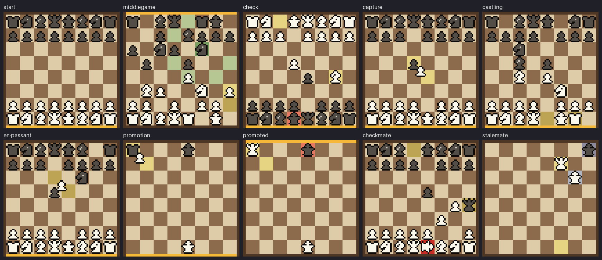
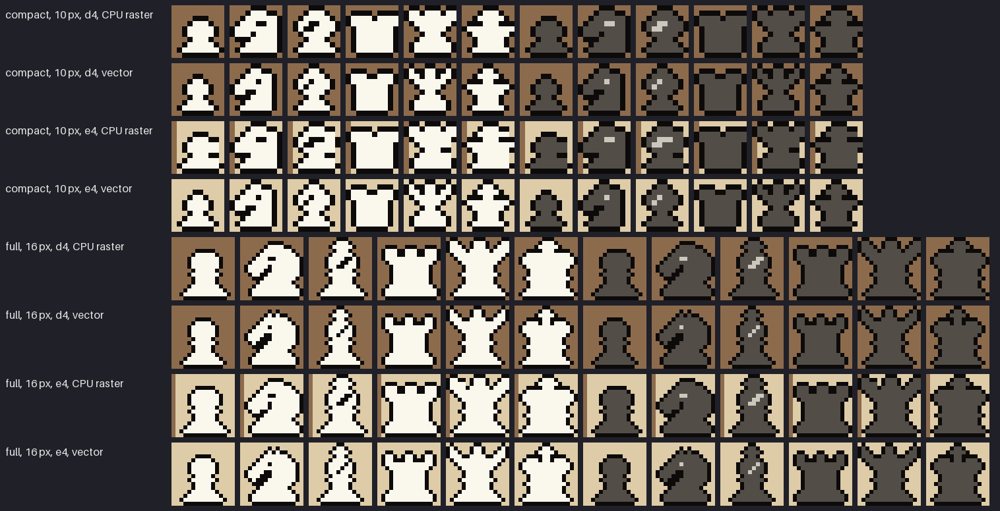
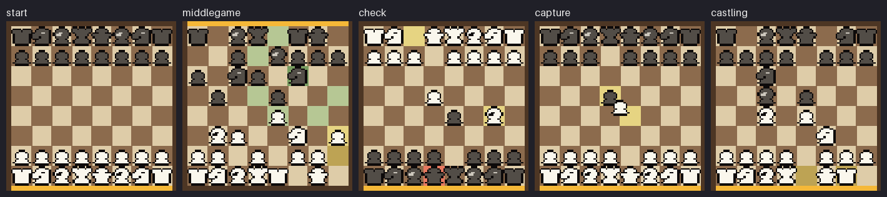
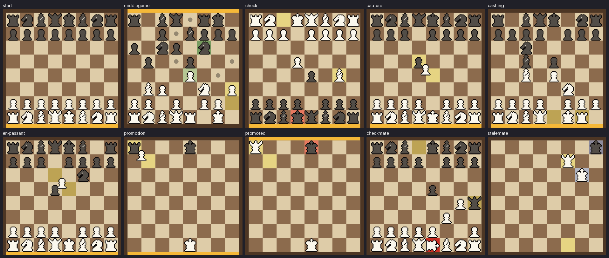

# Chess board drawing

`engine-chess-board` draws a chess position for any scenario that shows one
(#403). It turns a position from `engine-chess`, and the marks that explain a
game, into filled polygons and circles in a `RenderFrame`. It owns no game,
search, input or clock. The pieces are drawn in code from masks of cells, so
no font is needed, and every backend draws them the same way.



## What a host does

1. Lay out a `Board` with `Board::fit(area, view_height, orientation)`. It
   returns the largest square board that fits in `area`, centred in it.
   `view_height` is the height of the world that the camera shows. A board
   too small to read is refused with `TooSmall { needed }`, which gives the
   side, in world units, that would be enough. White is at the bottom unless
   the host asks for `Orientation::BlackAtBottom`. For players seen sitting
   at the board's left and right, `WhiteAtLeft` and `WhiteAtRight` turn the
   board a quarter. White's back rank then runs up that side, with the a-file
   at White's own left, and the pieces still stand upright.
2. Each frame, build a `Presentation`. `Presentation::of(&game)` gives the
   position, its revision, the last move, the result and the mark of the
   turn. The host can add the piece a player has picked up, with
   `Selection::of(&game, square)` listing where it may legally go, and a
   `Transition` to show a move in motion. A host that sets the board up or
   packs it away piece by piece lists in `hidden` the squares whose pieces
   are left off. Those squares and their marks are drawn as usual.
3. Call `draw(&mut frame, z, &board, &presentation)`. Drawing only adds to the
   frame, on layer `z`. It never plays a move or changes a game. The same
   board and presentation always give the same primitives, all inside
   `board.bounds()`, and never more than `MAX_PRIMITIVES` (323). The start
   position takes 111 with compact pieces and 115 with full ones. The busiest
   fixture, the middlegame with a knight selected, takes 118 and 122.
4. For input, `board.square_at(point)` gives the square under a point of the
   world, or `None` on the frame and beyond it. `board.square_rect(square)`
   gives the area a square covers.
5. A host that draws the board coming or going in its own way, as the Clock
   does while its board unfolds, can use the board's colours, `FRAME_COLOR`,
   `LIGHT_SQUARE` and `DARK_SQUARE`, and `FRAME_SHARE`, the share of the
   board's side that the frame takes on each side.

The board marks these things on its squares:

- The last move tints the squares it left and reached.
- A selection tints its square. With full pieces, each empty square the piece
  may reach gets a dot, and each piece it may take a tint. With compact
  pieces, every square it may reach is tinted.
- A check tints the checked king's square.
- At the end of a game, a king that lost by checkmate or resignation lies
  tipped over on a red square. After a draw, both kings' squares are blue.
- While the game is on, the frame is lit along the side of the player to
  move.

When several of these fall on one square, the first in that order wins: the
result, the check, the selection, a square it may reach, then the last move.

## Moves in motion

A `Transition` holds the position before a move, the move, the revision the
move led to and how far the move has gone, from 0 to 1. The host keeps the
time and sets the progress; `Transition::of_last_move` builds one for a
game's last move. The board draws the move in motion only while the
transition's revision is the presentation's, the move takes the position
before it to the presentation's position, and the progress is below 1.
Otherwise, for example for a stale revision, another move or a progress that
is not a number, it draws the board at rest.

The pieces that move are found by comparing the positions before and after
the move, so the picture follows what the rules did:

- A castling rook moves with its king.
- A piece taken on the square a move reaches stands until the mover arrives.
  So does a pawn taken en passant, on its own square.
- A promoting pawn travels as a pawn and becomes its new piece when it
  arrives.

Until the move arrives, the board shows the turn and the check of the
position it left, and holds back the result.

## The least sizes

There are two sets of pieces: full pieces sixteen cells high and compact
pieces ten cells high. A host knows how much of its world the camera shows,
not which screen shows it. So a board judges its squares by the share of the
view's height they take, as they would appear on the shortest screen the game
runs on: the HyperPixel on `spacewars.local`, 480 pixels tall.

| A square on a 480-pixel screen | Share of the view's height | Pieces |
| --- | --- | --- |
| 16 pixels or more | 1/30 or more | Full |
| 10 to 16 pixels | 1/48 to 1/30 | Compact |
| Under 10 pixels | Under 1/48 | None: `Board::fit` returns `TooSmall` |

A board is eight squares and a half across, with its frame. In the Clock's
camera, 480 units high, a board with compact pieces needs a side of 85 units
and one with full pieces needs 136. A board of 64 to 80 units, as #403
suggested, is too small: at 80 units a square is 9.4 pixels on the
HyperPixel. About 96 units lie below the Clock's face at 800×480, enough for
the least compact board, and the Clock stands its board there
([Chess board](clock.md#chess-board-405)). On the Picade, 1024×768, the same
board is 1.6 times as many pixels, and it keeps the pieces chosen for the
HyperPixel.

Rendered captures set these limits; counting primitives cannot say whether a
piece can be read. Earlier designs eight cells high could not be read at 8
pixels a square. Pieces ten cells high read at 10 pixels, where each cell is
a pixel. Full pieces read better than compact ones from 16 pixels.



A test draws each of the twelve pieces alone on a dark square and a light
one, at 10 and at 16 pixels a square, through the CPU raster and the vector
backends. For every pair of pieces, it counts the pixels inside the square
that differ. At 10 pixels the closest pair, the white knight and king on the
light square, differ in 9 of 64 pixels on the CPU raster; on the vector
backend the closest pairs differ in 16. At 16 pixels the closest pair, the
white pawn and bishop, differ in 15 to 21 of 196. The test fails if any pair
differs in fewer than 6.

The first colours gave black pieces a near-black body inside the near-black
outline. The outline fills the gaps between a piece's parts, such as a rook's
battlements, so a black piece showed only its outline's silhouette. With
compact pieces, the black knight and black king then differed in only 3 to 6
pixels. Black bodies are now dark grey, which keeps those gaps dark against
the body, and black pieces are now told apart at least as well as white
ones.

## Backends

- **GPU scene.** Both cabinets, `spacewars.local` and `sw-picade-2`, draw
  through it: lyon tessellates the polygons, which are drawn with 4×
  multisampling. The tests check that every fixture plans and tessellates to
  a mesh. They cannot draw it, so the vector captures stand in for it.
- **Vector.** The tests rasterize an SVG export of the vector adapter's paths
  with resvg, which anti-aliases them as multisampling does.
- **CPU raster.** The desktop's raster mode and software recovery use it. It
  widens each run of pixels by up to one, which draws pieces bolder. Where a
  piece's edge falls on a pixel boundary, its widened body can cover the
  outline's pixel on its right. At 10 pixels a square the pieces still read.
  With compact pieces on the Picade, each cell is 1.6 pixels and the CPU
  raster draws them blurred and lumpy, though the pieces can still be told
  apart.



## Fixtures and tests

`engine_chess_board::fixture::all()` gives ten presentations:

- the start;
- a Ruy Lopez middlegame with a knight selected;
- a check, with Black at the bottom;
- a capture, castling, en passant and a promotion, each halfway;
- the promoted queen at rest;
- checkmate;
- stalemate.

The crate's own tests cover:

- the square mapping, all four ways round;
- the turn's mark on the side of the player to move, all four ways round;
- pieces left off, with nothing else changed;
- hit testing on the frame and beyond it;
- refusing boards that are too small;
- that every primitive is filled, finite and inside the board, with no more
  than `MAX_PRIMITIVES`;
- that drawing twice gives the same primitives and leaves the presentation
  unchanged;
- moves in motion, from start to arrival, and stale transitions;
- castling, en passant, promotion and captures;
- every mark.

`chess_board_visual_tests` in `engine-client` draws every fixture at the
least compact size and at a full size on 800×480, 1024×768 and 480×800
screens, through the CPU raster and the vector backends. Each empty square
must show its own colour, light or dark, at its centre, and each piece must
cover at least a fifth of its square. The GPU scene must plan and tessellate
each frame.

To keep every capture, with an `index.html` that shows them, set
`SPACEWARS_CHESS_BOARD_ARTIFACTS` to a directory:

```sh
SPACEWARS_CHESS_BOARD_ARTIFACTS=target/chess-board \
    cargo test -p engine-client --bin engine-client chess_board_visual_tests
```

The images on this page were assembled from those captures and enlarged
without smoothing.


