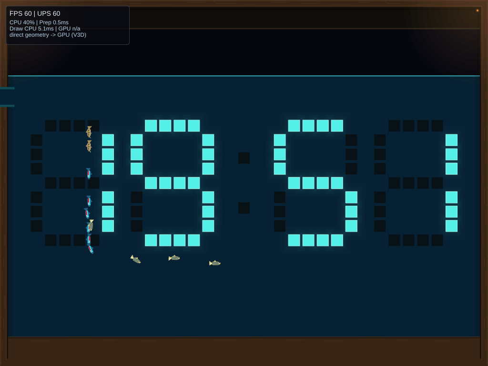
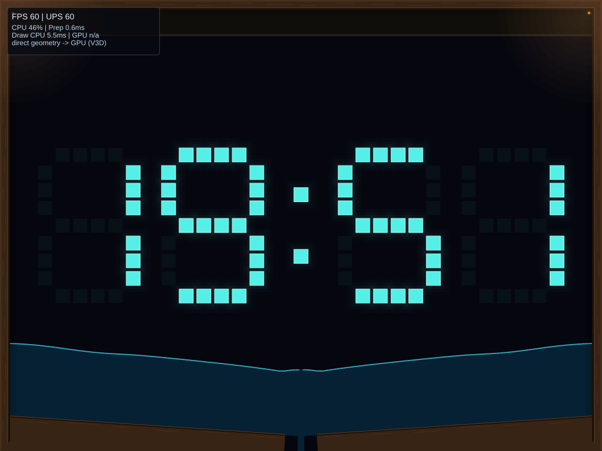
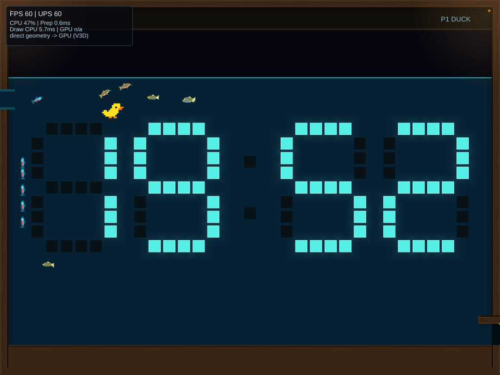

# Aquarium qualification — 2026-10-14

The Aquarium event completed five live cycles on `sw-picade.local`, including
two consecutive events sharing the same player duck. All 12 fish exited before
drainage in each cycle, with no failed exits or capacity-limited water steps.
The normal GPU path sustained every display refresh in the two screenshot-free
four-second swimming/draining traces. Software rasterization has less headroom:
its CPU-only full-cycle mean was 14.90 ms/frame and its worst interval p95 was
19.81 ms. These are different rendering paths and measurement boundaries.

See [the implementation and reproduction guide](clock.md#aquarium-177) for the
phase budgets, water approximation, floor controller, collision geometry and
resource ownership. The [compressed evidence](data/clock-aquarium-picade-20261014.json.gz)
contains the source manifest, binary manifest, sampled states, raw frame traces,
CPU benchmark CSVs and environment readings. It excludes saved user settings.

## Source and device

- Source base: `db6f020d86da0b3cbd72e13d13aa86c0f8c68593`.
- Changed production source digest:
  `936ee3d6ad122bb7baf00ad323d451b42a1301c605f300ce096eb961be878af4`.
  This is SHA-256 of Python `json.dumps(..., sort_keys=True)` containing the base and changed/new
  `.rs`, `.toml`, `.slint`, `.wgsl`, and `.glsl` file hashes. The archived manifest
  includes individual hashes; documentation was finalized after measurement.
- Device: Raspberry Pi 4 Model B Rev 1.4, aarch64, Linux `6.6.63-v8`.
- Live viewport: 1024×768, 60 Hz, retained/culled GPU scene path,
  `kms_profile_version=13`. The status renderer preference remains `raster`;
  the deployed GPU build uses its GPU scene path for live presentation.
- Installed `engine-client` SHA-256:
  `58bafb4497aacf5bd864b124c5111d185612725b025eac339a4ed3c11a449aaa`.
- Installed `spacewars-cli` SHA-256:
  `347f3c87299d50596adafed5f27067db70cad57caeef1b2c2480f6be8aa6bfc0`.
- Runtime compatibility signature:
  `6ecc3217c275a5bc3f07471b0532b24fe6370e45063d9dc2077be1b3c6706c61`.

The fast updater checked compatibility, installed both binaries, restarted the
kiosk and passed its health check. No OS image upgrade was needed. The build used
[the installed runtime's dependency revisions](data/clock-aquarium-runtime-20261014.yml)
as a kas overlay; compatibility checks were not bypassed. UTC benchmark timestamps
are on October 15; this report uses the workstation's October 14 local date.

## Lifecycle and controls

| Live case | Peak water parcels | Sampled maximum bodies / colliders | After completion |
| --- | ---: | ---: | --- |
| Unoccupied, with screenshots | 97 | 0 / 0 | 0 / 0 |
| Join, move, dive to exhaustion, dismiss, rejoin, dive during drain | 97 | 5 / 69 | Continuing duck, 4 / 4 |
| Unoccupied, without screenshots during traces | 97 | 0 / 0 | 0 / 0 |
| Retention pair, first event | 97 | 5 / 75 | Duck session 1, 4 / 4 |
| Retention pair, second event | 94 | 7 / 77 | Same session 1, 4 / 4 |

Parcel peaks are recorded after every water step, before residual cleanup.
Body/collider maxima are periodic samples, not per-step peak counters; changing
digits change the cell count. The second retention event adds two temporary liner
bodies beneath the continuing duck's floor, then removes them on completion.

All five cycles observed filling, swimming, exiting, draining and clearing.
They admitted the selected 6/4/2 fish group and reported 12 exits, zero failures,
and zero water-capacity stalls. The plain/joined/control water ledgers agreed
within one rounded microunit at every sample. Event state became null after
completion; the continuing duck remained independently observable.

The retention pair steered the duck onto a bank near the end of drainage and
paused immediately after each completion. The second event was started through
the public preview control without restarting the scenario or player session.
An earlier retention attempt began after the duck had already departed. Its
initial state had no player, so its final player assertion was invalid; those
samples and traces are retained under their original `retained-*` filenames
and used only as the unoccupied performance control. The explicit two-event
pair supplies the retention evidence.

The standard-profile control run exhausted the four-second allowance, observed
full submersion, then recovered at the surface. A separate `--profile picade`
run checked join, horizontal movement, a two-second Down dive, and recharge.
These commands exercise the application's controller routing; they do not
press physical cabinet switches or test the GPIO input driver.

| Full aquarium | Draining |
| --- | --- |
|  |  |



## Display timing

Each basic KMS trace recorded 240 main-loop samples. Nested text/application/
geometry detail was disabled. Display intervals use consecutive raw DRM
`flip_kernel_us` timestamps; missed refreshes use wrapping `flip_sequence`
differences. CPU loop times come from the separate CPU measurements and must
not be interpreted as GPU execution or input-to-photon latency.

| Trace | Completed flips | Mean Hz | Interval p95 / max (ms) | Skipped refreshes | Mean loop CPU (ms) |
| --- | ---: | ---: | ---: | ---: | ---: |
| Initial swim | 240 | 60.004 | 16.670 / 16.786 | 0 | 6.862 |
| Initial drain, screenshot taken during capture | 235 | 59.496 | 16.670 / 50.001 | 2 | 7.626 |
| Control swim, no screenshot | 240 | 60.004 | 16.668 / 16.684 | 0 | 7.045 |
| Control drain, no screenshot | 240 | 60.004 | 16.670 / 16.700 | 0 | 7.600 |

The first drain trace includes PNG screenshot work and a 50.95 ms CPU loop at
that capture. It remains in the evidence rather than being silently discarded.
The subsequent screenshot-free drain trace had no skipped refreshes. This
supports a capture-related stall; it is not a guarantee of zero hitches over
every event or device. Periodic submitted-FPS samples, including screenshots,
ranged from 57.1 to 60.1 and are not substitutes for page-flip intervals.

## CPU-only benchmarks

Nine independent processes ran the existing benchmark harness: Aquarium, Rain
and Meltdown, three repetitions each, 1024×768, raster scale 1, seed 7, 53 measured
simulated seconds after two warm-up seconds. Each report contains 3,180 frames.
The kiosk was paused in the background. The CPU governor remained `ondemand`;
before/after readings ranged from 69.1–76.4°C and 1.0–1.5 GHz. Frequency was not
locked, and these spot readings do not prove absence of throttling throughout.

| Case | Step mean (ms) | Scene mean (ms) | Raster preparation mean (ms) | Total mean (ms) | Run-mean range (ms) | Worst interval p95 (ms) |
| --- | ---: | ---: | ---: | ---: | ---: | ---: |
| Aquarium | 0.244 | 0.255 | 14.392 | 14.898 | 14.876–14.919 | 19.814 |
| Rain | 0.729 | 0.367 | 7.654 | 8.757 | 8.748–8.770 | 10.684 |
| Meltdown | 0.186 | 0.222 | 5.892 | 6.308 | 6.269–6.328 | 8.961 |

Means are weighted by reported frames. The last column is the largest reported
interval p95, not the percentile of all frames combined. These benchmarks
exclude Slint drawing, display upload and vsync. Rain and Meltdown are same-build
controls, not before/after performance comparisons. Aquarium's full-screen
software raster preparation dominates its CPU cost; the live GPU results above
are the relevant presentation check for this cabinet.

Reproduce on the device with the deployed client and a copied benchmark script:

```sh
bash benchmark-clock.sh --client /usr/bin/engine-client \
  --output /tmp/aquarium-benchmarks --cases aquarium,rain,meltdown \
  --seconds 53 --repeats 3 --scales 1 --renderer raster
```

## Automated coverage and limits

The final local checks passed: 334 Clock tests, 123 water tests, 693 client unit
tests, 15 common tests, 38 control tests, 32 CLI unit tests and six CLI functional
tests. The display-backed Aquarium lifecycle also passed; its saved-settings
assertion now waits for the asynchronous writer instead of racing scenario
restart. Formatting, shell syntax, diff whitespace and scoped strict Clippy
checks passed. The client suite includes both-renderer Aquarium captures, and
the scenario suite covers four fonts and three layouts, changing glyphs, fish
exit failure, native duck contacts, dive recovery and ownership interruption.

Water remains a height-column approximation, with explicit residual reclamation
at the end of the event. Fish and glyphs do not create a general pressure solve
around submerged cavities. The 120 Hz / 128-parcel stress fixture remains
capacity-limited; a separately provisioned 256-slot diagnostic demonstrates
the time-step control. Production uses 60 Hz and 128 slots. Device checks are
bounded observations, not a long unattended soak or hands-on cabinet review.
