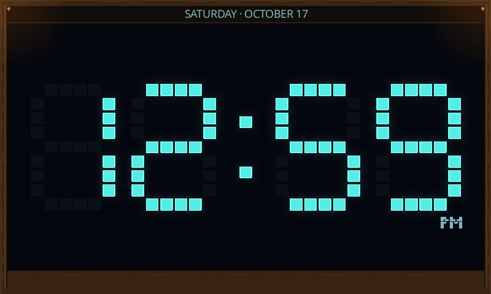
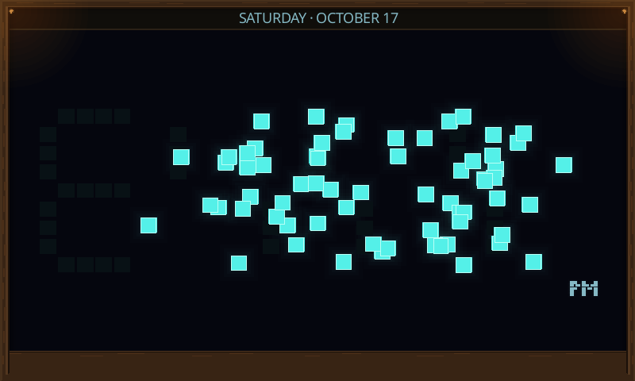
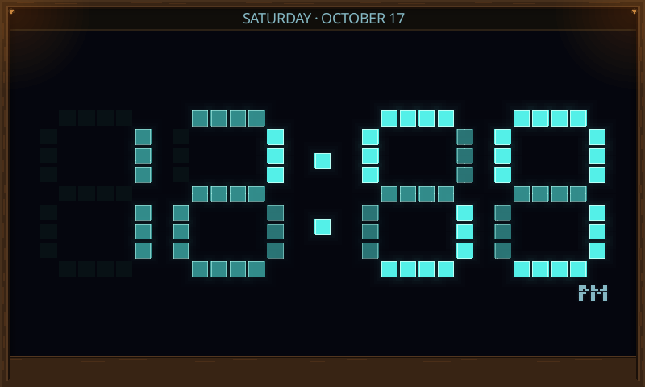
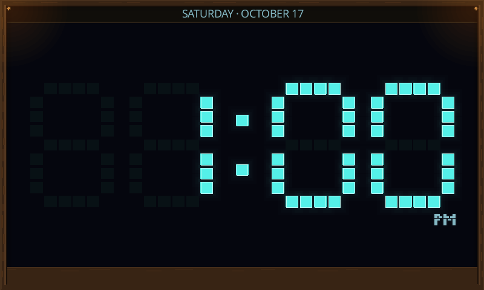
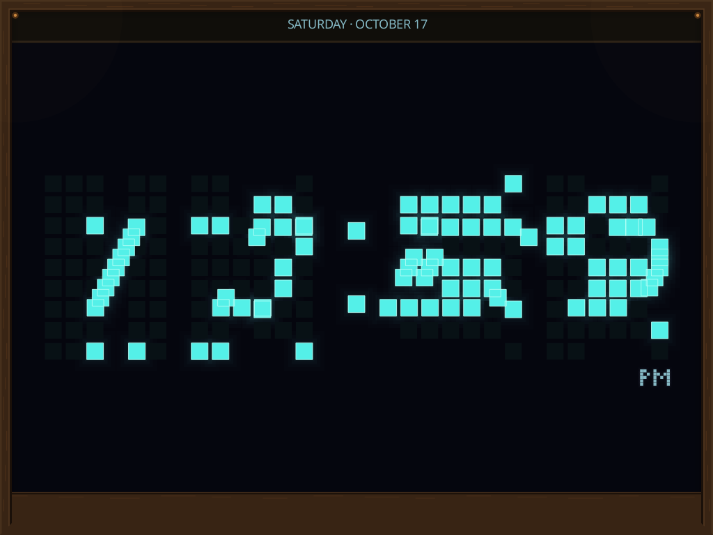
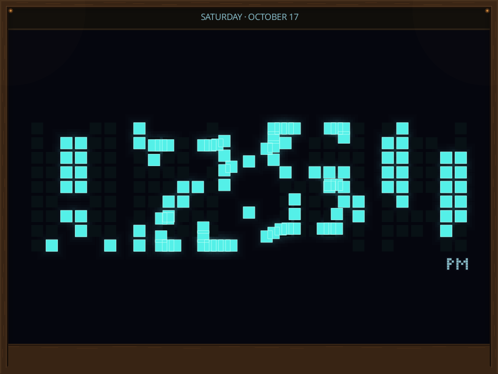
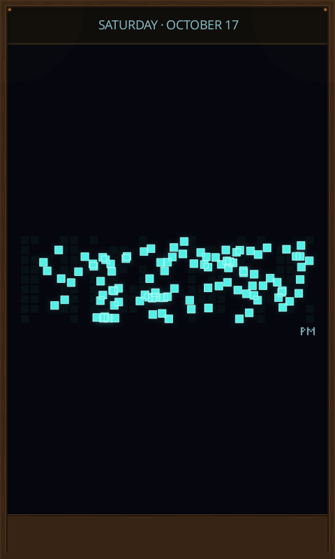
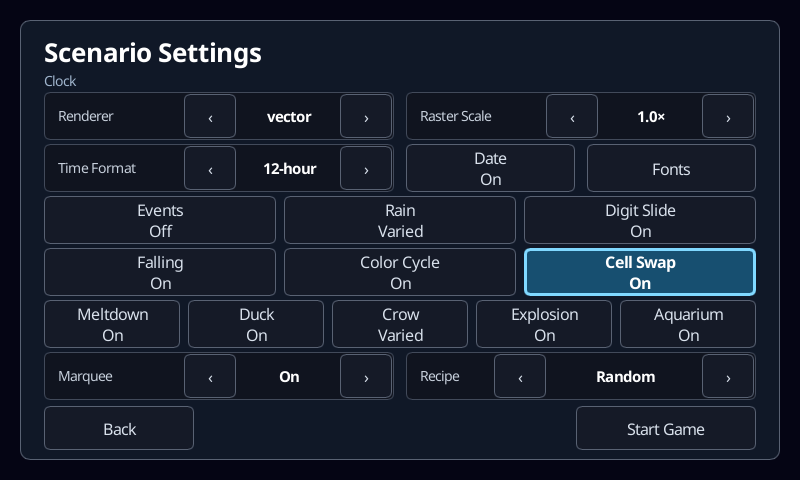
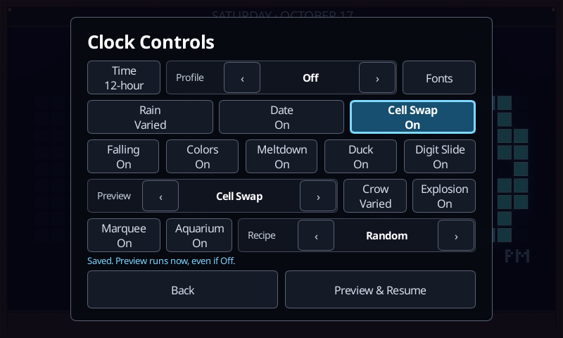
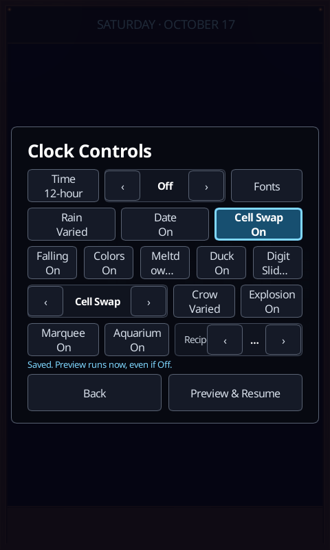

# Clock cell-swap validation

Implementation source: [`3c8f613`](https://github.com/aortez/space-wars/commit/3c8f613eb5ffc1c05daf31bc9dddd1662f958da4),
based on main `034b92c`. Captures and checks were generated locally from that
implementation on 2026-10-17. Deployment and device testing were explicitly
excluded from this change's validation scope.

## Behavior and local checks

| Check | Result |
| --- | --- |
| Clock scenario suite | 341 passed; 5 existing optional tests ignored |
| Client controls, navigation, inventory, activation, settings, keyboard/pointer input, Clock host integration and UI rendering | 121 passed |
| Common settings/types, control protocol and CLI unit suites | 85 passed |
| Local app workflows: Cell Swap preview/saved switch/restart and existing Digit Slide controls | 2 passed |
| Formatting and patch whitespace | Passed |

Mapping tests cover all four fonts, seeded shuffles and both mirror axes,
asymmetric digits, a blank leading hour and a mirror with no moving partners.
Each source and destination appears once. Rollover tests include minute, hour
and midnight changes at ticks 0, 1, 30 and 59, both growing and shrinking masks,
seconds-only updates, paused updates, settings edits and repeated corrections
during reconciliation. Completion uses the latest reading and never starts an
overlapping Digit Slide. Normal minute-change behavior remains covered by the
existing suite and its local app workflow.

Additional tests cover duck ownership, player compatibility, crow departure,
replacement, resize, saved opt-out, old settings, manual cycling and cooldowns.
The retained event and permutation are bounded to **4 KiB**, with at most 216
cells, no event-owned physics bodies and no stepping allocations. Rendering is
bounded to fewer than 1,600 primitives, including the ordinary frame and glow;
the captured cases peaked at **979**. These are resource bounds, not a hardware
frame-rate measurement.

## Captures

The fixture drives the real Clock scenario at fixed simulation ticks and renders
at **800×480**, **1024×768** and **480×800**. It captures all four fonts at ticks
0, 20, 40, 60, 67 and 75 through both production scene adapters (144 scene
captures), plus the real launcher and live control menus at each size.

Raster captures use the production CPU rasterizer. Vector captures export the
production vector adapter's paths and render them with Slint's SVG loader;
Slint's headless software window does not implement native Path drawing. Both
include the application's native text overlay. These vector images validate the
adapter's geometry and appearance; they are not GPU or physical-device captures.

For each adapter, the first frame is pixel-identical to the ordinary old face,
movement differs visibly, and the final frame is pixel-identical to the ordinary
new face. The [capture manifest](screenshots/clock/cell-swap-captures.json) records
dimensions, seed, font, phase, progress, cell counts and primitive counts.

The fixed reading changes from **12:59:58 PM to 1:00:00 PM at tick 30**. Date is
October 17, 2026. The scene uses the Off profile with an explicit preview, so
unrelated automatic events cannot contaminate the comparison.

| Font | Scenario seed | Selected mapping | Participating / moving cells |
| --- | --- | --- | --- |
| Classic | 3 | Shuffle | 63 / 63 |
| Matrix | 0 | Horizontal mirror pairs | 90 / 42 |
| Sans | 2 | Vertical mirror pairs | 103 / 50 |
| Serif | 3 | Shuffle | 100 / 99 |

The animation below uses the actual 800×480 raster frames at 30 samples per
second. It adds holds before and after the 1.25-second exchange/reconciliation
for review; the event itself has no hold or return trip.



| Exchange at tick 20 | Reconciliation at tick 67 | Current time at tick 75 |
| --- | --- | --- |
|  |  |  |

Matrix horizontal pairs at 1024×768, through the vector adapter:



Sans vertical pairs at 1024×768, through the vector adapter:



Serif shuffle at 480×800, through the vector adapter:



Launcher and live settings at 800×480:




The live switch and preview also fit the portrait layout:



## Reproduce

From the implementation checkout, run the core and adapter checks:

```sh
cargo test --locked --profile ci -p scenario-clock --lib
cargo test --locked --profile ci -p engine-common --lib
cargo test --locked --profile ci -p spacewars-control -p spacewars-cli
SPACEWARS_CELL_SWAP_ARTIFACTS=/tmp/spacewars-cell-swap-captures \
  cargo test --locked --profile ci -p engine-client \
  ui_render_tests::cell_swap::cell_swap_renders_motion_rollover_and_controls_at_target_sizes \
  -- --exact
```

On a local display (or under the repository's Xvfb test setup), run the public UI
workflow against the actual application:

```sh
SPACEWARS_KEEP_FUNCTIONAL_ARTIFACTS=1 \
  cargo test --locked --profile ci -p engine-client --test ui_control_functional \
  clock::cell_swap_preview_and_saved_switch_use_the_public_controls \
  -- --ignored --exact --test-threads=1
```

The functional test uses an isolated settings directory, verifies that preview
works while the switch is Off, waits for cleanup, changes enablement while
paused, and verifies persistence and restart. Exact animation phases are checked
at fixed ticks by the scenario/render tests rather than relying on process timing.
