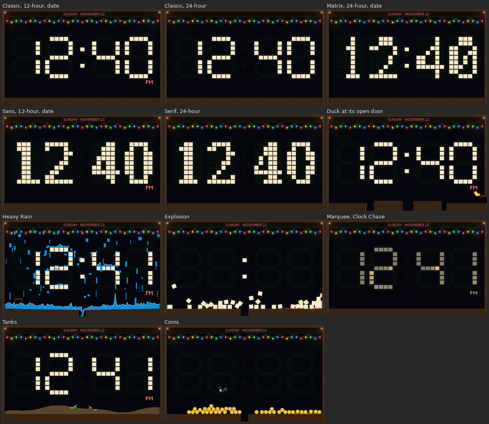
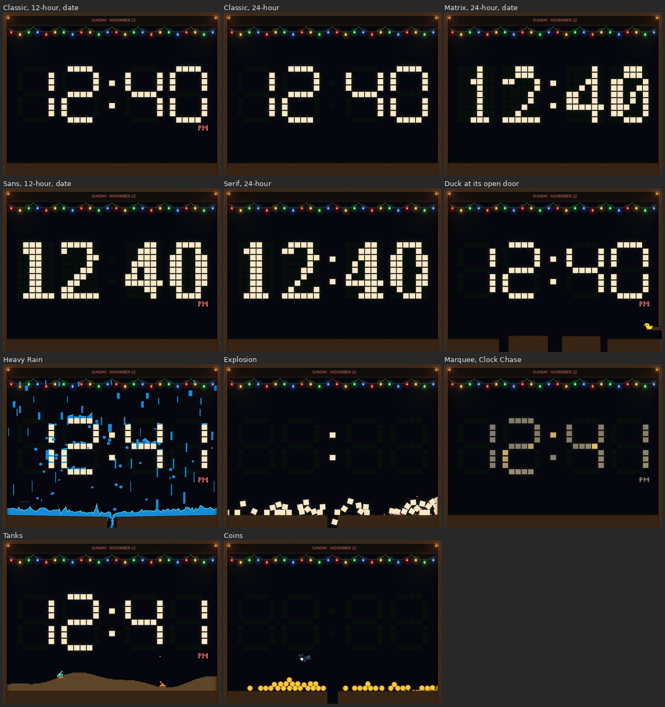
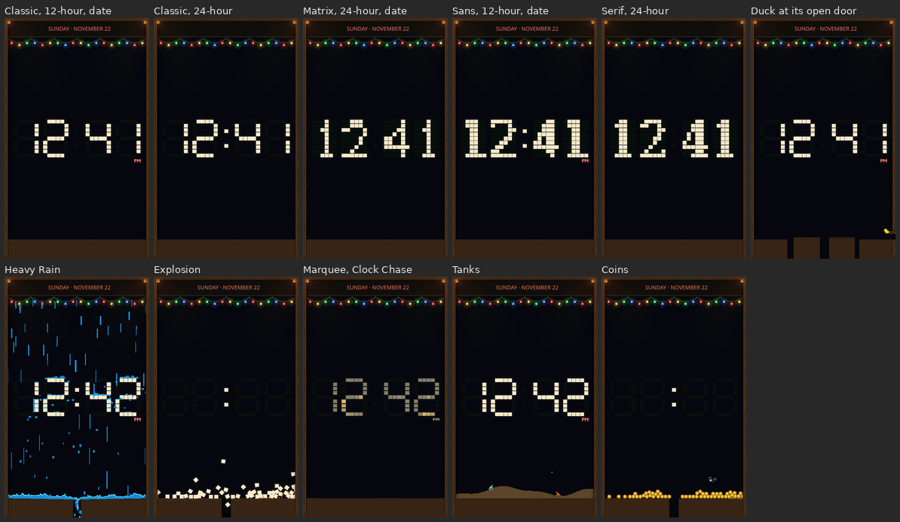
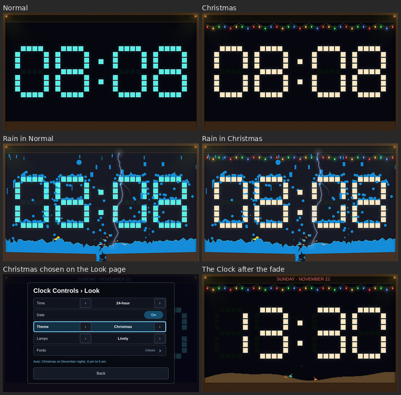

# Christmas qualification (#462) — 2026-11-22

Christmas is the Clock's first seasonal theme (#367). Auto wears it on December
nights, from 18:00 on each December evening until 06:00 the next morning, and a
chosen Christmas wears it all year. [Themes](clock.md#themes-455-460-457-458-461)
describes the look, the setting and the fade. This report gathers the evidence
#462 asks for before the first December night, 18:00 on December 1. It points
to the tests that hold each rule, and adds what they didn't show:

- pictures of Christmas at each screen size;
- the cost of Christmas and of its fade, against the same Normal scene;
- Christmas on a Pi 4 and a Pi 5 cabinet, chosen through Clock Controls, with
  each theme's display timing;
- Auto following the host's local time zone;
- the string clear of the face in every font.

Christmas and its fade held the display's full rate on both cabinets, at rest
and during Rain, without a skipped refresh. Neither cabinet's installed build
has the theme yet, so each needs an update before December 1.

Halloween (#456) waits until next year, so there is no Halloween look, October
rule or choice to keep. Until then October nights are ordinary: the December
test reads 21:00 on October 31 as Normal. Halloween's boundaries and its
restoration belong to #456 and #459.

## Auto's nights

`theme::tests::auto_wears_christmas_from_six_on_each_december_evening_until_six_the_next_morning`
reads each boundary, to the second:

| Reading | Auto wears |
| --- | --- |
| November 30, 18:00 to December 1, 06:00 | Normal: November's last night |
| December 1, 17:59:59 | Normal |
| December 1, 18:00 | Christmas: the first night starts |
| December 2, 05:59:59 | Christmas |
| December 2, 06:00 | Normal |
| December 25, 12:00 | Normal |
| December 31, 18:00 to January 1, 05:59:59 | Christmas: the last night |
| January 1, 06:00 | Normal |
| January 1, 18:00 | Normal |
| October 31 at 21:00, July 4 at 22:00, March 1 at 02:00 | Normal |

Auto goes by the latest reading only. There is no timer and no missed night is
made up, so a repeated hour, a skipped one, or a correction either way takes
the new reading's theme
(`theme::tests::the_clock_wears_the_theme_of_its_latest_reading_however_the_time_moved`).
The reading is the host's local civil time. The new
`client_scenarios::clock::theme_tests::autos_nights_follow_the_hosts_local_time_in_every_zone`
reads one instant in several zones, so Auto turns at each zone's own 18:00 and
06:00. At 02:00 UTC on December 2 it is Normal in UTC−9 (17:00), Christmas in
UTC−8 (18:00, the first evening) and in UTC (02:00), and Normal in UTC+5 (07:00
the next morning). At 14:00 UTC on January 1 it is Christmas in UTC−9 (05:00),
Normal in UTC−8 (06:00) and in UTC+14 (a January night). A zone set back an
hour takes the earlier reading's theme. The date and the time come from one
sample across offsets and daylight-saving corrections
(`client_scenarios::clock::tests::local_date_and_time_share_one_sample_across_offsets_and_dst_corrections`).

Without a usable date, Auto wears Normal, and a chosen Christmas still dresses
the `--:--` face (`theme::tests::auto_wears_the_ordinary_look_without_a_dated_reading`,
`theme::tests::auto_wears_normal_while_the_time_is_unknown_and_a_chosen_theme_holds`
and `unknown_time_tests`). Whether the time is usable is the OS manager's to
say (#257), and its `time_validity` tests hold that:

- a running clock stays usable through lost Wi-Fi and an overdue sync;
- a qualified RTC is usable after a reboot;
- an absent, uninitialized, reset or unreadable RTC stays unknown;
- forward and backward steps it accepts are measured against boot time;
- an unexplained clock change stays invalid until a new sync.

The Wi-Fi state and the sync's age never decide the theme.

A long pause doesn't hold the theme back: readings keep coming while the Clock
is paused, so the face heads for the theme the latest one gives and holds its
fade at the start until the Clock runs again
(`theme::tests::a_new_theme_fades_in_on_the_scenes_own_time` and
`theme::tests::the_state_reports_the_theme_what_auto_would_wear_and_the_fade`).

## The setting

- Christmas and Normal, chosen outright, hold at every date and time and with
  no time at all (`theme::tests::a_chosen_theme_holds_at_every_date_and_time_and_without_one`).
  Every picture below was taken on November 22, with Christmas chosen.
- Back on Auto, the face takes the latest reading's theme at once, without
  waiting for the next reading, and the string comes down after its fade when
  the night ends (`string_lights::tests::a_theme_comes_down_completely_when_the_night_ends`).
- Settings saved before there was a Theme read as Auto, and every choice
  round-trips (`settings::tests::theme_is_auto_in_old_settings_and_round_trips_every_choice`).
- Stepping Theme changes only the theme
  (`clock_settings_table::tests::stepping_a_setting_changes_only_its_own_fields`).
- Theme is the same row on the Look page of Clock Controls and of Scenario
  Settings, and the control API reaches it as `pause.clock.theme.previous` and
  `.next`, and `launcher.settings.clock.theme.previous` and `.next`
  (`ipc::tests::every_clock_control_is_listed_on_its_page_and_activates_as_its_input_does`).
  `clock state` prints the choice, the theme worn, what Auto would wear and the
  fade.
- Through the public controls, the functional test
  `clock::live_clock_controls_preserve_events_preview_and_persist_across_restart_and_relaunch`
  chooses Christmas while saving fails, saves it with the next change, and
  finds Christmas again after a restart and a relaunch.

## Pictures

Each sheet shows the live client in Christmas: the four fonts in both time
formats, with and without the date, the duck at its open door, and five events
mid-way. They come from the desktop client in Raster on a private X server,
sized to each screen.

**800×480**

**1024×768**

**480×800**

In every picture the digits, colon, date line and AM/PM mark read clearly, and
the string hangs above the face, behind everything in the room. The test that
holds the string clear of the face,
`string_lights::tests::the_string_hangs_under_the_canopy_from_rail_to_rail_and_clear_of_the_face`,
now runs every font in both time formats at seven aspects. Other tests hold the
string's bounds (at most 16 wires, 15 clips and 48 bulbs) and keep its clips
off the canopy's hatch and openings
(`string_lights::tests::the_string_is_bounded_and_its_bulbs_take_their_colors_in_turn`
and `string_lights::tests::nothing_of_the_string_touches_the_canopy_where_its_holes_open`).
There is no pumpkin art to leave behind: Halloween hasn't been drawn.

## Changes of theme

A theme changes only the look. Three twins run every event kind, every
Marquee recipe and every visit: one in Normal, one in Christmas, and one
turning between them every two-thirds of a second. They keep the same events,
IDs, ages, cooldowns, bodies, visitors, residents, plants and lamps, tick for
tick:

- `string_lights::tests::falling_explosion_coins_and_meltdown_wear_the_theme`;
- `string_lights::tests::rain_and_the_aquarium_wear_the_theme`;
- `string_lights::tests::color_cycle_and_the_face_events_wear_the_theme`, for
  Color Cycle, Cell Swap, Slot Machine, Grass and Tanks;
- `string_lights::tests::every_marquee_wears_the_theme`;
- `string_lights::tests::a_visit_wears_the_theme`, for the duck, the spider and
  the crow.

Digit Slide keeps the theme's face through the minute, and Auto turns in the
middle of it at 18:00 and at 06:00
(`string_lights::tests::the_minute_slide_keeps_the_themes_face` and
`string_lights::tests::auto_turns_the_theme_in_the_middle_of_the_minute_slide`).

`theme::tests::changes_of_theme_leave_the_world_as_it_would_have_been` runs a
Demo-profile twin through a dozen changes, some in quick succession, during
events and between them, while a player sits in and the host pauses. It keeps
the same world as its twin, tick for tick: the scheduler's deadlines and
cooldowns, the events, the arena and its bodies, the digits' surfaces, the
plants, the ceiling, the lamps and the player. Rapid changes never jump and
settle on the last
(`theme::tests::rapid_changes_of_theme_never_jump_and_settle_on_the_last`). A
start, a return or a restart shows the theme from the first frame
(`theme::tests::a_clock_shows_its_first_theme_at_once`).

The string is art only: no body, no surface and no light. The twins' bodies,
colliders, plants and lamps stay the same in every theme. The benchmark's
fixtures do too: the new
`client_scenarios::clock::benchmark::tests::every_theme_runs_the_same_scene_and_turning_always_fades`
runs every fixture in Normal, Christmas and Turning side by side and finds the
same event, phase, bodies, colliders, duck, spider and digits on every tick.
Calendar, Life, the evergreen and snow aren't built yet, so there is nothing of
theirs to check.

## Cost

The string costs the same on every frame, whatever the event.
[Themes](clock.md#themes-455-460-457-458-461) gives its cost on the development
machine: 219 primitives and 0.10 ms of raster at 800×480, 159 and 0.13 ms at
1024×768, and 119 and 0.05 ms at 480×800. The benchmark's new theme choice
finds the same counts. Each Christmas fixture peaks at exactly that many more
scene items than Normal's, and Turning peaks with Christmas, since a fade draws
everything Christmas does, only fainter. This workstation's timings aren't
given: other work was running, and repeats of one run differed by up to four
times.

On the cabinets, the CPU-only benchmark ran Idle and Rain in each theme with
the kiosk paused: raster scale 1, seed 7, three runs of 45 measured seconds
after 2 of warm-up. Each cell is the mean frame time of the three runs, which
agreed within 0.25 ms on the Pi 4 and 0.02 ms on the Pi 5:

| Cabinet | Case | Normal | Christmas | Turning |
| --- | --- | ---: | ---: | ---: |
| Pi 4, 1024×768 | Idle | 7.558 ms | 8.161 ms | 8.297 ms |
| Pi 4, 1024×768 | Rain | 9.671 ms | 10.397 ms | 10.353 ms |
| Pi 5, 800×480 | Idle | 1.896 ms | 2.092 ms | 2.092 ms |
| Pi 5, 800×480 | Rain | 2.590 ms | 2.787 ms | 2.802 ms |

In software raster the string costs 0.6 to 0.7 ms a frame on the Pi 4 and
0.2 ms on the Pi 5, as much during Rain as at rest. Turning, fading on every
frame, costs about the same as Christmas.

## Cabinets

Two cabinets ran this branch's build on November 22:

| Cabinet | Board | Screen | Renderer it runs |
| --- | --- | --- | --- |
| `sw-picade-2` | Raspberry Pi 4 Model B | Picade, 1024×768 over HDMI | Raster, scale 1 |
| `spacewars.local` | Raspberry Pi 5 Model B | HyperPixel, 800×480 over DPI | Raster, scale 1 |

The build's `engine-client` and `spacewars-cli` (SHA-256 `9d601542…` and
`8d8c0229…`, as its bundle's manifest gives them) ran from `/tmp`, under a
runtime drop-in for the kiosk unit and on a copy of each cabinet's settings
with auto-start off. Each cabinet started the Clock from the launcher, then
ran the visible fixture, `spacewars-cli host clock-benchmark idle|rain --theme
normal|christmas|turning`, in each theme in Raster, the renderer both run.
Each run gave a status sample, a 240-loop KMS trace, the Clock's state and a
screenshot, and no screenshot was taken during a trace. Display intervals use
consecutive `flip_kernel_us` timestamps and skipped refreshes the
`flip_sequence` differences, as in the
[aquarium report](clock-aquarium-validation.md#display-timing). Loop CPU is the
trace's loop stage, not GPU work.

| Cabinet | Case | Normal | Christmas | Turning |
| --- | --- | --- | --- | --- |
| Pi 4 | Idle | 60.00 Hz, 0, 5.75 ms | 60.00 Hz, 0, 6.80 ms | 60.00 Hz, 0, 6.65 ms |
| Pi 4 | Rain | 60.00 Hz, 0, 9.71 ms | 60.00 Hz, 0, 10.37 ms | 60.00 Hz, 0, 10.25 ms |
| Pi 5 | Idle | 60.06 Hz, 0, 1.25 ms | 60.06 Hz, 0, 1.57 ms | 60.06 Hz, 0, 1.59 ms |
| Pi 5 | Rain | 60.06 Hz, 0, 3.27 ms | 60.06 Hz, 0, 3.60 ms | 60.06 Hz, 0, 3.60 ms |

Each cell gives the mean refresh rate of the 240 page flips, the refreshes
skipped, and the mean loop CPU.

At scale 1 the cabinets' build draws Raster through the GPU scene, in the same
few GL draws whatever the theme: 12 a frame on the Pi 4, which also draws its
performance overlay, and 3 on the Pi 5. Every theme held the display's full
rate on both cabinets, with no refresh skipped, at rest, during Rain and
through every fade. The string adds about 1 ms of loop CPU at rest and 0.7 ms
during Rain on the Pi 4, and 0.3 ms either way on the Pi 5. Each cabinet also
ran the fixtures in Vector, the original renderer, which no cabinet uses any
more; those numbers stay with the evidence.

Through the controls, as a player would: after the fixtures, Restart left the
fixture for an ordinary Clock on the copied settings, whose Theme was Auto and
wore Normal on November 22. On the Look page of Clock Controls, two presses of
`pause.clock.theme.next` chose Christmas. The face headed for Christmas with
its fade held while paused, and a trace started on the paused menu caught the
fade as the Clock resumed: 240 flips at 60.00 Hz on the Pi 4 and 237 at
60.06 Hz on the Pi 5, with none skipped. Each Clock then wore Christmas with
its fade complete, and Christmas was saved.

| `sw-picade-2`, 1024×768 | `spacewars.local`, 800×480 |
| --- | --- |
|  |  |

Rain falls the same in both themes, drop for drop; only the look changes. The
Picade's settings turn on its performance overlay, top left; it isn't part of
the theme.

Afterwards each cabinet went back to its installed build: the drop-in was
removed, the kiosk restarted on `/usr/bin/engine-client`, the trial's files
left `/tmp`, and the installed settings had the same checksum as before.

Neither installed build has the theme yet. The Pi 4 runs a build from
November 10 (`1a237493`) and the Pi 5 one from November 8 (`07babfc5`), both
before the look (#651) and the setting (#661), so each needs a newer build
before 18:00 on December 1. The traces, status samples, states, screenshots and
benchmark reports are kept on the owner's workstation under
`target/clock-benchmarks/christmas-462-20261122/`.
