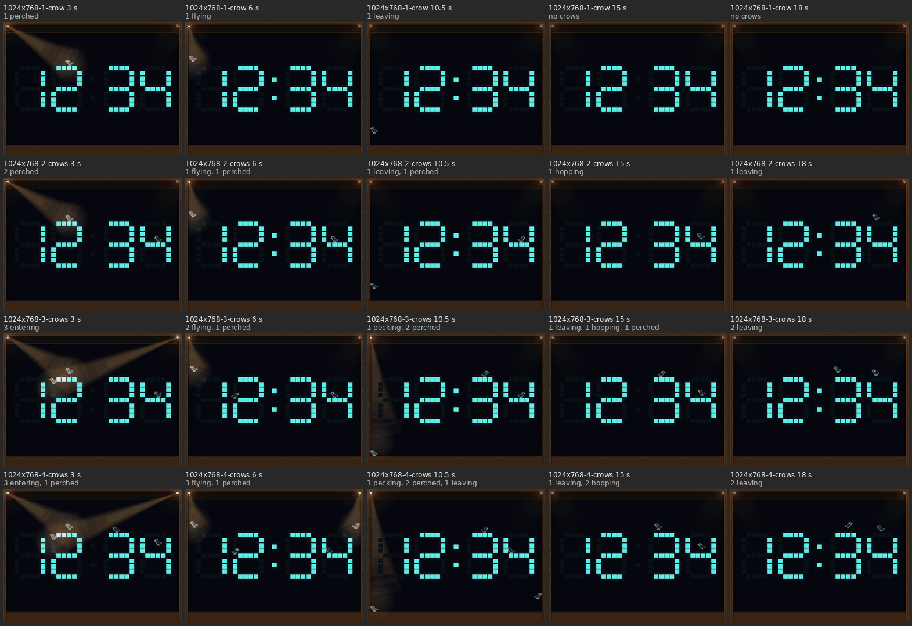
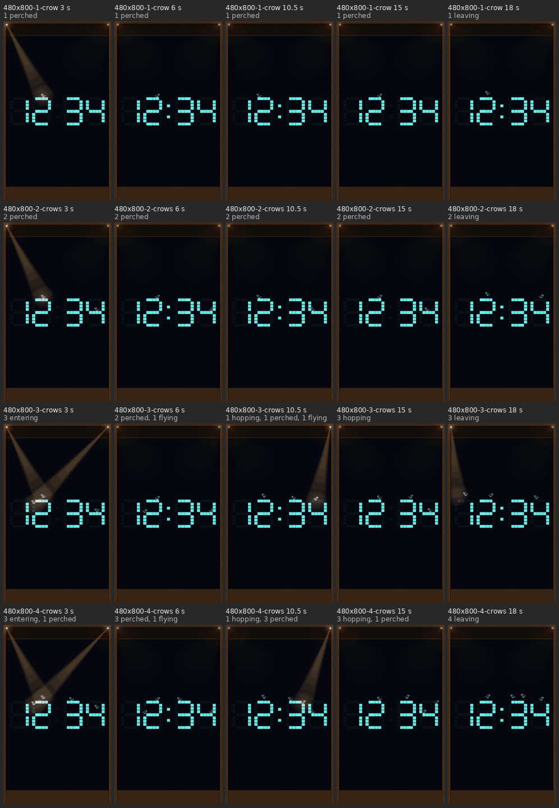
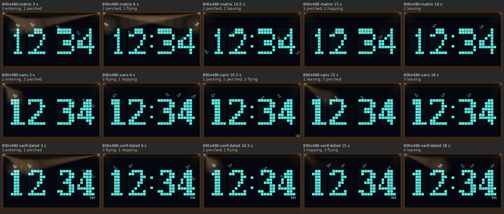
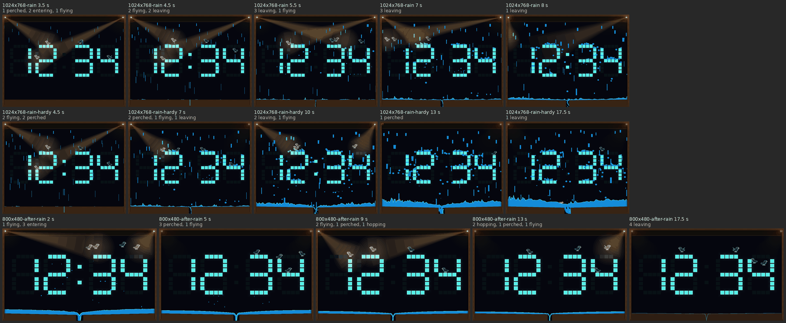
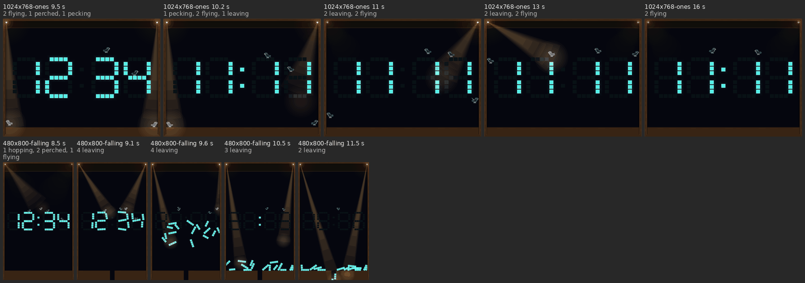
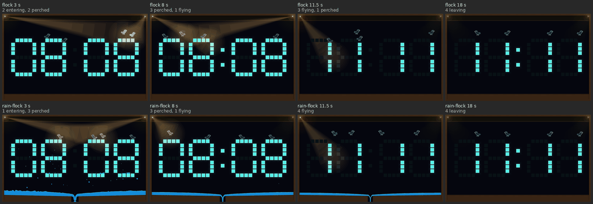

# Crow flock qualification (#372) — 2026-11-26

A visit of crows holds up to four (#370), and one visit in four brings a flock
of two, three or four (#371). [Crow visitor](clock.md#crow-visitor) describes
how a flock comes in, keeps its spacing, reads the water and leaves. This report
gathers the evidence #372 asks for before flocks count as done. It points to the
tests that hold each rule, and adds what they didn't show:

- a flock beside each of the Clock's other events, on every face, and through
  the controls;
- pictures of one to four crows on each font, at landscape and portrait sizes,
  dry and wet and with their perches changing under them;
- the cost of one crow and of four, dry and beside the water a shower left,
  against the same scene without them;
- one crow and four on a Pi 4 and a Pi 5 cabinet, with each window's display
  timing: as the crows come, as the face turns under them and as they leave.

Flocks held each cabinet's full display rate in Raster, the renderer both
run, as they came, as the face turned under them and as they left, dry and
after rain: no crow cost a refresh, and no loop went over the frame's 16.7 ms.
The busiest case, four crows coming in after rain on the Pi 4, averaged
10.01 ms a loop, 1.0 ms more than Rain alone, and its longest loop took
13.80 ms. Nothing needed changing. Beside every event and through the controls
the flocks did what [Crow visitor](clock.md#crow-visitor) says they do, and
every crow had gone within its visit's 22 seconds.

## Beside the events

`crow_flock_events_tests::a_flock_and_each_event_beside_it_keep_their_own_lifecycles`
brings a flock of four beside each event that may share a visit: every event
but another Crow, the spider and Tanks. The spider and Tanks wait for a visit
to end, and a visit waits for them. Each of the thirteen runs at 16:9 and at
0.6, once starting half a second before the flock and once four seconds after
it: 52 flocks. A twin whose crows leave at once is the control. Beside the
flock each event keeps the same kind, ID, lifecycle, phase and phase tick on
every step, the same water and the same duck, until two seconds after the last
crow has gone. Throughout, no crow is bound for or settled in another's room,
a perched crow stands only on a lit cell of the face as it is at that moment,
and every crow starts for home by the 17-second deadline and is gone within
the 22-second cap. Falling, Meltdown, Explosion, Coins, Digit Slide, Cell Swap
and Marquee take the perches and send every crow home at once: 56 crows in
all. When the last crow has gone, no crow's body is left in the arena, the
crows' claim on it is released, and the Crow cooldown runs once, from that
moment.

`crow_flock_events_tests::a_flock_stands_only_on_the_face_it_sees_as_the_time_goes_on`
brings a flock of four to every font at aspects 0.25, 0.6, 16:9 and 4, in
24-hour time and in 12-hour time with the date, at 11:11 and at 21:11, which
leave few perches: 64 flocks. The time goes on second by second and turns a
minute ten seconds into the visit, as the crows hop. Every perched crow stands
on a lit cell of the face as it is at that moment, none is bound for or
settled in another's room, and each visit is over within the cap. 26 crows
changed their target as the time went on.

## Through the controls

`crow_flock_events_tests::a_flock_carries_on_through_busy_requests_event_cycling_and_setting_changes`:
while a flock visits, another crow asked for by Preview, by a trigger or by
Next Event is refused and changes nothing, neither the crows,
the event ID nor the Crow cooldown. Preview and Next Event say "Crow is
already visiting". With Rain also on, Next Event starts Rain beside the flock.
Changing the temperament to Hardy and switching Crow off sends no crow home
and changes no crow's temperament, and the next visit is all Hardy.
`crow_flock_events_tests::a_flock_beside_a_players_duck_keeps_off_the_ground`
brings a flock beside a player's duck at four seeds. No crow goes for the
ground, which the duck has taken, and the duck is still the player's when the
last crow has gone.

Through the control socket, the UI functional test
`crow_trigger_pause_settings_and_restart_preserve_the_resident_contract` now
asks for another crow while its flock of four visits. The guarded
`clock trigger crow` is refused with `action-unavailable` and "A crow is
already visiting; wait for departure", and the refusal's Clock state lists the
same four crows of the same visit. The test goes on, as before, to pause on
the Events page with the flock there, change the crows' setting, press Crow's
Play without replacing the visit, and restart to an empty arena on the same
settings.

## Pictures

`crow_visual_tests::flock::crow_flocks_render_and_export_a_visual_matrix`
runs seventeen visits from the same seed, renders each through the raster and
the vector adapters every two seconds, and checks that crows are drawn exactly
while they are there and that every one has gone by the cap:

- one to four crows in Classic at 1024×768 and at 480×800;
- a flock of four in Matrix, Sans and Serif at 800×480, the Serif one in
  12-hour time with the date on;
- a flock of four in Heavy Rain from 3 seconds, Varied and all Hardy, at
  1024×768;
- a flock of four that comes 24 seconds into Heavy Rain, once its shower is
  over and its water lies pooled, at 800×480;
- a flock of four whose face turns from 12:34 to 11:11 ten seconds into the
  visit, at 1024×768, and one under Falling from 9 seconds, at 480×800.

With `SPACEWARS_CROW_FLOCK_ARTIFACTS` set, it writes every fourth step as a
frame, 15 a second, and a viewer that plays the seventeen side by side:

```sh
SPACEWARS_CROW_FLOCK_ARTIFACTS="$PWD/target/crow-flight/flock" \
  cargo test --locked --profile ci -p engine-client --bin engine-client \
  crow_flocks_render_and_export_a_visual_matrix
python3 -m http.server 8766 --directory target/crow-flight
```

Open `http://localhost:8766/flock/`. The export takes about half a minute and
writes about 700 MB. The sheets below are frames of it, at the moments that
matter in each visit, each labeled with what its crows are doing. They are
the software raster; the cabinets' pictures under [Cabinets](#cabinets) are
the GPU scene they run. The live client's text overlay draws the date line,
so the Serif frames show the room the face leaves for it, not its text.

**One to four crows, 1024×768**



**One to four crows, 480×800**



**Flocks on the other fonts, 800×480**



**Flocks and water**



**Perches that change under a flock**



Every frame of the seventeen visits was checked for crows stacked on one spot,
crows moving as clones, crows cut off by the canopy or the rails, digits a
crow made hard to read, and crows that vanished or stayed. None was found:

- Perched crows keep their room, which the events tests above measure for
  every flock. Crows pass close only in the air, for a moment, as the design
  lets them; the after-rain flock has two within a wing of each other for half
  a second at 2 seconds.
- Each crow of a flock keeps its own rhythm. In the four-crow visit at
  1024×768, two go down to peck and leave while the other two perch and hop
  at their own times until the deadline. Classic's crows land at the same
  moments at 1024×768 and 480×800, since the face has the same shape in
  pitches at both sizes; the flocks part from there.
- A perched crow stands on top of a lit cell, and every face reads clearly
  with the crows on it, wet or dry.
- Every crow is gone before the 22-second cap. The last goes at 21.5
  seconds, in the after-rain visit.

The water decides who stays. In Heavy Rain from 3 seconds the Varied flock's
four perch, then leave in the rain between 4 and 6 seconds. The Hardy flock
perches through the downpour: three leave between 7 and 10 seconds, and one
stays until the deadline. After the shower, all four of the after-rain flock
perch and hop beside the pooled water until the deadline. When the face turns
to 11:11, the two crows on the face fly to the ones' uprights, the narrowest
tops a digit has, and land there within four seconds; the two pecking the
floor leave as they would have. Under Falling all four leave at once.

## Cost

The cabinets ran the headless benchmark with the kiosk paused: raster scale 1,
seed 7, each cabinet's screen size, and three runs of 47 measured seconds after
1 of warm-up. Each run holds one rain visit or two dry ones. Ten seconds into
a visit the crow fixtures' face turns to 11:11, which lights fewer cells than
08:08, so from then on they draw less than Idle and Rain do. The table compares
the first ten seconds of each visit, while every fixture shows 08:08. Each
cell is the mean frame time over the three runs, which agreed within 0.34 ms
on the Pi 4 and 0.07 ms on the Pi 5, with the worst frame in brackets:

| Cabinet | Scene | No crows | One crow | Four crows |
| --- | --- | ---: | ---: | ---: |
| Pi 4, 1024×768 | Dry | 7.75 ms (10.56) | 8.17 ms (11.75) | 8.87 ms (10.55) |
| Pi 4, 1024×768 | After rain | 9.34 ms (10.52) | 10.08 ms (12.30) | 10.67 ms (13.07) |
| Pi 5, 800×480 | Dry | 1.80 ms (2.76) | 1.93 ms (3.29) | 2.15 ms (3.18) |
| Pi 5, 800×480 | After rain | 2.41 ms (3.21) | 2.55 ms (3.29) | 2.73 ms (3.37) |

These are CPU-only frames in software raster, which no cabinet draws live. Four
crows cost the Pi 4 1.1 ms a frame when dry and 1.3 ms after rain. Of that, 0.2
to 0.3 ms is the simulation, the crows' bodies in the arena included, 0.1 to
0.2 ms the scene, and 0.8 ms drawing the crows and the lamps' spotlights that
follow them. On the Pi 5 four crows cost 0.3 ms either way. One crow costs
the Pi 4 0.42 ms when dry and 0.74 ms after rain, and the Pi 5 0.13 and
0.14 ms. Over the whole runs the Pi 4's slowest frames came in the shower
before any crow had come, Rain's own 16.33 ms the slowest; with crows about,
none took 14 ms. No frame on the Pi 5 took 5 ms.

## Cabinets

Two cabinets ran this branch's build on November 26:

| Cabinet | Board | Screen | Renderer it runs |
| --- | --- | --- | --- |
| `sw-picade-2` | Raspberry Pi 4 Model B | Picade, 1024×768 over HDMI | Raster, scale 1 |
| `spacewars.local` | Raspberry Pi 5 Model B | HyperPixel, 800×480 over DPI | Raster, scale 1 |

The build is commit `8042f790` with this branch's changes. Its
`engine-client` and `spacewars-cli` (SHA-256 `6bc6fc2f…` and `0a0538a4…`, as
its bundle's manifest gives them) ran from `/tmp`, under a runtime drop-in for
the kiosk unit and on a copy of each cabinet's settings with auto-start off,
the Clock chosen and the event profile Off, so that only the fixtures brought
an event or a crow. Each cabinet started the Clock from the launcher, then ran
the visible fixtures, `spacewars-cli host clock-benchmark
idle|crow|flock|rain|rain-crow|rain-flock`, three rounds of each, in Raster.
The live fixtures take each cabinet's saved launch seed. Each visit took
three 240-loop KMS traces, timed from when its crows came: as they came in,
from 0.2 seconds; as the face turned under them, from 8.5 seconds, across the
turn at 10; and as they left, from 16.8 seconds, across the 17-second
deadline. Idle and Rain, without
crows, are the controls, traced at the same moments. The Clock's state was
read before and after each trace and the host's status after the last, and
nothing was read or captured during a trace. Display intervals use consecutive
`flip_kernel_us` timestamps and skipped refreshes the `flip_sequence`
differences, as in the
[aquarium report](clock-aquarium-validation.md#display-timing). Loop CPU is
the trace's loop stage, not GPU work.

Each cell gives the mean refresh rate of the window's three traces, the
refreshes skipped, and the mean loop CPU with the longest loop in brackets.

**`sw-picade-2`, 1024×768**

| Case | As they come | As the face turns | As they leave |
| --- | --- | --- | --- |
| Idle | 60.00 Hz, 0, 5.63 ms (8.56) | 60.00 Hz, 0, 5.63 ms (8.30) | 60.00 Hz, 0, 5.64 ms (8.44) |
| One crow | 60.00 Hz, 0, 6.22 ms (9.47) | 60.00 Hz, 0, 5.52 ms (8.39) | 60.00 Hz, 0, 5.04 ms (7.93) |
| Four crows | 60.00 Hz, 0, 7.09 ms (10.53) | 60.00 Hz, 0, 6.25 ms (9.44) | 60.00 Hz, 0, 5.14 ms (7.78) |
| Rain | 59.92 Hz, 1, 9.00 ms (13.23) | 60.00 Hz, 0, 8.70 ms (12.90) | 60.00 Hz, 0, 6.43 ms (11.99) |
| Rain, one crow | 60.00 Hz, 0, 9.34 ms (13.25) | 60.00 Hz, 0, 8.68 ms (13.19) | 60.00 Hz, 0, 5.59 ms (11.56) |
| Rain, four crows | 60.00 Hz, 0, 10.01 ms (13.80) | 60.00 Hz, 0, 9.11 ms (13.10) | 60.00 Hz, 0, 6.41 ms (11.80) |

**`spacewars.local`, 800×480**

| Case | As they come | As the face turns | As they leave |
| --- | --- | --- | --- |
| Idle | 60.06 Hz, 0, 1.44 ms (1.84) | 60.06 Hz, 0, 1.45 ms (1.79) | 60.06 Hz, 0, 1.43 ms (1.77) |
| One crow | 60.06 Hz, 0, 1.65 ms (2.00) | 60.06 Hz, 0, 1.38 ms (1.99) | 60.06 Hz, 0, 1.15 ms (1.54) |
| Four crows | 60.06 Hz, 0, 1.94 ms (2.34) | 60.06 Hz, 0, 1.68 ms (2.32) | 60.06 Hz, 0, 1.39 ms (1.86) |
| Rain | 60.06 Hz, 0, 2.80 ms (3.42) | 60.06 Hz, 0, 2.62 ms (3.25) | 60.06 Hz, 0, 1.76 ms (3.12) |
| Rain, one crow | 60.06 Hz, 0, 3.04 ms (3.74) | 60.06 Hz, 0, 2.51 ms (3.24) | 60.06 Hz, 0, 1.52 ms (2.88) |
| Rain, four crows | 60.06 Hz, 0, 3.40 ms (4.01) | 60.06 Hz, 0, 2.85 ms (3.71) | 60.06 Hz, 0, 1.65 ms (2.91) |

At scale 1 the cabinets' build draws Raster through the GPU scene, in the same
few GL draws whatever the scene: 12 a frame on the Pi 4, which also draws its
performance overlay, and 3 on the Pi 5. With crows, every window held the
display's full rate on both cabinets with no refresh skipped, and no loop took
longer than 16.7 ms. The one refresh skipped came on the Pi 4 in one of the
three Rain traces, with no crows, whose longest loop took 12.32 ms. As a flock
comes in, the Pi 4's loop takes 1.5 ms more than an empty face's, and 1.0 ms
more after rain, leaving 2.9 ms to spare in its longest loop. The Pi 5's takes
0.5 ms more, and 0.6 ms more after rain. One crow costs a third to a half as
much. After the turn the crow fixtures' face reads 11:11, which draws fewer
cells than the controls' 08:08, so those windows show what a visit costs, not
the difference crows make.

Updates kept pace too. Every status sample read 60 updates a second, one to a
loop, and at the start of every window the simulation's tick was within three
ticks of wall time: a steady lag from reading the state just before the trace
starts, the same with crows or without. At the turn the crows changed perches
in every run: the lone crow's one, two of the dry flock's on the Pi 4 and three
on the Pi 5, and all four of the flock after rain. By the end of the last
window every crow had gone.

Untraced, each cabinet then showed a flock and a flock after rain at four
moments of a visit: at 3 seconds, as they settle; at 8, perched; at 11.5,
after the turn; and at 18, leaving. These are the cabinets' own screenshots,
through the GPU scene:

**`sw-picade-2`, 1024×768**


**`spacewars.local`, 800×480**



They match the software pictures: the crows perch apart, fly to the ones'
uprights after the turn and leave by the deadline, and every digit reads
clearly. The Picade's settings turn on its performance overlay, top left; it
isn't part of the Clock.

Each cabinet also ran one round in Vector, the original renderer, which no
cabinet runs any more. It holds 60 Hz on neither cabinet in Heavy Rain, with
or without crows, nor on the Pi 4 at 1024×768 even at rest, where it draws
about 30 frames a second. On the Pi 5 a flock coming in cost it one refresh.
Its pictures show the crows as Raster draws them. Those numbers stay with the
evidence.

Afterwards each cabinet went back to its installed build: the drop-in was
removed, the kiosk restarted on `/usr/bin/engine-client`, the trial's files
left `/tmp`, and the installed binaries and settings had the same checksums as
before. The traces, status samples, states, screenshots, benchmark reports and
the visual matrix's frames are kept on the owner's workstation under
`target/clock-benchmarks/crow-flock-372-20261126/`.
