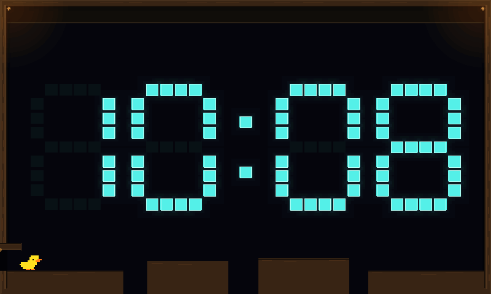
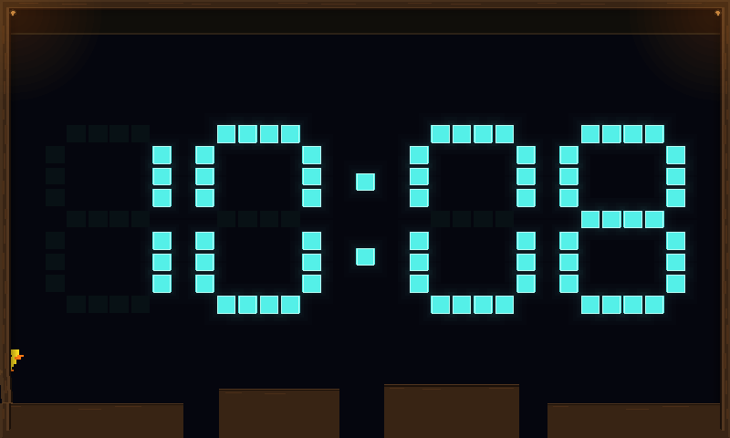
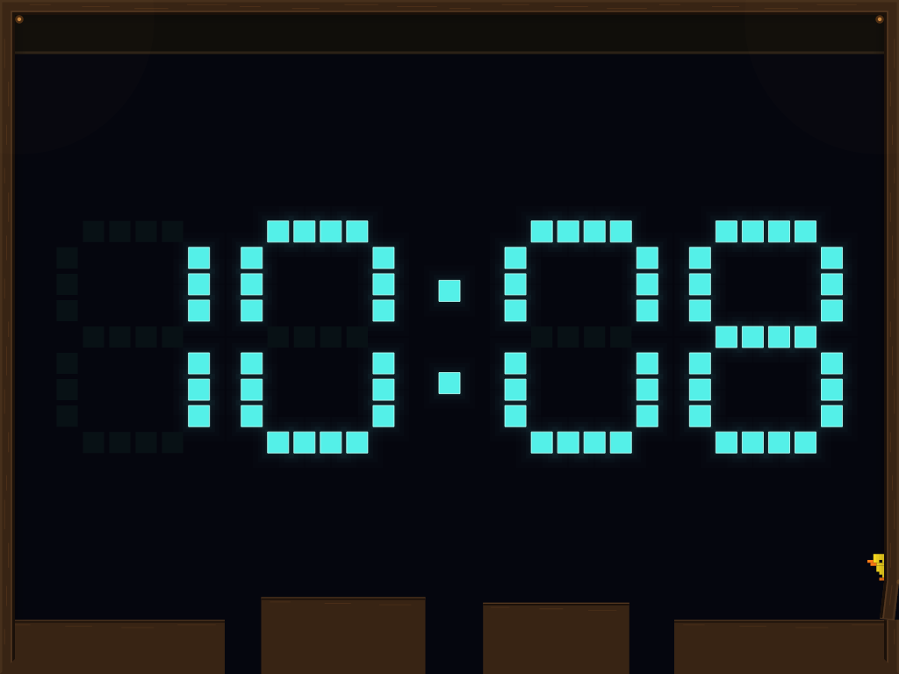
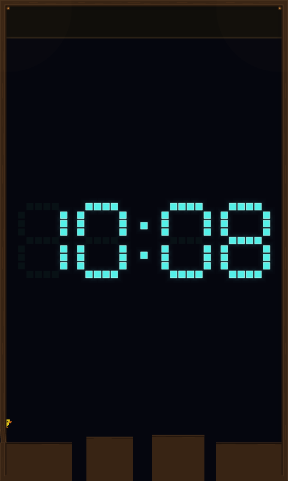

# Direct entrance-flap landing experiment

Implements #484 as an opt-in alternative to the occasional pull-up detour.
Set `SPACEWARS_CLOCK_DUCK_FLAP_DETOUR=direct-landing` when starting the client.
This changes the route on the existing seeded, roughly 20% of selected visits;
it does not force every duck to detour or change saved settings. The default
continues to use the fully open flap's catch/pull-up route.

The successful direct route lands on the flap's **narrow upper edge near the
hinge, late in closure**, rather than its fully open horizontal face. At the
three tested layouts the flap is about 12–17% open when the duck settles. It is a
small perch beside the frame. This experiment does not demonstrate a direct
flat-floor jump onto a fully open flap, or a stable perch on a steep broad face.

After normal spawning, the duck waits 0.2 seconds for its floor contact to settle,
then surveys a bounded set of ordinary launch and steering timings. The survey
uses actual body motion, physical support, the flap's rotating geometry and
swept obstruction rule, ordinary acceleration/jump strength, and collision
clearance in the existing world. Its free-flight estimate includes the discrete
gravity integration used by the ordinary solver. No speculative world, body
placement, forced support, stronger jump, or calibration samples are inserted.

The survey has at most 60 candidates, each with fewer than 58 free-flight steps,
and a 64-query ceiling per tick. It checks the physical return surface, including
holes inside a compound body's bounds, and the outbound/return corridors. The
launch is rechecked against the settled body, and each approach movement checks
for newly introduced obstacles. The live solver owns every contact: intent never
holds the door open. A candidate must produce three consecutive upward contacts
before a 0.6-second perch, followed by a normal jump back to the course.

This is deliberately a narrow entrance experiment. It accepts stationary, level,
dry support at the ordinary spawn location, including a closed responsive floor.
It refuses moving/sloping support, blocked launch or return paths, missing return
material, unsuitable flap motion, and expired opportunities. Changed conditions
can abort a committed attempt. Water, takeover, departure and the four-second
attempt budget retain priority. A failed/late landing is not retried. Warm-up and
normal course navigation resume afterward without learning from the stunt.

## Validation

392 Clock tests (five existing ignores), 53 common/control tests and 77 matching
client tests passed. Core Clippy with warnings denied, formatting and diff checks
passed. Both local capture-adapter tests passed. No deployment was performed.

The regression matrix covers both entrances and Careful/Flowing at 800×480,
1024×768 and 480×800. All twelve ordinary-spawn combinations complete landing,
continuous perching, return and normal departure. Forty seeded courses preserve
the course and occasional selection. Separate tests cover blocked launch/return,
return-floor gaps, moving floors, lost support, late/disrupted landings, real water
immersion, timeout, departure and takeover with unchanged position/momentum.
Full Clock scenes replay identically, pause without advancing and clean up on
resize.

The captures use the ordinary manual Duck event trigger, an explicitly selected
profile and Platforms course. Entrance mirroring is selected before the event
starts. From normal spawn onward, production decisions run the whole sequence;
fixtures never inject movement, catch/climb commands, poses or support. The
49-frame, 20-fps animation covers normal spawn through the completed return.
The 84 stage frames cover every layout/entrance/profile combination. Both raster
and vector exports retain the full target dimensions. Vector export uses Slint's
SVG loader and native text; these are local render captures, not device GPU shots.

[Capture telemetry and hashes](screenshots/clock/duck-direct-flap-manifest.json).



| Perch, 800×480 raster | Mirrored perch, 1024×768 vector |
| --- | --- |
|  |  |



## Reproduction

```sh
cargo test --offline --locked --profile ci -p scenario-clock -p engine-common -p spacewars-control
cargo clippy --offline --locked --profile ci -p scenario-clock -p engine-common -p spacewars-control --all-targets --no-deps -- -D warnings
cargo test --offline --locked --profile ci -p engine-client clock

SPACEWARS_DUCK_DIRECT_FRAMES=/tmp/duck-direct-frames.json \
SPACEWARS_DUCK_DIRECT_CLIP_FRAMES=/tmp/duck-direct-clip.json \
  cargo test --offline --locked --profile ci -p scenario-clock \
  direct_flap_scene_replays_pauses_and_captures_the_whole_visit
SPACEWARS_DUCK_DIRECT_FRAMES=/tmp/duck-direct-frames.json \
SPACEWARS_DUCK_DIRECT_ARTIFACTS=/tmp/duck-direct-captures \
  cargo test --offline --locked --profile ci -p engine-client \
  ui_render_tests::duck_flaps::direct_flap_fixtures_render_through_both_adapters \
  -- --ignored --exact
SPACEWARS_DUCK_DIRECT_CLIP_FRAMES=/tmp/duck-direct-clip.json \
SPACEWARS_DUCK_DIRECT_CLIP_ARTIFACTS=/tmp/duck-direct-clip-captures \
  cargo test --offline --locked --profile ci -p engine-client \
  ui_render_tests::duck_flaps::direct_flap_clip_renders_through_both_adapters \
  -- --ignored --exact
```

Automatic promotion remains a separate decision after reviewing this narrow
perch. When promoted, a safe direct route should take precedence; use the pull-up
when only the edge is safely reachable, and skip when neither route is safe.
Admission must leave enough time for that fallback. Higher natural launch
surfaces and alternate flap geometry remain unproven. Springboard response stays
in #474; this experiment uses rigid flaps.
