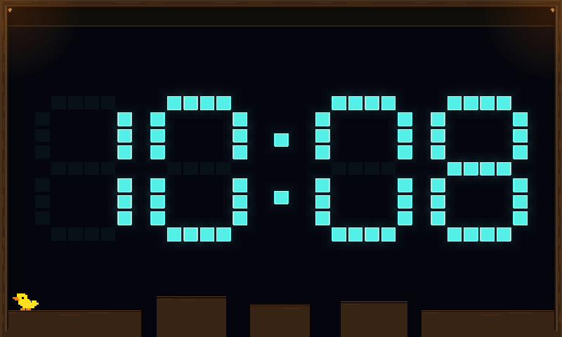
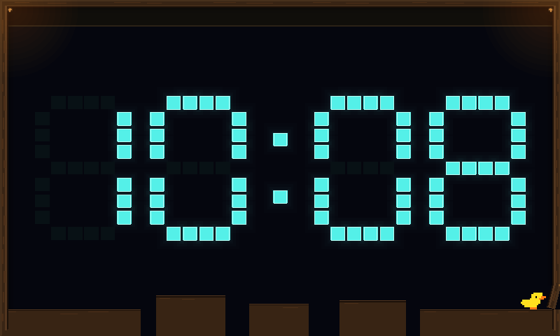
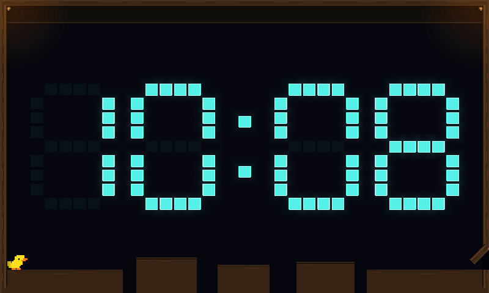
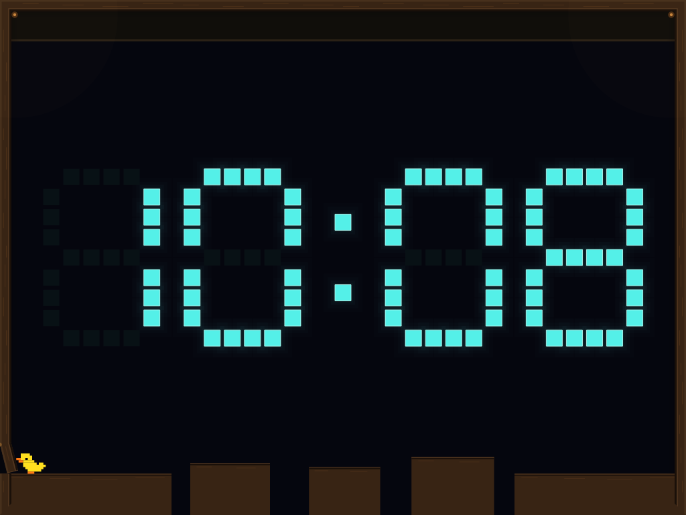
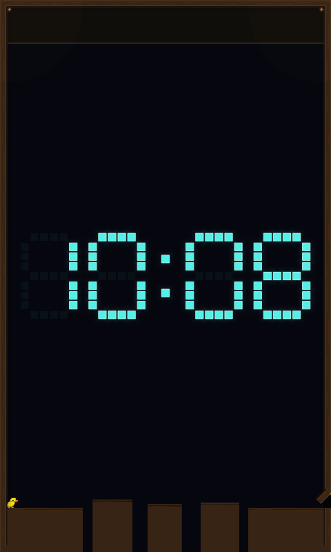

# Clock duck exit priority

When the exit opens behind the automatic duck, it brakes and heads back toward
it instead of completing another crossing. The physical movement limits are
unchanged. A committed jump, catch or climb finishes before the route changes;
water and collision recovery retain control until safe footing returns.

A duck already approaching the opposite wall within one body length of its tag
line may finish that tag first. This allowance is granted once, on grounded dry
support on the entrance bank, and expires after 45 simulation ticks (0.75 seconds).
It cannot start a new obstacle sequence or extend the visit deadline. The
captured examples tag and turn after 12 ticks (0.2 seconds); the other examples
request the exit direction on the first decision after the door opens.

Opening the exit prevents new optional flap detours. A committed detour can
finish its jump/climb and safe return, skipping the optional perch delay. Its
local animation age survives the visit's switch to the exit phase. Water,
missing support, blocked paths and attempt/departure deadlines still interrupt
it. Player controls and the opt-in status of direct flap landings are unchanged.

## Evidence

The capture fixture starts a normal duck on the existing seeded platform course.
It lets the real controller calibrate and travel before adjusting **only the
exit-opening time**, to exercise a door opening behind the duck and an imminent
opposite-wall tag. It does not place the duck, feed movement commands, inject
learned capabilities or alter its movement. Both orientations and both profiles
run twice at 800×480, 1024×768 and 480×800: 24 cases, 48 visits. All depart normally,
replay identically, and preserve state/rendering during pause checks.

The separate threshold test stages a small position/velocity offset on the same
physical bank to check just inside and outside the one-body-length boundary.
Other tests open the exit during actual return jumps and staged near-miss
catches/climbs, and cover a stalled grace timeout, repeated notifications, water,
recovery, detours, player control, cleanup and unchanged lifetime bounds.

Local exports retain the full target dimensions. Both production rendering
adapters are exercised; vector exports use Slint's SVG loader and native text.
These are local captures, not device GPU screenshots.



| Exit opens behind the duck | Near-wall tag finishes before turning |
| --- | --- |
|  |  |

| Mirrored visit, 1024×768 | Portrait visit, 480×800 |
| --- | --- |
|  |  |

[Capture telemetry and file hashes](screenshots/clock/duck-exit-manifest.json).

## Checks

- Clock: 402 tests passed; five existing diagnostic/export tests ignored.
- Client: 77 matching Clock tests passed; display-dependent functional tests remain in CI.
- Both explicit render exports passed (144 still PNGs and 154 clip PNGs).
- Clock Clippy with warnings denied, formatting and diff checks passed.
- Self-review covered launch contacts, route replacement, one-time grace, ledge
  completion, recovery priority, detour timing and player isolation. The final
  launch-contact guard reproduced the exact same captured frames and telemetry.

## Reproduction

```sh
cargo test --offline --locked --profile ci -p scenario-clock
cargo clippy --offline --locked --profile ci -p scenario-clock --all-targets --no-deps -- -D warnings
cargo test --offline --locked --profile ci -p engine-client clock

SPACEWARS_DUCK_EXIT_FRAMES=/tmp/duck-exit-frames.json \
SPACEWARS_DUCK_EXIT_CLIP_FRAMES=/tmp/duck-exit-clip.json \
  cargo test --offline --locked --profile ci -p scenario-clock \
  exit_turns_and_near_wall_tags_replay_on_all_target_layouts
SPACEWARS_DUCK_EXIT_FRAMES=/tmp/duck-exit-frames.json \
SPACEWARS_DUCK_EXIT_ARTIFACTS=/tmp/duck-exit-captures \
  cargo test --offline --locked --profile ci -p engine-client \
  ui_render_tests::duck_flaps::exit_priority_fixtures_render_through_both_adapters \
  -- --ignored --exact
SPACEWARS_DUCK_EXIT_CLIP_FRAMES=/tmp/duck-exit-clip.json \
SPACEWARS_DUCK_EXIT_CLIP_ARTIFACTS=/tmp/duck-exit-clip-captures \
  cargo test --offline --locked --profile ci -p engine-client \
  ui_render_tests::duck_flaps::exit_priority_clip_renders_through_both_adapters \
  -- --ignored --exact
```

The clip samples every six simulation ticks (10 FPS). The checked-in GIF uses
those unmodified full-size raster frames at that cadence. Still exports contain
72 frames through each adapter; clip exports contain 77 through each adapter.
