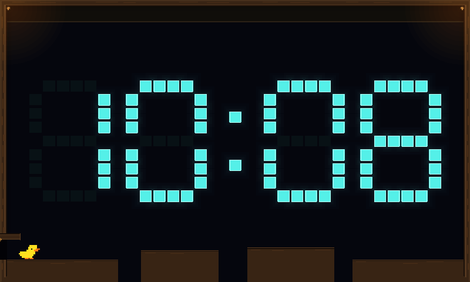
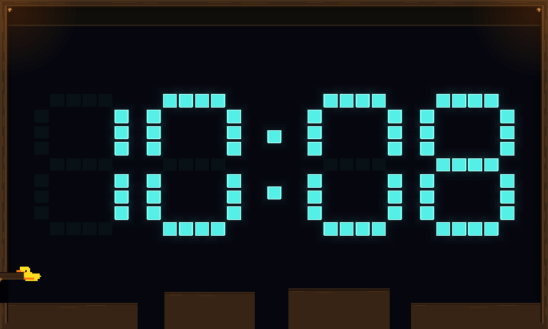
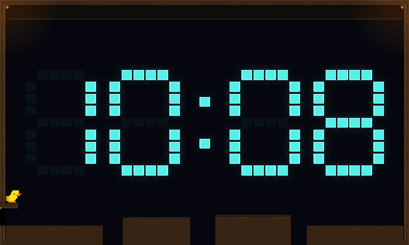
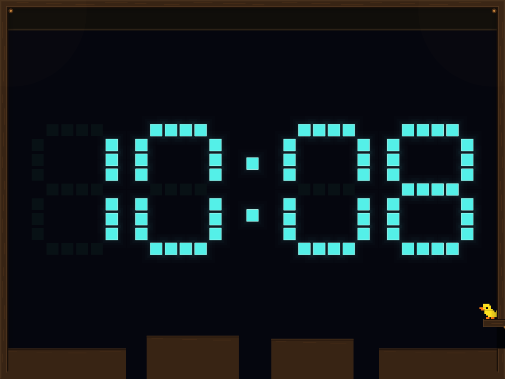
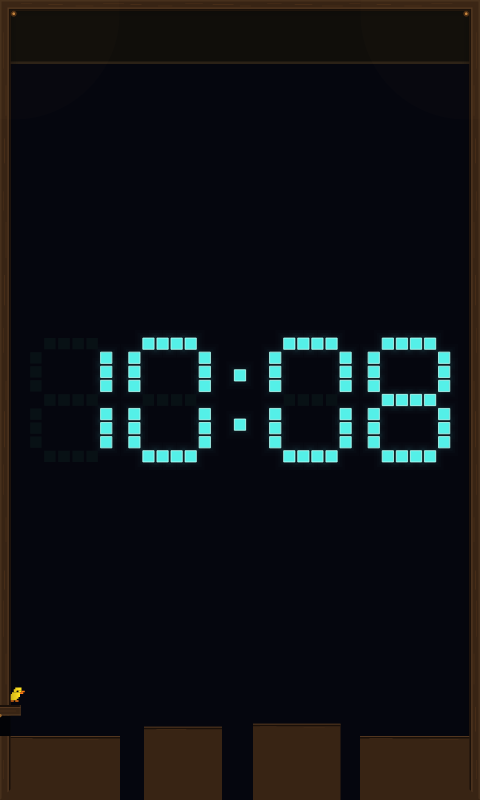
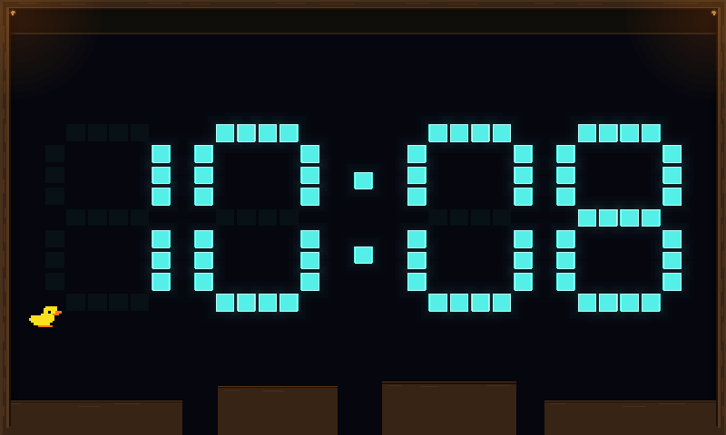

# Automatic entrance-flap detour

Implements the first ledge-based behavior in #478, after #283. On approximately
20% of visits, a duck turns toward its fully open entrance flap, jumps with its
ordinary movement inputs, catches the tip, pulls up, perches for 0.6 seconds,
then jumps back to the floor and resumes its course. Careful and Flowing use the
same shared actuator and automatic 0.3-second hang/pull-up adapter.

The entrance opportunity precedes ordinary warm-up. This small authored route
therefore checks the current body, flap pose and stationary support against the
ordinary movement actuator before starting. It uses bounded read-only sweeps in
the existing world to check approach, climb clearance and return flight. Actual
movement still comes from ordinary commands and shared ledge forces. It neither
sets the duck's pose nor writes calibration samples. Warm-up starts after the
return; the course navigator continues to learn its own capabilities normally.

Selection uses an independent seeded random stream. The course, entrance choice
and profile are not rerolled. There is at most one deliberate attempt per visit.
The complete detour has a four-second budget, including approach, shared climb,
perch and return flight. This replaces the ticket's provisional three seconds
without shortening the animation or extending the 35-second visit envelope.

Only a stationary, fully open flap is eligible. The return needs dry, stationary,
level support with room to land. Closed responsive floors qualify; moving/sloping
floors and obstructed or expired entrances skip the detour. Standing or an actual
ledge attachment can hold the pending door closure. Selection/approach intent
never holds the flap. Water, lost support, departure and time limits cancel the
attempt. Takeover stops autonomous commands while retaining the physical body,
momentum and any committed attachment/climb. Retirement releases all claims.

`duck.navigation.flap_detour` is an additive, defaultable diagnostic containing
phase, attempts, elapsed/perch ticks, this tick's clearance-query count and
outcome. Detour planning has a 64-query ceiling; shared ledge actuation retains
its separate 64-query ceiling. No new bodies, physics worlds or production
capture/logging hooks were added.

## Verification

380 Clock tests (five existing ignores), 53 common/control tests and 74 matching
client tests passed. Core Clippy with warnings denied, formatting and diff checks
passed. The scene export and both local capture-adapter tests passed as well.

The regression tests cover all three target layouts (800×480, 1024×768, 480×800),
both entrances and both profiles. Ordinary-spawn visits complete the detour and
exit normally, with warm-up samples collected afterward. Additional cases cover
seeded selection, unchanged course geometry, blocked perch/return, changing flap
pose, failed catch, real water immersion, lost support, impulse disruption,
deadline/timeout, takeover, shared-arena retirement/rejoin, and responsive floors.

Full Clock scenes replay twice with identical render frames and diagnostics,
pause without advancing, and clean up on resize. Rain, Falling and Meltdown can
join during the hang without replacing the visit or bypassing its budget.

The older frozen hurdle-course and fixed-time mixed-collision fixtures explicitly
omit this optional stunt so their original calibration/jump counts and collision
timings remain regression baselines. The new tests exercise the detour separately,
including actual shared-event interruptions; they do not force poses or support.

## Capture method

The scene fixture uses the normal manual Duck event trigger with a selected
scenario seed, Platforms course and explicit profile. It varies entrance mirroring
before the visit starts. From tick zero, ordinary production decisions perform the
entire approach, catch, climb, perch, return and eventual departure. No test places
the duck on a flap or injects movement/catch/climb commands.

The capture set has nine stages for every size/entrance/profile combination,
plus a 20-fps sequence of the complete detour at 800×480. Both exports use the
production raster/vector render inputs. Vector images use Slint's SVG loader
and native text, not device GPU rendering. Captures are local; no deployment.

The 108 stage frames produced 216 local PNGs; the 69 animation frames produced
another 138. Successful detours took 201–206 ticks (3.35–3.43 seconds). The sampled
frames contained at most six bodies/colliders and 35 detour clearance queries.

## Selected captures

[Capture source, telemetry and hashes](screenshots/clock/duck-flap-detour-manifest.json).



| Hanging, 800×480 raster | Perching, 800×480 raster |
| --- | --- |
|  |  |

| Mirrored perch, 1024×768 vector | Beginning return jump, 480×800 vector |
| --- | --- |
|  |  |



## Reproduction

```sh
cargo test --offline --locked --profile ci -p scenario-clock -p engine-common -p spacewars-control
cargo clippy --offline --locked --profile ci -p scenario-clock -p engine-common -p spacewars-control --all-targets --no-deps -- -D warnings
cargo test --offline --locked --profile ci -p engine-client clock

SPACEWARS_DUCK_DETOUR_FRAMES=/tmp/duck-detour-frames.json \
SPACEWARS_DUCK_DETOUR_CLIP_FRAMES=/tmp/duck-detour-clip.json \
  cargo test --offline --locked --profile ci -p scenario-clock \
  flap_detour_scene_replays_pauses_and_captures_the_whole_visit
SPACEWARS_DUCK_DETOUR_FRAMES=/tmp/duck-detour-frames.json \
SPACEWARS_DUCK_DETOUR_ARTIFACTS=/tmp/duck-detour-captures \
  cargo test --offline --locked --profile ci -p engine-client \
  ui_render_tests::duck_flaps::flap_detour_fixtures_render_through_both_adapters \
  -- --ignored --exact
SPACEWARS_DUCK_DETOUR_CLIP_FRAMES=/tmp/duck-detour-clip.json \
SPACEWARS_DUCK_DETOUR_CLIP_ARTIFACTS=/tmp/duck-detour-clip-captures \
  cargo test --offline --locked --profile ci -p engine-client \
  ui_render_tests::duck_flaps::flap_detour_clip_renders_through_both_adapters \
  -- --ignored --exact
```

Direct landing onto a reachable flap is the separate follow-on experiment #484. Once
enabled, a safe direct landing should take priority over the pull-up route.
Springboard behavior remains #474.
