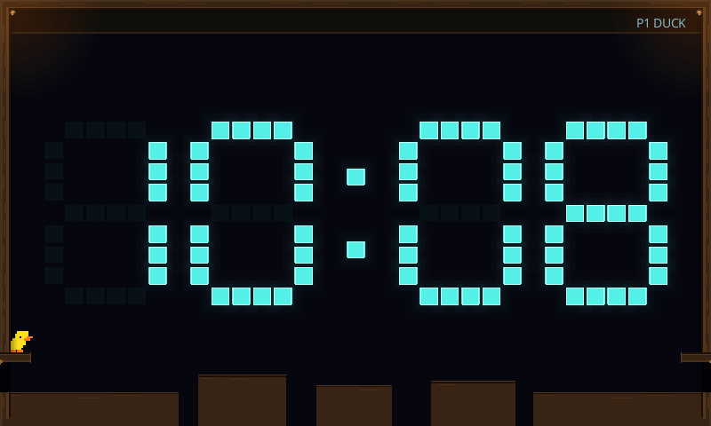
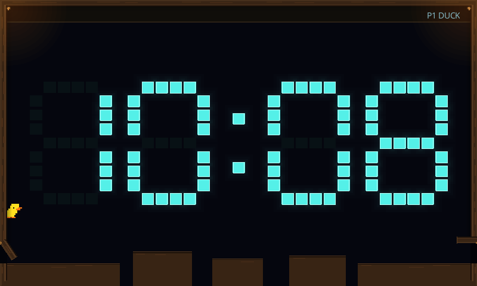
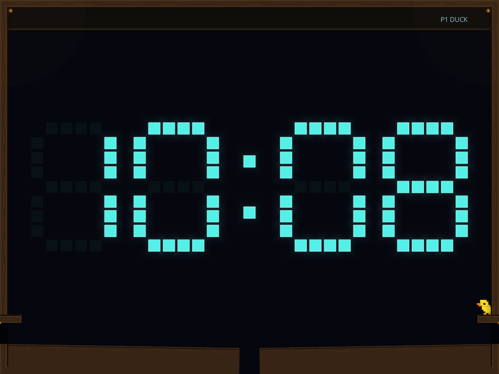
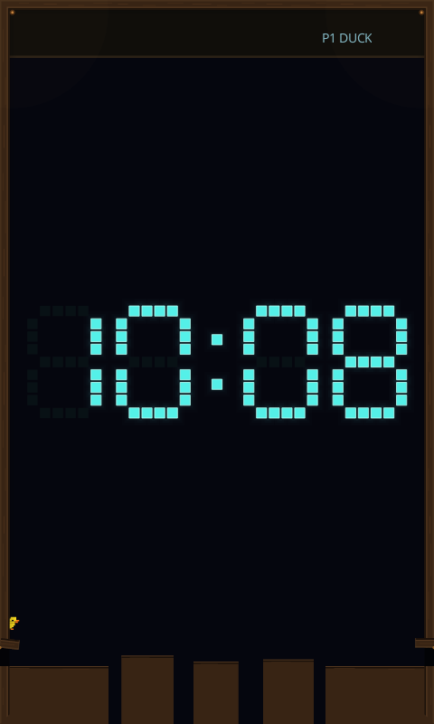
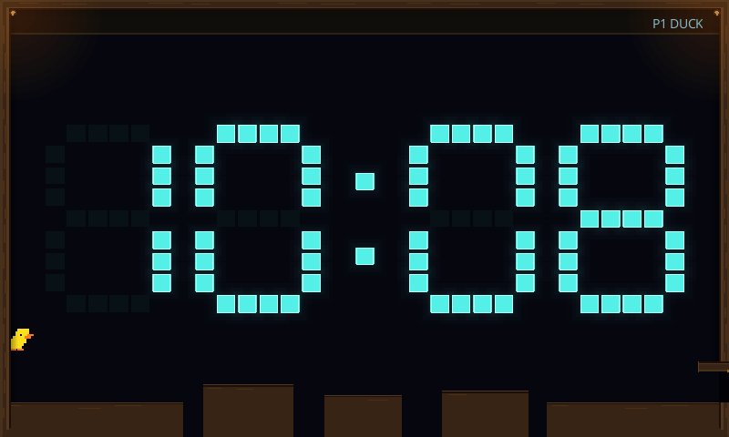

# Rigid duck door flaps

Issue [#280](https://github.com/aortez/space-wars/issues/280) makes the existing
wooden flaps physical. Rendering and the two bounded kinematic colliders share
the same footprint, hinge and actual pose. Standing contact or a validated
attachment holds a closing flap; obstruction defers the next swept movement.
Closure resumes from the held pose when clear. Jumping uses the support point's
incoming physical velocity without an added launch bonus.

Spring response and a well-timed extra boost remain an experiment in
[#474](https://github.com/aortez/space-wars/issues/474). The attachment fixture
establishes the occupancy contract. [Shared ledge mechanics](clock-duck-ledges-validation.md)
implement #281; player controls follow separately in #282.

## Local validation

Run these from the repository root with the normal local Cargo target directory:

```sh
cargo test --offline --locked --profile ci -p scenario-clock
cargo test --offline --locked --profile ci -p engine-common -p spacewars-control
cargo test --offline --locked --profile ci -p engine-client --bin engine-client clock -- --test-threads=1
SPACEWARS_KEEP_FUNCTIONAL_ARTIFACTS=1 cargo test --offline --locked --profile ci -p engine-client --test ui_control_functional clock::duck_runs_jumps_exits_and_supports_live_controls_and_cleanup -- --ignored --test-threads=1
```

The scenario suite passes 342 tests (five existing diagnostic/export tests are
ignored). The common/control suites pass 53 tests, and 72 client Clock checks
pass, including the corrected Rain body count and shaded Falling capture. The
actual client duck workflow covers entry, jumps, exit, live controls,
replacement and cleanup.
Scenario coverage includes ordinary-input jumps onto a closing flap in both
orientations, standing beyond the original closure deadline, attachment
validation, stale-claim rejection, swept obstruction, support velocity, pause,
resize, takeover and shared Rain/Falling/Meltdown ownership. A horizontal flap
supports a stationary duck; a partially closed, sloping flap can still be slid
off under ordinary physics.

## Target-size render fixtures

These deterministic local captures use the real scenario geometry and physical
contacts at 800×480 (HyperPixel), 1024×768 (Picade) and 480×800 (portrait). The
fixture initially places the actor just above an open flap, lets the solver
settle it, waits beyond the closure deadline, then performs an ordinary jump.
It captures standing, jumping, closing and closed poses, for both entrance
orientations and both course/responsive floors. The responsive floor starts
partly open and moves under the usual dry-floor simulation.

The separate input-only test reaches the closing flap from the ordinary spawn
using steering and one Jump press; it does not reposition the actor or change
jump strength. The captures use the placed fixture to make each layout's
standing and release stages directly comparable.

```sh
SPACEWARS_DUCK_FLAP_FRAMES=/tmp/duck-flap-frames.json cargo test --offline --locked --profile ci -p scenario-clock rigid_flap_scene_fixtures_cover_pause_floor_motion_and_target_viewports
SPACEWARS_DUCK_FLAP_FRAMES=/tmp/duck-flap-frames.json SPACEWARS_DUCK_FLAP_ARTIFACTS=/tmp/duck-flap-captures cargo test --offline --locked --profile ci -p engine-client --bin engine-client rigid_flap_fixtures_render_through_both_adapters -- --ignored --test-threads=1
```

The export renders 48 frames through both production adapters, producing 96
PNGs. Raster captures use the normal raster renderer. Vector captures use the
production vector geometry exported through Slint's SVG loader, because the
headless software window cannot draw native Path items; both retain the native
text overlay. These are local fixture captures, not Raspberry Pi GPU captures.
The matrix peaks at 607 primitives and nine total bodies, including no more
than two flap bodies. Source revision, fixture telemetry and image hashes are
recorded in [the capture manifest](screenshots/clock/duck-flaps-manifest.json).

| Standing on the rigid flap, 800×480 raster | Closing after jumping clear, 800×480 raster |
| --- | --- |
|  |  |

| Right entrance with responsive floor, 1024×768 vector | Ordinary jump, 480×800 vector |
| --- | --- |
|  |  |


