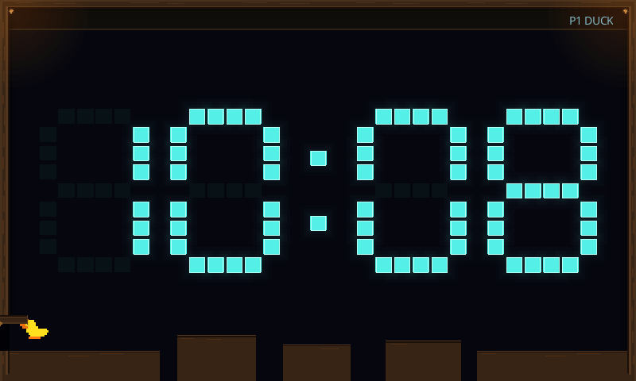
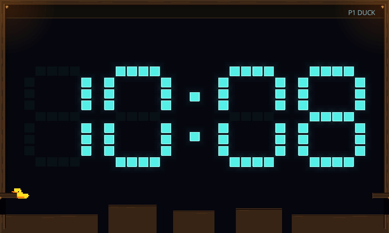
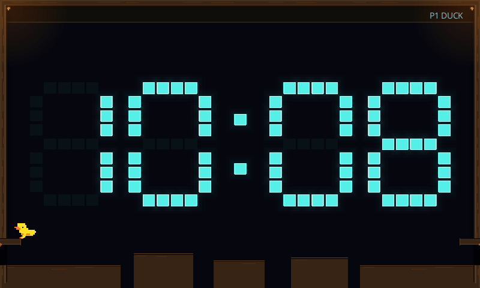
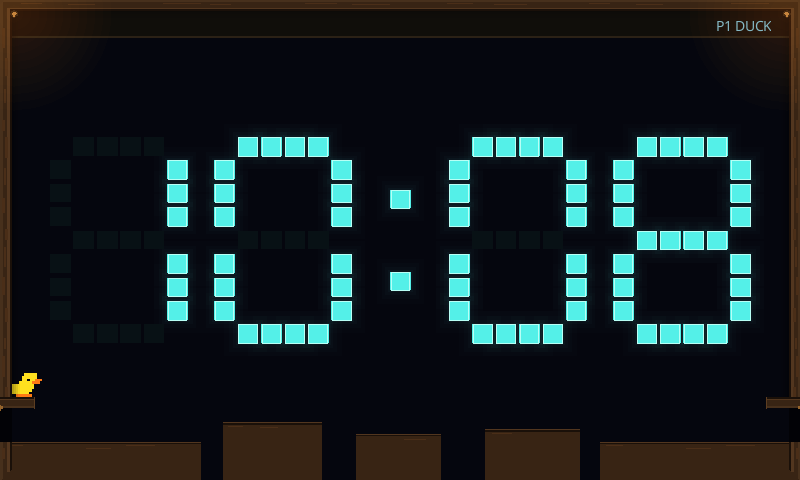
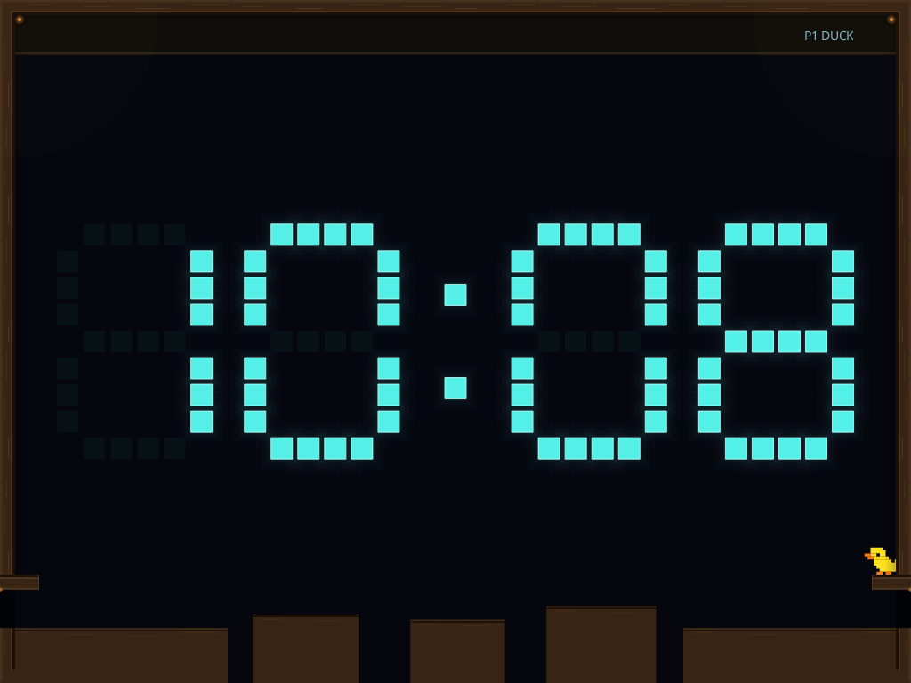
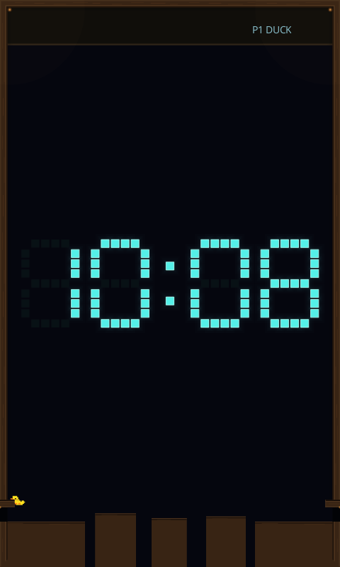

# Clock duck ledge mechanics

Issue [#281](https://github.com/aortez/space-wars/issues/281) adds shared catch,
hang, pull-up and release mechanics on course-platform edges and fully open
door flaps. The existing dynamic duck body, collider, mass, gravity, jump
strength and flap dimensions remain authoritative. A bounded movement actuator
pulls that body through collision-checked space; it never places the duck above
the ledge or creates another physics world.

This foundation accepts explicit `LedgeCommand::{Catch, Climb, Release, Idle}`
commands. Each command lasts one simulation tick; Idle preserves a valid hang.
The player adapter is [#282](https://github.com/aortez/space-wars/issues/282),
the automatic adapter is [#283](https://github.com/aortez/space-wars/issues/283),
and deliberate flap visits are [#478](https://github.com/aortez/space-wars/issues/478).
Those adapters are separate work: ordinary player inputs and automatic visits
do not request a catch yet. Scripted shared commands exercise this foundation.

## Movement and limits

Only the finite authored course inventory and fully open, stationary-angle flap
tips supply candidates. Foreign solids, digits, loose debris, steep/closing
flaps and unreachable edges do not become grab targets. Existing ordinary
standing/jumping on debris is unchanged.

A candidate needs a compatible approach, a clear hand reach, room for the
hanging hull and a plausible landing area. The capture settles into a visible
hang. Climb checks the full rise/across/settle path before starting and checks
the next segment each tick. Success requires a real upward support contact.
A blocked start stays hanging; a newly blocked path or lost/disrupted support
releases the existing body with its current momentum. Hanging has no stamina
timer. The automatic visit's existing timeout still applies.

| Limit | Initial value |
| --- | --- |
| Maximum anchor reach | 2.5 body radii |
| Target driven speed relative to support | 8 radii/second |
| Maximum actuator acceleration | 240 radii/second² |
| Attachment disruption speed | 32 radii/second relative to support |
| Maximum settled-hang position error | 1.25 radii |
| Capture settling budget | 30 ticks (0.5 seconds) |
| Complete climb budget | 120 ticks (2 seconds) |
| Release/re-catch cooldown | 12 ticks (0.2 seconds), plus cleared catch intent |
| Candidate inventory | At most 16 edges |
| Clearance work | At most 64 casts per tick |

The hull remains dynamic and collision-enabled. Ordinary gravity and buoyancy
still act; the attachment actuator supplies bounded correction. A release tick
does not also apply Jump, swimming or diving. A takeover clears the previous
source's pending command while preserving a committed climb or valid hang.
Flap claims use their existing visit generation and are removed on release,
confirmed landing and retirement.

`duck.ledge` publishes phase, support identity, current anchor, climb stage,
rearm/cooldown, fixed-size outcome counters and per-tick query counts. Missing
ledge diagnostics default cleanly when reading older payloads. Visible wings
meet the authoritative anchor, tucked feet distinguish the hang, and the body
itself rises through the pull-up; these poses add no physical limbs.

## Local verification

```sh
cargo test --offline --locked --profile ci -p scenario-clock -p engine-common -p spacewars-control
cargo clippy --offline --locked --profile ci -p scenario-clock -p engine-common -p spacewars-control --all-targets --no-deps -- -D warnings
cargo test --offline --locked --profile ci -p engine-client --bin engine-client clock -- --test-threads=1
cargo test --offline --locked --profile ci -p engine-client --test ui_control_functional clock::duck_runs_jumps_exits_and_supports_live_controls_and_cleanup -- --ignored --test-threads=1
```

The scenario suite passes 360 tests (five existing diagnostic/export tests are
ignored), with 53 common/control tests and 72 client Clock tests. The real
client workflow checks the existing entry, movement, controls and cleanup;
new ledge commands are covered by the shared-mechanic fixtures, not by a player
input adapter that has yet to be implemented.

The new coverage includes an ordinary-spawn jump/catch/pull-up onto the fully
open entrance flap at 800×480, 1024×768 and 480×800 in both directions; a course
near-miss; a ten-second hang; blocked and interrupted climbs; support removal;
an external impulse; water; takeover; stale intent; release/rearm; ineligible
solids; replay; pause; resize and shared-arena retirement. No placed actor or
changed jump impulse is used for the successful approach/catch/climb captures.

## Captures

```sh
SPACEWARS_DUCK_LEDGE_FRAMES=/tmp/duck-ledge-frames.json cargo test --offline --locked --profile ci -p scenario-clock ledge_scene_fixtures_replay_and_render_with_pause_and_teardown
SPACEWARS_DUCK_LEDGE_FRAMES=/tmp/duck-ledge-frames.json SPACEWARS_DUCK_LEDGE_ARTIFACTS=/tmp/duck-ledge-captures cargo test --offline --locked --profile ci -p engine-client --bin engine-client ledge_fixtures_render_through_both_adapters -- --ignored --test-threads=1
```

The fixture uses ordinary steering/Jump from the normal spawn, then explicit
shared Catch/Climb/Release commands. It captures reaching, hanging, pull-up,
standing after an ordinary turn toward the course, jumping away and a separate
deliberate drop, mirrored at all three
viewports. Every sequence is replayed and compared exactly, including rendered
frames; paused snapshots remain unchanged. Thirty-six frames produce 72 PNGs
through the two presentation paths.

Raster images use the production raster adapter. Vector images export the
production vector geometry through Slint's SVG loader, with the native text
overlay, because the headless software window cannot draw native Path items.
These are local captures; no Pi deployment or device GPU validation was done.

[Source revision, capture telemetry and image hashes](screenshots/clock/duck-ledges-manifest.json)
record the selected frames. The capture matrix peaks at 610 primitives and
9 total bodies, including at most two flap bodies.

| Reaching, 800×480 raster | Hanging, 800×480 raster |
| --- | --- |
|  |  |

| Pull-up, 800×480 raster | Confirmed standing after turning, 800×480 raster |
| --- | --- |
|  |  |

| Right entrance, 1024×768 vector | Portrait hang, 480×800 vector |
| --- | --- |
|  |  |
