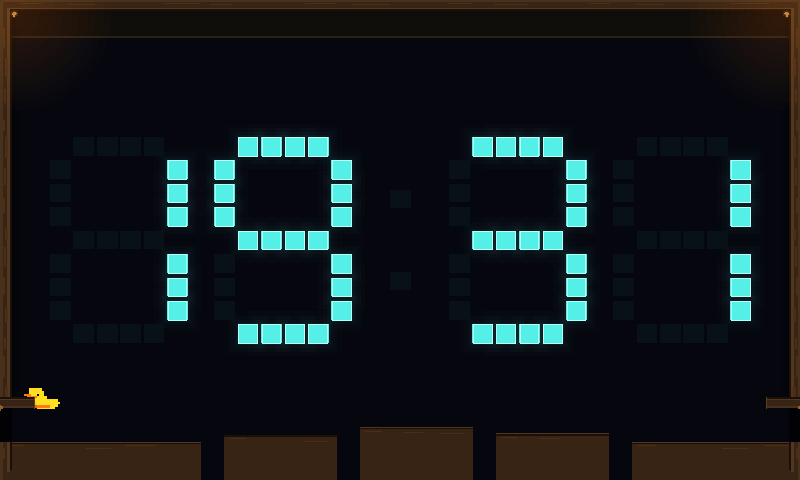
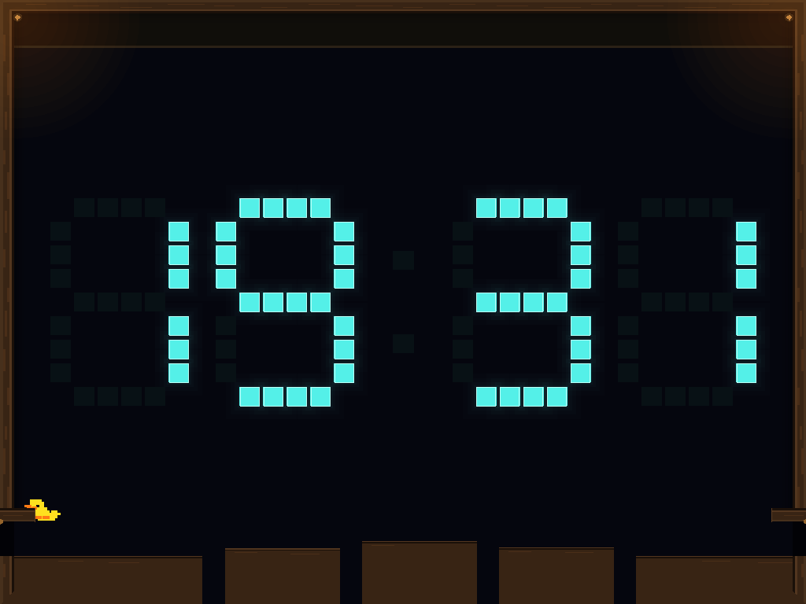
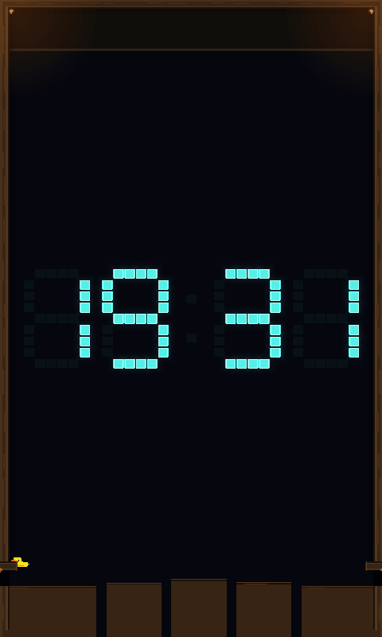

# Player duck ledge controls

Implements #282 using the shared catch/hang/pull-up actuator. Hold Jump to catch
a reachable ledge, release and press it again to climb, or press Down to drop.
Down wins over a simultaneous Jump while attached. The release tick consumes the
movement action, so it cannot also swim or jump. Held Jump keeps the existing
rearm gate closed after a drop until the player releases it.

The adapter reuses the existing held buttons and Jump edge. It adds no input
payload, movement tuning, stamina timer, history, bodies or controller bindings.
An uninterrupted hold cannot climb after catching or jump after landing.
Horizontal input does not move the attachment sideways. Existing support loss,
collision disruption, water, takeover and arena ownership remain authoritative.

## Checks

The scenario fixtures start from an ordinary player spawn and use movement
inputs, without placing the body or forcing a Catch/Climb command. They exercise
both entrances at 800×480, 1024×768 and 480×800, a one-minute hang with stable
body/collider counts, fresh climb/jump edges, no-catch releases, and simultaneous
Jump/Down with momentum-preserving drops. The existing water fixture now tests
Down's attachment priority before normal swimming resumes. Automatic takeover
coverage also climbs from the retained attachment using player input.

Client fixtures dispatch actual Slint Space/Down key events or the logical
owning gamepad/Picade seat through `map_input` and serialized scenario actions.
They cover catches, holds, climbs, drops, foreign/stale input, pause, disconnect,
neutral gating, dismissal during Rain/Falling/Meltdown, and resize during a climb.
Picade inputs are simulated logical controls, not a device deployment.

```sh
cargo test --offline --locked --profile ci -p scenario-clock -p engine-common -p spacewars-control -p spacewars-cli
cargo test --offline --locked --profile ci -p engine-client --bin engine-client clock
cargo clippy --offline --locked --profile ci -p scenario-clock -p engine-common -p spacewars-control -p spacewars-cli --all-targets --no-deps -- -D warnings
cargo fmt --all -- --check
```

## Local captures

These show the keyboard fixture's held-Jump catch from normal spawn. They use
the production raster scene renderer at the target dimensions; Slint's separate
native text overlay is omitted. Raster/vector frame inputs are compared by the
fixture, but these PNGs are raster captures, not device GPU validation. The Clock
reading comes from the normal client input mapping and varies with capture time.

```sh
SPACEWARS_PLAYER_LEDGE_ARTIFACTS=/tmp/player-ledges \
  cargo test --offline --locked --profile ci -p engine-client --bin engine-client \
  player_tests::ledges::keyboard_and_owning_gamepad_ledge_sequence_uses_real_client_actions
```






