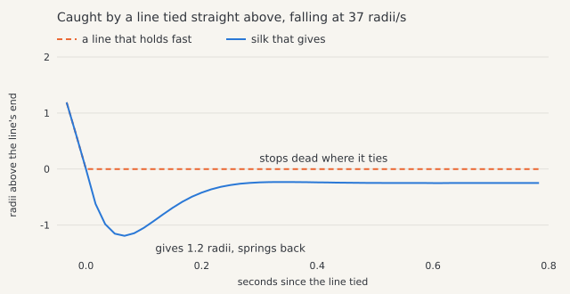
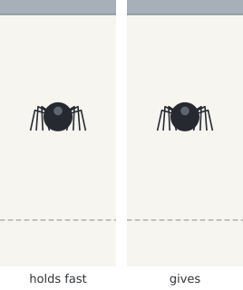
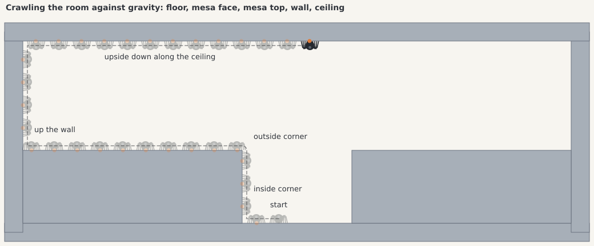
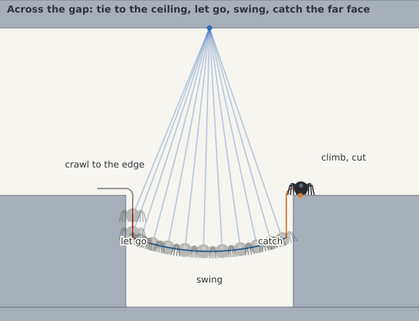
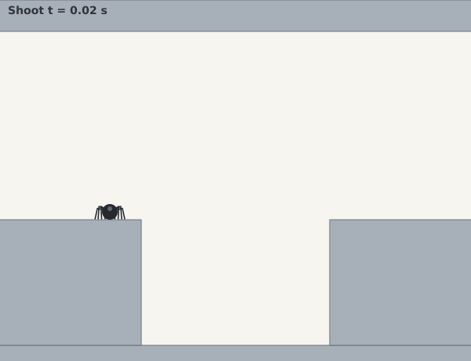
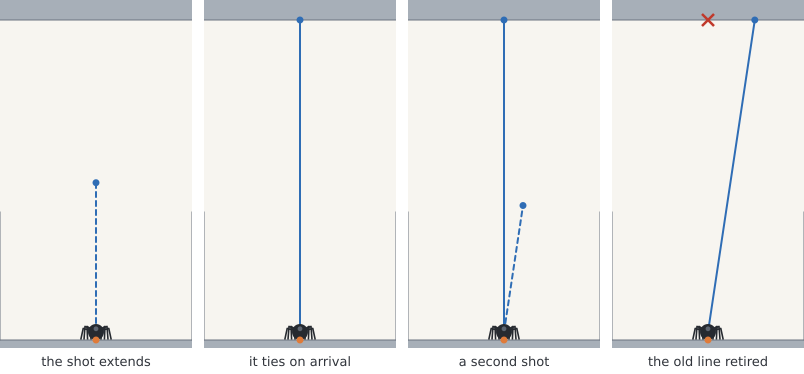
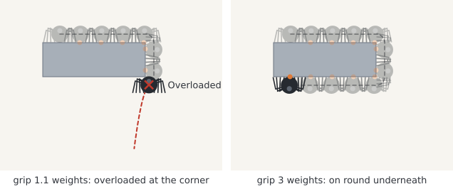
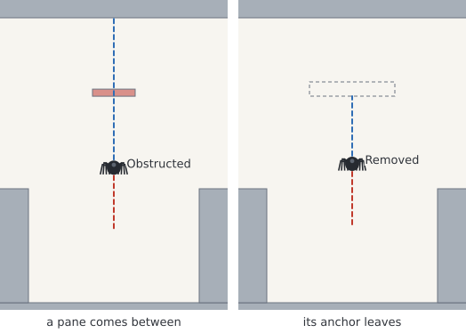

# Clock spider mechanics

Issue [#381](https://github.com/aortez/space-wars/issues/381) is the first slice
of the Clock spider visit ([#162](https://github.com/aortez/space-wars/issues/162)):
the physical mechanic on small fixtures, with no Clock integration yet. Clock
surfaces in the canonical arena are [#382](https://github.com/aortez/space-wars/issues/382),
visits, controls and rendering are [#383](https://github.com/aortez/space-wars/issues/383),
and qualification is [#384](https://github.com/aortez/space-wars/issues/384).

[The spider on the digits](clock.md#the-spider-on-the-digits) is #382: the
adapter that puts this mechanic in Clock's arena, on the actual digit cells
and the frame.

`engine_rapier::spider` holds one spider in a world it does not own. The whole
body is one dynamic ball with its rotation locked; a renderer draws the legs.
Each tick the host passes a `SpiderIntent` (crawl, grip, shoot, cut and reel) to
`Spider::drive` before its own world step, with a predicate naming the colliders
the spider may hold. Automatic and manual intent meet the same limits. The
spider applies bounded impulses to its own body and their reactions to dynamic
supports, and ties at most one rope. It never steps the world. A zero or invalid
`dt` changes nothing, and a paused host simply does not drive or step. No Rapier
type crosses the API. The world indexes a new solid at its next step, so
`Spider::insert` refuses a spider inside a solid only once that solid has been
through a step.

## Climbing

Each tick the spider looks at no more than 32 colliders near its body, sensors
included. Of those it may hold, it measures the nearest eight from where its
body is now: the nearest boundary point, the normal toward the body, and the
gap. The held surface is always measured first, so a crowd never hides it, but
more than 32 colliders within reach can hide a new one. A surface it is not
touching must also be visible from the body's center, so a leg never reaches
through a solid. Rapier's contact manifolds are not used, because they date
from the start of the last step and drop out as soon as the body lifts a hair
off a surface.

On the held surface the legs press with a quarter of a weight, close any gap
within reach, and crawl at the asked speed relative to the surface. Gravity is
compensated within the grip and drive limits, so a weak drive slips down a wall
and a weak grip cannot hang from a ceiling. The legs follow the surface as it
will move through the coming step, so a platform driven by its next pose
carries the spider from the step it starts. The reaction goes to a dynamic
support at the held point.

- **Corners.** Crawling into a surface ahead turns onto it at an inside corner.
  The body pivots around an outside corner on that corner's nearest point.
  Where the held surface falls away, a touching neighbor carries the hold on,
  so seams between colliders and corners two colliders share cost nothing.
- **Holding identity.** A held point is kept in its body's frame together with
  the collider's generational handle. A support that leaves the world, or is
  replaced under the same identity, is let go as `Removed` and never inherited.
- **Letting go.** The hold ends with `Requested` (grip off), `Ineligible` (the
  predicate refuses it), `OutOfReach`, or `Overloaded`. Overloaded means either
  the static pull exceeds the grip, or the body parted while the legs pulled at
  their limit, as when rounding a corner too fast for a weak grip. A spider that
  lost its hold waits 0.15 s before catching again.

While the legs, the line's give or the reel carry the spider, it asks the world
to carry its weight through the next step (`PhysicsWorld::carry_weight`). That
step applies the whole weight as one impulse before it solves and keeps gravity
off the body while it does. Their impulses then meet the weight at once,
instead of across the solver's substeps, which would let a spider climbing
against gravity outrun its speed limit. The spider never sets its own gravity
scale. It weighs, and falls, under whatever scale the host gives its body, as
Clock's arena does for its residents. A step taken without a drive before it
finds the spider unheld, and it falls.

## One silk line

- **Shooting.** A shot casts one ray, up to the silk range, for an eligible
  target. The line's end then travels at the shot speed, which is the visible
  cue (`SpiderShot::tip`).
- **Tying.** On arrival, the target's presence, eligibility and range are
  checked again, along with a clear span from the body to it. The new line then
  ties as long as the span, between the shortest and the longest line, and
  replaces the old one. Each line takes a fresh joint identity and is retired
  exactly once. Tying takes nothing off the spider's speed. The line is taut
  from the start, so its give catches a spider drawing away from the anchor as
  it catches any line going taut, and the rest of the spider's velocity swings
  it on round the anchor.
- **Failures.** A shot that cannot tie reports `NoTarget`, `Blocked`, `Busy`,
  `TargetLost`, `Obstructed`, `OutOfRange` or `Cut`. It fails as `OutOfRange`
  as soon as its target is farther than the longest line, so a target drawing
  away faster than the shot never keeps it going.
- **Give.** Silk stretches a little. Drawn past its length, the line pulls the
  spider and its anchor together as a damped spring would through the coming
  step. It never pushes, and its damping at most stops the two drawing apart.
  One weight stretches it 0.25 radii, so a hanging spider rests that far past
  the line's length under a tension of one weight. Its damping ratio of 0.7
  sets how it settles: at 1 it settles without a bounce, and the lower it is,
  the more it bounces. The line stretches at most its give of 5 radii, and
  then holds fast.
- **Free anchors.** A dynamic anchor gives way by its mass at the anchor point,
  turning included, so the line pulls the spider and the anchor as one pair,
  and a light free anchor is drawn in without flinging the two together. The
  spider cannot see what else holds an anchor up, so one hanging on its own
  rope or resting on a shelf still counts only its own mass, and the line is
  softer and bouncier on a light one than on a fixed anchor. Kicked down at 10
  radii/s, a hanging spider rises 0.004 radii past its hang under the ceiling,
  0.12 radii under a rope-hung block a quarter of its mass, and 0.42 radii
  under one a sixteenth of its mass.
- **The catch.** At Clock scale, a spider falling at 37 radii/s when a line
  straight above it ties draws the line out 1.2 radii. The give takes at most
  16 radii/s off it in a tick, where a line that held fast would take all 37 in
  the tick it tied on. The spider stops falling 0.07 s after the tie, springs
  back 0.02 radii past where it comes to hang, and is still within about half a
  second.
- **The rope.** The world holds the line as a rope,
  `PhysicsWorld::insert_tether`, a Rapier rope joint: unilateral, so it pulls
  but never pushes. The world's tether API reports its length, distance and
  tension. The rope is as long as the line and its give together, so it holds
  only what the give has not stopped. A rope is never shorter than the span
  between its ends: it ties at least that long, and shortening stops at the
  span, so the solver never drags its ends together through whatever lies
  between. The rope's tension is the last solver substep's impulse, so it reads
  the steady load. A catch does not show in it, and neither does weight passed
  on as an impulse before the step, such as that of a spider holding on beneath
  what the rope carries. The line's own tension adds the give's and the reel's
  pull to it.
- **Reeling.** Reeling in gathers slack at up to the reel speed for free. On a
  taut line it climbs with at most the reel pull, adding only what the give and
  the legs left undone, and keeps only the span a climb actually closed. A reel
  too weak to lift the spider holds on without climbing, and a reel at the
  shortest line stops pulling; either way the line carries the weight. Paying
  out lengthens the line up to the longest.
- **Release.** A cut keeps the body's velocity. A solid coming between the
  spider and its anchor releases the line as `Obstructed`; the line never wraps.
  An anchor that leaves or is replaced releases it as `Removed`, with no hidden
  pin left behind.
- **Order.** The world indexes a new solid in its next step, so the span sees
  it from the tick after that.

## Limits

Distances are in body radii, speeds in radii per second and forces in body
weights under `SpiderSpec::gravity`. That reference gravity keeps the limits
meaningful in a weightless world.

| Limit | Default |
| --- | --- |
| Grip, the most pull toward a held surface | 3 weights |
| Drive, the most push along it | 2 weights |
| Crawl speed | 5 radii/s |
| Reach past the body | 0.5 radii |
| Steady press onto a held surface | 0.25 weights |
| Re-catch delay after a lost hold | 0.15 s |
| Silk range | 40 radii |
| Shot speed | 160 radii/s |
| Line length | 1.25 to 60 radii |
| Reel speed and pull | 6 radii/s, 2.5 weights |
| Pay-out speed | 10 radii/s |
| Silk stretch under one weight | 0.25 radii |
| Silk damping ratio | 0.7 |
| Silk give, the most a line stretches | 5 radii |
| Colliders looked at per tick | at most 32 (`MAX_NEARBY`) |
| Colliders measured per tick | at most 8 (`MAX_SURFACES`) |
| Rays per tick | at most 11 (`MAX_RAYS`) |

The fixtures run at two scales at 60 Hz:
- Clock's: gravity 400 units/s², a 6-unit spider and a 20-unit length unit, so
  66.7 radii/s² of gravity.
- Metres: 9.81 m/s² and a 5 cm spider, so 196 radii/s².

Those two bound the tested range: gravity from 66.7 to 196 radii/s² at 60 Hz.
Tests below marked "at both scales" run at each. The rest run at Clock's.

## Diagnostics

`Spider::state` reads the spider without changing it. It reports:
- the mode (`Free`, `Crawling` or `Hanging`), position, velocity and `up`;
- the support, with its identity, local and world point and normal;
- the line, with joint and anchor identity, local and world anchor, length,
  distance, slack, stretch, taut and tension;
- the shot, with its target and tip;
- the last intent, the last release reason and the last shot failure;
- running counts of catches, releases, shots, failures, lines tied and lines
  retired;
- the last tick's rays, colliders looked at and colliders measured;
- the bodies, colliders and joints it owns, as the world has them.

A support, anchor or shot target that has left the world since the last tick
already reads as let go, with the counts the next drive will report.

The counts balance:
- shots = lines tied + failures + a shot still extending;
- lines tied = lines retired + the line held;
- catches = releases + the surface held.

`Spider::remove` takes the body, collider and line out once, ends any shot as
`Cut`, and returns the balanced counts.

## Local verification

```sh
cargo +1.89.0 test --locked --profile ci -p engine-rapier
cargo +1.89.0 check --locked --profile ci --workspace --all-targets
```

The engine-rapier library passes 536 tests and ignores two capture tests, one
of them the spider's. Its integration tests also pass. The mechanic has 55
tests: 44 spider tests, 6 tether tests, and 5 tests of the world's carried
weight and nearby queries. The spider tests use a room with a floor, walls, a ceiling and
two mesas with a gap between them, plus single fixtures. The shared harness
checks the ray and collider bounds on every tick it runs.

**Climbing**
- Climbing the room at both scales: floor, inside corner, mesa face, outside
  corner, mesa top, wall and ceiling. The body stays on the surface and crawls
  at 5 radii/s on every face.
- Crossing a seam between two colliders, on a floor and upside down on a
  ceiling, without letting go.
- A weak drive slipping down a wall at a fifth of gravity.
- A weak grip released as `Overloaded` at a shelf's corner with its velocity
  kept, while a full grip goes on round underneath.
- A quick spider, with grip enough to hang still from any face, parting from
  a shelf's corner taken at full speed and going round it at half speed.
- Catching what is within reach, but not 0.8 radii away and not through a pane.
- A crowd of colliders it may not hold never hiding one it may, and a crowd of
  sensors costing no more than the bound.

**Supports**
- Riding and crawling on platforms moving sideways and upward.
- A support that is removed or replaced, made ineligible, dropped away faster
  than the grip can follow, or moved out of reach in one tick.
- A free crate held from beneath: the crate and the spider together gain
  momentum at their combined weight, within 0.1% every tick, so every push of
  the legs reaches the crate.

**The silk line**
- The visible shot and its tie at both scales, and each shot failure, among
  them a target drawing away faster than the shot.
- A shot at a support moved since the last step tying where the support now is.
- Hanging under a tension of one weight, as far past the line's length as one
  weight stretches it, and swinging within 0.5% of the pendulum period at both
  scales.
- A slack line letting the spider fly free until it goes taut and catches it,
  and a line tied across a fall swinging it on at its speed.
- A line tied across a fall straight away from its anchor, at both scales and
  two dampings. Tying takes nothing off the fall, the give slows the spider
  without stopping it in a tick, and the spider comes to hang stretched by its
  weight alone. At the default damping it springs back barely past its hang;
  damped less, it bounces well past.
- A line drawn out to its give holding fast, and a stretched line pulling the
  spider back but never pushing it.
- Reeling at 6 radii/s up to the shortest line at both scales, and crawling and
  reeling at once climbing no faster than the faster of the two.
- A weak reel holding still, paying out, and gathering slack.
- A cut, six replacements, an obstruction, and an anchor removed or replaced.
- An anchor on a moving beam.

**Weightless worlds**
- Momentum conserved while reeling in a free block, while a line's give draws a
  free block along, and while crawling on a free plank.
- A line giving to a free block a sixteenth of the spider's mass, tied under
  its middle and off it: flung apart, the two close again no faster than they
  parted and gain no energy.

**Lifecycle**
- Zero and invalid steps change nothing, and the spider never steps the world.
- 3000 restless ticks of shooting, cutting, reeling and regripping keep the
  owned state bounded and the counts balanced.
- Removal leaves the rest of the world intact, refusals add nothing, and a
  cloned world and spider run identically.
- A step without a drive finding the spider unheld, falling under the gravity
  scale the host gave it.
- A support, anchor or target that leaves the world reading as let go before
  the next drive, which then agrees.
- A scripted brain crosses the gap at both scales: tie, pay out, let go over
  the edge, swing, catch the far face, climb, cut.

The tether tests cover:
- the pendulum period at both scales;
- a slack rope exerting no force;
- length changes and refusals;
- removal with either end;
- snapshot round trips;
- a rope never shorter than the span between its ends, so shortening it never
  drags a bob through a wall.

The world tests cover:
- a carried weight met at once for one step only, waiting through invalid
  steps, kept by clones and snapshots, and gone with its body;
- nearby colliders found nearest first within a bounded look;
- a moved body measured where it is, and a point a ray found kept on it;
- a position-driven body's velocity through the coming step.

## Captures

The drawings come from an ignored test that writes SVG from the fixtures
above, at Clock scale. They are diagnostic drawings of the physics state, not
the Clock renderer, which arrives with #383.

```sh
SPACEWARS_SPIDER_CAPTURE=/tmp/spider cargo +1.89.0 test --locked --profile ci -p engine-rapier --lib spider::tests::capture -- --ignored
cd /tmp/spider
inkscape --export-type=png climb.svg swing.svg shot.svg grip-limit.svg let-go.svg catch.svg
cd /tmp/spider/swing && inkscape --export-type=png frame-*.svg
ffmpeg -framerate 20 -i frame-%04d.png -vf "split[a][b];[a]palettegen=max_colors=48:stats_mode=full[p];[b][p]paletteuse=dither=none" -loop 0 ../swing.gif
cd /tmp/spider/catch && inkscape --export-type=png frame-*.svg
ffmpeg -framerate 15 -i frame-%04d.png -vf "split[a][b];[a]palettegen=max_colors=48:stats_mode=full[p];[b][p]paletteuse=dither=none" -loop 0 ../catch.gif
```

Faded bodies are earlier ticks. Orange marks the held point and blue the silk.

The catch sets silk that gives beside a line that holds fast, drawn with a
give of 0.001 radii. The dashed gray line marks the line's end at its length,
where the spider was when the line tied. The animation shows one tick a frame,
at a quarter of real time.

| Catching a fall | Catching a fall, at a quarter of real time |
| --- | --- |
|  |  |



| Across the gap | Across the gap, animated |
| --- | --- |
|  |  |



| Grip limits | Letting the line go |
| --- | --- |
|  |  |
