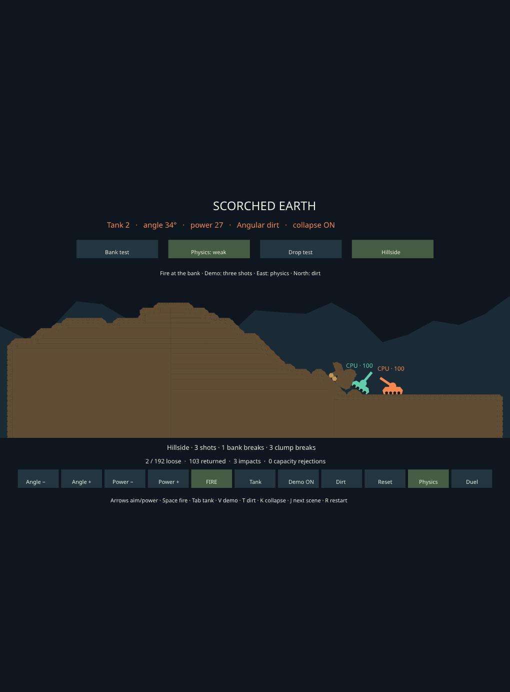

# Compound CCD sweep pruning

The October 8 irregular-bank fixtures exposed a roughly 49 ms simulation tick
on the Picade when the Spacewars quarry fragment landed. Stage profiling found
the cost in continuous collision detection (CCD), rather than cell extraction,
terrain collider rebuilding, cohesion or grain deposition.

In the Angular fixture's tick 49, the original Pi physics step spent about
44.7 ms finding impact times and clamping motion. The desktop version spent
about 7.2 ms there. Ordinary contact detection and constraint solving accounted
for only a small part of the tick. The fragment's compound collider sweeping
against the planet's compound terrain colliders was the expensive case.

## Shared change

Parry 0.29 bounds each node of a compound shape's BVH with a sphere during a
nonlinear sweep. A thin terrain piece can have a large sphere, so geometrically
distant pieces still reach the iterative sphere/shape queries.

[`world/ccd.rs`](../crates/engine-rapier/src/world/ccd.rs) adds a stateless query
dispatcher to the canonical physics world. Before the existing node query, it
rejects pairs of boxes whose complete swept bounds cannot intersect. Possible
contacts retain the original sphere score, traversal ordering, full time
interval, convex-shape query, penetration handling and contact response.
Other query types and all persistent contact manifolds delegate to Parry.
The filter applies to terrain compounds in both games and the terrain lab.

Each swept bound contains the local box at both endpoints plus a conservative
rotational margin. For a point at distance `r` from the rotation center, the
maximum deviation from the chord between its endpoints is bounded by
`r * angle² / 8`, from the linear-interpolation error bound on its second
derivative. `2 * r` also bounds the deviation for any number of full turns.
The smaller of these bounds covers positive/negative rotation, offset centers,
and translation. Additional padding keeps near-touching and rounding-sensitive
candidates. Non-finite bounds fall back to the original query.

This is a candidate-rejection optimization. It changes no terrain geometry,
grain limits, strength, fracture rules, time step, CCD activation, solver
iterations, CCD substep limit, or prescribed planet motion.

Rapier omits query dispatchers from snapshots. The small vendor setter restores
this dispatcher while retaining the saved contact graph and manifold workspaces.
The existing moving-ground velocity correction remains in place. See
[vendor provenance and the complete patch list](../vendor/rapier2d/SPACEWARS_PATCH.md).
The adapted compound traversal retains Parry's Apache-2.0 attribution.

## Profiling

Rapier's existing aggregate CCD timer was unused, and its clamping timer reset
on each substep. The vendor instrumentation now accumulates both first-impact
searches and clamping. `PhysicsStepMetrics` exposes the total, both components
and the actual number of substeps. Counters never enter simulation decisions or
saved state. The quarry runner's `--profile` emits these and the existing shared
stage timings to stderr after each measured tick:

```sh
cargo +1.89.0 run --locked --release -p scenario-spacewars \
  --example destruction_benchmark -- \
  --shape angular --seconds 3 --profile --replay
```

Spans are inclusive; do not add `world_step`, Rapier wall time and CCD time
together. The profiled runs locate costs. Reported performance comparisons use
separate unprofiled runs, with observations, conservation audits and replay
outside the update timer.

## Acceptance

The focused regression compares every bit of the time, witnesses, normals and
status in 4,096 filtered/reference sweeps. Cases include both operand orders,
Round/capsule/thin-box/compound shapes, translating and rotating bodies, offset
centers, nonzero interval starts, existing penetration and separating motion.
A rotation-only impact explicitly lies outside both endpoint boxes. Swept-bound
tests sample intermediate corners across scales, pivots and multiple turns.

Six fixed/moving-ground physics cases compare serialized physical state and
contact events on all 1,080 ticks, with a save/restore halfway through. They
cover a tumbling compound, a fast small ball, both kinematic modes and one/four
CCD substeps. Existing moving-passenger and moving-wall regressions also pass.

The broader acceptance includes the existing barrage and six-scene Spacewars
benchmarks, both grain shapes, Off/Weak/Strong hillside/quarry/curved fixtures,
and hillside seeds 7/91. Before/after runs use the same workload geometry and
inputs. The full measurements and deployment verification are linked below.

## Measurements — 2026-10-08

The target is `sw-picade.local`, a Raspberry Pi 4 Model B Rev 1.4. Six alternating
before/after pairs per shape cover the first three seconds of the Weak quarry;
the first pair is warmup. These are the **medians of five measured maximum
tick times**, in milliseconds:

| Host / grain shape | Before | After | Reduction |
| --- | ---: | ---: | ---: |
| Desktop / Round | 7.64 | 2.65 | 65% |
| Desktop / Angular | 7.87 | 2.92 | 63% |
| Picade / Round | 47.45 | 20.95 | 56% |
| Picade / Angular | 49.25 | 20.45 | 58% |

Across those five Pi runs, maxima ranged from 46.07–48.16 ms before and
18.55–21.51 ms after for Round; Angular ranged from 48.32–51.32 ms before and
20.36–20.74 ms after. The broader matrix also runs each complete 30-second
fixture. Pi mean / p95 / maximum, one run per case:

| Weak workload / shape | Before (ms) | After (ms) |
| --- | --- | --- |
| Hillside / Round | 1.20 / 2.74 / 20.84 | 1.23 / 2.82 / 23.12 |
| Hillside / Angular | 1.27 / 2.51 / 22.38 | 1.28 / 2.60 / 19.85 |
| Quarry / Round | 3.89 / 5.00 / 47.92 | 3.96 / 5.23 / 18.91 |
| Quarry / Angular | 4.37 / 5.39 / 49.68 | 4.30 / 5.40 / 20.40 |
| Curved planet / Round | 6.62 / 10.44 / 22.09 | 6.72 / 10.57 / 21.04 |
| Curved planet / Angular | 7.96 / 11.19 / 23.50 | 7.96 / 11.25 / 23.99 |

Most ticks do other work, so mean cost changes little. Existing 120-second
barrage mean cost is 4.066 → 4.079 ms for Round and 2.123 → 2.143 ms for Angular.
The existing combined-Weak Spacewars match means are 7.919 → 7.902 ms and
7.967 → 8.009 ms. The complete default/combined combat/match results are in the
raw report. Shapes evolve different contact workloads and have no universal
performance ranking.

The kiosk stayed paused throughout headless timing. Device samples read 79.4°C
and 80.3°C at 1.5 GHz; dedicated throttle status was unavailable. Rendering is
excluded. The remaining 19–24 ms fixture peaks still exceed a 16.7 ms frame
budget, so further work is needed for consistent rendered 60 FPS.

All 827 engine/scenario tests pass, including the five new CCD tests. Core and
Scorched strict Clippy pass; Spacewars has the same 17 existing warning
locations. The full matrix has 104 executions and 144 scene results, 48 replayed
scenarios, 72 before/after scene-hash matches across both hosts, and 72
desktop/Pi scene-hash matches. Quarry/curved comparisons also match the physical
motion hashes. The repeated spike runs retain their hashes and the profiled
runs pass replay with profiling disabled on the replay side.

[Raw measurements, source/binary hashes and deployment](data/dirt-collapse-cost-20261008.json) ·
[per-second traces](data/dirt-collapse-cost-traces-20261008.jsonl.gz) ·
[before/after stage profiles](data/dirt-collapse-cost-profiles-20261008.jsonl.gz) ·
[local runtime verification](data/dirt-collapse-cost-local-live-20261008.txt) ·
[Picade runtime verification](data/dirt-collapse-cost-picade-live-20261008.txt).

The rebuilt client/CLI pair is deployed through the normal fast-update path.
Installed hashes match the bundle; the kiosk service is active with no restarts,
and live pause/resume controls respond without a UI error. It is left paused in
its existing Spacewars selection.

The rebuilt local preview is paused in Weak/Angular Hillside before firing.
Its ordinary three-shot sequence still releases the bank, carries the tank
down, chips the fragment and returns dirt to the terrain:


