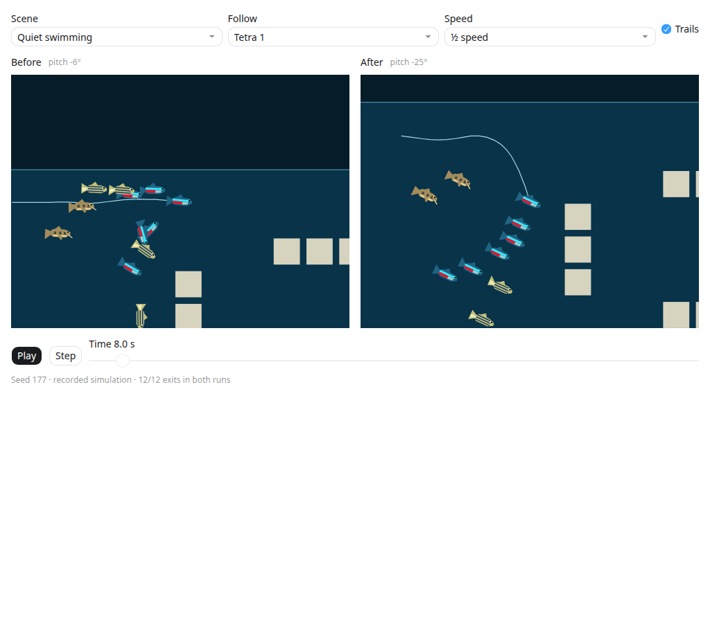

# Aquarium swimming review (#551)

Fish now retain a horizontal facing independently of their nose-up/down pitch.
Pitch eases toward the travel direction with a 25-degree limit. Near-vertical
travel and tiny horizontal currents retain the previous facing; a reversal
narrows the side silhouette over approximately one third of a second, then
opens it facing the other way. The body remains upright, and hovering relaxes
its pitch toward level. Both production renderers consume the same polygons.

Routes look ahead up to twelve grid steps, combining horizontal and vertical
progress where both descend the destination field. Shortcuts check inflated
solid geometry and submerged clearance. The existing velocity smoothing then
rounds transitions between visible route sections. Narrow vertical passages
still permit vertical translation with a bounded body tilt.

Movement retains the four swept substeps and stays within exit-connected grid
cells. This matters: smoothing alone allowed inertia and separation to strand
fish beside narrow glyph gaps. If a fish is outside the conservative route
grid, a bounded local search can steer it back along a clear segment. It does
not teleport the fish. Existing exceptional corrections for changed digits
remain separate.

The six tetras still share a goal, four danios retain their faster bursts, and
two corydoras retain bottom feeding pauses. This first pass changes posture,
turn presentation and route smoothing; a new propulsion/coasting model is not
included.

## Interactive comparison



The review viewer replays sampled production trajectories and postures, using
the fish polygon shapes and transforms. It offers synchronized before/after
playback, scrubbing, 0.25/0.5/1x speed, short trails, individual-fish following
and a whole-aquarium view. Quiet swimming and a scripted player-duck visit use
seed 177, Classic font, 800x480, and the same initial 12:38 reading. Departure
jumps to the gathering phase of the quiet clip.

These are 10 Hz recorded traces interpolated for display, not a second
JavaScript swimming controller. The viewer simplifies the water to its filled
bounds and the duck to its sampled body circle; it is not an application
screenshot or a hardware performance measurement. The controls do not retune
the game. Simulation keeps running at its existing 60 Hz.

Capture the current implementation (use an absolute output path):

```sh
SPACEWARS_FISH_CAPTURE=/absolute/path/after.json \
  cargo test --locked --profile ci -p scenario-clock capture_swimming_review \
  -- --ignored --nocapture
```

The reviewed before/after recordings are retained as compressed JSON. Build
the comparison from this checkout:

```sh
python3 tools/build-fish-swimming-viewer.py \
  docs/data/fish-swimming-before.json.gz docs/data/fish-swimming-after.json.gz \
  /absolute/path/fish-swimming.html
```

The output is a self-contained inline HTML fragment. The builder checks matching
scene metadata and durations, successful physical departures, pose encodings,
and the one-megabyte inline budget. `heading` identifies the original
velocity-aligned rendering; `pitch-facing` identifies the independent posture.
Future comparisons can use `pitch-facing` on both sides. The initial baseline
was captured from `33adab7` with the recording helper added but no swimming
changes. The builder also accepts uncompressed JSON from new captures.

## Checks

Focused posture coverage exercises ascent, descent, reversal and hover jitter.
An open-water fixture checks diagonal lookahead beyond the adjacent cell.
Existing aquarium tests cover all four fonts and three layouts, varied seeds,
both time formats, changed digits, retained courses, duck scattering, physical
exits and conserved water. Same-seed checks include posture and tail phase.
The client capture test exercises the changed fish polygons through both
production render adapters alongside the diving duck.

Local validation: 455 Clock tests passed (six optional captures ignored), the
client raster/vector diving-duck capture passed, and the viewer's playback,
scrubbing, selections, end-of-clip behavior and layout passed at 360, 736 and
1024 pixels in both themes. Formatting and whitespace checks passed. Strict
Clippy remains blocked by existing `needless_range_loop` in `ceiling.rs` and
`collapsible_if` in `events/duck/shared.rs`; device performance was not measured.
