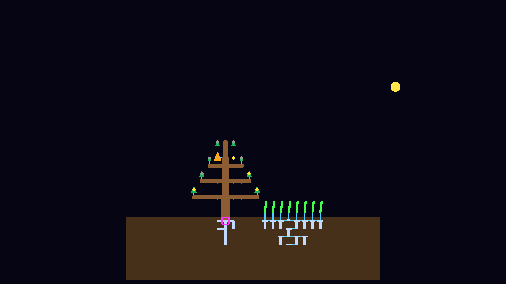
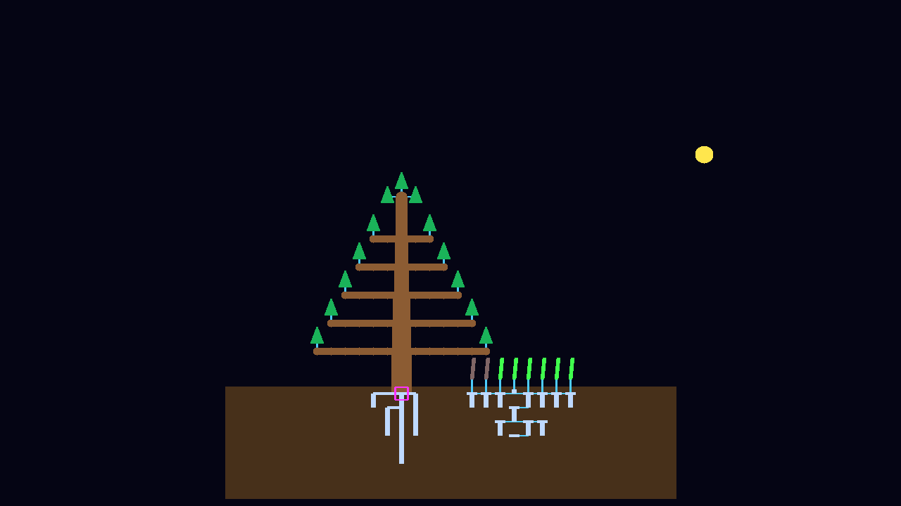
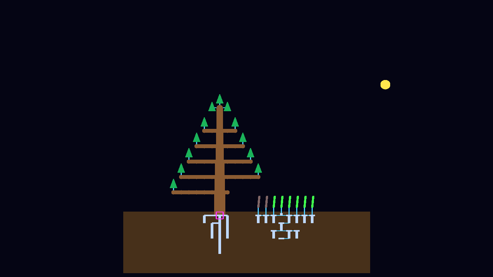
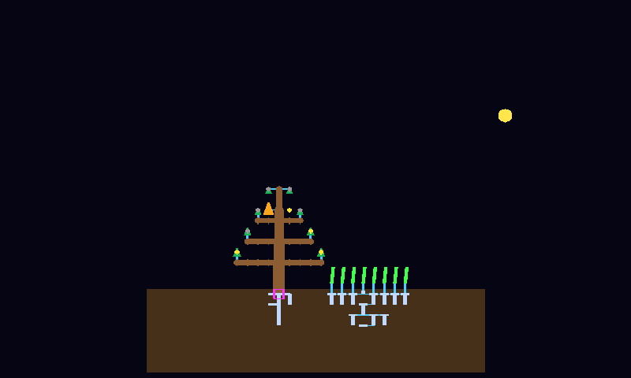
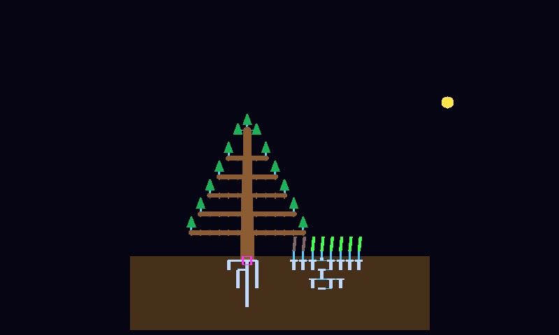
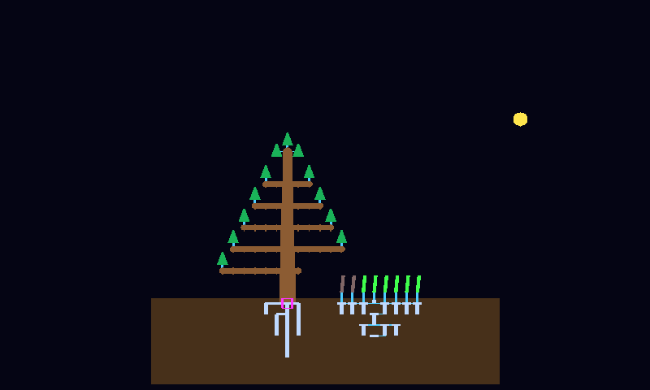

# Garden Lab

Select **Garden Lab** in the ordinary launcher or use `--scenario garden-lab`.
This is the P4 visible grass testbed. It composes shared Plants, grass policy
`0x6772617373000002`, real dirt contact and canonical directional visibility.
No hidden feeding or random spawning is added.

Up/down selects the displayed control; Space or the gamepad bottom button
activates it. Left/right moves the opaque shade. Esc/Start opens host pause;
R or the host Restart action creates a fresh world. The in-scene reset control
also replaces all owned physics, light publication, tissue IDs, reserves,
accumulation and diagnostics with a repeatable finite seed.

The control row supplies pause/resume, single step, faster/slower, light,
independent nutrients and water, shade on/off and movement, underground
inspection, cutting, fresh planting and tissue selection. Light cycles through
full sun (1000), dim room (50), 250 and 500. Soil toggles each availability
between 0 and 1000 independently. Cutting removes actual shoots and their
resource shares; roots/runners survive and must pay for replacement. Full death
cannot recover without deliberate reset/planting.

Living shoots are green, stressed tissue amber, dead tissue grey. Underground
roots/runners are white, connected by cyan lines from the actual topology.
Inspection toggles underground tissue and lines. A pink outline identifies the
selected tissue in the scene; **Inspect next tissue** moves the outline and
its diagnostics together. Underground selections are visible with inspection
enabled. The selected tissue shows
organism/tissue identity, role, health, reserves, exposure, root contact and
accepted/offered intake, maintenance costs and wait reason. Exposure/contact
are the last pre-physiology sample; new tissue has no sample until the next
boundary. Aggregate intake/upkeep/growth and grass plan reason are displayed.

Physiology always advances in 1000 ms ticks with unchanged authoritative
coefficients. Viewing defaults to 1x, adjustable from 1x to 16x. Fractional
nanoseconds carry between host updates. Lab pause freezes accumulated time;
step runs exactly one tick while paused. Host pause does not call scenario
updates. At most eight ticks run per update; excess elapsed time is discarded
and reported rather than charging a partial or enlarged tick. A run stops
aging at 480 ticks. Reset starts another bounded run.

Fixtures use seed 42, origin [8,3], 16x8 cells, dirt at y<=3, initial reserves
[30,30,30], radius four, at most 32 tissues and one growth proposal per tick.
Roots/runners establish multiple shoots by simulation second nine (nine wall
seconds at default speed with no dropped time). This is a viewing configuration,
not a biological realism or device performance claim. Each light publication is
bounded by 256 rays, 65,536 footprint tests and 524,288 collider records; actual
last-tick counts appear in the scene and deterministic fixture output.

The `garden_lab_contract` tests cover replay/topology/accounting, paired
sun/dim and isolated supplies, connected shade death/recovery, paid regrowth
and permanent death, pause/step/reset/equal-time playback/work bounds, and exact rendered-workflow
milestones.
The `garden_lab::` functional selection drives real launcher, gameplay input,
pause, restart and return in vector and raster modes, retaining growth,
connectivity, shade failure, cutting/regrowth and dim/shortage captures. Image
review and complete host verification are required before acceptance; writing
a fixture or capturing an image does not itself establish a passing workflow.

Tissue, connection and shade silhouettes are filled world-space polygons. The
shared rendering contract measures stroke widths in pixels; using subpixel
widths for these silhouettes made the first host capture effectively invisible.
Filled geometry projects its thickness in both renderers without changing the
physiology or weakening the green-pixel visibility assertion.

The existing `status` endpoint includes a `garden_lab=` JSON line with the last
published state, including tissue identities, connections, reserves, health,
resource ledger and control settings. Like other host diagnostics, publication
may lag by a performance sampling interval. The functional test waits for the
expected state, and runs exact tick milestones while lab-paused. Each retained
PNG is accompanied by a JSON state record and the controller history.

The rendered workflow asserts frozen pause accounting and one-tick stepping,
multiple shoots and runners with visible underground connections at second 10,
connected sunlit/shaded tissue at second 14, recovery at second 18, and local
shade death at second 30. It also checks shade movement/removal, hides actual
connections when inspection is off, and verifies cutting preserves survivor
identity and pays for new shoots at second 11 with a conserved resource ledger.
Separate dim, nutrient-only and water-only fixtures assert unmet costs and
health loss at second 10 and full death at second 40. Speed changes and host
restart/return have state assertions. The full UI selection covers both raster
and vector modes; no screenshot substitutes for a state assertion.

A window-free client regression named `garden_render_contract` also exports
production raster PNGs and vector-adapter SVGs at 1280x720 and 800x480 when
`SPACEWARS_GARDEN_RENDER_ARTIFACTS` is set. These inspectable geometry previews
do not include the window/text overlay and do not replace real UI captures.

Playback contracts compare complete plant state/accounting, grass plan, exposure
and work diagnostics, fractional phase, light publication tags/counters, host
controls and canonical physics snapshots at equal simulated duration. They
exercise 999,999,999ns + 1ns crossing a tick, 60 × 16,666,667ns retaining 20ns,
zero elapsed time, and a 4x→8x change with 500,000,012ns already pending.
Reset tests first modify light, soil supplies, shade position, inspection,
selection, speed, pause and pending time, then require fresh defaults, no stale
light/exposure diagnostics, restored physics and a repeatable subsequent tick.

The UI workflow retains a Garden Lab launcher capture in each renderer's run.
It also selects the next tissue while paused, compares the selected diagnostic
record to that tissue's identity/health/stores, and asserts the pink marker's
pixels lie at that tissue's projected cell before retaining its PNG/JSON pair.

## Live growth limits

The last four controls raise/lower the tissue ceiling (1–128, one tissue per
activation) and spread radius (0–8, one cell per activation). Defaults remain
32 tissues and radius four. Changes edit the existing policy in place, including
while paused: they preserve biological state, IDs, connections, stores, health,
ledgers, elapsed time and fractional playback phase. Lowering below the current
patch retains every tissue and blocks new expansion until eligible. Explicit
fresh planting and host restart restore defaults.

Spread uses Chebyshev distance from the original seed: both cell-coordinate
axis differences must be at most the radius. Cells are one world unit. This
square bound is further restricted by the finite 16×8 habitat, solid dirt for
roots/runners, empty shoot space, valid support and occupied sites. Routine
limits are below the policy's 256-tissue/128-cell ceilings and the runtime's
256-tissue ceiling. Radius eight covers the finite lab width from seed [8,3];
128 tissues is no larger than its total cell count. Lighting retains its
256-ray/65,536-footprint/524,288-collider budgets, candidate work remains at most
four sites per tissue, and only one growth intent is proposed per tick.

Current explanations summarize only the checks actually reached, in their
original candidate order, with duplicate reasons collapsed. Each candidate
records its first refusal; masked later checks are not proven blockers. A
proposal ends enumeration early and still requires runtime admission. Missing
nutrients, water and energy refer to component reserves at planning time; full
soil/light settings do not guarantee affordability. Runtime admission is shown
separately with its ledger tick because intake and upkeep precede final growth
spending. Idle tissue still pays maintenance. No eligible candidates is not a
resource or tissue-cap diagnosis. Current explanations are recomputed without
advancing physiology. Growth limits, lab PAUSED, host pause and the COMPLETE
480-second run are distinct; raising limits never extends a completed run.

## Paid maturation profile v2

Actual soil/contact and directional-light fixtures with seed 42 first produce a
small shoot at second 1 and three living size-three blades at second **186**.
They reach eight mature blades before cutting at second 240. Cutting preserves
24 underground tissue identities and removes blade resource shares without
refunding their investment. Small, newly constructed replacements appear at
second **241**; the first three mature at **403**, with eight mature survivors
through the bounded second-480 stop. Every healthy fixture tick requires full
health, checks conservation and enforces a single proposed growth operation.

The named profile retains root size 2, runner size 1, initial blade size 1 and
finite seed stores [30,30,30]. Root uptake is [8,8,0] resource units per size per
second. Construction costs per size remain root [3,3,3], runner [2,2,2], blade
[4,4,4]. Development pays at most [1,1,1] each admitted second toward [10,10,10]
per size increment: two increments cost [20,20,20] per mature blade. Selection
is by least lifetime investment then ID, after provisioning new root/shoot/runner
sites; no elapsed-age timer earns growth. Canonical upkeep and photosynthesis
rates are unchanged. These coefficients are abstract resource units, not
biological measurements.

The healthy connected patch contains 12 size-two roots, 12 size-one runners
and 8 size-three blades. Its mature offered intake is [192,192,192] per second,
and actual paid upkeep is [60,84,84]. At size one, the same blade population
produces only 64 energy per second and pays [44,52,52] total upkeep. Immediately
after cutting, underground upkeep is [36,36,36] and energy intake is zero; stored
energy must pay upkeep and fresh blade construction until photosynthesis resumes.
Added capacity creates no reserves. The 480-second fixture spends [474,474,474]
on construction plus development, with per-tick and cumulative resource
reconciliation including overflow and simultaneous cut losses.

Both production renderer paths use the same filled blade geometry. Length grows
with authoritative size and paid progress. The selected diagnostic displays size,
paid balance, increment target, lifetime investment and next payment. Exported
state includes these fields, complete config/profile/seed and actual admission
outcomes. Playback contracts compare full biology at 1x, 4x and 16x through a
240-second cut and the 480-second stop; fractional phase and catch-up tests remain.

The real UI workflow now requests emergence, intermediate development,
establishment, pre/post-cut, small replacement and mature-regrowth PNG/state pairs
in both renderers, in addition to shortage/recovery and control histories.
Window-free render exports include a corresponding milestone sequence and matching
state records, explicitly labeled preview-only. They do not establish real UI
acceptance. This worker's Xvfb attempt failed creating `/tmp/.tX100-lock` under
the restricted sandbox; launcher host verification and inspection of real UI
sequences remain required.

The retained deterministic run reconciles initial [30,30,30] plus offered intake
[89216,89216,56192] against final stores [1020,996,996], paid upkeep
[23732,30756,30756], construction/development [474,474,474] and recorded losses
[64020,57020,23996]. Losses include discarded capacity overflow as well as cuts;
o offered intake is silently omitted from this equation.

## Moss on dirt and a movable rock

Five controls follow the grass controls, so existing control positions are
unchanged; Light now also cycles to dark (0) after 500.

| Control | Effect |
| --- | --- |
| Place moss on dirt and rock | Deliberately places one moss cell with `[24,24,24]` reserves at bed cell [1,4], at the left end of the soil surface outside the grass spread, if no bed patch exists. If no rock stands, inserts a free-standing rock body and places a patch on its rounded top face. Repeating changes nothing; it never revives or tops up moss. |
| Turn rock 90 degrees | Turns the rock about its frame origin. Its moss keeps its support-local cells, contact and reserves; only its light changes. |
| Break rock edge | Removes the rock's right column, refreshes and synchronizes the body, then detaches moss that lost its surface and discards its shares. Exposed rock is ordinary surface for paid regrowth. |
| Remove rock | Removes the rock body and detaches its whole patch. Placing moss again inserts a new body incarnation and a new organism. |
| Scrape moss strip | Removes moss in bed column 2 and rock column 3, with their shares. Remnants may pay to grow back. |

The rock is a separate support with its own runtime, light publisher and light
namespace, because the runtime's occupancy and space checks carry no support.
Each boundary ticks the bed (grass and dirt moss together) and then the rock;
each publication receives the other support's opaque tissue as `WorldOccluders`.
Moss declares no disks, so today this matters only for grass shoots. Grass-only
runs publish exactly as before.

Moss draws as low olive domes resting on the surface it touches, oriented by
the actual solid neighbors, and turning with the rock. Stressed and dead moss
share the amber and grey colors; the rock is slate. With inspection enabled,
moss links run through the middle of its domes. Selection walks bed tissue,
then standing rock tissue. Selected moss shows its last light sample, surface
contact flag, current contact reason and offered/accepted surface supply. A
moss line summarizes both patches and their current plan; once moss is placed,
the grass line labels its intake, upkeep and growth as the shared bed ledger.
The `status`
`garden_lab=` record adds the same moss fields to moss tissue entries and a
`moss` object with the bed plan and the rock's pose, turns, break/removal state,
tissue (with world points), ledger, plan and light work.

`garden_lab_contract_moss` covers deliberate placement that leaves the grass
patch and its 32-tissue limit unchanged; dim-room growth on dirt and rock while
the same light kills the grass, then total death in darkness; the nutrient and
water toggles each cutting only that surface supply on both supports; the rock turned
upside down, with the old top face measured at zero light and dying back while
other moss lives; breakage, removal and a fresh placement on a new body; scraping
with exact shares lost and only new, paid tissue refilling the strips; and replay,
reset and equal-time playback at 1x, 4x and 16x with the rock. In those fixtures
a patch placed at second 0 under the dim room has 8 living dirt cells and 17 of
17 rock cells alive at second 200. The window-free `garden_render_contract_moss_*`
check exports labelled preview-only PNG/SVG frames when
`SPACEWARS_GARDEN_RENDER_ARTIFACTS` is set.

The full-only functional case
`garden_lab_moss_surfaces_light_motion_and_support_loss_in_both_renderers` drives
the real launcher in vector and raster modes: placement, a 90-second dim run,
the rock turned over and stepped once, then until the inverted face has died
beside living moss while the dim room has killed the grass, breakage, removal and
a scraped strip regrown by new tissue, retaining a PNG/JSON pair at each stage. Rock pixel checks
count only the rock's own screen region, because anti-aliased HUD text produces
the same slate grey. It took 258 seconds under local Xvfb; there is no hosted
runner measurement yet.

## Tree bed (#743)

The last control, **Tree bed: a conifer beside grass**, shows a second bed, in
which the hand-written conifer from [Plants](plants.md#tree-743) grows beside a
grass patch. The lab shows one bed at a time. Each bed keeps its own world,
plants, clock, control cursor and settings, and only the bed shown runs, so
the grass bed, its control positions and its tests are unchanged. **Back to
grass bed** returns to it, and showing the tree bed again finds it as it was,
even after the grass bed's reset. The host's restart starts the whole lab
again, on its grass bed.

The bed is 32 cells wide and 26 tall, with dirt up to row 7: eight rows of dirt
where the grass bed has four, and air for a tree 14 cells tall. The tree's seed
is at [12,7] and the grass's at [20,7], each with its finite reserves, under
the grass physiology and the grass bed's grass traits. Light falls straight
down at the chosen intensity; the sun drawn in the corner only marks it. At
each boundary the bed measures light at every blade and needle and at up to
64 cells the tree asks about, and the runtime admits the tree's winning bids
and the grass's plan together.

Playback starts at 16x and goes from 1x to 64x, with the grass bed's 1000 ms
ticks, catch-up limit and fractional carry. A run stops aging at 1200 ticks.

| Control | Effect |
| --- | --- |
| Pause / resume, single step, faster, slower | As in the grass bed, from 1x to 64x. |
| Light | Cycles full sun (1000), dim room (50), 250, 500 and dark (0). |
| Nutrients, water | Each toggles its soil supply between 1000 and 0. |
| Shade, shade left, shade right | A bar high above the bed, first over the grass's seed. Left and right also move it. |
| Underground inspection | Shows or hides roots and the links between tissues. |
| Inspect next tissue | Moves the pink selection through the bed's tissue in ID order. |
| Bids on/off | Shows or hides each point's last bid. |
| Cut a branch | Cuts the selected wood and everything beyond it, if it is off the trunk; otherwise the lowest branch, on the grass's side first. The cut tissue's shares are lost. |
| Plant fresh tree and grass | Replaces the bed with a fresh one, with the default settings. |
| Back to grass bed | Shows the grass bed. |

Wood is brown, drawn from its parent with a width that grows with the square
root of its size, so the trunk tapers. Needles are green triangles that
lengthen as they mature. Blades, runners and roots draw as in the grass bed,
and stressed and dead tissue share its amber and grey. With bids shown, each
point that bid anything but a wait carries a dot: yellow when its bid won, red
when the world refused it, and grey when higher bids spent the decision's
budget first. A winning growth bid also draws a yellow line to the cell it
grows into. The text lists the tree (its living wood, needles and roots, dead
tissue, height, depth, cuts, and energy intake and upkeep), the grass, the
last decision's bids by outcome with refusals by reason, the light work and
probes, and the selected tissue. A selected point of the tree also shows its
kind, its place in the tree's frame, its bid, priority and outcome, and the
readings it has: light for a needle, and for wood what it carries and the
headroom back to the seed.

The `garden_lab=` status record adds `view` (`grass` or `tree`) and a
`tree_bed` object, null until the bed is first shown. It holds the bed's clock
and settings, the three summaries, its ledger, light work and probe count, and
every tissue; the tree's tissue entries add the point's kind, bid, priority and
outcome.

With seed 42 in full sun, the conifer stands 14 cells tall at tick 600, with
branch tiers reaching 6, 5, 4, 3 and 2 cells to each side, 13 needles and 16
roots down to depth 5. It takes in 312 energy a tick and pays 213 in upkeep.
The grass fills its 32 tissues; its two blades under the lowest tier have died
in the tree's shade, and the six beyond it live. Cut at tick 600, the lowest
branch on the grass's side grows back only as a one-cell stub under the tiers
above, which the tree keeps. A top branch, in the light, grows back to its
full two cells within 200 ticks.

| | Growing, with its bids | Grown, over dead grass | The lowest branch cut | Its stub, 200 ticks on |
| --- | --- | --- | --- | --- |
| 1280×720 |  |  |  |  |
| 800×480 |  |  |  |  |

At tick 200 the tree is 10 cells tall with three tiers; that tick, four of its
points' bids won and five were outbid. At tick 600 its cone is complete, and the
two blades under its lowest tier are grey. Cut, the lowest right branch goes
with its needle, and by tick 800 a one-cell stub stands in its place. The
pictures come from the window-free renderer, without the text.
`SPACEWARS_GARDEN_RENDER_ARTIFACTS=<dir> cargo test --locked --profile ci -p
engine-client garden_render_contract_tree_bed` regenerates all eight.

`tree_bed_contract` covers that growth with an exact replay; light and shade
reaching the blades beneath; showing the bed from the grass controls with its
own cursor, clock and settings while the grass bed waits, the 64x limit, pause,
step and the 1200-tick stop; both cuts; and fresh planting. The window-free
`garden_render_contract_tree_bed_draws_wood_needles_bids_and_grass` counts
wood, needle, blade and winning-bid pixels at 1280x720 and 800x480, checks
that hidden bids draw nothing and that a cut removes wood and needles from the
picture, and exports preview-only PNG, SVG and state files when
`SPACEWARS_GARDEN_RENDER_ARTIFACTS` is set.

The full-only functional case
`garden_lab_tree_bed_grows_cuts_and_returns_in_both_renderers` drives the real
launcher in vector and raster modes. It shows the tree bed from the grass
controls, runs it at 64x, checks every tree point's bid in the status, the
grown cone and the dead grass beneath it, cuts the lowest branch and returns to
the grass bed, retaining a PNG/JSON pair at each stage. It took 56 seconds
under local Xvfb.
