# Garden Lab

Select **Garden Lab** in the ordinary launcher or use `--scenario garden-lab`.
This is the P4 visible grass testbed. It composes shared Plants, grass policy
`0x6772617373000002`, real dirt contact and canonical directional visibility.
No hidden feeding or random spawning is added.

Up/down selects the displayed control; Space or the gamepad bottom button
activates it. Left/right moves the opaque shade. Esc/Start opens host pause;
R or the host Restart action creates a fresh world. The in-scene reset control
also replaces all owned physics, light publication, tissue IDs, reserves,
accumulation and diagnostics with a repeatable finite seed.

The control row supplies pause/resume, single step, faster/slower, light,
independent nutrients and water, shade on/off and movement, underground
inspection, cutting, fresh planting and tissue selection. Light cycles through
full sun (1000), dim room (50), 250 and 500. Soil toggles each availability
between 0 and 1000 independently. Cutting removes actual shoots and their
resource shares; roots/runners survive and must pay for replacement. Full death
cannot recover without deliberate reset/planting.

Living shoots are green, stressed tissue amber, dead tissue grey. Underground
roots/runners are white, connected by cyan lines from the actual topology.
Inspection toggles underground tissue and lines. A pink outline identifies the
selected tissue in the scene; **Inspect next tissue** moves the outline and
its diagnostics together. Underground selections are visible with inspection
enabled. The selected tissue shows
organism/tissue identity, role, health, reserves, exposure, root contact and
accepted/offered intake, maintenance costs and wait reason. Exposure/contact
are the last pre-physiology sample; new tissue has no sample until the next
boundary. Aggregate intake/upkeep/growth and grass plan reason are displayed.

Physiology always advances in 1000 ms ticks with unchanged authoritative
coefficients. Viewing defaults to 1x, adjustable from 1x to 16x. Fractional
nanoseconds carry between host updates. Lab pause freezes accumulated time;
step runs exactly one tick while paused. Host pause does not call scenario
updates. At most eight ticks run per update; excess elapsed time is discarded
and reported rather than charging a partial or enlarged tick. A run stops
aging at 480 ticks. Reset starts another bounded run.

Fixtures use seed 42, origin [8,3], 16x8 cells, dirt at y<=3, initial reserves
[30,30,30], radius four, at most 32 tissues and one growth proposal per tick.
Roots/runners establish multiple shoots by simulation second nine (nine wall
seconds at default speed with no dropped time). This is a viewing configuration,
not a biological realism or device performance claim. Each light publication is
bounded by 256 rays, 65,536 footprint tests and 524,288 collider records; actual
last-tick counts appear in the scene and deterministic fixture output.

The `garden_lab_contract` tests cover replay/topology/accounting, paired
sun/dim and isolated supplies, connected shade death/recovery, paid regrowth
and permanent death, pause/step/reset/equal-time playback/work bounds, and exact rendered-workflow
milestones.
The `garden_lab::` functional selection drives real launcher, gameplay input,
pause, restart and return in vector and raster modes, retaining growth,
connectivity, shade failure, cutting/regrowth and dim/shortage captures. Image
review and complete host verification are required before acceptance; writing
a fixture or capturing an image does not itself establish a passing workflow.

Tissue, connection and shade silhouettes are filled world-space polygons. The
shared rendering contract measures stroke widths in pixels; using subpixel
widths for these silhouettes made the first host capture effectively invisible.
Filled geometry projects its thickness in both renderers without changing the
physiology or weakening the green-pixel visibility assertion.

The existing `status` endpoint includes a `garden_lab=` JSON line with the last
published state, including tissue identities, connections, reserves, health,
resource ledger and control settings. Like other host diagnostics, publication
may lag by a performance sampling interval. The functional test waits for the
expected state, and runs exact tick milestones while lab-paused. Each retained
PNG is accompanied by a JSON state record and the controller history.

The rendered workflow asserts frozen pause accounting and one-tick stepping,
multiple shoots and runners with visible underground connections at second 10,
connected sunlit/shaded tissue at second 14, recovery at second 18, and local
shade death at second 30. It also checks shade movement/removal, hides actual
connections when inspection is off, and verifies cutting preserves survivor
identity and pays for new shoots at second 11 with a conserved resource ledger.
Separate dim, nutrient-only and water-only fixtures assert unmet costs and
health loss at second 10 and full death at second 40. Speed changes and host
restart/return have state assertions. The full UI selection covers both raster
and vector modes; no screenshot substitutes for a state assertion.

A window-free client regression named `garden_render_contract` also exports
production raster PNGs and vector-adapter SVGs at 1280x720 and 800x480 when
`SPACEWARS_GARDEN_RENDER_ARTIFACTS` is set. These inspectable geometry previews
do not include the window/text overlay and do not replace real UI captures.

Playback contracts compare complete plant state/accounting, grass plan, exposure
and work diagnostics, fractional phase, light publication tags/counters, host
controls and canonical physics snapshots at equal simulated duration. They
exercise 999,999,999ns + 1ns crossing a tick, 60 × 16,666,667ns retaining 20ns,
zero elapsed time, and a 4x→8x change with 500,000,012ns already pending.
Reset tests first modify light, soil supplies, shade position, inspection,
selection, speed, pause and pending time, then require fresh defaults, no stale
light/exposure diagnostics, restored physics and a repeatable subsequent tick.

The UI workflow retains a Garden Lab launcher capture in each renderer's run.
It also selects the next tissue while paused, compares the selected diagnostic
record to that tissue's identity/health/stores, and asserts the pink marker's
pixels lie at that tissue's projected cell before retaining its PNG/JSON pair.

## Live growth limits

The last four controls raise/lower the tissue ceiling (1–128, one tissue per
activation) and spread radius (0–8, one cell per activation). Defaults remain
32 tissues and radius four. Changes edit the existing policy in place, including
while paused: they preserve biological state, IDs, connections, stores, health,
ledgers, elapsed time and fractional playback phase. Lowering below the current
patch retains every tissue and blocks new expansion until eligible. Explicit
fresh planting and host restart restore defaults.

Spread uses Chebyshev distance from the original seed: both cell-coordinate
axis differences must be at most the radius. Cells are one world unit. This
square bound is further restricted by the finite 16×8 habitat, solid dirt for
roots/runners, empty shoot space, valid support and occupied sites. Routine
limits are below the policy's 256-tissue/128-cell ceilings and the runtime's
256-tissue ceiling. Radius eight covers the finite lab width from seed [8,3];
128 tissues is no larger than its total cell count. Lighting retains its
256-ray/65,536-footprint/524,288-collider budgets, candidate work remains at most
four sites per tissue, and only one growth intent is proposed per tick.

Current explanations summarize only the checks actually reached, in their
original candidate order, with duplicate reasons collapsed. Each candidate
records its first refusal; masked later checks are not proven blockers. A
proposal ends enumeration early and still requires runtime admission. Missing
nutrients, water and energy refer to component reserves at planning time; full
soil/light settings do not guarantee affordability. Runtime admission is shown
separately with its ledger tick because intake and upkeep precede final growth
spending. Idle tissue still pays maintenance. No eligible candidates is not a
resource or tissue-cap diagnosis. Current explanations are recomputed without
advancing physiology. Growth limits, lab PAUSED, host pause and the COMPLETE
480-second run are distinct; raising limits never extends a completed run.

## Paid maturation profile v2

Actual soil/contact and directional-light fixtures with seed 42 first produce a
small shoot at second 1 and three living size-three blades at second **186**.
They reach eight mature blades before cutting at second 240. Cutting preserves
24 underground tissue identities and removes blade resource shares without
refunding their investment. Small, newly constructed replacements appear at
second **241**; the first three mature at **403**, with eight mature survivors
through the bounded second-480 stop. Every healthy fixture tick requires full
health, checks conservation and enforces a single proposed growth operation.

The named profile retains root size 2, runner size 1, initial blade size 1 and
finite seed stores [30,30,30]. Root uptake is [8,8,0] resource units per size per
second. Construction costs per size remain root [3,3,3], runner [2,2,2], blade
[4,4,4]. Development pays at most [1,1,1] each admitted second toward [10,10,10]
per size increment: two increments cost [20,20,20] per mature blade. Selection
is by least lifetime investment then ID, after provisioning new root/shoot/runner
sites; no elapsed-age timer earns growth. Canonical upkeep and photosynthesis
rates are unchanged. These coefficients are abstract resource units, not
biological measurements.

The healthy connected patch contains 12 size-two roots, 12 size-one runners
and 8 size-three blades. Its mature offered intake is [192,192,192] per second,
and actual paid upkeep is [60,84,84]. At size one, the same blade population
produces only 64 energy per second and pays [44,52,52] total upkeep. Immediately
after cutting, underground upkeep is [36,36,36] and energy intake is zero; stored
energy must pay upkeep and fresh blade construction until photosynthesis resumes.
Added capacity creates no reserves. The 480-second fixture spends [474,474,474]
on construction plus development, with per-tick and cumulative resource
reconciliation including overflow and simultaneous cut losses.

Both production renderer paths use the same filled blade geometry. Length grows
with authoritative size and paid progress. The selected diagnostic displays size,
paid balance, increment target, lifetime investment and next payment. Exported
state includes these fields, complete config/profile/seed and actual admission
outcomes. Playback contracts compare full biology at 1x, 4x and 16x through a
240-second cut and the 480-second stop; fractional phase and catch-up tests remain.

The real UI workflow now requests emergence, intermediate development,
establishment, pre/post-cut, small replacement and mature-regrowth PNG/state pairs
in both renderers, in addition to shortage/recovery and control histories.
Window-free render exports include a corresponding milestone sequence and matching
state records, explicitly labeled preview-only. They do not establish real UI
acceptance. This worker's Xvfb attempt failed creating `/tmp/.tX100-lock` under
the restricted sandbox; launcher host verification and inspection of real UI
sequences remain required.

The retained deterministic run reconciles initial [30,30,30] plus offered intake
[89216,89216,56192] against final stores [1020,996,996], paid upkeep
[23732,30756,30756], construction/development [474,474,474] and recorded losses
[64020,57020,23996]. Losses include discarded capacity overflow as well as cuts;
o offered intake is silently omitted from this equation.

## Moss on dirt and a movable rock

Five controls follow the grass controls, so existing control positions are
unchanged; Light now also cycles to dark (0) after 500.

| Control | Effect |
| --- | --- |
| Place moss on dirt and rock | Deliberately places one moss cell with `[24,24,24]` reserves at bed cell [1,4], at the left end of the soil surface outside the grass spread, if no bed patch exists. If no rock stands, inserts a free-standing rock body and places a patch on its rounded top face. Repeating changes nothing; it never revives or tops up moss. |
| Turn rock 90 degrees | Turns the rock about its frame origin. Its moss keeps its support-local cells, contact and reserves; only its light changes. |
| Break rock edge | Removes the rock's right column, refreshes and synchronizes the body, then detaches moss that lost its surface and discards its shares. Exposed rock is ordinary surface for paid regrowth. |
| Remove rock | Removes the rock body and detaches its whole patch. Placing moss again inserts a new body incarnation and a new organism. |
| Scrape moss strip | Removes moss in bed column 2 and rock column 3, with their shares. Remnants may pay to grow back. |

The rock is a separate support with its own runtime, light publisher and light
namespace, because the runtime's occupancy and space checks carry no support.
Each boundary ticks the bed (grass and dirt moss together) and then the rock;
each publication receives the other support's opaque tissue as `WorldOccluders`.
Moss declares no disks, so today this matters only for grass shoots. Grass-only
runs publish exactly as before.

Moss draws as low olive domes resting on the surface it touches, oriented by
the actual solid neighbors, and turning with the rock. Stressed and dead moss
share the amber and grey colors; the rock is slate. With inspection enabled,
moss links run through the middle of its domes. Selection walks bed tissue,
then standing rock tissue. Selected moss shows its last light sample, surface
contact flag, current contact reason and offered/accepted surface supply. A
moss line summarizes both patches and their current plan; once moss is placed,
the grass line labels its intake, upkeep and growth as the shared bed ledger.
The `status`
`garden_lab=` record adds the same moss fields to moss tissue entries and a
`moss` object with the bed plan and the rock's pose, turns, break/removal state,
tissue (with world points), ledger, plan and light work.

`garden_lab_contract_moss` covers deliberate placement that leaves the grass
patch and its 32-tissue limit unchanged; dim-room growth on dirt and rock while
the same light kills the grass, then total death in darkness; the nutrient and
water toggles each cutting only that surface supply on both supports; the rock turned
upside down, with the old top face measured at zero light and dying back while
other moss lives; breakage, removal and a fresh placement on a new body; scraping
with exact shares lost and only new, paid tissue refilling the strips; and replay,
reset and equal-time playback at 1x, 4x and 16x with the rock. In those fixtures
a patch placed at second 0 under the dim room has 8 living dirt cells and 17 of
17 rock cells alive at second 200. The window-free `garden_render_contract_moss_*`
check exports labelled preview-only PNG/SVG frames when
`SPACEWARS_GARDEN_RENDER_ARTIFACTS` is set.

The full-only functional case
`garden_lab_moss_surfaces_light_motion_and_support_loss_in_both_renderers` drives
the real launcher in vector and raster modes: placement, a 90-second dim run,
the rock turned over and stepped once, then until the inverted face has died
beside living moss while the dim room has killed the grass, breakage, removal and
a scraped strip regrown by new tissue, retaining a PNG/JSON pair at each stage. Rock pixel checks
count only the rock's own screen region, because anti-aliased HUD text produces
the same slate grey. It took 258 seconds under local Xvfb; there is no hosted
runner measurement yet.

## Tree bed (#743)

The last control, **Tree bed: a conifer beside grass**, shows a second bed, in
which the hand-written conifer from [Plants](plants.md#tree-743) grows beside a
grass patch. Grown, it drops seeds that sprout into trees of their own where
they land in the open (#760). The lab shows one bed at a time. Each bed keeps its own world,
plants, clock, control cursor and settings, and only the bed shown runs, so
the grass bed, its control positions and its tests are unchanged. **Back to
grass bed** returns to it, and showing the tree bed again finds it as it was,
even after the grass bed's reset. The host's restart starts the whole lab
again, on its grass bed.

The bed is 32 cells wide and 26 tall, with dirt up to row 7: eight rows of dirt
where the grass bed has four, and air for a tree 14 cells tall. The tree's seed
is at [12,7] and the grass's at [20,7], each with its finite reserves, under
the grass physiology and the grass bed's grass traits. The sun shines at the
chosen intensity from 15 degrees off vertical on the left, so the tree's
shadow falls toward the grass, and is drawn up that direction from the tree's
seed. The tree's wood lets three quarters of the light crossing it through and
its needles three fifths ([Plants](plants.md#tree-743)), so the crown shades
what lies under it without darkening it; blades stay opaque. At each boundary
the bed measures light at every blade and needle and at up to 64 cells the
trees ask about, and the runtime admits the trees' winning bids and the
grass's plan together, up to 32 intents a tick; the grass plans first, and the
trees share what it leaves. After the tick, the bed's
[grove](plants.md#seeds-and-the-grove-760) takes in each seed that landed as a
tree and clears away each tree that has died. The bed holds at most 256
tissues, as many as its light measures, and once it is full a seed that lands
cannot sprout until something is cleared.

Playback starts at 16x and goes from 1x to 64x, with the grass bed's 1000 ms
ticks, catch-up limit and fractional carry. A run stops aging at 2000 ticks.

| Control | Effect |
| --- | --- |
| Pause / resume, single step, faster, slower | As in the grass bed, from 1x to 64x. While the wood is physical, a single step moves its bodies a sixtieth of a second instead of growing a tick. |
| Light | Cycles full sun (1000), dim room (50), 250, 500 and dark (0). |
| Sun | Cycles the sun 15 degrees from the left, overhead, and 15 degrees from the right. |
| Nutrients, water | Each toggles its soil supply between 1000 and 0. |
| Shade, shade left, shade right | A bar high above the bed, first over the grass's seed. Left and right also move it. |
| Underground inspection | Shows or hides roots and the links between tissues. |
| Inspect next tissue | Moves the pink selection through the bed's tissue in ID order. |
| Bids on/off | Shows or hides each point's last bid. |
| Cut a branch or root | Cuts the selected wood and everything beyond it, if it is off its tree's trunk, or the selected root of a tree and every root that grew from it, unless it is the tree's seed; otherwise the planted tree's lowest branch, on the grass's side first. The cut tissue's shares are lost. Physical wood falls where it was cut, and a cut root no longer holds its tree. |
| Physical wood on/off | Hangs the trees' wood on hinges under gravity while they grow; off, the living wood leaves the world and the trees grow on as their cells stand. See [Physical wood](#physical-wood-224). |
| Light snow, heavy snow | Lays snow on the selected wood, else the tip of the planted tree's lowest branch, on the grass's side first, making the wood physical; the same control again clears it. |
| Wind | Cycles calm, a breeze and a gale that blow toward the grass, making the wood physical. See [Roots that hold](#roots-that-hold-225). |
| Plant a tree seed in the grass | Lifts the grass from column 22, two cells right of the grass's seed, with its shares, and plants a tree seed in its top cell of dirt. Nothing happens if a tree holds that cell or the one above it. |
| Plant fresh tree and grass | Replaces every plant with fresh seeds of the tree and grass, under the same settings. |
| Back to grass bed | Shows the grass bed. |

Wood is brown, drawn from its parent with a width that grows with the square
root of its size, so the trunk tapers. A needle cell is a spray of five thin
green needles from the wood it grows on, leaning away from the trunk, which
lengthen as it matures; the one on top of the leader stands upright. A cone
is a rust oval hanging from the branch tip above it, longer as it ripens. A
seed that has not sprouted is a tan oval lying on the soil, drawn whether or
not the bed shows what is underground. Blades, runners and roots draw as in
the grass bed, and stressed and dead tissue share its amber and grey. With bids shown, each
point that bid anything but a wait carries a dot: yellow when its bid won, red
when the world refused it, and grey when higher bids spent the decision's
budget first. A winning growth bid also draws a yellow line to the cell it
grows into. The text lists the planted tree (its living wood, needles, cones
and roots, dead tissue, height, depth, cuts, and energy intake and upkeep);
the grove (its trees, its unsprouted seeds, the seeds dropped and trees
cleared so far, and the bed's tissues against its limit); the grass; every
tree's last decision's bids by outcome with refusals by reason; the light work
and probes; and the selected tissue, with its organism and the organism whose
seed it grew from. A selected point of a tree also shows its kind, its place
in its tree's frame, its bid, priority and outcome, and the readings it has:
light for a needle, and for wood what it carries and the headroom back to the
seed.

The `garden_lab=` status record adds `view` (`grass` or `tree`) and a
`tree_bed` object, null until the bed is first shown. It holds the bed's clock
and settings, with the sun's direction in `sun`, the four summaries, its
ledger, light work and probe count, and every tissue. `trees` lists the
grove's trees, each with its `organism`, its seed's cell in `origin`, the
`parent` organism whose cone dropped it (null when planted) and whether it has
`sprouted`. `dropped` and `cleared` count the seeds dropped and trees cleared
away since planting. Each tissue entry adds its last light reading, null where
it takes none. The trees' entries add the point's kind, bid, priority and
outcome; a point born since the last decision has not bid yet.

With seed 42 in full sun from the left, the conifer reaches its full 14 cells
at tick 570. At tick 600 its branch tiers reach 6, 5, 4, 3 and 2 cells to each
side, and it carries 36 needles and 32 roots down to depth 6. Needles cover
both sides of the top tiers and the whole sunny side of the lower ones; on the
shaded side of the lowest two, only the last two cells are lit enough to keep
them. It takes in 521 energy a tick and pays 429 in upkeep, 4 of it for two
young cones. The grass fills its 32 tissues. Its nearest blade dies in the crown's shadow at tick 513 and the
next by tick 900, and the six beyond live. Cut at tick 600, the lowest branch
on the grass's side grows back only as a one-cell stub under the tiers above,
which the tree keeps. A top branch, in the light, grows back to its full two
cells within 200 ticks. Under the overhead sun the hand-written conifer stops
at 11 cells: each needle under a tier keeps 450 of the sun, which pays little
more than its upkeep and the wood carrying it, and the leader waits for a
surplus it never reaches.

From tick 572 the grown tree hangs a cone below the tip of each of its lowest
branches, the only tips with an open cell beneath them. The first ripens and
drops at tick 606, and its seed lands under the crown at column 16. It never
sprouts, and it is cleared away 180 ticks later. The next two land beyond the
crown, at columns 2 and 26, at ticks 614 and 638, and each sprouts at its first
decision. At tick 787 the bed reaches its 256 tissues. The young trees then
grow only into room that shed tissue frees: by tick 850 they stand 9 and 10
cells tall, and they are no taller at tick 2000. Every seed the tree drops from
tick 787 on lands under its crown and finds no room to sprout. By tick 1000 the
tree has dropped 5 seeds, and 2 have been cleared away. By tick 2000 it has
dropped 10: the two that sprouted, seven cleared away, and one still lying
under the crown.

A seed planted in the grass at tick 100 lies between two blades and sprouts at
its first decision. Hemmed in, it climbs a cell before its first needles, which
stand above the blades by tick 104. The grass does not shade it, since blades
are one cell tall, but its roots and runners fill the soil around the seed and
grow back into the lifted column beneath it, so the seedling grows no root of
its own. It grows to 4 cells of wood and 4 needles by tick 134, but its one
root brings in 16 water a tick, and at tick 200 it pays 26. At tick 304 it runs
dry: 2 cells of wood and 3 needles die of thirst, and it sheds them the next
tick. From then on it regrows a cell of wood and a needle and loses them again
about every 180 ticks: a sapling held down by the grass, which lives on.

| | Growing, with its bids | Grown, beside grass in its shadow | The lowest branch cut | Its stub, 200 ticks on |
| --- | --- | --- | --- | --- |
| 1280×720 |  |  |  |  |
| 800×480 |  |  | 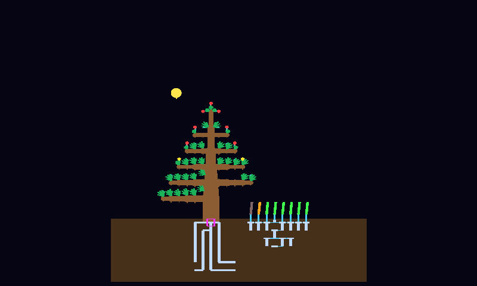 |  |

At tick 200 the tree is 11 cells tall with four tiers. That tick, three of its
points' bids won, and 20 were refused (red) because the wood behind them could
not yet carry more foliage. At tick 600 it is grown, with a young cone below
each of its lowest branches, and the grass's nearest blade is grey, with the
next amber. Cut, the lowest right branch goes with its two needles and its
cone, and by tick 800 a one-cell stub stands in its place, between two young
trees grown from its seeds.

| | A ripe cone, and a seed under the crown | Young trees from its seeds | A seedling in the grass | The sapling it stays |
| --- | --- | --- | --- | --- |
| 1280×720 |  | 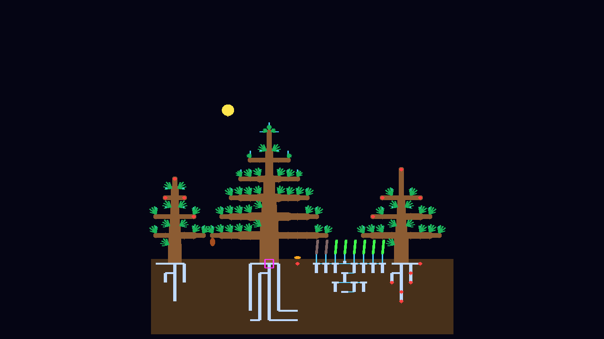 | 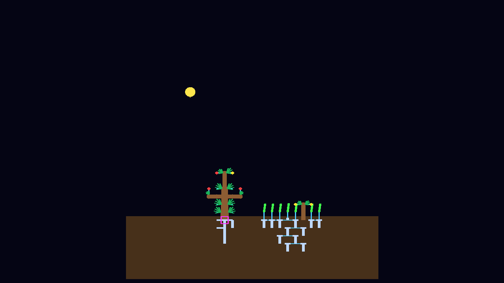 |  |
| 800×480 | 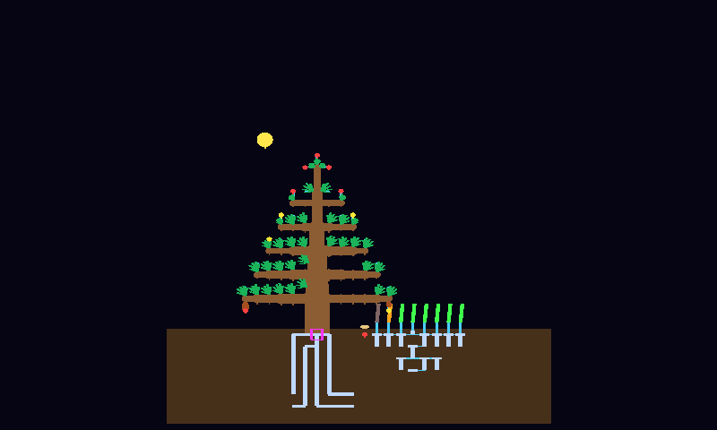 | 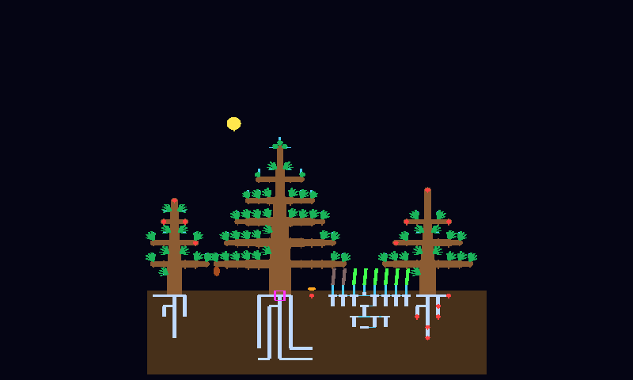 | 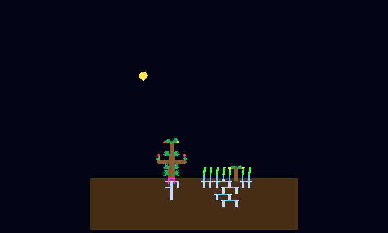 | 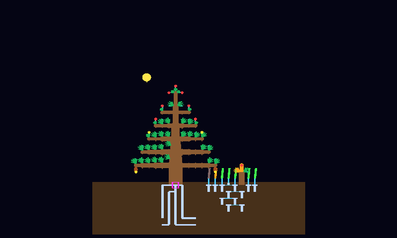 |

Planted fresh, at tick 612 the tree's left cone is ripe, the right one is
young, and its first seed lies on the soil under the crown. By tick 1000 two of
its seeds have grown into young trees beyond the crown, and another seed lies
under it. Planted in the grass at tick 100, a seed has sprouted between two
blades by tick 110, its needles above them. By tick 600 it is a sapling, its
top and one spray of needles amber with drought. The pictures come from the window-free
renderer, without the text. `SPACEWARS_GARDEN_RENDER_ARTIFACTS=<dir> cargo test
--locked --profile ci -p engine-client garden_render_contract_tree_bed`
regenerates all sixteen, and the eight of [physical wood](#physical-wood-224).

`tree_bed_contract` covers that growth with an exact replay; light reaching
the blades, and the shade's shadow falling along the sun from the left and
straight beneath it overhead; showing the bed from the grass controls with its
own cursor, clock and settings while the grass bed waits, the 64x limit, pause,
step and the 2000-tick stop; both cuts; and fresh planting under the same
settings. It follows every seed the tree drops to tick 1000: none lands on the
grass; those beyond the crown sprout at their first decision and grow needles;
those under it never sprout and are cleared away, the first refused for shade
alone; the bed fills to its 256 tissues; and the run replays. It plants a seed
in the grass, lifting the grass from its column with its shares, and checks
that the seedling climbs above the blades, grows no root of its own, takes in
less water than it pays and stays a living sapling, and that planting again
there does nothing. A seed still goes in beneath the young tree that reaches
over that column by tick 1000. The window-free
`garden_render_contract_tree_bed_draws_wood_needles_bids_grass_cones_and_seeds`
counts wood, needle, blade, winning-bid, cone and seed pixels at 1280x720 and
800x480. It checks that hidden bids draw nothing, that a cut removes wood and
needles from the picture, that cones and a seed show at tick 612, and that the
young trees add wood by tick 1000, and exports preview-only PNG, SVG and state
files when `SPACEWARS_GARDEN_RENDER_ARTIFACTS` is set.

The full-only functional case
`garden_lab_tree_bed_grows_cuts_and_returns_in_both_renderers` drives the real
launcher in vector and raster modes. It shows the tree bed from the grass
controls, runs it at 64x, checks every tree point's bid in the status, the
grown tree with needles lit through the tree above them and the dead blade in
its shadow, and cuts the lowest branch. It plants a seed in the grass and finds
it in the status as an unsprouted tree with no parent, with the grass gone from
its column but not from either side, makes the wood physical as described
[below](#physical-wood-224), and returns to the grass bed, retaining a PNG/JSON
pair at each stage. It took 112 seconds under local Xvfb, on a machine busy
with other work.

### Physical wood (#224)

**Physical wood on/off** hangs every tree's wood on hinges under gravity while
the trees grow. Each wood tissue becomes a body: a box from the tissue it grew
from to its own cell, as wide as the wood is drawn. A hinge joins it where it
grew from, to the wood it grew on or, at a trunk's foot, to its tree's roots,
which hold the tree in the dirt ([Roots that hold](#roots-that-hold-225)). The
hinge is a beam of wood with a square section as wide as the segment, as long
as it, with wood's bending stiffness, strength and damping ([connection
loads](design/material-connection-loads.md)). The segment weighs wood's 0.6 per
cubic cell, and each needle and cone tissue adds 0.02 and 0.05 per size to the
wood it grows on. Gravity is 9.81 cells per second squared, a cell being a
meter. The bodies move in real time, a step for each of the lab's sixty updates
a second. An air drag of 1 per second settles a branch within seconds, rather
than the most of a minute wood's own damping would take. Living wood is solid
to all but living wood: dead wood and loose snow land on it, and it lands on
the dirt. Living wood passes living wood, since its segments overlap where they
join, and the two bodies of a hinge never touch. A trunk's foot stands half in
the dirt, and passes through it. Light passes living wood's bodies, since its
tissues shade at their cells: the bed names them to the light as transparent.
Turned off, the living wood, its roots' bodies and any snow leave the world,
the wind drops, and the trees grow on as their cells stand.

The trees' cells stay the shape their wood rests in. Growth and light work on
them as they do at rest, and the bodies and the drawing carry the sag. At each
boundary, before the next step, the bodies take in what growth did. New wood
gets a segment where the wood it grew on now hangs, moving as that wood moves
there, and is hinged to it at rest. Wood that thickened gets a wider box, the
mass of it and a hinge as wide, and wood whose needles and cones grew, dropped
or were shed takes their new weight. Its hinge keeps the rest it was joined at
rather than the turn it has, and the work it has absorbed stays absorbed
(`reshape_connection` in [connections that
bend](design/material-connection-loads.md#connections-that-bend)), so nothing
sets a tree back upright and nothing makes its sag creep.

Wood beyond a break or a cut, and wood a tree sheds, becomes dead wood: the
same bodies, moving as they were, drawn grey with what grew on them. The tree
loses those tissues and their shares of the stores, as in any cut. Wood hinged
to living wood comes away from it, and keeps its other hinges, so a tree that
dies stands on them, its foot still on its roots, which die with it and hold
on, until it breaks or is uprooted. Dead wood, and snow that slid off it, lands
on the dirt and on living wood, passes through dead wood and shades where it
lies. Wood that dies lies in the living wood it came away from, as a branch's
first segment starts inside its trunk. So it passes through all wood until a
step finds it clear of the living wood, and is never thrown out of it. Dead
wood that living wood grows into, or is built over when the wood is made
physical again, passes through it the same way. What rests on a branch falls
through it when that branch dies, since dead wood passes through dead wood. A
box ends at the cells its wood spans, so a thick trunk's lowest segments, which
a capsule's rounded ends would push into the soil, stand clear of it. The bed
keeps at most 256 segments of dead wood, as many as it has tissues, and past
that clears away the wood that died first, with all that died with it, its
roots among it. Dead wood and roots that fall out of the bed are cleared away
too. Resting the wood leaves dead wood where it is, and replanting the bed
removes it.

**Light snow** and **Heavy snow** lay a block of snow of mass 1 or 5 on top of
the selected wood, or else on the tip of the planted tree's lowest branch, on
the grass's side first, and make the wood physical if it is not. The snow's
weight builds up over a second, so that it bends the branch rather than
striking it. The same control again clears it, and the other replaces it,
building up from the weight already there if it lands on the same wood. A load
that exhausts a hinge breaks it, and the wood beyond falls as dead wood. A cut
while the wood is physical drops the branch the same way. Snow on wood that
dies slides off. Resting the wood clears the snow.

With seed 42 at tick 600, held there, the grown conifer's most loaded hinge is
the root of its lowest branch toward the grass, six cells of wood, five of size
two and a tip of size one. Its own weight holds that hinge at 0.32 of its safe
load, after a first swing to 0.58, and its tip droops 0.29 cells, after a first
swing to 0.53. The tip settles within 0.01 cells in 6 s, and without the air's
drag it would take 46 s. The thicker lowest branch on the other side droops
0.17. Each droop includes the 0.01 cells the whole tree sinks on its roots.
Light snow on the first branch's tip doubles its droop to 0.61 cells, at 0.63
of the root's safe load, after swinging it to 0.69; laid at its full weight at
once, it would swing it to 0.83. Cleared, the branch springs back to within
0.01 of where it hung. Heavy snow bends it to 1.20 cells at its tip and breaks
its root 0.98 s after it is laid, at 1.2 times the safe load. The broken branch
first touches the dirt a third of a second later, and the snow lands by its
tip. The same light snow adds 0.16 cells to the thicker branch's tip against
0.32 to the thinner one's, and laid by the trunk on the thinner branch's first
segment, it adds 0.01, a thirtieth as much, to that branch's tip. The same light snow adds 0.16 cells to the thicker branch's
tip against 0.32 to the thinner one's, and laid by the trunk on the thinner
branch's first segment, it adds 0.02, a twentieth as much, to that branch's
tip.

A branch that falls lands on the branch below. On the grass's side the second
tier's branch, five cells of wood, hangs two cells above the lowest. Cut away,
it lands on the lowest branch with a blow that loads its root to 0.99 of its
safe load, and then lies on it, 3 cells above the dirt: the root carries 0.55
where it carried 0.32, and its tip droops 0.43 cells where it drooped 0.29. The
third tier's branch, four cells of wood, cut away instead, lands on the
second's, whose root then carries 0.19 where it carried 0.12. Cut away in turn,
the second tier's branch drops with what it carried onto the lowest, which
breaks 0.8 s later at 1.42 of its safe load, and the three branches lie on the
dirt. Under light snow on its tip the lowest branch carries 0.63, and the
second tier's branch alone, cut onto it, breaks it 1.1 s later. Light snow on
the tip of the third tier's branch slides off when that branch is cut, and
comes to rest with it on the second's, which holds both at 0.29.

Growing on at 16x from tick 600, the conifer and the young trees from its seeds
gain 48 segments in a minute, to tick 1560, and segments are reshaped 219
times. No hinge is refused or breaks. Checked every 5 s, none carries more than
0.35 of its safe load, and no segment lies more than 0.008 cells from the wood
it hangs from. Over the first 30 s the trees grow exactly as at rest: a bed
whose wood rests reaches the same tissues, stores and ledger at the same tick.
The minute of the lab's updates takes 12% more processor time than at rest,
4.49 s against 4.01 s at the best of five runs each on a busy machine; the wood
alone, before it stood on roots, took 9% more. It ends with 106 bodies, three
of them the trees' roots. The light's work counts each living segment and root
plate it passes as a collider record, 14,204 against 134 at rest, with the same
rays and footprints. Heavy snow laid after 8 s of growth, at tick 728, still
breaks the lowest branch a second later. Made physical at tick 30 and run at
64x, the grove reaches 102 segments by tick 2000 without a break. Without water
at 64x from tick 600, the conifer dies at tick 776, and its 54 segments stand
as dead wood without a break.

Shed wood is the brain's to avoid. After the functional case's cut at tick 650
and its seed in the grass, the young tree from the seed at x 26 grows a bare
tip over the grass at x 23 from tick 777 and sheds it two or three ticks
later, again and again, as it does with the wood at rest. Physical, each tip
it sheds falls as a segment of dead wood, 24 by tick 854, and they come to
rest on one another, since dead wood passes through dead wood. The cap bounds
the pile.

| | Under its own weight | Heavy snow, about to break | Broken, on the dirt | Dead, standing |
| --- | --- | --- | --- | --- |
| 1280×720 | 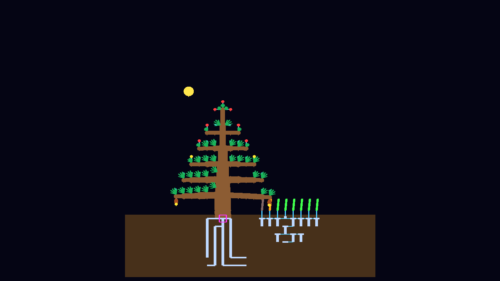 | 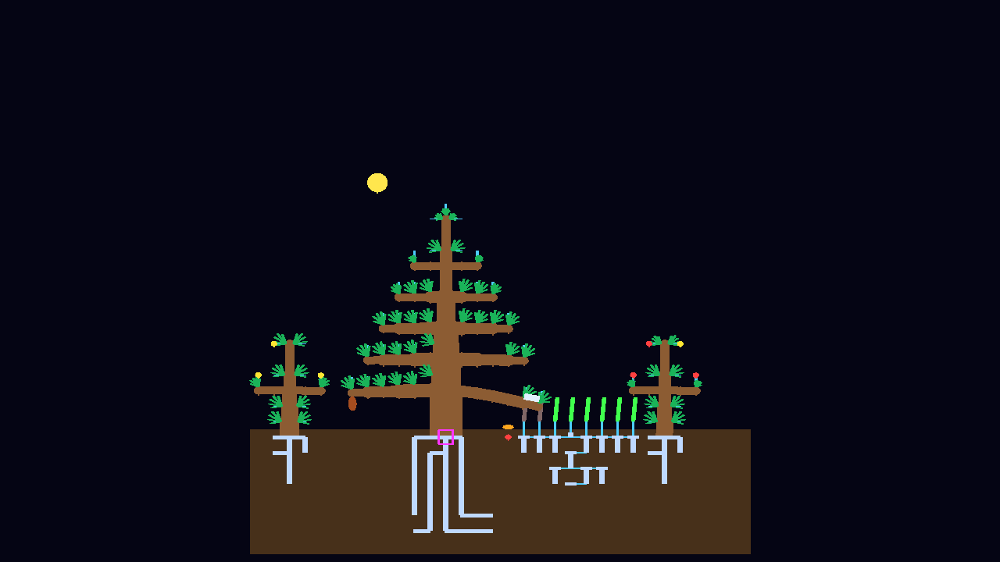 | 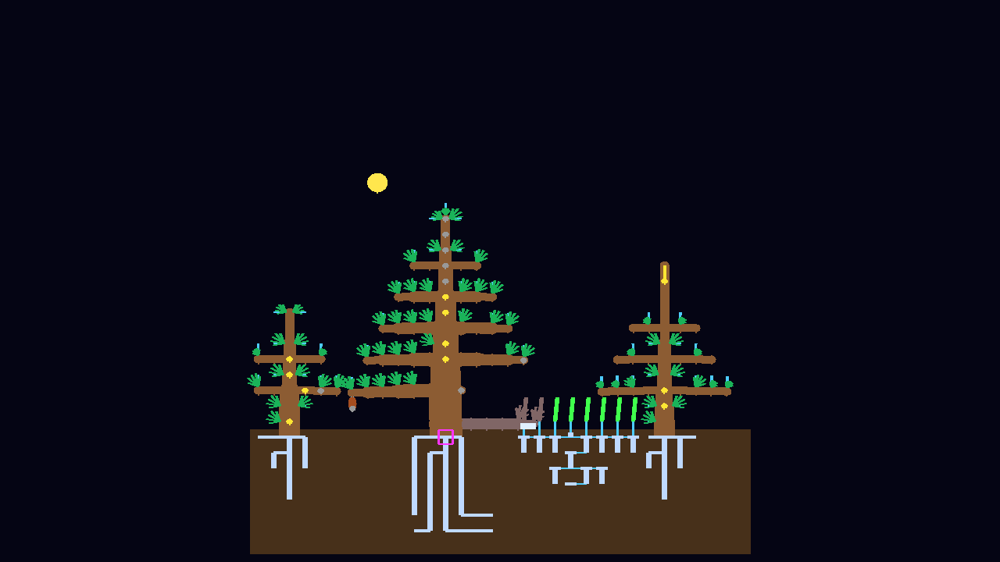 | 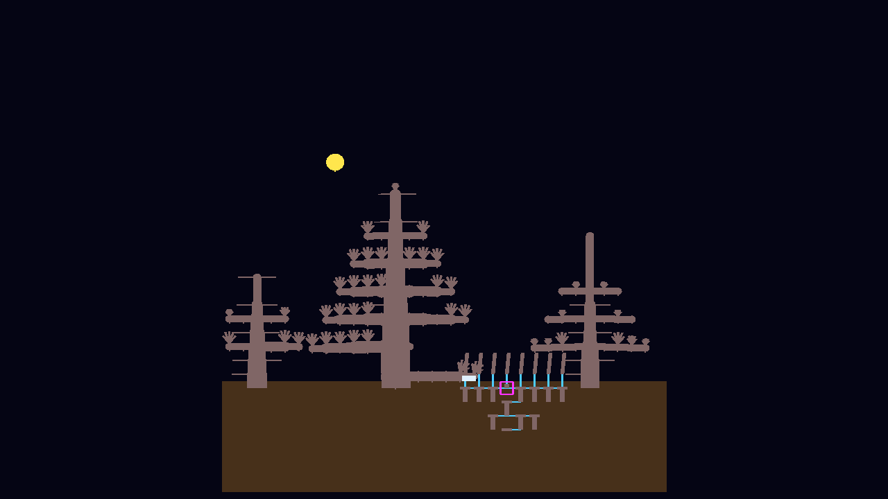 |
| 800×480 | 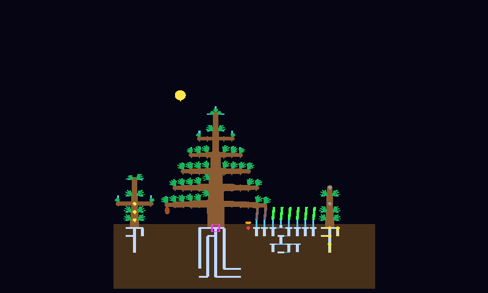 | 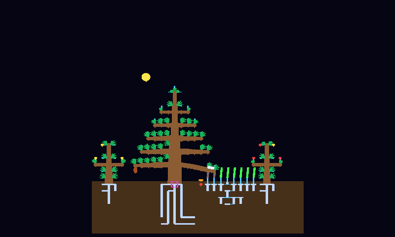 | 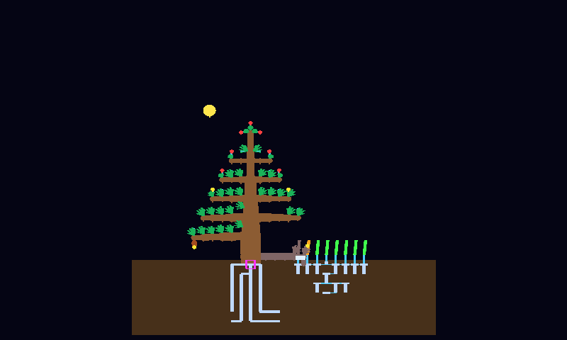 | 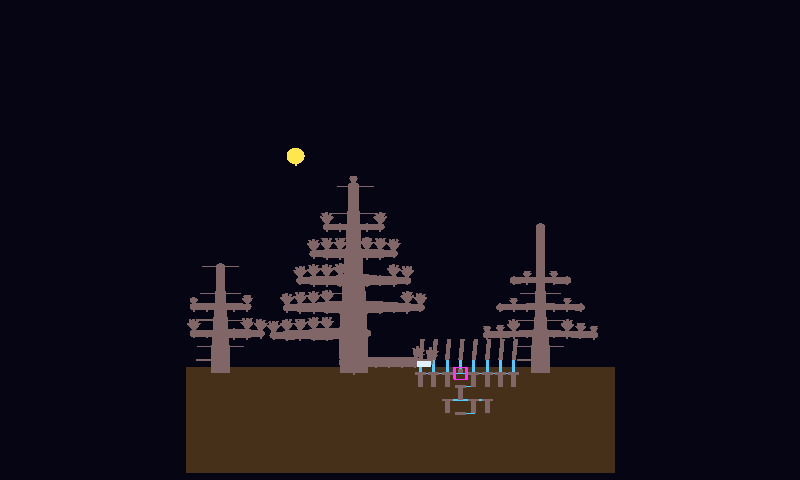 |

| | Caught by the branch below | Broken under two |
| --- | --- | --- |
| 1280×720 | 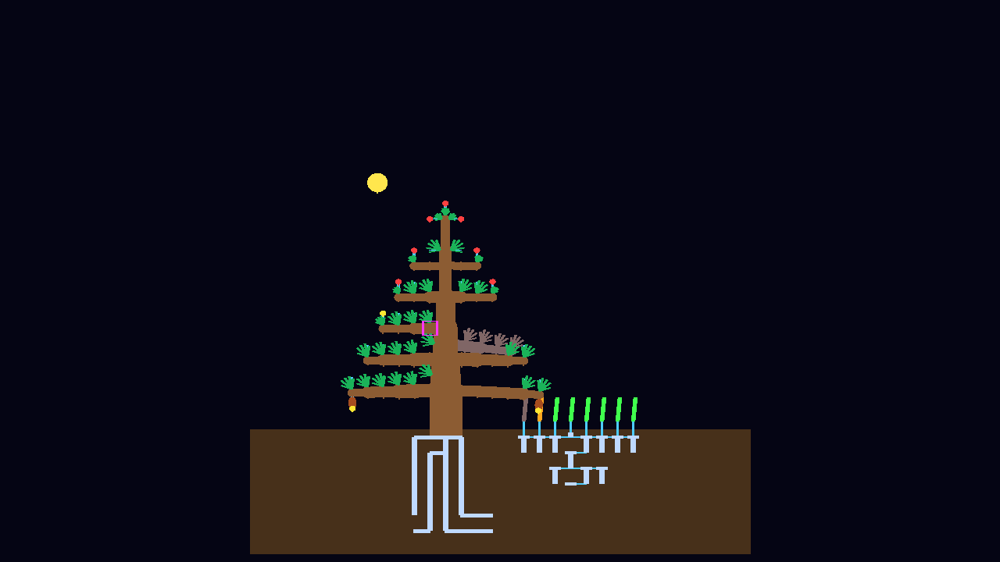 | 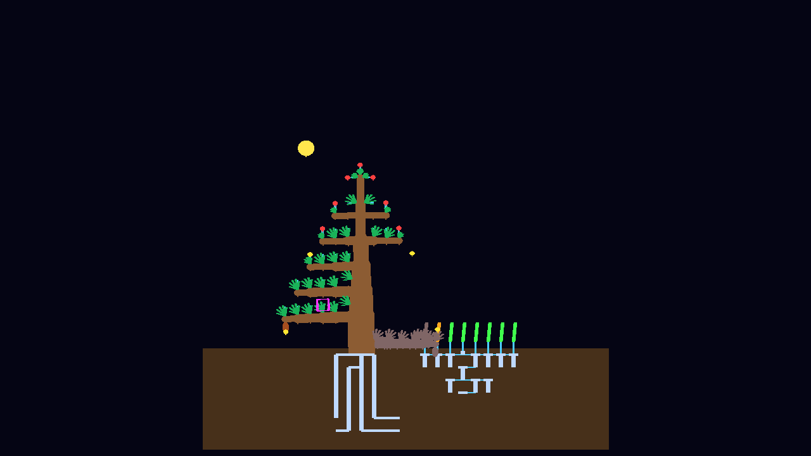 |
| 800×480 | 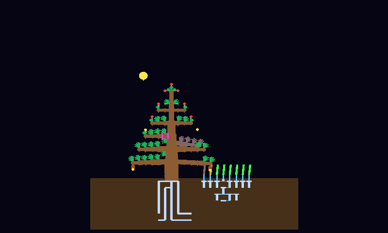 | 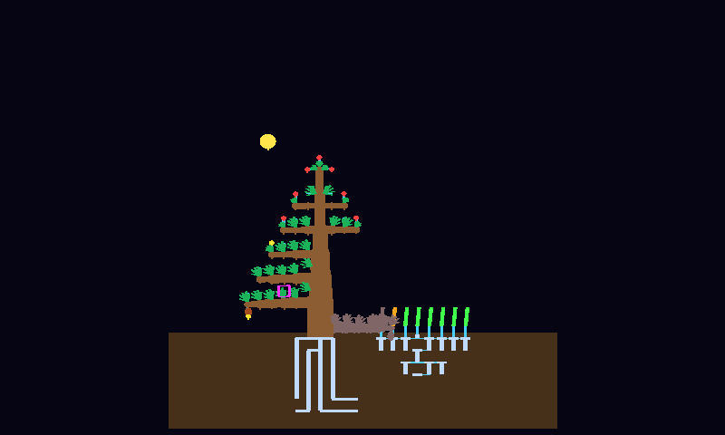 |

The pictures are from the window-free renderer without the text. The first four
have the trees growing at 16x: 8 s after the wood became physical at tick 600,
0.9 s after heavy snow was laid, 3 s after that, and at tick 1110, 2 s after
the conifer died of the drought that turning the water off at 64x began. The
last two hold the trees' clock at tick 600: 8 s after the third tier's branch
on the grass's side was cut away, and 10 s after the second tier's was cut in
turn. The render contract's command above regenerates them with the others. The
light's line gives the wood after it while the wood is physical or any is dead:
its hinges with the most loaded one, the snow, the dead segments against the
cap, and the breaks. A selected wood tissue shows its hinge's load and turn.
The status's `tree_bed` adds `wood`: whether it is `physical`; each living wood
tissue's hinge, with its `utilization`, its `turn` in radians from the rest it
was joined at and how far its wood's end hangs below its cell, in `droop`; the
`snow`, with its `mass`, the wood it is `on`, whether it is still `fastened`
there, whether, slid off, it is `parting` from living wood it lies in, and the
`share` of its weight built up; the `dead` segments and the cap, `max_dead`,
with how many of them are `parting`; the `breaks`; the `work` of keeping the
bodies in step with growth, in segments `grown`, `reshaped`, `died` and
`cleared`, with the hinges `refused` a new beam and the last `refusal`; the
world's `bodies` and `colliders`; and the `summary`.

`wood_tests` checks, with the trees' clock held, that the grown tree made
physical is first drawn where it was, then sags and settles near the droop and
load above; that light snow bends the lowest branch and that it springs back
when cleared; that the same snow bends the thicker branch and one nearer the
trunk less; that heavy snow breaks the branch within 2 s, takes its tissue from
the tree and leaves it and the snow at rest on the dirt, drawn grey, and that
while it builds up no line of the bed's text is longer than a window 1280
pixels wide can show; and that a cut drops physical wood, resting the wood lets
the tree grow again with the dead wood still lying there, and replanting leaves
only the bodies the bed had before. With the clock running, it checks over 30 s
at 16x that each new segment starts where its parent ends, at rest on its hinge
and moving as its parent moves there; that every wood tissue has a segment as
wide as its wood and as heavy as it and what grows on it, on a hinge as wide,
with no other joint and nothing stale in the world; that no hinge was refused,
broke or set the lowest branch upright; and that the trees grew exactly as a
bed at rest. It checks that thickened wood keeps its hinge's turn and settles
no lower; that wood shed at a boundary comes away from the trunk with the
motion it had, drawn grey with its needles, and lands on the lowest branch,
which holds it; that the conifer killed by drought stands as dead wood on its
hinges for 5 s, and replanting removes it; and that past a cap of ten, the
first branch cut is cleared with its hinges when the second falls. With the
clock held again, it checks that the third tier's branch, cut away, lies on the
second's, which carries more for it, and that the second's, cut in turn, breaks
the lowest under the two, leaving all three on the dirt with one hinge gone for
each cut and the break; that a cut branch's first segment alone goes on passing
through wood, that none is thrown, that at rest all of it falls to the dirt,
and that physical again the segment lying in the rebuilt trunk passes through
it without moving; and that snow on a cut branch slides off and comes to rest
with it on the branch below. The window-free
`garden_render_contract_tree_bed_physical_wood_bends_breaks_falls_and_dies_standing`
counts living wood, grey wood and snow pixels at both viewports, and
`garden_render_contract_tree_bed_living_wood_catches_a_cut_branch_and_breaks_under_two`
counts the grey wood caught and then fallen. The full-only functional case
above makes the wood physical and lays light snow on the tip of the lowest
branch left after its earlier cut while the bed waits. It checks that the
branch droops as the trees grow on, then, with the bed waiting again, that a
cut moves the lowest branch's segments from the hinges to the dead wood and
that the snow stays fastened unless its branch was cut. It runs the dead wood
down to the dirt, and checks that resting the wood leaves it there.

### Roots that hold (#225)

While the wood is physical, its roots hold each tree. A tree's roots are one
body, its root plate. Each root tissue weighs 0.15 per size at its cell, a
cell's length of wood as wide as wood of that size, and the body touches
nothing and shades nothing. The trunk's foot is hinged to it. Every root that
lies in dirt anchors the plate there
([anchors](design/material-connection-loads.md#anchors)): springs hold the
plate at the root's cell, and hold its turn, with the stiffness of a beam of
the root's own section, a cell long, made of the dirt's grip. The grip has a
hundredth of wood's stiffness and a twelfth of its strength, 2,000 and 240, so
a root gives an eighth of a cell before the dirt lets go of it, and pulls out
long before it would snap. An anchor carries its stiffness times how far its
own cell has moved. So the anchors share the tree's weight evenly, and share
whatever turns the tree by where they hold: roots that reach wide and deep
carry the most of it, at the longest arms. Grass keeps its roots as they were,
with no bodies.

A load the grip cannot hold safely charges the same connection law as an
overloaded hinge, and an anchor it exhausts lets go for good: its root grips
nothing again, at rest or physical, for as long as its tree has it. What it
carried passes to the anchors that are left. A tree whose last anchor lets go
is uprooted: it leaves the bed's plants, as in a cut at its seed, and its wood
and roots die where they are and fall. A tree that dies standing keeps its
roots as it keeps its wood: they die with it and hold it by the anchors they
had.

The plates keep step with growth as the wood does. At each boundary, before the
next step, a root that grew is anchored where its tree's plate has carried its
cell, a root the tree shed or lost to a cut gives up its anchor, and the plate
weighs what its roots now weigh. A tree gets its plate with its first wood: a
seed that has not sprouted holds nothing up. **Cut a branch or root** cuts the
selected root of a tree with every root that grew from it, as it cuts a branch,
and the roots that are left hold the tree.

**Wind** is the bed's sideways load, toward the grass: calm, a breeze and a
gale in turn, of 2 and 6 per unit of sail. It makes the wood physical if it is
not, and rises and drops by the gale's push in 3 s, so that it leans on a tree
rather than striking it. A segment's sail is the face it turns to the wind, as
deep as it is wide: its length where it stands and its width where it points
along the wind, with 0.15 per size for each needle tissue on it and 0.05 for
each cone. The wind is still at the dirt and full from 4 cells above it. It
pushes living wood, and dead wood while it still stands: joined, through the
wood it grew on, to roots that have not turned 45 degrees from where they grew.
Fallen wood lies where it fell. Resting the wood drops the wind.

With seed 42 at tick 600, held there, the grown conifer's wood weighs 28.9 and
its 32 roots 9.6. Its anchors carry that weight between them, the most loaded
at 0.10 of its safe load, and the tree sinks 0.01 cells on them. The breeze
pushes it with 84, a fifth of its weight: it leans 0.24 degrees on its roots,
its top moves 0.6 cells toward the grass, and the most loaded anchor carries
0.24. That anchor is the root that reaches farthest toward the grass and
deepest, at [15, 1]. The gale pushes the tree with 271, seven tenths of its
weight: it leans 0.76 degrees, its top moves 1.9 cells, that anchor carries
0.58, the trunk's foot 0.49 and its most loaded hinge, on the thin trunk at
[12, 17], 0.61. The dirt holds its windward roots down and its lee roots up:
the column of roots farthest to windward, which pressed on the dirt in the
calm, now pulls up on it. Nothing lets go, and in the calm again the tree
stands as it stood.

Roots cut away leave the rest to carry more. The root that leaves the seed
toward the grass has seven more beyond it, and the one on the other side six.
With either cut, the conifer still stands in the gale, its most loaded anchor
at 0.86 or 0.82. With both cut, 17 anchors hold it in the calm, at 0.17 at
most. The same gale then pulls them out: the first lets go 2.7 s after the wind
begins to rise, at nine tenths of the gale's push, with the tree leaning 1.5
degrees, and the other 16 follow within half a second. Uprooted, the tree goes
over toward the grass and comes to rest 10 s after the wind began to rise. It
lies on its branches, reaching 12.8 cells from where it stood, with its root
plate turned 70 degrees out of the dirt. Four of its dead hinges break in the
fall, and all 54 segments stay in the bed.

At tick 1200 the conifer and the two young trees from its seeds, twelve roots
each, stand in the gale with their most loaded anchors at 0.61, 0.45 and 0.65.
Growing on at 16x from tick 600 for a minute, the trees end on 56 anchors with
none above 0.22, none let go, and they grow exactly as at rest. The conifer
killed by drought stands on its dead roots' 32 anchors, and leans in the gale
as it did alive.

A root plate is rigid, and the dirt's grip is the same in every direction and
at every depth. A root's intake does not depend on its anchor: a root that
pulled out still feeds its tree. The plates and the trunks' feet pass through
the dirt, so a fallen tree's roots are drawn through it. A tree lives or dies
whole when its roots let go: its cells cannot lie down. Dirt cannot yet be dug
away from roots, and the trees' brain does not yet sense what its anchors
carry; both are #225's next steps.

| | Held in the gale | Uprooted |
| --- | --- | --- |
| 1280×720 | 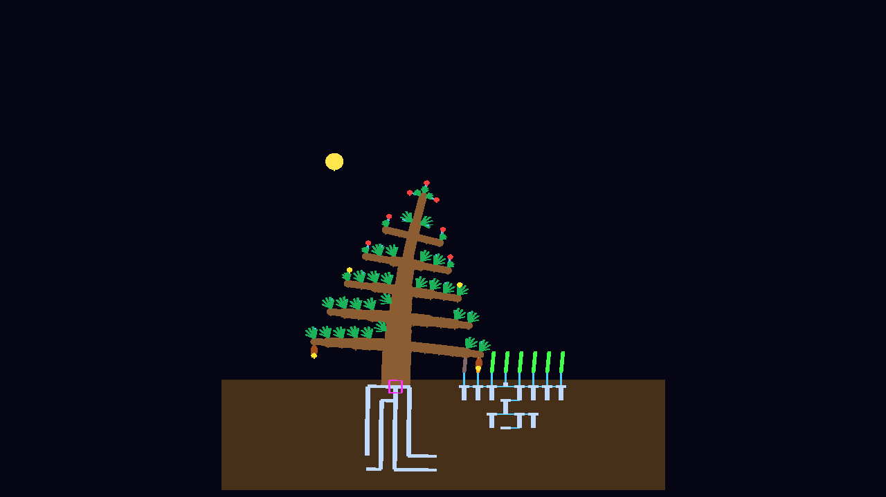 | 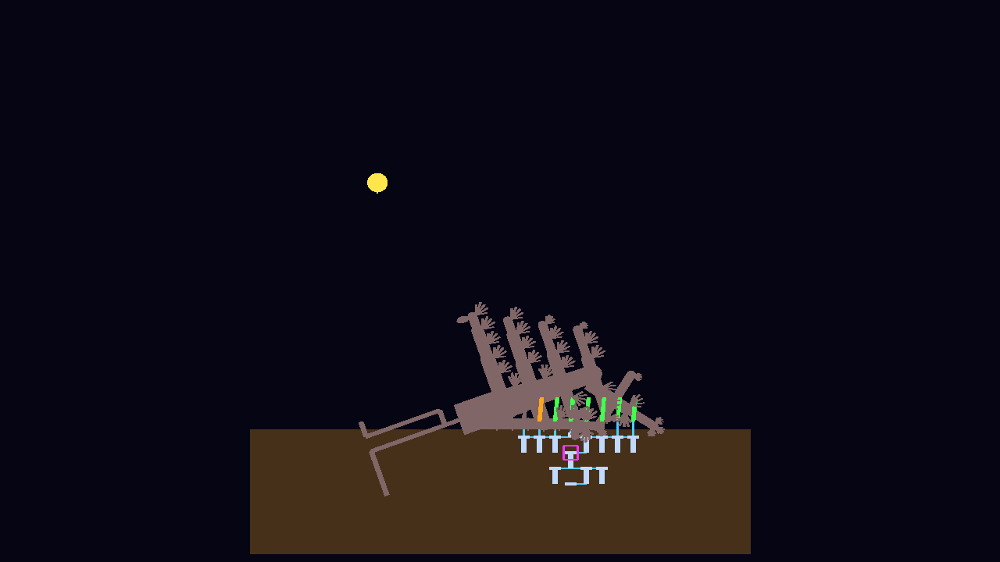 |
| 800×480 | 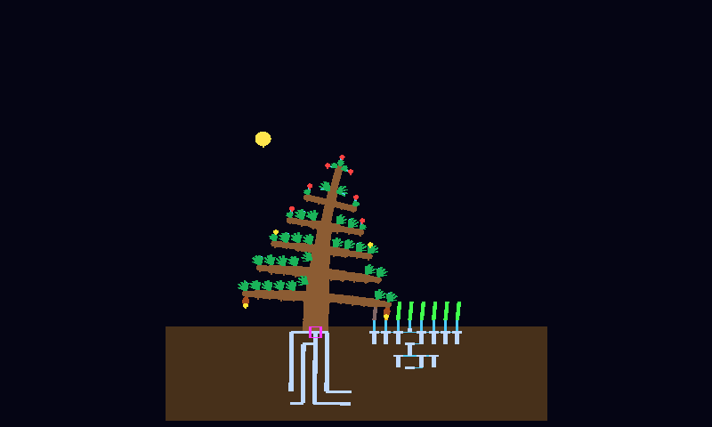 | 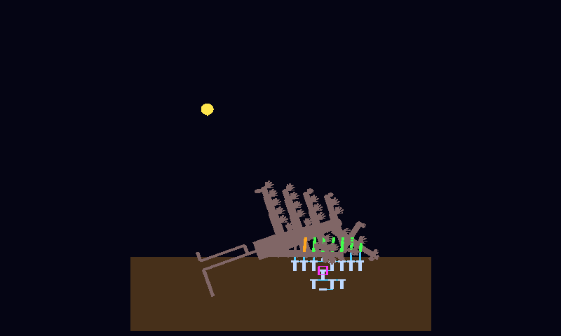 |

The pictures are from the window-free renderer without the text, with the
trees' clock held at tick 600: 12 s into the gale on all its roots, and 14 s
into the gale that followed the cutting of both side roots in the calm. While
the wood is physical the grove's line gives the roots after it: the living
trees' anchors with the most loaded one, the wind, with its push while that
rises or drops, and the anchors pulled out and trees uprooted since planting. A
selected root shows what its anchor carries, or that it pulled out of the dirt.
A dead tree's roots are drawn under inspection, and wherever no anchor holds
them. A bid's marks now go with a point the bed has lost, where they stayed in
the air until the next decision. The status's `wood` adds `roots`: each
gripping root's anchor in `anchors`, with its `utilization` and the force it
carries along its root and across it, in `pull`; how far each living tree's
root plate has turned, in radians, in `leans`; the roots now `pulled` out; the
anchors the load has broken, in `pulls`; the trees `uprooted`; the
`dead_plates`; and the `summary`. It adds `wind`, with its `name`, its `level`
and its `push` now.

`roots_tests` checks, with the trees' clock held, that the grown conifer made
physical has one body for its roots, anchored at each of its 32 roots, with its
trunk's foot hinged to it, and that the anchors together carry its weight
straight down; that a breeze and a gale lean it further each, load the anchor
farthest to lee and deepest most, hold the windward roots down and the lee
roots up, carry the wind's push, and leave it as it stood when the wind drops,
with no line of the bed's text longer than the window; that with both side
roots cut the same gale pulls every anchor out, a few at a time, and the tree
leaves the bed's plants, falls toward the grass with its roots turned over and
comes to rest there, the same bodies as it stood on; that with either side root
cut it holds; and that a root made to let go grips nothing again through rest
and growth and says so when selected. With the clock running, it checks that
the conifer killed by drought stands on the anchors its roots had and leans in
the gale; and that from tick 300 every root the trees grow is anchored before
the next step, with the plate as heavy as its roots. It checks that resting
takes the living roots' bodies and the wind, and that roots and a trunk's foot
cut loose by hand fall out of the bed and are cleared. `wood_tests` now
measures a trunk's foot against where its roots have carried it, and counts an
anchor for every root of a sprouted tree. The window-free
`garden_render_contract_tree_bed_roots_hold_a_tree_in_a_gale_until_they_are_cut`
draws the two pictures and counts the fallen tree's grey. The full-only
functional case above, once its snow has built up and while the bed runs, turns
the wind to a breeze, checks that a tree leans on roots that hold, and brings
the calm back.