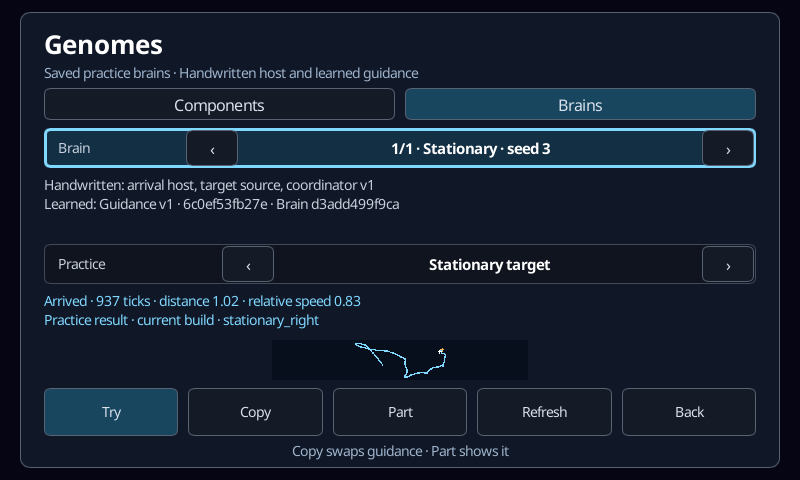
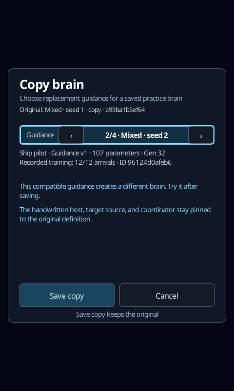

# Guidance components, saved brains, and practice trials

The launcher’s **Genomes** view connects saved guidance components and complete
practice brains to repeatable trials. The **Components** tab includes the
retained stationary finalist and three mixed-arrival finalists, plus genomes
exported by local training. **Brains** contains saved assemblies that combine
an exact learned component with the handwritten arrival host, target source,
and coordinator. These brains support the declared arrival practices; ordinary
match assignment remains part of the [broader design](design/evolutionary-training.md).

Choose a genome with the arrows. Its details show the supported role, parameter
count, origin generation, recorded training arrivals when available, and stable
genome ID. Recorded training scores describe the original recipe and build.
They are not a ranking across different curricula or evidence about the current
application build. **Refresh** reads newly saved candidates without changing
the selected ID when that entry remains available.

[Training → History](managed-training.md#saved-history) links a retained winner,
validation result or practice receipt to its exact component or saved brain.
Missing links leave the browser unavailable rather than selecting a substitute.
The history view preserves the original result even when its export is missing.

Choose **Stationary target** or **Moving target**, then **Try**. These are the
fixed `stationary_right` and `moving_right` arrival cases from the existing
[material arrival fixture](ship-arrival-diagnostic.md). The trial pins the exact
genome into the named practice brain, with ordinary flight controls and a
separate physical world. It reports outcome, elapsed ticks, final distance,
and relative speed. The static trajectory preview shows the ship path in blue,
the target path in gold, and the final ship position in white. It is not a live
view of training or an interactive match assignment.

Back leaves the browser while a trial finishes. Reopening preserves its selected
genome and most recent result. Changing genome or practice clears the displayed
result. A trial does not change the live match, saved controller settings,
training population, or random sequence. One bounded practice worker may run
alongside the single training worker; Pause remains available in Training if
foreground work needs the CPU. The open browser and a pending trial suppress
idle auto-start.

**Seed** opens Training setup with that exact component selected. Starting
creates a new job: one unchanged selected genome occupies the first slot and
the remaining slots are random. Every candidate is evaluated afresh. For the
mixed curriculum this selection replaces its usual bundled parent. It does
not resume the original experiment or import old fitness. The **Initial genomes**
row shows the selected ID and random count; either arrow restores the recipe’s
default population. Selection is disabled while a training job is active.

## Saved practice brains

In Components, **Save** creates a named practice brain with the selected
guidance genome and opens it in Brains. Names initially describe the component's
source. The details identify the handwritten and learned parts; **Part** opens
the exact learned dependency in Components. A whole assembly is not a training
seed: inspect its component to start a new component-training run.

**Copy** opens a replacement-guidance view. Choose another compatible component
and **Save copy**, then try the result in either declared practice. The original
remains saved and unchanged. **Cancel** returns to it without saving. Once a save
has started, **Back** leaves the view while the save finishes. Replacing a
component changes the assembly's behavioral identity. Saving an already known
composition selects that existing identity and preserves its name.

An assembly pins its organism, required capabilities, practice host, supported
practices, target-source and coordinator versions, guidance observation/action
contract, and exact genome ID. The target source takes its initial offset and
constant velocity from the selected practice case; those physical parameters
are retained in the trial receipt. The arrival host uses ordinary controls and
has no fallback controller that can complete a failed component's task.

Unknown hosts or contracts and missing or damaged dependencies disable trials
with an explanation. Each trial resolves its dependencies again, so a file
removed after browsing cannot silently use a cached or replacement controller.
**Refresh** retries after repairing the library. A brain with a missing genome
can still be copied with a different compatible component if its host definition
is supported. Compatibility does not require the training recipe's fixed model
architecture or the original training executable; exact job continuation keeps
its separate runtime checks.

Browsing, copying, saving and trials use the same bounded background worker.
They do not alter an active training job, its selected seed or its random stream.
Back returns to the launcher; reopening preserves the selected entry. Only one
library operation runs at a time.

## Storage and identity

The job writer exports each completed generation’s selected genome into
`training/genomes/<genome-id>.json`, beside the existing job checkpoint and best
export. The library artifact includes the full model, version, identity, first
source, generation, recorded training counts, and original runtime. A checksum
covers the metadata and model. Saving the same genome again preserves the first
artifact; each later job checkpoint retains its own score history. Files are
created atomically without replacing existing entries. Corrupt or mismatched
artifacts are reported and excluded from selection.

Refresh also migrates valid `run-*.best.json` exports from earlier Training
versions into immutable entries, leaving the exports untouched. Their previous
generation and fitness are shown as unknown because a bare model does not
establish those facts. This scan is bounded to 256 training-directory entries.

Practice summaries are saved under
`training/trials/<genome-id>/<receipt-sha256>.json`. They retain the case, exact
practice-brain definition and identity, runtime, outcome, measurements, and
fitness. Repeating the same trial on the same build produces the same receipt.
The detailed trace stays only in memory for the current preview, bounded by the
fixture’s 1,200-tick limit. This avoids accumulating another collection of large
raw trace files.

Saved brains add three paths beside the existing genome storage:

- `training/assemblies/<assembly-id>.json`: a checksummed, immutable behavior
  definition. Its ID hashes the versioned definition, not its name or results.
- `training/assemblies/names/<assembly-id>.json`: separately checksummed display
  metadata. Changing a name does not change the behavior ID or prior receipts.
  The storage API supports renaming; this UI currently assigns descriptive names.
- `training/assembly-trials/<assembly-id>/<receipt-sha256>.json`: the exact
  assembly definition and compact episode, including genome, practice case,
  runtime, measurements and outcome. Repeating a trial on the same build
  produces the same receipt, including after a display-name change.

Saving an assembly also retains its bundled genome dependency in `genomes/`.
Neither assemblies nor receipts overwrite an existing different artifact.
Missing or damaged name metadata produces a warning and an ID-based display
name; it cannot change or substitute behavior. Damaged behavior artifacts are
reported and excluded.

The browser reads at most 256 saved directory entries per refresh, reports
truncation, and always includes the four bundled fixtures. It does not delete
older models. Current practice supports the declared Guidance v1 contract;
training additionally requires the frozen 9→8→3 architecture. Other valid
component artifacts can be inspected but unavailable actions stay disabled.
Model compatibility is independent of exact job-resume compatibility: a new
build can trial a compatible genome even when it cannot resume its old job.
The assembly scan has its own 256-directory-entry bound. Following a dependency
or saving a brain can select one exact entry beyond a truncated listing; the
next scan replaces that listing rather than accumulating extra entries. This
slice has one learned Guidance v1 slot. Other organism hosts, whole learned
brains, and multi-component assemblies need their own declared execution
contracts; an old assembly is not assumed to support future vehicles or rules.

## Control interface and verification

The screen ID remains `launcher.genomes`. `genomes.components` and
`genomes.brains` select the tabs. Shared controls are `genomes.previous`,
`genomes.next`, `genomes.practice.previous`, `genomes.practice.next`,
`genomes.try`, `genomes.refresh`, and `genomes.back`.
Components expose `genomes.seed` and `genomes.save`; Brains expose
`genomes.copy` and `genomes.inspect`. The copy view exposes `genomes.copy.save`
and uses `genomes.back` to cancel before saving or leave while a save is busy.
Read-only controls expose `genomes.id`, `genomes.kind`, `genomes.dependency`,
`genomes.definition`, `genomes.status`, `genomes.receipt`, and `genomes.warning`.
`genomes.id` identifies the selected component or assembly; `genomes.dependency`
always identifies its guidance genome. `genomes.definition` contains the saved
assembly JSON when inspecting a brain or choosing a replacement.

```sh
spacewars-cli ui activate launcher.genomes --expect-screen launcher.main
spacewars-cli ui activate genomes.try --expect-screen launcher.genomes
spacewars-cli ui state --json
```

Commands are asynchronous; wait for `genomes.status` to become `ready` and check
the screen’s error and warning fields. Tests verify immutable provenance, safe
migration of earlier exports, corruption rejection,
repeatable trials, exact selected-genome seeding, and checkpoint continuation.
The real Slint/worker workflow covers both practice cases, leaving/reopening,
seed selection, job completion, and footer touch actions at 800×480, 1024×768,
and 480×800 at 1×. `SPACEWARS_GENOME_ARTIFACTS` retains these rendered screens.
No device rollout or physical-controller playtest is claimed by these tests.

Assembly coverage additionally compares complete practice episodes, including
controls, between the saved and existing practice paths on identical builds.
It covers immutable saves and copies, metadata-only renaming, missing/corrupt
dependencies, unsupported hosts/capabilities, declared scenario restrictions,
and execution with a different compatible model architecture. The Slint workflow
covers save/copy/cancel, dependency links, leaving during a save, reload and both
practice cases while a real training job keeps its identity and makes progress.
It checks touch at all three layouts and the shared keyboard/gamepad menu path;
`SPACEWARS_ASSEMBLY_ARTIFACTS` retains these rendered screens at 1×.

Local Rust 1.89.0 validation on 2026-10-14 passed 692 client tests (four existing
ignores), 82 agent tests, 38 CLI tests, and 38 control tests. The client and CLI
build successfully with the locked, offline `ci` profile. Strict scoped Clippy
passes for agent/CLI/control; client linting retains the existing warnings
outside this work. Logs and the 1× browser screenshots are under
`target/training-ui/`.

The saved-assembly follow-up passes **698 client tests** (four existing ignores)
and **90 agent tests** using the same Rust 1.89.0 locked, offline `ci` profile.
Strict agent Clippy passes. Client Clippy retains its existing 29 normal/50 test
warnings, with none in the new assembly/browser code. These 1× captures come
from the automated Slint workflow, not a device rollout:





Still planned: an evaluation-history UI, searching/filtering larger libraries,
name-editing/pinning controls, multiple selected seeds, whole learned brains and
broader hybrids, animated practice replay with stepping, and assignment into
ordinary gameplay scenarios.
