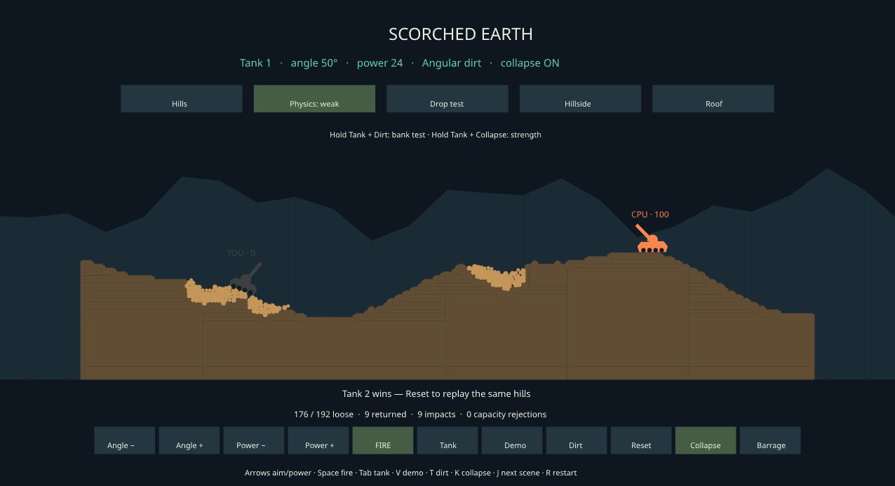

# Dirt during longer matches

The first broader gameplay review supports retaining the current terrain rules.
Ordinary bot combat and mixed asteroids every eight seconds leave capacity for
new dirt and allow physical ship recovery. Continuous heavy asteroids every
second cause more refusals and can leave a bot unable to recover, but material
continues to settle and new ground continues to break even late in those runs.

The implementation change in this pass is a development-runner improvement.
`surface_combat_soak` now accepts the same dirt presets as the launcher, runs
for up to ten minutes, and records per-second simulation timing. Its material
audit now counts loose cells as well as solid and removed cells. The default
remains Off. No gameplay physics, grain limit, strength, or bot policy changed.

## Coverage

The desktop review uses seeds 42, 777, and 4242 with Weak/Angular and Weak/Round:

- Six Scorched duels run for 300 seconds. Firing stops when a tank dies, so
  much of each run is the quiet aftermath, not continuous combat.
- Six Scorched barrages fire 120 shells over 240 seconds, then rest for another
  60 seconds. Every case also passes a separate per-second deterministic replay.
- Six Space Wars bot duels run for 300 seconds without environmental asteroids.
- Six more use mixed asteroids every eight seconds for 300 seconds.
- Two seed-42 stress cases use heavy asteroids every second for 300 seconds.
- Six capture trials switch P1 to its existing tactical landing controller
  after 60 seconds of fighting, with mixed asteroids every eight seconds.
- Two additional seed-777 controls request capture immediately and run for
  120 seconds, because that seed had already lost its subject ship at the
  scheduled 60-second handoff.

That is 34 desktop cases. Eight seed-42 combat, mixed, heavy, and capture cases
are repeated on the Picade. Every case passes its material/physics audit.
All eight full desktop/Pi reports match after removing timing fields, including
per-second observations, decisions, damage, terrain, and recovery outcomes.

The combat runner starts from the launcher's ordinary flight positions and
uses its normal bot policies with 15-second combat breaks. It runs without
match-finish rules. Capture trials retain their finished capture controller
after success or failure; their remaining duration is not continued P1 combat.
These distinctions matter when interpreting a five-minute report.

## What accumulates

All six ordinary Space Wars duels have zero release refusals. They finish with
zero or one loose grain, and each completes four physical ship recoveries in
total across the two players. They cause only one or two terrain cannon hits
per case, so they are useful integration checks but light dirt workloads.

All six mixed-asteroid duels also have zero release refusals. They finish with
15–30 loose grains and complete three to five ship recoveries per case.

The heavier workloads make the distinction between persistent rubble and a
complete destruction stall visible:

| Workload | Release refusals | Loose at end | Cumulative deposits | New releases late in the run |
| --- | ---: | ---: | ---: | ---: |
| Scorched barrage, seed 42, Angular | 13 | 116 | 2,964 | 598 |
| Scorched barrage, seed 42, Round | 6 | 60 | 3,436 | 979 |
| Scorched barrage, seed 4242, Angular | 22 | 144 | 2,408 | 476 |
| Scorched barrage, seed 4242, Round | 0 | 53 | 3,662 | 994 |
| Space Wars heavy asteroids, seed 42, Angular | 46 | 187 | 2,358 | 202 |
| Space Wars heavy asteroids, seed 42, Round | 16 | 129 | 3,488 | 448 |

For Scorched, the late interval is the final firing minute, seconds 180–240.
For Space Wars it is seconds 240–300. New releases are the change in loose
population plus the change in cumulative deposits; they include every release
cause. Deposits may count the same material through multiple release/return
cycles. Refusals count atomic batches, not lost material or individual cells.

The other two Scorched barrage cases, seed 777, refuse zero Angular and four
Round blasts. Ordinary Scorched duels refuse zero blasts except seed-777
Angular, which refuses one and finishes with 172 loose grains. That quiet pile
persists, but it does not establish a general late-match capacity failure.

Round recycles more material in the two heavy Space Wars comparisons. Different
contact geometry changes subsequent impacts and bot behavior, so those totals
alone do not establish that one shape should replace the other.

## Recovery and ground use

The seed-42 and seed-4242 capture trials complete landing, claiming, reboarding,
and departure with both shapes. The scheduled seed-777 trials cannot begin
their intended landing because P1 has already lost its ship. Both additional
seed-777 trials, requesting capture from the start, complete successfully.
Those controls cover a different encounter and do not turn the failed handoff
into a success under identical conditions.

The clearest remaining gameplay concern is in the one-second heavy stress
case. Angular P2 reaches the recovery task's two-minute limit; Round P1 reaches
`no supported claim progress` at tick 3,071 and remains blocked through tick
18,000. Round P2 later completes a recovery. The pool still admits material
while those bot failures persist. This is a reproducible recovery concern;
the review has not isolated its cause sufficiently to justify changing shared
packing, collision clearance, or the grain budget.

A short local Scorched check also uses normal controller input to lower shot
power and fire repeatedly with Weak/Angular physics. The visible result has
deformed slopes, physical rubble, and tank damage. It is a control/rendering
smoke check, not a full human assessment of aiming, balance, or traversal.



## Performance and next decision

Picade scenario-step p95 is approximately 0.61/0.67 ms for ordinary combat,
3.36/2.17 ms for mixed asteroids, and 10.01/8.94 ms for heavy asteroids
(Angular/Round). Heavy-case maxima are 23.04/28.40 ms. The runner excludes AI
and rendering from these step measurements. It ran at nice level 10 alongside
the existing kiosk; desktop runs overlapped other cases and builds. These are
additional workload measurements, not an isolated performance comparison or a
rendered-60-FPS guarantee. Occasional steps still exceed 16.7 ms.

This pass found no general capacity stall requiring a terrain-rule change.
For the next hands-on review, the local window is a fresh, paused human-versus-
bot material combat game with Weak/Angular dirt and mixed asteroids every
eight seconds. The extreme setting remains useful for reproducing the recovery
failures. A separate recovery investigation should establish whether a new
attempt or a different route can succeed before altering that policy.

[Local combat review ready to resume](screenshots/dirt-late-match/local-combat-ready.png).

## Reproduction

```sh
cargo +1.89.0 run --locked --release -p spacewars-ai \
  --example surface_combat_soak -- \
  --seed 42 --seconds 300 --dirt weak-angular --break-interval 15 \
  --asteroid-interval 8 --asteroid-severity mixed --frames true \
  --out target/dirt-match-review
```

Use `--dirt weak-round` for Round, omit the asteroid options for ordinary
combat, or use interval `1` and severity `heavy` for the stress case. Add
`--land-after 60 --landing-policy tactical` for the capture trial. Supported
dirt values are `off`, `round`, `angular`, `weak-round`, `weak-angular`,
`strong-round`, and `strong-angular`.

```sh
cargo +1.89.0 run --locked --release -p scenario-scorched-earth \
  --example scorched_benchmark -- \
  --seed 42 --shape angular --seconds 300 --bombardment-seconds 240 \
  --cohesion weak --slumping --breakup --diagnostics --replay
```

Native and static aarch64 builds pass. Formatting and diff checks pass. Clippy
reports no warnings in the changed example; its library retains the existing
`manual_is_multiple_of` warning in `mission_opponent_forecast.rs`. Omitted
`--dirt` and explicit `--dirt off` produce identical non-timing reports in a
separate 45-second comparison. Runtime code is unchanged, so this pass validates
the runner with real audited cases rather than repeating the engine unit suite.

[Measurements, commands and identities](data/dirt-late-match-20261009.json) ·
[Per-second terrain and recovery traces](data/dirt-late-match-traces-20261009.jsonl.gz).
Full reports, saved render frames, source snapshots, executables, and scripts
are retained in `target/dirt-late-match-review/`. No application redeployment,
commit, or PR was needed for this diagnostic pass.

The [recovery handoff to #178](terrain-recovery-handoff.md) now retains the exact
source and controlled fresh-attempt experiments. None completes a ship recovery;
the immediate Angular reset reaches owned ground before failing rebuild placement.
