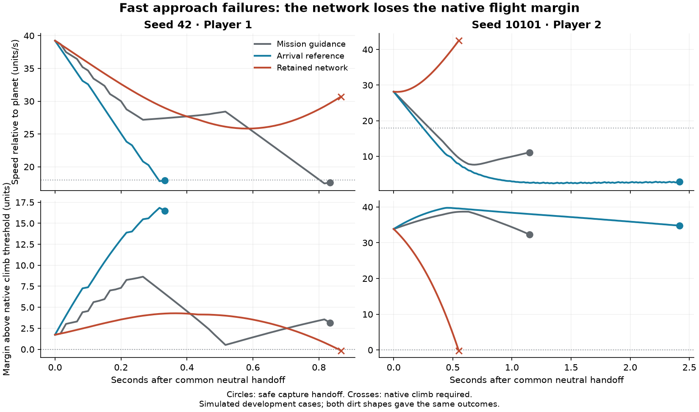

# Learned guidance in match approaches

The retained arrival network completed **4/8 safe native handoffs**, missing the
frozen 8/8 development gate. The handwritten arrival reference completed 8/8;
ordinary Recovery-v1 mission guidance completed 6/8. Failed trials ended when
the native host required a climb, before contact or damage. These results call
for training on faster inward approaches before live match integration.

The [census](learned-guidance-approach-census.md) supplied the real match starts.
The [machine-readable results](data/learned-guidance-approach-v1-results.json)
retain every outcome, timing, control count, and initial/final flight measurement.

## Results and diagnosis

Each row below occurred in both Angular and Round dirt. Times are physical
steps at 60 Hz after the common neutral setup tick. A climb outcome means the
native coordinator ended the direct-transfer phase; the trial did not continue
with handwritten recovery and count that as learned success.

| Start | Mission guidance | Arrival reference | Retained network |
| --- | --- | --- | --- |
| Seed 42, P1 | Arrived, 50 ticks | Arrived, 20 ticks | Climb required, 52 ticks |
| Seed 42, P2 | Climb required, 117 ticks | Arrived, 193 ticks | Arrived, 65 ticks |
| Seed 10101, P1 | Arrived, 47 ticks | Arrived, 146 ticks | Arrived, 58 ticks |
| Seed 10101, P2 | Arrived, 69 ticks | Arrived, 145 ticks | Climb required, 33 ticks |

In both distinct failed network starts, it held thrust throughout, commanded
nearly full turning, and never engaged the brake. For seed 10101 P2, speed
relative to the planet rose from 28.15 to 42.48 units/s in 33 ticks. The native
climb threshold rises with inward speed; it overtook the ship's remaining
altitude. In seed 42 P1, the network reduced total speed from 39.23 to 30.70,
but used up its altitude margin before reaching the capture speed gate.

The arrival reference succeeds from these same physical states using the same
nine observed quantities, with braking enabled on every movement tick. That
demonstrates reachable handoffs in these cases and identifies a useful training
gap. It does not establish that permanent braking is the best general policy.
The original mission controller's two interruptions are a separate baseline
limitation; they do not lower the candidate's 8/8 requirement.



The component traces contain 1,412 inferred/reference decisions; every requested
turn, thrust, and brake value matches the following physically applied controls.
All 24 trials ended without damage. The source/fork parity test passed, and the
existing agent regression replayed all three retained mixed-arrival genomes
successfully on their full original acceptance suite. That regression used its
own test executable from the same source; its runtime is recorded separately.

The next training experiment should add faster inward motion, varied heading
and spin, and the moving planetary braking frame while retaining the existing
arrival checks. Use this inspected set as development material, then freeze
new validation cases. Keep the current nine-input contract for that experiment;
the reference already demonstrates sufficient information for these starts.
The [bounded continuation experiment](learned-guidance-match-training.md)
implements that training and evaluation plan.

## Fixed cases and criteria

The [case manifest](data/learned-guidance-approach-v1-plan.json) fixes eight starts:
the first unassisted direct transfer within 35 units of the ordinary entry for
each seat, seeds 42 and 10101, and weak Angular/Round dirt. Their source ticks
come from the retained census. Reproduce the original matches through those
ticks, then clone their complete physical state and host context. These are
development cases from two worlds with correlated dirt variants.

Every controller receives one common neutral tick before the scored portion.
The marker then follows the planet center at a fixed world-space radial offset
of radius plus 85; its velocity is the planet-center velocity. All motion after
initialization uses canonical controls and the normal physics step. Combat and
the other Recovery-v1 seat remain active; environmental asteroids remain off.

The candidate is the mixed-arrival seed-1 genome
`693447c6df8315017a67f8dba8809568cf08f3ec66131302bfd026fa49f343fb`.
Run all eight cases for each of three controllers, without selecting a different
genome, retuning a reference, dropping failed cases, or extending deadlines.

**The candidate gate is 8/8 safe native capture handoffs within 300 physics steps
(five seconds), including the final neutral handoff step.** Contact, assistance,
new damage, loss of control or frame, leaving altitude 40–220, saturated/invalid
inputs, invalid output, timeout, native preemption, and round termination are
separate non-success outcomes. A later handwritten rescue cannot earn success.
Compare success counts with both handwritten baselines; compare arrival time,
thrust/brake ticks, and total absolute turn on paired successful cases only.

This small gate implements the agreed expectation of complete success on a
bounded supported suite. The longer-term target of roughly 99% across varied
cases requires a separate, much larger frozen evaluation; these eight cases
cannot estimate that reliability or establish match strength.

## Component test and native handoff

The native arm continues the original mission controller, including its steering
memory. The component arms hold that seat's original mission memory while their
arrival controller supplies complete movement actions and neutral non-movement
channels. Every tick, a disposable clone runs the native host decision to check
its priorities. A changed task or obstacle detour ends the trial as preempted.
The cloned decision's discarded steering updates never enter a component arm.

When the native controller produces its actual `arrived` event and enters
capture, apply that neutral handoff and check the resulting physical state for
failure before recording success. This uses the real arrival gate, rather than
letting the network declare completion or merely measuring proximity.

The fixture is a component capability experiment. A future live adapter must
continue mission progress bookkeeping while the component owns steering;
this test's held mission memory is not that adapter. Original absolute clocks
are retained, each trial is bounded to five seconds, and all preemptions are
reported. The [integration plan](design/learned-guidance-match-v1.md) covers the
subsequent host-state, fallback, per-seat UI, and full-match checks.

## Reproduction

The test requires explicit modes and fresh output directories. Preflight
recreates all starts, verifies them against the census, checks the neutral
handoff, and saves their physical/controller identities without running any
candidate or reference evaluations. Evaluation requires that exact preflight
receipt, including the same executable identity and manifest hash.

```sh
RUST_MIN_STACK=16777216 \
SPACEWARS_APPROACH_MODE=preflight \
SPACEWARS_APPROACH_OUT=/tmp/approach-preflight-NEW \
cargo +1.89.0 test -p engine-client --bin engine-client \
  --locked --offline --profile ci retained_guidance_match_approaches \
  -- --ignored --nocapture

RUST_MIN_STACK=16777216 \
SPACEWARS_APPROACH_MODE=evaluate \
SPACEWARS_APPROACH_PREFLIGHT=/tmp/approach-preflight-NEW/preflight.json \
SPACEWARS_APPROACH_OUT=/tmp/approach-evaluation-NEW \
cargo +1.89.0 test -p engine-client --bin engine-client \
  --locked --offline --profile ci retained_guidance_match_approaches \
  -- --ignored --nocapture
```

Each evaluation retains all 24 episode outcomes and per-tick traces with inputs,
outputs, physical state, and native handoff events. A passing Rust test means
the measurement completed correctly; inspect `candidate_passed` in
`results.json` for the separately recorded candidate gate.

## Retained evidence

The local archive is
`data/training-experiments/recovery-guidance-approach-probe-v1-20261016.tar.gz`
(1,252,411 bytes), SHA-256
`9ec4f62287d562865011d03dd517dc0dc3db4b94a9fa1f4a7b434c639a7d3aea`.
All 45 members were checked against the retained checksums. It includes the
source patch against `1df24f2b574400a7b9ae78145c67402721aae907`, frozen
identities, full traces, analysis, plot source, and validation receipts.
The authoritative results are under `receipt-fix/evaluation/`.

The first harness attempt stopped before any controller evaluations because
reparsing JSON changed the comparison of promoted floating-point values despite
byte-identical receipts. The corrected harness compares canonical receipt
bytes; it was rebuilt and frozen again before evaluation. The archive preserves
both attempts. Cases, candidate, references, physical starts, and criteria did
not change. Rebuilds require a fresh preflight from the same new executable.
