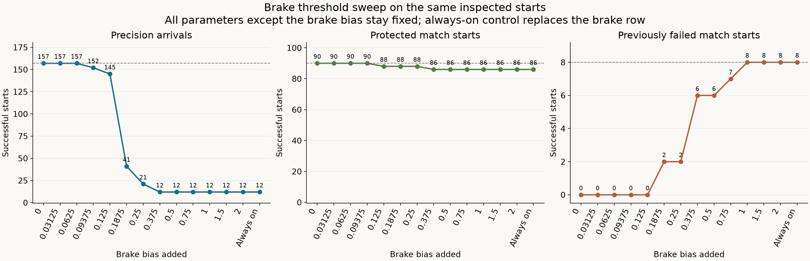
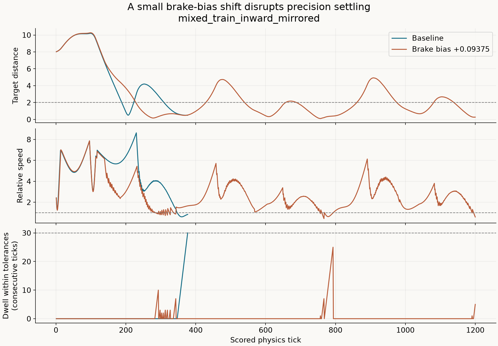

# Diagnosing the remaining brake-off approaches

All eight failures of the [focused-progress finalist](learned-guidance-focused-progress.md)
can complete the native arrival handoff when braking changes. A uniform brake
bias does not provide a usable improvement in this sweep: the small tested
shifts preserve existing successes but recover no failures, while larger shifts
recover failures and lose precision arrivals. The current retained candidate
therefore remains unchanged at **90/98 inspected match starts and 157/157
precision arrivals**.

This diagnostic includes all 82 previously inspected match starts and the 16
validation starts from the preceding experiment. All 98 are now inspected data;
there are no fresh validation continuations or evolutionary generations here.

## Controlled intervention

The [frozen recipe](data/learned-guidance-brake-bias-v1-plan.json) tests 13 offsets
added to the final linear brake bias, starting at zero, plus a constant-brake
control. Every other network parameter stays fixed. The constant-brake control
instead sets the brake row's eight weights to zero and its bias to +1.
Steering and thrust outputs are identical on identical inputs; subsequent
actions can differ after braking changes the observed trajectory.

Each variant runs the same 98 match starts and all 157 distinct precision
starts: **3,570 physical episodes** in total. The original nine observations,
action decoder, physics, native priorities, admission gates, failure rules and
precision tolerances retain their existing behavior.

| Added brake bias | Precision / 157 | Protected matches / 90 | Recovered failures / 8 |
| --- | ---: | ---: | ---: |
| 0, retained baseline | 157 | 90 | 0 |
| 0.03125 | 157 | 90 | 0 |
| 0.0625 | 157 | 90 | 0 |
| 0.09375 | 152 | 90 | 0 |
| 0.125 | 145 | 88 | 0 |
| 0.1875 | 41 | 88 | 2 |
| 0.25 | 21 | 88 | 2 |
| 0.375 | 12 | 86 | 6 |
| 0.5 | 12 | 86 | 6 |
| 0.75 | 12 | 86 | 7 |
| 1.0 | 12 | 86 | 8 |
| 1.5 | 12 | 86 | 8 |
| 2.0 | 12 | 86 | 8 |
| Constant brake | 12 | 86 | 8 |

The sweep takes **24.0 seconds**, with another 0.3 seconds for the declared
precision traces. Native-source reconstruction and the separate preflight bring
the completed execution phases to **75.6 seconds**. Compilation, the rejected
first preflight, analysis and packaging are outside that timing.

The [machine-readable results](data/learned-guidance-brake-bias-v1-results.json)
retain every variant and per-case outcome. This finite grid establishes that
none of the tested uniform shifts meets retention; it does not rule out every
intermediate bias or a different state-dependent brake policy.

## Recoverable match starts

The first tested offset to recover seed 10037 P1 in both shapes is +0.1875,
completing after 74 ticks with 31 braking ticks. This resolves the two newest
cases' recoverability under a braking intervention. At +0.375, seed 42 P1 and
seed 1021 P2 also recover in both shapes. The longer seed 42 P2 start first
recovers at +0.75, and the longer seed 10101 P2 start at +1.0.

The constant-brake control completes all eight: seed 42 P1 after 19 ticks,
seed 42 P2 after 84, seed 10101 P2 after 117, seed 1021 P2 after 63, and seed
10037 P1 after 42. Paired dirt shapes have identical results and are correlated
cases, rather than independent evidence of generalization.

The protected losses are the familiar seed 8191 P2 pair, starting at +0.125,
and the seed 131071 P2 pair, starting at +0.375. These are native route or sun
avoidance preemptions. More braking alone does not preserve the timing of those
previously successful native handoffs.

## Why precision regresses first

At +0.09375, all eight failed-match action sequences are still unchanged from
the baseline, yet five precision starts already time out. Their longest dwell
within both tolerances is 20–29 ticks, short of the required 30 consecutive
ticks. Each enters the arrival window; the changed policy fails to settle there.

For example, `mixed_train_inward_mirrored` originally arrives after 377 ticks.
With +0.09375, it repeatedly passes through the target region but times out at
1,200 ticks with a longest dwell of 25. Its final position and speed are both
inside tolerance, but its current dwell is only five ticks. The other four
regressions are `qualification_target_motion_b2_p0`,
`mixed_fresh_moving_b2_p0`, `mixed_fresh_moving_b3_p0`, and
`mixed_fresh_inward_b0_p0`.

The first changed brake decisions in these five precision traces occur at
relative speeds 1.07–3.56 and target distances 7.02–23.84. The eight failed match
starts have initial relative speeds 31.83–50.26 and distances 16.92–64.12.
Those quantities are already represented in the nine inputs. They distinguish
these sampled situations; this does not prove that the current hidden layer
can express every needed distinction across all trajectories.

The failed matches' maximum brake outputs range from -0.7290 to -0.1827.
Shifts that leave every brake decision below zero provide no behavioral progress
on those cases. This suggests testing whether a graded reward for moving toward
braking can help evolution cross the binary action threshold selectively.
It is a search hypothesis, rather than a demonstrated fix.

## Matched training follow-up

Start from the unchanged focused finalist and compare the current fitness with
a training-only progress term for braking at these eight demonstrably
recoverable starts. Put completed precision arrivals, all 90 protected match
starts, and additional completed starts ahead of that term. Keep the comparison
matched in initialization, mutation settings and budget, and freeze separate
validation worlds before training.

The purpose is to test whether feedback below the on/off threshold helps search
find selective braking. All 98 current match starts are training evidence now.
A candidate still needs every precision start, inspected approach and fresh
validation approach before live integration can proceed. No such candidate was
selected by this diagnostic.

The subsequent [graded-braking comparison](learned-guidance-graded-braking.md)
completes that experiment. The graded arm reaches 92/98 inspected and 16/16
fresh starts, compared with 90/98 and 14/16 for the matched control, retaining
all 157 precision arrivals and every baseline match success. The added
recoveries apply braking later in their trajectories; every fixed initial brake
output is still negative. Six inspected failures continue to block integration.

## Verification and reproduction

All **19 targeted guidance tests pass**. The new checks cover the isolated bias
intervention, zero-offset identity, distinct physical starts, protected-set
membership and the fixed episode budget. Formatting and whitespace checks pass.
The frozen preflight reproduces all 98 match starts and 157 precision starts
from the preceding receipt.

All 98 baseline match traces are byte-identical to the preceding finalist, and
all 157 baseline precision endpoints have identical native values apart from
runtime identity. The other 1,274 match trials either retain baseline actions
throughout or first change only braking; their shared prefixes remain physically
identical. Trace verification covers 91,913 match decisions. The declared rule
selects all five precision failures at the first regressing nonzero offset;
their ten baseline/changed
traces match ordinary endpoints and verify another 9,042 decisions. Both plots
were visually checked. All 2,248 manifest-listed files in the four preceding
experiment packages remain unchanged.

The first preflight stopped on JSON representation differences before any
model continuations. Its 98 world and mission hashes already matched. The
corrected comparison reads both representations through the same JSON parser,
and an independent comparison verifies the resulting serialized receipt against
the prior file. The rejected attempt's source, executable and logs are retained.

The ignored test `learned_guidance_brake_bias` accepts
`SPACEWARS_BIAS_MODE=preflight|sweep`, a fresh `SPACEWARS_BIAS_OUT`, the exact
baseline through `SPACEWARS_BIAS_MODEL`, and the preceding receipt through
`SPACEWARS_BIAS_PRIOR`. The sweep also requires the frozen
`SPACEWARS_BIAS_PREFLIGHT`. Build with Rust 1.89.0, locked offline dependencies,
the optimized `ci` profile and `RUST_MIN_STACK=16777216`. Workers use Auto at
75% total-machine CPU.

The evidence directory is
`data/training-experiments/recovery-guidance-brake-bias-v1-20261017/`.
`run.py` executes both phases; `analyze.py` verifies endpoints and action
prefixes; `inspect_traces.py` measures precision divergences and failed-match
brake outputs; `plot.py` renders the figures. The source patch includes the
preceding local harness work against
`d9f1ee9d725fcb797f1a5271bcf49043217e375f`.

| Identity | SHA-256 or genome ID |
| --- | --- |
| Recipe | `4ae8f01b6bcbdc5ab1f65ec8e04bd7f676a9f59b0ec857c5bd4df080a07b77b5` |
| Source patch | `b82ffe0b62138cad40a5a8f8e42521cc003de2df88b6f463fd73b40b23a1d3b3` |
| Preflight | `358e64cd1d139ca50d2966bd7050fa7af49ae339f43937bb989960822f35031e` |
| Baseline genome | `9ba26f93021d1c2ec7ca97288d81f47d33645965822680ea8d5ec26cfdadf705` |
| Baseline file | `3eca0ae862f9f8e28518c5bc73dd0b3252bf9cc654fbdac3d8a599dc26f1724f` |

The frozen runtime is
`diagnostic_v1/linux/x86_64/5e841de100e9ec7a3944eafb7b2f595999734a19d5a78deda755e8359d136a13`.

The archive is
`data/training-experiments/recovery-guidance-brake-bias-v1-20261017.tar.gz`
(62,467,949 bytes), SHA-256
`245496e795b7edfc78fe296e88c361bdbba21497f7b6165f6e4a73822e592e68`.
All 1,444 members were verified against retained files. Both attempts' frozen
executables are retained separately from the archive.
