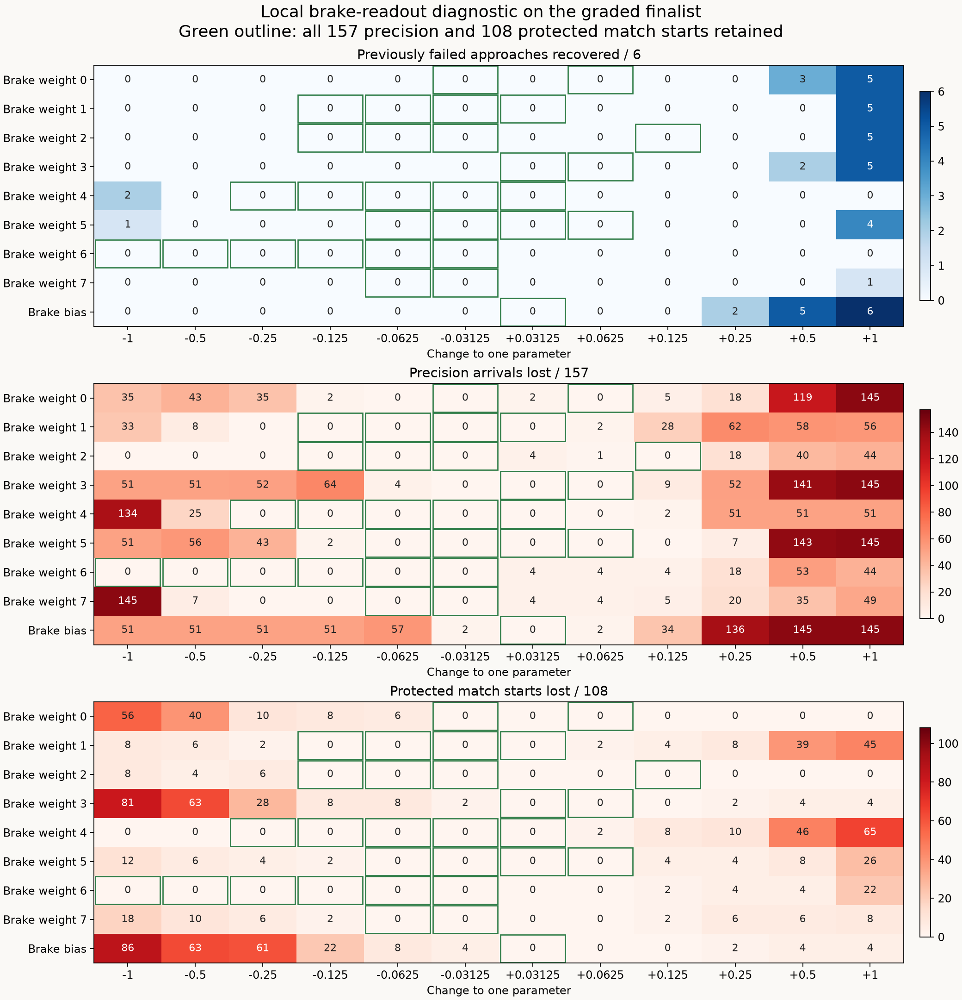

# Selective-braking neighborhood diagnostic

None of the **108 tested single-parameter brake changes** adds a recovery while
preserving all **108 successful match starts and 157 precision arrivals**. A
useful direction nevertheless emerges: increasing brake weight 2 by 1 recovers
five of the six failures and keeps all 108 match successes, but loses 44 precision
arrivals. Always braking recovers all six, losing four match starts and 145
precision arrivals. The retained
[graded finalist](learned-guidance-graded-braking.md) remains unchanged.

The subsequent [joint-readout fit](learned-guidance-brake-joint-fit.md) also
produces no candidate when every successful reference brake decision must be
preserved. Exact feature-space certificates identify that stricter constraint's
conflict; successful outcomes may still permit different braking trajectories.

This is an inspected diagnostic. No evolution, fresh validation, production
policy change or candidate promotion occurs here.

## Results

| Variant | Precision /157 | Protected matches /108 | Remaining failures recovered /6 |
| --- | ---: | ---: | ---: |
| Graded finalist | 157 | 108 | 0 |
| Best retained coordinate, weight 0 −0.03125 | 157 | 108 | 0 |
| Brake weight 2 +1 | 113 | 108 | 5 |
| Brake bias +1 | 12 | 104 | 6 |
| Always brake | 12 | 104 | 6 |
| Best final-population neighbor, slot 1 | 157 | 108 | 0 |

Thirty coordinate variants preserve all successes; none adds a recovery.
Together with the baseline and one population neighbor, 32 of the 125 tested
variants satisfy full retention. None of the 15 final-population neighbors
recovers any of the six current failures.

The preceding graded run's 384 recorded candidate evaluations also reveal a
limit to simply relaxing precision retention: among candidates preserving the
then-protected 90 match starts, no candidate completes more than two of its
eight additional starts, even without a precision requirement. This is a
statement about that recorded search, not about every possible controller.

The complete sweep evaluates **33,875 episodes** in 109.26 seconds; declared
trace replays bring diagnostic time to 112.72 seconds. Preflight and physical
source reconstruction bring the recorded execution phases to **2 minutes
47.77 seconds**, excluding compilation, analysis and archiving.

See the results and trace audit (`docs/data/learned-guidance-brake-neighborhood-v1-results.json`, in git history)
and [precision inspection](data/learned-guidance-brake-neighborhood-v1-inspection.json).

## What the useful direction changes

The brake-weight-2 intervention changes only one coefficient in the final brake
output row. The hidden layer and the steering and thrust functions remain
identical. Trace prefixes confirm that the first changed action is braking;
subsequent physical trajectories can produce different steering and thrust
commands from those same functions.

| Recovered approach | Shapes | First changed brake decision | Relative speed then | Native handoff tick |
| --- | --- | ---: | ---: | ---: |
| Seed 42 P1, short start | Angular and Round | 45 | 27.14 | 72 |
| Seed 42 P2, longer start | Angular | 26 | 48.27 | 73 |
| Seed 1021 P2 | Angular and Round | 28 | 32.67 | 60 |

Decision and handoff indices are one-based within the scored continuation,
after its common neutral preparation tick. Seed 10101 P2 still never brakes
and is preempted by native `launch` after 28 ticks. Always braking recovers it
in 138 ticks, confirming that a braking intervention can still succeed with
the latest model's steering and thrust functions.

The 44 precision regressions are unacceptable. The declared first three
regressions are moving-target cases, and their paired traces show early braking
that prevents successful pursuit:

| Precision case | First changed decision | Relative speed then | Closest distance in changed run | Final distance |
| --- | ---: | ---: | ---: | ---: |
| `qualification_target_motion_b0_p0` | 4 | 4.72 | 19.75 | 77.17 |
| `qualification_target_motion_b0_p4` | 4 | 3.78 | 18.07 | 55.85 |
| `moving_right` | 3 | 3.28 | 20.65 | 47.30 |

All three time out at 1,200 ticks without entering the two-unit distance window.
They brake for 490–504 ticks, compared with 98–102 ticks in their successful
baseline runs. Their required 30-tick dwell never begins. These particular
failures concern reaching the target, rather than only settling inside it.
The inspected successful match interventions and precision regressions have
different relative speeds, already represented in the observation contract.
That distinction does not by itself establish that the current hidden features
can separate every required decision.

Always braking also loses the player 2 shape pairs for seeds 8191 and 131071,
which are retained by the weight-2 intervention. Those native host preemptions
remain failures; later handwritten recovery is not counted as component success.

## Frozen scope and selection

The [recipe](data/learned-guidance-brake-neighborhood-v1-plan.json) combines all
98 previously inspected starts with the 16 now-observed validation starts.
Their 108 successes are protected; the six failures remain additional cases.
All 157 distinct original precision starts are included. Dirt-shape pairs share
world construction and may share trajectories; the starts are not independent
statistical samples.

Each of the eight brake-row weights and its bias is changed separately by
±0.03125, ±0.0625, ±0.125, ±0.25, ±0.5 and ±1. The +1 intervention is larger
than the ordinary maximum per-parameter mutation step of 0.15. The scan spans
both small and larger changes; it does not establish that no unsampled offset
or coordinated change can work.

The remaining variants are the unchanged finalist, an always-braking control,
and slots 1–15 of the frozen final graded population. Slot 0 is the baseline.
Every neighbor's original precision and match-completion counts are reproduced
on the new executable before interpreting the expanded retention results.

Trace selection is fixed before evaluation: baseline, always brake, best fully
retained coordinate, best coordinate with any new recovery, and best population
neighbor. Ranking uses precision completion, protected completion, additional
completion, then remaining-case speed and position progress; ties retain recipe
order. Repeated selections are deduplicated. All 114 baseline match traces are
kept; other selected variants retain the six failures and every protected loss.
The first three precision losses per selected variant receive paired baseline
and changed traces. These trace choices diagnose outcomes, not qualify models.

## Follow-up diagnostic

The [joint brake-readout fit](learned-guidance-brake-joint-fit.md) keeps the
graded finalist and records its hidden activations across all 108 successful
match starts and 157 precision arrivals. It finds no candidate requesting
initial braking while preserving every recorded successful brake decision,
including when each distinct failed start is targeted separately. Independent
exact-arithmetic certificates confirm that conflict on the frozen features.

That strict action-preservation requirement is stronger than successful
arrival. The next proposed experiment allows different braking trajectories
and judges a bounded repair by episode outcomes. Keep the observation contract
and acceptance gate unchanged: retain every baseline success, add recoveries,
then use a newly frozen validation cohort before qualification.

## Verification and reproduction

All **26 targeted guidance tests pass**. New tests cover isolated coordinate
changes and unchanged other outputs, complete case membership and budget, and
stable trace-selection priorities. Formatting and whitespace checks pass.

All 114 match starts and 157 precision starts reproduce the prior receipt.
The baseline's 114 match traces are byte-identical to the graded comparison;
all 157 precision endpoints match native values apart from runtime identity.
The audit verifies 14,250 match endpoints, 19,625 precision endpoints, all 108
isolated coordinate changes, 142 match traces and 12 full precision traces
(six baseline/changed pairs).
It checks 7,298 match decisions and 11,567 precision decisions, including 22
controlled match prefixes and six controlled precision prefixes. Every retained
trace matches its ordinary endpoint. The plot was visually checked. All 4,354
manifest-listed files in the six preceding experiment packages remain unchanged.

The ignored test `learned_guidance_brake_neighborhood` accepts
`SPACEWARS_NEIGHBOR_MODE=preflight|sweep`, a fresh `SPACEWARS_NEIGHBOR_OUT`, the
exact baseline via `SPACEWARS_NEIGHBOR_MODEL`, the preceding physical receipt
via `SPACEWARS_NEIGHBOR_PRIOR`, and the frozen graded checkpoint via
`SPACEWARS_NEIGHBOR_CHECKPOINT`. Sweep also requires
`SPACEWARS_NEIGHBOR_PREFLIGHT`. Build with Rust 1.89.0, locked offline dependencies,
the optimized `ci` profile and `RUST_MIN_STACK=16777216`. Workers use Auto at
75% total-machine CPU.

The evidence directory is
`data/training-experiments/recovery-guidance-brake-neighborhood-v1-20261017/`.
`run.py` executes preflight and sweep; `analyze.py` verifies endpoints and
controlled action prefixes; `inspect_precision.py` measures the three selected
pursuit regressions; `plot.py` renders the coordinate scan. The source patch
includes preceding local harness work against
`d9f1ee9d725fcb797f1a5271bcf49043217e375f`.

| Identity | SHA-256 or genome ID |
| --- | --- |
| Recipe | `7428acb6f94e331b87ee65af63d34409233d367ceab2717f390ba38fc1b7a3d3` |
| Source patch | `f35553707752d0c0866c7f73b44cfe5d086e7caafaab100921685a5ad3019dc6` |
| Preflight | `158691418086cf5632401a37dd40d3b8c54f47bb41197ef15db1be0890d12c23` |
| Baseline genome | `6ff82f329388dae5957dd77187520dc4f3322c4f2965fd8c88580b3569a4ad1e` |
| Baseline file | `6648b1a9c32efa8625b0c79825e7fedc44be29f47ce506c5100e4e5878d5c548` |

The frozen runtime is
`diagnostic_v1/linux/x86_64/c1838043f4e501854a9f724572f9e70bdcbfafb6c227448d6aede397f26a4c79`.

The archive is
`data/training-experiments/recovery-guidance-brake-neighborhood-v1-20261017.tar.gz`
(33,899,645 bytes), SHA-256
`ed58d470782e2e543f9d21c67e152fd9e5ee8cff7fb2551f6588cec67dc624c2`.
All 440 members were verified against retained files. The frozen executable is
retained separately from the archive.
