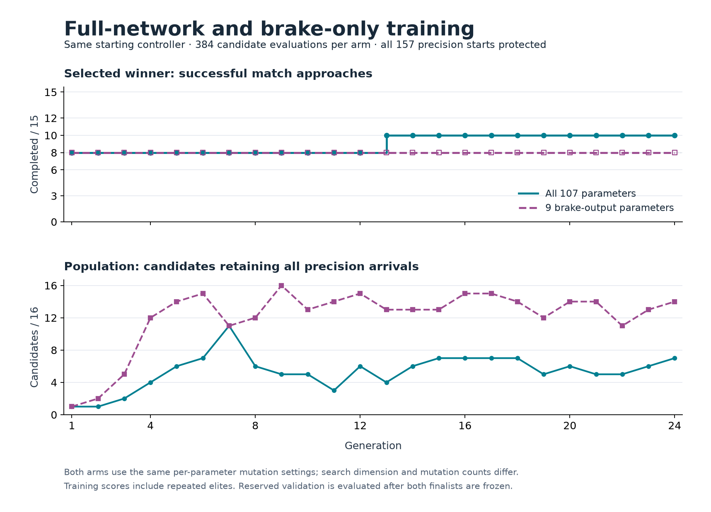
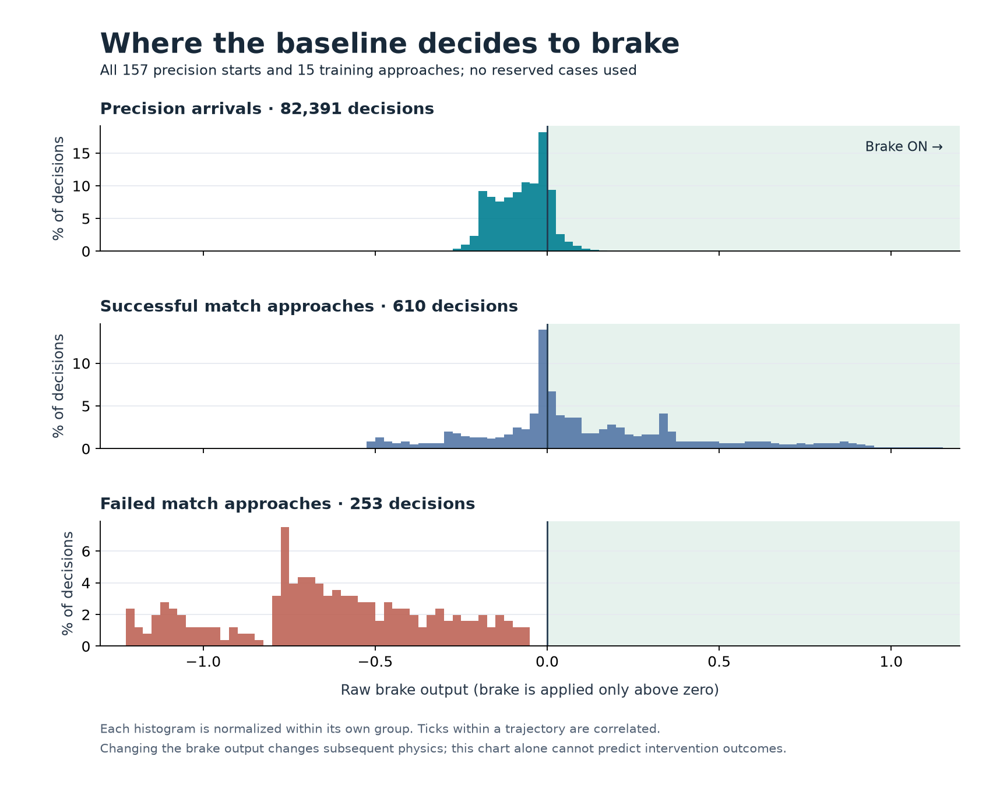

# Brake readout training comparison

Full-network continuation improved training approaches from **8/15 to 10/15**
and development from **38/54 to 42/54**. Evolving only the brake-output row did
not change either completion count. Both finalists retained **157/157 precision
arrivals** and completed **16/16 fresh validation approaches**, as did their
shared starting controller. Neither qualifies live integration: failures remain,
and full-network training also regressed two previously successful development
approaches.

The subsequent [protected-match experiment](learned-guidance-protected-matches.md)
recovers those two regressions, retains all 61 known match successes and adds
four more, with 157/157 precision arrivals intact. Its remaining failures and
missing reserved coverage still prevent live integration.

The two arms started from the same
[full-retention finalist](learned-guidance-full-retention.md), using the existing
nine observations, 9–8–3 network and action decoder. Training evaluated 132,096
episodes in **5 minutes 17 seconds**, excluding source reconstruction. The
complete sequence, including preflight, capture, an intentional pause/resume
and final comparison, took about **7 minutes 32 seconds** on the optimized build.

## Results

| Controller | Training approaches | Development approaches | Fresh validation | Precision starts |
| --- | ---: | ---: | ---: | ---: |
| Ordinary mission guidance | 14/15 | 52/54 | 16/16 | — |
| Arrival reference | 12/15 | 52/54 | 16/16 | 157/157 |
| Starting v3 network | 8/15 | 38/54 | 16/16 | 157/157 |
| Full-network finalist | 10/15 | 42/54 | 16/16 | 157/157 |
| Brake-only finalist | 8/15 | 38/54 | 16/16 | 157/157 |

Full-network training reached ten approaches at generation 13 and retained that
completion count through generation 24. It repaired the short seed-10101 P2
and seed-2027 P2 training approaches, applying the brake on 29/76 and 28/73
owned ticks respectively before native capture. Every earlier training success
remained successful. Five training approaches still end in a native climb
request without applying the brake.

Development gained six successes: those two short approaches and seed 73 P2,
each in both dirt shapes. It lost seed 8191 P2 in both shapes. These two
regressions **do apply the brake**, but their changed trajectories trigger the
host's sun-avoidance route after 116 scored ticks; the baseline completed capture
after 106. This is a separate problem from the remaining no-brake training failures.
Development overlaps training, and paired dirt variants are correlated.

The brake-only arm preserves the baseline's exact set of successful cases;
it makes small progress-score changes without completing additional approaches.
The equal budgets evaluated **338 distinct full-network genomes versus 140
distinct brake readouts**. With only nine parameters and the same 5% mutation
probability, the restricted search repeats more unchanged offspring. These
results compare the declared search recipes; they do not prove that a better
brake readout is unrepresentable or that new observations are required.

## Baseline braking behavior

The complete baseline capture contains **82,391 precision decisions**, including
12,217 brake applications. Its median raw brake output is −0.065; 15,148
decisions (18.4%) fall within 0.01 of the switching threshold. Braking requires
an output above zero. All seven failed training approaches instead keep braking
off across 253 decisions, with outputs from −1.224 to −0.053. A global increase
would alter many precision decisions before reaching most of those failed-match
outputs; closed-loop effects still require physical evaluation.

The machine-readable report (`docs/data/learned-guidance-brake-readout-v1-results.json`, in git history)
retains per-case gains and losses, output distributions, population history,
settling measurements and verification counts. The useful next diagnosis is the
new sun-avoidance regression alongside the five remaining no-brake training
failures. Full-network continuation remains the more productive tested search;
an expanded match-retention curriculum would be a new experiment with fresh
validation, not an extension selected using these outcomes.

## Frozen comparison

The [recipe](data/learned-guidance-brake-readout-v1-plan.json) declares two arms:

| Arm | Parameters evolved | Fixed parameters |
| --- | ---: | --- |
| All | All 107 network parameters | None |
| Brake | Eight final-layer brake weights and one bias | Hidden layer and turn/thrust output rows |

The brake arm evolves a separate eight-input, one-output search genome. Each
evaluation inserts that row into the frozen full network. The exported finalist
is an ordinary 107-parameter guidance genome; the search genome is not directly
usable as ship guidance. For identical observations, changing the brake row
cannot change turn or thrust outputs. Its physical trajectories can differ
because braking changes subsequent observations.

Each arm starts with its baseline seed and 15 random genomes in its own search
space. Both run 24 generations of 16 candidates, retain two elites, use
tournaments of three, and mutate each parameter with probability 0.05 by a
uniform perturbation within ±0.15. Initialization scale is 0.5, parameter limit
8, and run seed 1. The smaller search space changes the number of expected
mutations and the distribution of initial controllers; this comparison does
not isolate mutation count from search dimension.

Each candidate evaluates every one of the 157 distinct original precision
starts and the same 15 match-training approaches. The existing ordered fitness
retains precision completions first. Each arm has 384 candidate evaluations and
66,048 training episodes, for 132,096 episodes total. The last generation's
winner is exported from each arm before either is tested on reserved cases.
Results cannot extend training or select a different generation.

Development contains the previous 40 inspected approaches plus the 14 available
v3 validation starts. Those 54 cases are now inspected evidence. Four fresh
seeds—307, 1543, 12289 and 262147—reserve both seats and dirt shapes using the
same first-eligible discovery rule. Missing requested starts remain missing.
The existing integration gate still requires all precision starts, all 15
training approaches, all 54 development approaches and all 16 requested reserved
approaches without damage. Both arms are reported; validation does not select
between them.

The optimized episode pool uses Auto at 75% total machine CPU. Scheduling is
outside the fitness and random streams. The executable, source patch, recipe,
baseline genome and physical-start receipt are frozen before training.

## Reproduction

The test-only `learned_guidance_brake_readout` harness uses
`SPACEWARS_BRAKE_MODE` with `preflight`, `capture`, `train-all`, `train-brake`,
`resume-all`, `resume-brake` or `evaluate`. `SPACEWARS_BRAKE_MODEL` names the
original v3 finalist file, whose bytes and genome ID must match the recipe.
`SPACEWARS_BRAKE_OUT` must be fresh except for resume. Every mode after preflight
requires its exact receipt through `SPACEWARS_BRAKE_PREFLIGHT`.

`capture` records compact inputs, raw outputs and applied decisions for all 157
baseline precision trajectories and the 15 training approaches. It asserts that
tracing preserves each complete precision episode. `SPACEWARS_BRAKE_STEPS` can
stop training after a declared number of candidate batches; resume reloads the
checkpoint with the same executable and task. Every invocation checks the
actual checkpoint reload path.

Evaluation requires `SPACEWARS_BRAKE_RUNS` naming a directory with completed
`all/` and `brake/` runs. It compares both finalists with their shared baseline,
ordinary mission guidance and the arrival reference, then replays precision
cases to check endpoint parity and settling. The standard Rust 1.89.0, locked
offline dependencies, optimized `ci` profile and `RUST_MIN_STACK=16777216`
apply. No production controls or defaults change.

## Verification

All 11 targeted guidance tests passed, including readout grafting and identical
turn/thrust outputs on shared inputs. The 69 reused physical match starts and
157 precision starts matched v3. Baseline capture reproduced all 157 original
precision endpoints and all 15 training traces. Both runs checked checkpoint
reloads; the full-network arm also preserved its first generation across a
separate resume process.

The comparison ran 425 match episodes and 668 original-suite endpoint reports,
all ending at 100 health. All 207 reused baseline/reference/mission match traces
are byte-identical to v3; 334 reused precision endpoints match apart from runtime.
All 628 traced precision replays match their ordinary endpoints. The retained
32 full precision traces verify 26,076 applied decisions, and match traces verify
26,000 component decisions. Frozen source, executable, checkpoint and finalist
hashes remained unchanged. Formatting and whitespace checks pass.

## Retained evidence

The local archive is
`data/training-experiments/recovery-guidance-brake-readout-v1-20261017.tar.gz`
(39,695,261 bytes), SHA-256
`05b7532b615f668222310122a42783dd5fad55cc3dee4e3d0dd8df85c9ac70ca`.
All 681 members were verified against their retained files. The frozen test
executable is retained separately; the package includes the source patch against
`d9f1ee9d725fcb797f1a5271bcf49043217e375f`, recipe, baseline genome, starts,
checkpoints, selections, traces, scripts, plots and validation receipts.

The runtime is
`diagnostic_v1/linux/x86_64/3c9f0f07b64894672aada3330929e7264a94dec95a36836ccb9ad25b1d2bbcb3`.
The full-network finalist is
`87ef80d47da3fa4d3c15cccfdf83ce7d7377644808ee557867749c18e67d5600`
(file SHA-256 `61654e392602f1e3f0fd9cf59cc0b0160e3e663a6ce178582d5fd4defe65be27`).
The expanded brake-only finalist is
`639fea9942596e3702d735b6035db7a35d452048d3dd8702d521b6ba4b7b9488`
(file SHA-256 `804b6847583024f93b499719cea11fb35f69e4114922168eff2cb8fe7bbb0004`).
