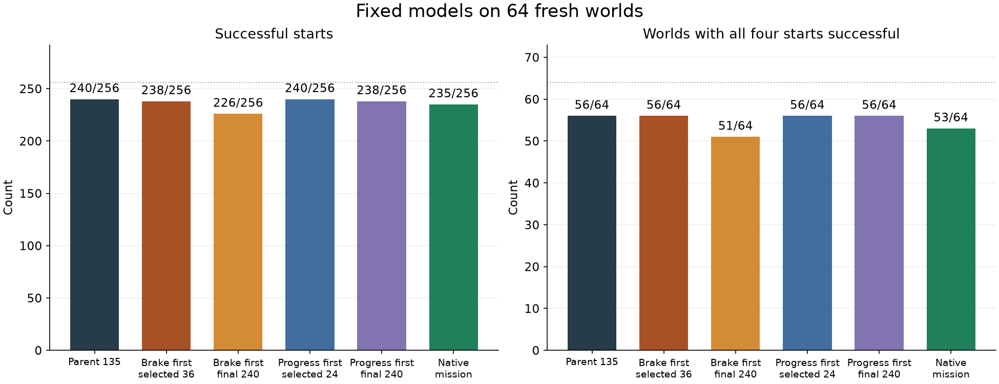
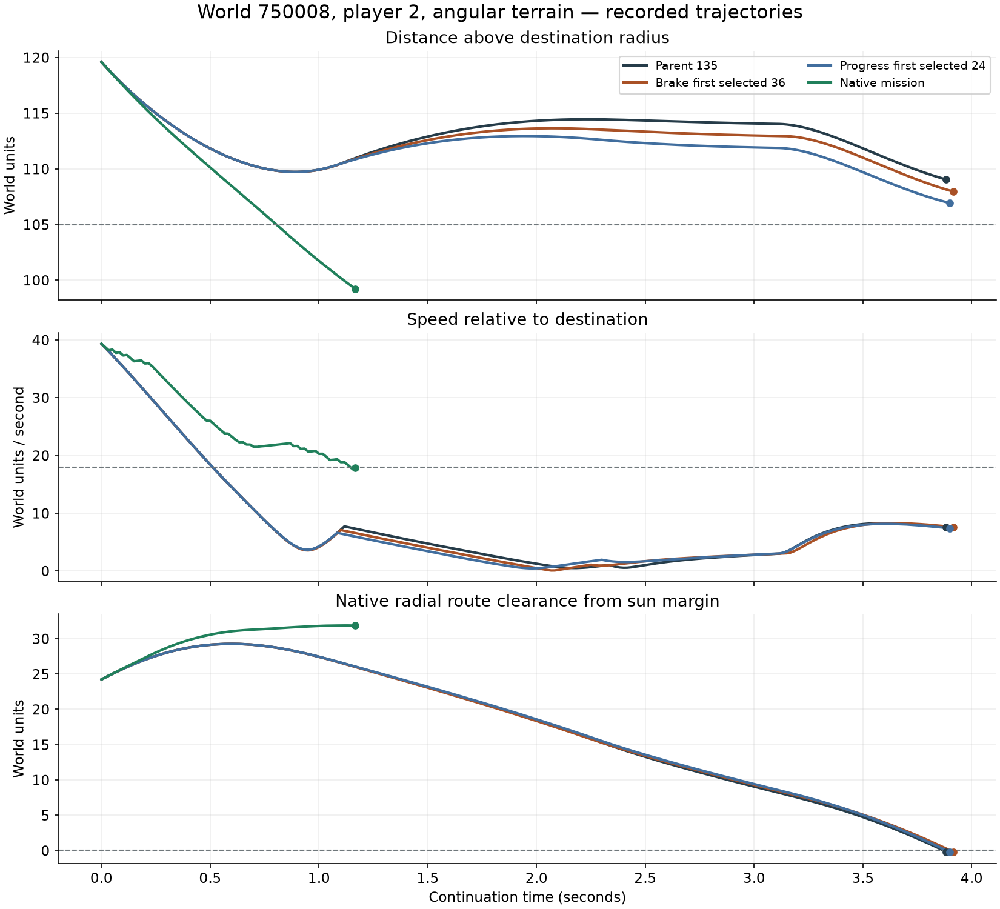

# Fixed guidance models across 64 new worlds

Validation checkpoint selection preserved better models than taking the final
generation in this sample. The selected physical-progress-first model completes
**240/256 fresh approach starts**, matching every success and failure of the
original parent. The selected brake-first model completes **238/256**, losing
two parent successes in one world. Neither improves the parent's fresh-world
completion count.

Keep the progress-first generation-24 artifact alongside the parent for further
research: it retains the earlier training and validation gains without a newly
observed completion regression. This is an artifact-level recommendation from
one evolution seed, not evidence that changing reward priority generally helps.
No production model or scoring default changed.

## Fresh approach results

The [frozen plan](data/learned-guidance-broad-v1-plan.json) compares five saved
models and native mission control on identical physical starts. Models were
frozen before discovering worlds, and none were trained or selected during this
evaluation. Each world contributes both players in angular and round terrain.

| Controller | Arrivals / 256 | All four starts arrived / 64 worlds | Gains / losses against parent |
| --- | ---: | ---: | ---: |
| Original generation 135 parent | 240 | 56 | — |
| Brake first, selected generation 36 | 238 | 56 | 0 / 2 |
| Brake first, final generation 240 | 226 | 51 | 2 / 16 |
| Progress first, selected generation 24 | 240 | 56 | 0 / 0 |
| Progress first, final generation 240 | 238 | 56 | 0 / 2 |
| Native mission control | 235 | 53 | — |

The selected brake-first checkpoint gains 14 starts and loses two compared with
its final checkpoint. The selected progress-first checkpoint gains two and loses
none compared with its final checkpoint. This fresh comparison supports using
validation to retain earlier checkpoints, while the brake-first regression shows
that validation cannot guarantee preservation on unseen worlds.

That regression is world 770055 player 1 in both shapes. The parent and selected
progress-first model arrive after 29 ticks; selected brake-first control runs for
66 ticks before the host requests a climb. The final progress-first model instead
loses world 770034 player 1 in both shapes.

These are bounded approach continuations, not full matches or completed ship
recoveries. Every fresh non-arrival ends because the host requests another mode
or route. Native gameplay would continue after that transition; this diagnostic
stops there. The parent and selected progress-first model have 12 sun-route
interruptions and four climb interruptions each. Native control reaches 12 starts
that they miss, while they reach 17 that native control leaves for another mode.
The net count does not establish a generally superior gameplay controller.

Completion ties also hide timing differences. Across their 240 common arrivals,
selected progress-first control is faster than the parent on 52 starts, slower
on 155 and tied on 33. Total elapsed ticks are 12,851 versus 12,810. Timing was
reported after evaluation and did not affect selection.

[Open the synchronized replay](data/learned-guidance-broad-v1-replay.html) for
all six controllers on 256 fresh starts and the two retained diagnostic starts.
It shows recorded paths relative to the moving target, controls and outcomes;
it does not render terrain or the whole world. The
[complete results](data/learned-guidance-broad-v1-results.json) retain paired
case lists, outcome categories, world counts and diagnostic measurements.

## Why the retained sun route interrupts guidance

World 750008 player 2 reproduces exactly in both terrain shapes. The host remains
in **Transfer** and requests a route around the sun; it does not enter emergency
**AvoidSun** mode. This distinction matters because the component trial owns only
an unobstructed local approach, while routing remains with the host.

The native arrival gate requires distance below the destination radius plus 105
and speed relative to that destination below 18, with the native query and frame
conditions satisfied. Both selected learned models fall below the speed threshold
at tick 31, but never enter the required radius. They slow almost to a stop outside
it, then resume inward progress. Native control keeps moving inward and arrives
at tick 70.

| Controller | End tick | Closest altitude above destination radius | Result |
| --- | ---: | ---: | --- |
| Parent | 233 | 109.04 | Sun route requested |
| Selected brake first | 235 | 107.95 | Sun route requested |
| Selected progress first | 234 | 106.92 | Sun route requested |
| Native mission | 70 | 99.23 | Arrived |

At each learned endpoint, the native radial route crosses inside the sun's
65-unit routing margin. The emergency closest-approach margin remains positive:
3.36 units for selected brake-first control and 2.76 for selected progress-first
control. Recorded geometry therefore agrees with the requested detour. Native
control completes its approach while the route still has 31.86 units of clearance
outside that routing margin.

The immediate learning problem is finishing the approach promptly after slowing
down. These traces do not justify disabling the host guard or adding sun inputs
to the component. They also do not isolate a single faulty action: steering,
thrust and braking jointly produce the delayed path.

## Scope and verification

Discovery scans 69 seeds, 770001 through 770069, to obtain the first 64 complete
worlds. Five lack an eligible start for one player within the fixed 10,800-tick
prefix or before the round ends. All missing starts are retained in the discovery
audit. No continuation outcome filters the cohort. Results apply to the admitted
approach states; player and shape cases within a world are correlated.

The executable run takes 138.5 seconds, including source discovery, the retained
diagnosis and all six fresh comparisons. All 32 focused Rust tests pass, followed
by the ignored experiment test. The audit checks 1,548 episode traces, 70,986
component decisions and 2,298 diagnostic geometry states. The ten retained
learned diagnostic traces are byte-identical to the earlier experiment. Geometry
replay verifies every physical step against the recorded world hash. Source
states remain unchanged after each controller's evaluation.

Browser checks cover all 1,548 terminal states, playback, case switching and a
narrow viewport. Desktop and mobile captures were inspected at 1× scale. An
initial diagnostic check exposed JSON numeric representation differences before
fresh discovery; the corrected comparison uses the same JSON decoder on both
sides and retains exact world and trace hashes. That failed attempt is retained.

## Next experiment

Use the now-inspected failures as development cases and keep the parent as a
fixed comparator. The selected generation-24 artifact is the stronger candidate
for further refinement: it retains all 317 prior training starts, the 28/32
validation result and every parent success here. It has not established a fresh
completion advantage or passed live hybrid integration.

A useful controlled follow-up would compare the existing mutation scale with
smaller steps, using the same scoring and validation rule in both arms. Include
the feasible near-arrival failures and protect demonstrated successes. Reserve
new worlds for final evaluation after checkpoint selection; these 64 worlds
are now inspected evidence and must not be presented as a fresh test again.

The evidence package is
`data/training-experiments/recovery-guidance-broad-v1-20261018/`. It retains the
source, executable, fixed models, source states, complete traces, analysis,
replay and a verified archive manifest. Production controls remain unchanged.
