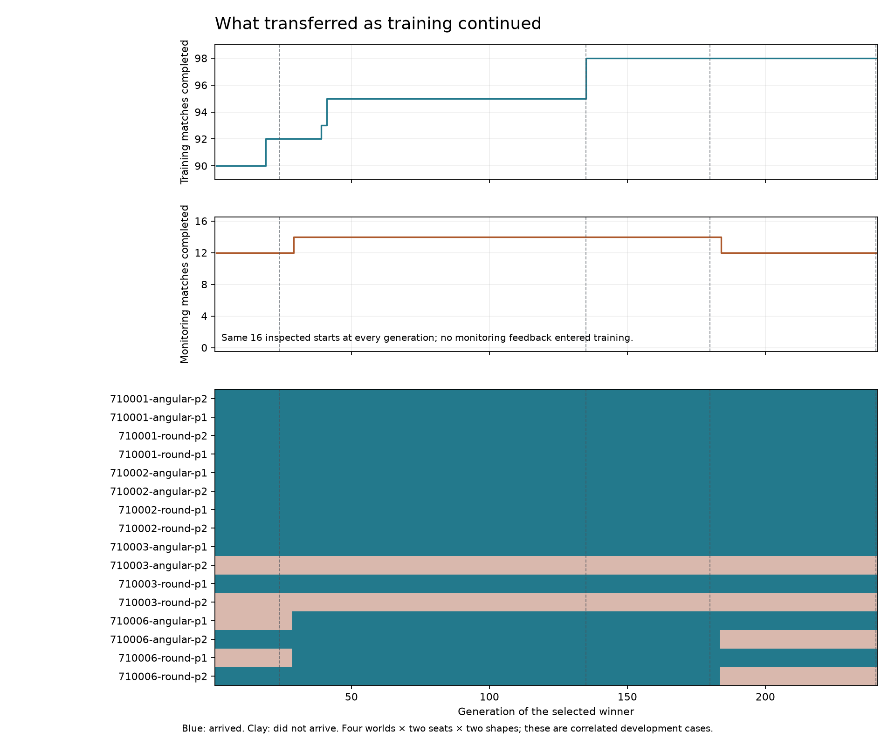
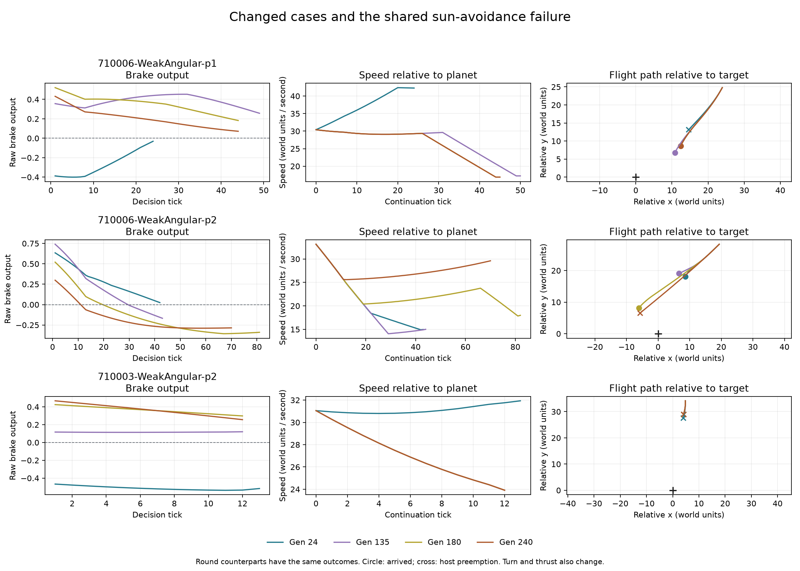

# Transfer across saved training checkpoints

The [240 generation run](learned-guidance-graded-long.md) first solves all its
training cases at generation 135, but its best observed transfer occurs before
the final generation. Generations **135 and 180 complete 128 of 130 inspected
match starts**, retaining all **157 precision arrivals**. Generation 240 completes
126 of those match starts. The two common failures trigger native sun avoidance
under both handwritten controls as well.

## When behavior changes

Every saved generation winner was evaluated on the same 16 recently inspected
starts. This retrospective diagnostic does not change the original run's
selection or its frozen generation 240 result.

| Generations | Completed monitoring starts | Change |
| --- | ---: | --- |
| 1 through 28 | 12/16 | Seed 710006 player 1 and seed 710003 player 2 fail in both shapes |
| 29 through 183 | 14/16 | Seed 710006 player 1 succeeds in both shapes |
| 184 through 240 | 12/16 | Seed 710006 player 2 loses its success in both shapes |

All four checkpoints selected for full rechecking preserve 157/157 precision
arrivals and the original 90 protected approaches. Generations 135, 180 and 240
also preserve all eight difficult training approaches and all 16 previously
inspected approaches outside selection. Generation 24 completes two of the eight
difficult approaches. Thus the later regression occurs outside the training
cases, while the original training success counts remain full.

The monitoring cohort contains four worlds, each tested in two seats and two
dirt shapes. Shape counterparts are correlated observations. This is development
evidence, not a new qualification set or a reliability estimate across evolution
seeds. The fixed final model remains generation 240 for the original experiment.

## What the trajectories show

On seed 710006 player 2, generation 24 arrives after 43 ticks, generation 135 after
44, and generation 180 after 82. Generation 240 releases the brake earlier and
is preempted for launch at tick 70. Its relative speed initially falls, then
rises again. Turn and thrust change too, so this comparison does not isolate a
single causal parameter or action.

[Open the synchronized flight replay](data/learned-guidance-checkpoint-review-v1-replay.html)
to select any of the 16 starts, play or pause, change speed, and scrub the four
checkpoints together. It displays recorded positions relative to the moving
target, actual applied controls, speed and terminal outcomes. It is a schematic
flight trace player; terrain and other world geometry are not rendered.

Seed 710003 player 2 remains preempted for sun avoidance throughout all 240
winners, in both shapes. The native mission controller reaches the same kind of
intervention at tick 20 and the reference arrival controller at tick 18. This
supports investigating the handoff domain separately; it does not establish
that no alternative trajectory can arrive.

## Next training comparison

The [broader coverage plan](data/learned-guidance-coverage-v1-plan.json) retains
the architecture, original starting parent and initial population, mutation
settings and 240 generation budget. It expands match training from 98 to 160
starts: 128 demonstrated known successes plus 32 native-completing starts on
eight new worlds. All known successes receive protected priority. The two shared
sun-avoidance cases remain explicit host diagnostics outside selection.

Another eight worlds supply monitoring at generation 1 and every 12 generations.
A third group of eight worlds supplies final evaluation after the fixed winner
is frozen. Monitoring never selects a winner or stops training. Both held-out
groups retain native-eligible starts even when a native continuation does not
arrive; native outcomes and discovery exclusions are reported separately.

The completed original run supplies the control. Both recipes use 3,840 candidate
evaluations, but broader coverage requires more physical episodes. This compares
the expanded recipe, including its retention priorities, rather than isolating a
single reward change. Live integration remains separately gated.

## Reproduction and checks

The frozen [review plan](data/learned-guidance-checkpoint-review-v1-plan.json)
selects all 240 generation winners for monitoring and generations 24, 135, 180
and 240 for full evaluation. Repeated identical winner genomes share monitoring
results. The test-only adapter reconstructs and verifies all 130 physical starts
against the original receipts and reproduces all four saved training scores.

All 260 rechecked generation 24 and 240 match traces are byte-identical to the
completed experiment. All 334 original precision endpoint entries match at
native precision. The audit verifies 520 checkpoint match traces, 26,597 component
decisions, 628 precision endpoint parity checks, and 32 handwritten-control traces.
All 30 targeted guidance tests pass. Browser checks cover case selection,
playback, scrubbing, terminal outcomes and a narrow viewport; both layouts and
plots were inspected.

The local package is
`data/training-experiments/recovery-guidance-checkpoint-review-v1-20261017/`.
It retains the source patch, frozen executable, exact genomes, physical receipts,
full results, monitoring history, replay generator and evidence checks. Run
`experiment-tests learned_guidance_checkpoint_review --ignored --nocapture`
with `SPACEWARS_REVIEW_ROOT` pointing at a fresh output root containing the
review plan; `analyze.py`, `plot.py`, and `replay.py` produce the reports.
