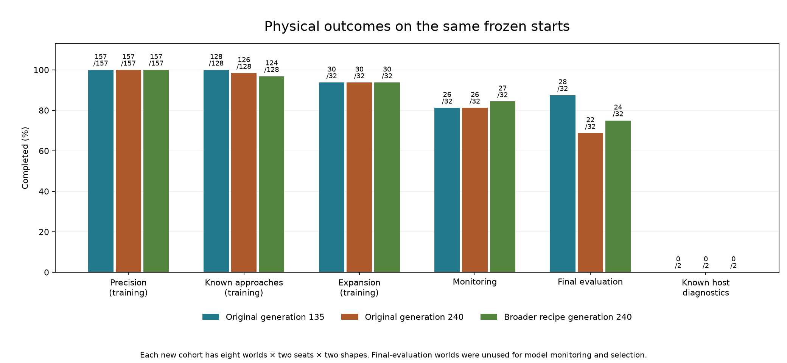
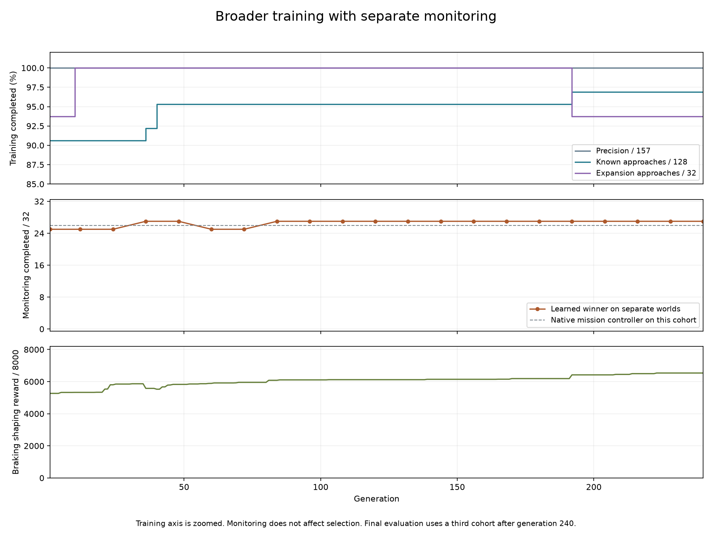
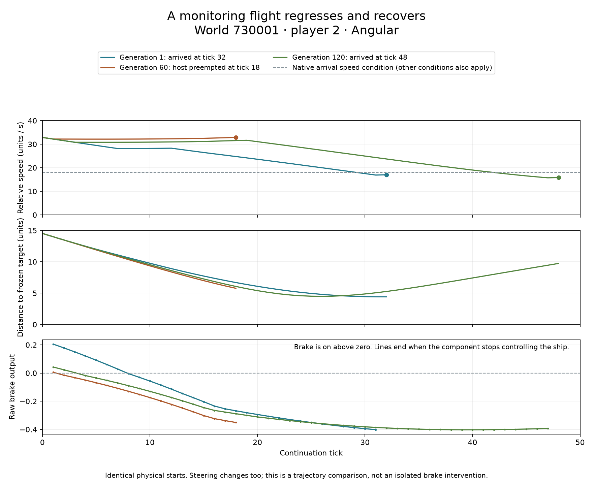

# Broader arrival training with separate monitoring

The broader 240-generation run completes **24/32 final-evaluation approaches**,
compared with 22/32 for the original final model and **28/32 for the original
generation-135 checkpoint**. It retains 124/128 known approaches, so its
development-retention requirement fails. Generation 135 remains the strongest
starting point among these three models; none is newly qualified for live use.

## Results

All models were tested on identical physical starts. Each preserves 157/157
precision arrivals. The final-evaluation worlds were unused for model monitoring
and selection; all three identities were frozen before those continuations.

| Model | Known / 128 | Expansion / 32 | Monitoring / 32 | Final evaluation / 32 | Host diagnostics / 2 |
| --- | ---: | ---: | ---: | ---: | ---: |
| Original generation 135 | 128 | 30 | 26 | 28 | 0 |
| Original generation 240 | 126 | 30 | 26 | 22 | 0 |
| Broader recipe generation 240 | 124 | 30 | 27 | 24 | 0 |

Against generation 135, the broader model loses four known approaches and four
final-evaluation approaches, gains no expansion successes, and has two monitoring
gains offset by one loss. The known losses are `train-42-p1-d65`,
`train-42-p2-d65`, `train-10101-p2-d65`, and `seed-42-weak-round-p1`; all trigger
native launch preemption. The final-evaluation losses are world 740005 player 2
and world 740006 player 1 in both shapes. Against the original generation 240,
the new model has four final-evaluation gains and two losses, producing its
net improvement of two.

The extra monitoring success is not dominance over either earlier model or the
native controller. On the 26 monitoring starts that native control completes,
generation 135 completes 24, the old final model 22, and the broader model 23.
On the 26 native-completing final-evaluation starts, those counts are 24, 18 and
20. Each learned model also completes four of the six native final-evaluation
nonarrivals. The complete case-level comparisons are in the
[results](data/learned-guidance-coverage-v1-results.json).

[Open the synchronized replay](data/learned-guidance-coverage-v1-replay.html)
to compare all three models on any of the 226 match starts. It includes grouped
case selection, play/pause, speed, scrubbing, recorded controls, outcomes and
model identities. It is a schematic flight trace, without terrain or other
world geometry.

Known successes rise from 116 to 118 at generation 36, 122 at generation 40 and
124 at generation 192. Expansion reaches 32/32 at generation 10, then falls to
30/32 at generation 192. Monitoring moves 25 → 27 → 25 → 27 at the sampled
generations 1, 36, 60 and 84, and its successful case set remains unchanged
through generation 240. The last ordered-fitness improvement occurs at
generation 223. All 3,840 candidate evaluations finish, covering 3,346 distinct
genomes. Training, checkpoint saves and monitoring take 52m 17.83s; monitoring
itself takes 2.46s. The enclosing training phase, including reconstruction,
takes 53m 10.10s, and final evaluation takes 1m 41.59s.

## Comparison

The [checkpoint review](learned-guidance-checkpoint-review.md) found that the
original generation-135 model completed all 128 demonstrated match successes,
while generation 240 lost two starts outside selection. The
[frozen coverage plan](data/learned-guidance-coverage-v1-plan.json) tests broader
training with the same original parent, initial population, evolution seed,
network, mutation settings and 240-generation budget. The completed original
run supplies the control; original generations 135 and 240 are the declared
comparators. Generation 135 is a retrospective development comparator, not a
replacement for the original experiment's fixed final model.

Each candidate receives 157 precision episodes, 128 known approaches, and 32
new training approaches. The eight original brake probes and their reward
formula remain unchanged. Retention membership expands, and approach-progress
rewards now concern the 32 expansion starts. This compares the broader recipe;
it does not isolate corpus size from retention priorities or progress membership.

Both runs evaluate 16 candidates for 240 generations: 3,840 candidate
evaluations. The broader run uses 1,217,280 training episodes, compared with
979,200 for the original run. Generation and population budgets match; physical
episode counts and elapsed time do not.

## Selection and regressions

The 107-parameter network starts from one original parent and 15 independently
randomized candidates. Each generation evaluates all 16, copies the best two
unchanged, and produces 14 offspring. Each offspring chooses the best of three
randomly sampled population members, with replacement. It copies that parent
and gives each parameter a 5% chance of adding a uniform offset from -0.15 to
just below +0.15, clipping to [-8, 8]. That selects about 5.35 parameters per
offspring on average. There is no crossover or backpropagation.

Fitness compares, in order: precision successes, known-approach successes,
expansion successes, brake-probe reward, approach speed and position rewards,
precision position and velocity rewards, and spare ticks. Each earlier term
takes precedence over all later terms. Ties use genome identity and population
slot for deterministic ordering. See the
[evolution runner](../crates/engine-agent/src/evolution.rs) and
[graded fitness](../crates/engine-client/src/client_scenarios/surface_sortie/mission/guidance_approach/training/match_retention/graded.rs).

Elitism preserves the best ordered training score. It does not preserve every
lower-priority reward or unseen flight. Success priorities protect group counts;
while a group is imperfect, one gained case can offset a different lost case.
Monitoring never participates in breeding or early stopping. All generation
winners remain saved, including models whose observed transfer later regresses.

A retrospective inspection of generations 121–140 illustrates the search
pressure: 25 of 280 offspring preserve all 157 precision successes, 18 also
preserve at least 122 known successes, and 10 also retain all 32 expansion
successes. This interval was inspected after evaluation and did not alter the
recipe. Distinct candidates continue to be produced, but most cannot replace
an elite without losing a higher-priority success count.

Generation 192 provides a training-side example: known successes rise from 122
to 124 while expansion successes fall from 32 to 30. Precision remains 157/157.
The ordered score prefers this change because known successes come before
expansion successes. The combined match-success count does not increase in this
step. Monitoring remains 27/32 at the sampled generation 192 winner.

One observed example is the change from generation 48 to 60: completion counts
remain 157 precision, 122 known and 32 expansion starts, while brake-probe reward
rises from 5,827 to 5,891. Monitoring falls from 27 to 25 successes because both
shapes of world 730001 player 2 lose their arrival. Both recover by the sampled
generation 84 winner.

The retained Angular traces show generation 1 arriving at tick 32 with seven
braking ticks. Generation 60 brakes once and triggers a native launch handoff
at tick 18. Generation 120 brakes three times and arrives at tick 48. Its initial
brake output is 0.043, compared with 0.006 for generation 60, and it remains
positive for longer. Steering changes too; these traces do not establish that
braking alone causes the different outcomes. This inspected example explains
fluctuating transfer and is not an additional qualification test.

## Cohorts and interpretation

Native-only discovery scans the three frozen seed lists in order. Every
accepted world must supply one eligible start for each seat and each dirt
shape. Expansion additionally requires all four native continuations to arrive.
Monitoring and final evaluation do not filter by continuation outcome. All
scanned worlds, missing starts, native outcomes and exclusions are retained.

| Cohort | Worlds | Starts | Native arrivals | Use |
| --- | ---: | ---: | ---: | --- |
| Expansion | 8 | 32 | 32 | Candidate fitness |
| Monitoring | 8 | 32 | 26 | Generation 1 and every 12 generations; outside selection |
| Final evaluation | 8 | 32 | 26 | After all three model identities are frozen |

The frozen generation-240 winner is used without early stopping or selection
by monitoring. Full match traces are retained for all final models on all 226
starts. Monitoring also retains full traces at generations 1, 60, 120, 180 and
240. Monitoring is development evidence; final evaluation is separate.

The two previously shared seed-710003 player-2 sun-avoidance cases remain
explicit host diagnostics outside fitness. Their unresolved outcomes do not
prove recovery impossible or waive the existing live-integration gate. Raw
results must also distinguish learned performance on native successes from
learned recoveries of native failures: 26/32 is a comparison, not a ceiling.

This is one evolution seed, and each new cohort has eight world groups.
Seat and shape counterparts are correlated. Discovery is conditional on the
native host reaching an eligible approach. These results cannot establish
whole-match reliability or generalization across unrelated worlds and organisms.
Production controls, physics, observations and actions are unchanged.

## What to do next

Use the original generation-135 artifact as the parent for the next controlled
continuation. It already scores 157 precision, 128 known and 30 expansion
successes under this broader recipe, exceeding the new finalist's own ordered
training score. This comparison deliberately restarted from the original parent
to match the previous run; it did not test continuing from generation 135.
The result therefore does not demonstrate that broader data is harmful or that
the network lacks capacity. It demonstrates that this search did not reach an
already available better solution within its budget.

Starting from generation 135 with the same known-success group puts both
precision and known counts at their maxima. Elitism and the existing priority
order would then prevent losing any of those cases to an expansion gain.
First inspect the shared expansion failure, world 720006 player 1 in both
shapes: all three learned models trigger sun avoidance, while native control
arrives. That gives a concrete target for the next continuation or bounded
diagnostic. Any recipe or mutation change should be declared before training,
and another final comparison should use fresh worlds. These final-evaluation
results are now inspected development evidence for future decisions.

## Verification and retained evidence

The native preflight verifies frozen physical sources, disjoint cohort seeds
and unchanged brake probes. Initial population IDs match the original run.
All 240 saved winners obey the native fitness/tie ordering; all 478 elite
copies retain their identities and scores, and the ordered winning score never
decreases. Monitoring receipts match the exact saved generation winners. Final
re-evaluation reproduces the final training score and monitoring endpoints.

The audit checks 678 final match traces and 36,268 component decisions, 160
monitoring traces, 471 precision endpoint parity checks, and 24 precision traces
with 20,900 decisions. All 260 repeated earlier-model match traces are
byte-identical to the checkpoint review; all 334 repeated precision endpoints
match at native precision. All 30 targeted guidance tests pass. Browser checks
verify playback, case changes, 678 terminal outcomes and the narrow layout;
plots and desktop/mobile replays were inspected. Integrity checks do not imply
that the model passed the gameplay integration gate.

The package is
`data/training-experiments/recovery-guidance-coverage-v1-20261017/`. It retains
the plan, source patch, runtime identity, executable, initial-population receipt,
checkpoint, all final traces, plots, replay generator and audits. A failed
preflight serialization comparison was corrected before discovery or training;
its executable, source and log remain in `attempt-1/`. The successful preflight
completed before either training or learned final-evaluation continuations.

To reproduce with the retained executable, set `RUST_MIN_STACK=16777216` and
`SPACEWARS_COVERAGE_ROOT` to a fresh output directory, then run
`experiment-tests learned_guidance_coverage --ignored --nocapture` successively
with `SPACEWARS_COVERAGE_MODE=preflight`, `train`, and `evaluate`. Keep the
referenced prior packages at their frozen paths. Analysis and replay scripts
read the completed output and package metadata. The compressed evidence package
excludes the executables, which remain alongside it, and includes file checksums
and a verification of all historical package manifests.
