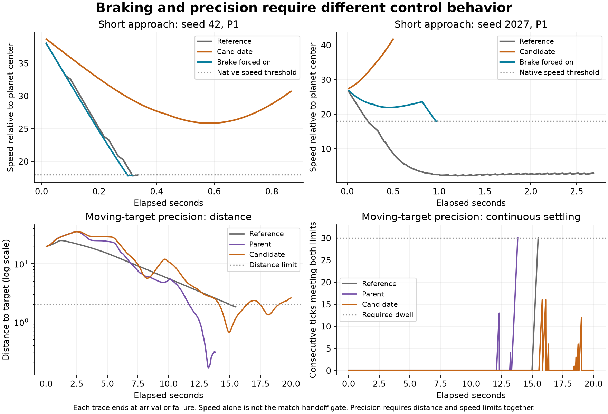

# Match braking and precision settling

Forcing the rejected v2 network's brake on completes **43/43 inspected match
approaches**, but reduces its older precision arrivals from **152/157 to 9/157**.
This isolates a useful braking intervention; it is not a usable candidate.
The five original precision failures reach the required distance and speed,
then leave the valid window before completing the 30-tick dwell.

The test-only training harness now supports retaining all **157 distinct older
arrival starts** during selection. Coverage and deduplication are tested; no
new training run has used that configuration yet. The v1 and v2 recipes remain
unchanged. The next experiment needs to preserve precision while improving
match braking, with the existing nine inputs and success thresholds.

## Controlled comparison

The [frozen plan](data/learned-guidance-failure-diagnostic-v1-plan.json) compares
four controllers on identical physical starts and one executable. It reuses
all 43 distinct match starts from the
[v2 experiment](learned-guidance-match-retention.md), together with the complete
older arrival suite. Every case is already inspected development evidence;
this experiment provides no fresh validation or training selection.

| Controller | Older precision arrivals | Inspected match approaches |
| --- | ---: | ---: |
| Arrival reference | 157/157 | 40/43 |
| Retained parent | 157/157 | 21/43 |
| Rejected v2 finalist | 152/157 | 37/43 |
| v2 with brake forced on | 9/157 | 43/43 |

The intervention changes only the final linear layer's brake output: its eight
weights become zero and its bias becomes +1. The hidden layer, turn output,
thrust output, 9–8–3 architecture, action decoder, and host rules stay identical.
Turn and thrust outputs are identical on identical observations; subsequent
physical trajectories naturally diverge once braking changes those observations.

All six failed v2 match starts now complete the native capture handoff. The
longest intervention approach takes 276 ticks, within the unchanged 300-tick
limit. This also completes the three earlier approaches that the arrival
reference times out on. All 800 episodes, comprising 628 practice arrivals and
172 match approaches, end at 100 health.

The two short Angular failures show a definite brake-off decision, rather than
an action-application error. The v2 brake output stays between −0.865 and −0.386
on seed-42 P1, and between −0.431 and −0.095 on seed-2027 P1. Both otherwise
thrust throughout their 52 and 30 owned ticks, until the host requires a climb.
With the brake intervention they complete in 19 and 59 ticks respectively,
including the native handoff. Their Round variants also recover.



## The precision failures reach the target but do not settle

Full trajectories cover all five v2 precision timeouts and three successful
sibling configurations. Every failed case enters the joint distance-and-speed
window, sometimes repeatedly, but none holds it for the required 30 ticks.
Success still requires distance at most 2 units and target-relative speed at
most 1 unit/s, within the original 1,200-tick deadline.

| Failed case | Longest continuous dwell | Total ticks within both limits | Final distance | Final relative speed |
| --- | ---: | ---: | ---: | ---: |
| `qualification_target_motion_b1_p0` | 16 | 60 | 2.585 | 1.069 |
| `qualification_target_motion_b2_p0` | 18 | 59 | 2.571 | 0.974 |
| `qualification_target_motion_b3_p0` | 17 | 53 | 2.596 | 1.015 |
| `qualification_combined_a0_b1_p0` | 28 | 104 | 2.063 | 0.439 |
| `qualification_combined_a1_b0_p0` | 20 | 106 | 2.114 | 0.497 |

During their last 300 ticks, the five failures use no brake, apply thrust for
31–35 ticks, and average about 1.766 rad/s of absolute spin. Distance and relative
speed repeatedly cross the success limits. The parent also spins near that
rate but succeeds, so spin alone is not a demonstrated cause or a new failure
criterion.

Constant braking does not repair these precision failures: all eight traced
precision starts fail under the intervention and never enter the joint window.
They end 73–87 units from their moving markers. The reference coordinates turn
and thrust with its always-on brake and succeeds on all 157 practice starts;
merely changing the candidate's brake output does not reproduce that behavior.

These observations support training for coordinated braking and settling. They
do not establish that the current network can satisfy every case jointly, or
that an additional input is needed.

## Full retention and the next experiment

The older suite has 167 partition entries representing 157 distinct starts.
The harness can now collect all six partitions and deduplicate on every
`ArrivalCase` field except its name, preserving the first occurrence's order.
Its existing fitness ranks retained completions before match completions and
progress. The new coverage test verifies that every original start occurs
exactly once in this configuration. The earlier recipes still select their
original 12 and 28 retention cases.

Use all 157 starts in the next bounded training recipe, keeping completed
precision arrivals first in selection. Keep the nine-input contract and current
arrival/handoff requirements. Record maximum continuous dwell as well as
endpoint distance and speed, so near-target improvement is distinguishable
from actual settling. Any change to selection's progress terms must be declared
in that new recipe before training; this diagnostic changes none of them.

All 43 match starts here are now development evidence, including former
validation worlds. Reserve different worlds before evaluating the next trained
candidate. The constant-brake model remains a diagnostic artifact. Live match
delegation is still gated by the
[integration plan](design/learned-guidance-match-v1.md).

The subsequent [full-retention experiment](learned-guidance-full-retention.md)
implements this curriculum with the same network, fitness order, and 15 match
training starts. It records settling for every original start after selection.

## Verification and reproduction

Six fixture tests passed, including complete-suite coverage, brake-output
isolation, source/replay parity, and selection ordering. The controlled diagnostic
passed in 169.14 seconds. All 43 starting-state records match the v2 receipts;
all 129 reused baseline match traces are byte-identical; all 471 reused practice
endpoint reports match apart from runtime identity. Independent analysis checked
32,139 precision decisions and 15,074 match decisions against applied controls,
and recomputed every precision dwell counter from physical measurements.

The [result summary](data/learned-guidance-failure-diagnostic-v1-results.json)
contains every outcome, failed precision measurement, selected trajectory
summary, and verification count. The local evidence package retains all 172
match traces and 32 full precision traces, plus endpoint reports for every
practice episode. No production adapter, bot default, or device changed.

```sh
RUST_MIN_STACK=16777216 cargo +1.89.0 test -p engine-client --bin engine-client \
  --locked --offline --profile ci guidance_approach -- --nocapture

RUST_MIN_STACK=16777216 \
SPACEWARS_GUIDANCE_DIAG_MODEL=data/training-experiments/recovery-guidance-match-learning-v2-20261016/run/finalist.json \
SPACEWARS_GUIDANCE_DIAG_OUT=/tmp/guidance-failure-diagnostic-NEW \
cargo +1.89.0 test -p engine-client --bin engine-client \
  --locked --offline --profile ci learned_guidance_failure_diagnostic \
  -- --ignored --nocapture
```

The output directory must be fresh. The fixture checks the exact parent and
finalist identities and saves the plan, models, and initial-state receipts
before the four controller evaluations. Rebuilt executables get their own
runtime identity; do not relabel their results as this retained run.

The runtime is
`diagnostic_v1/linux/x86_64/5ef5dddbec014a3c4f784d5119eeed7d6b652c42261c1ef1c89ce0798615c544`.
The plan SHA-256 is
`f465a3bc316168ed38b3260fa4f12f033718b271414c3b6a18f79a566d92f68c`.
The intervention genome is
`7d28a8745a6837d803e36fa836fd114593c04802b4195069de1c91ac7d3a7002`,
with file SHA-256
`95c14b05f9314715f79e3eef8964fe28897c2c3d1e2b5dc5e685dcb924fc9f26`.

The retained archive is
`data/training-experiments/recovery-guidance-failure-diagnostic-v1-20261016.tar.gz`
(27,338,384 bytes), SHA-256
`d768a6f8e2695f836835acc0f88c1df72bafcc3ae3d3df63d72b7470ba42645f`.
All 222 members were verified against their source bytes and hashes. It includes
the source patch against `1df24f2b574400a7b9ae78145c67402721aae907`, frozen
identities, models, physical receipts, full traces, endpoint reports, analysis
and plotting scripts, and validation receipts. Formatting, whitespace, source
and executable hashes, and patch verification passed.
