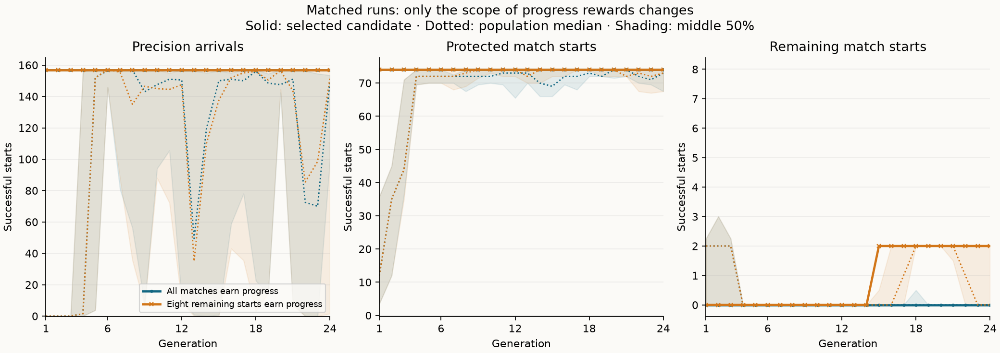
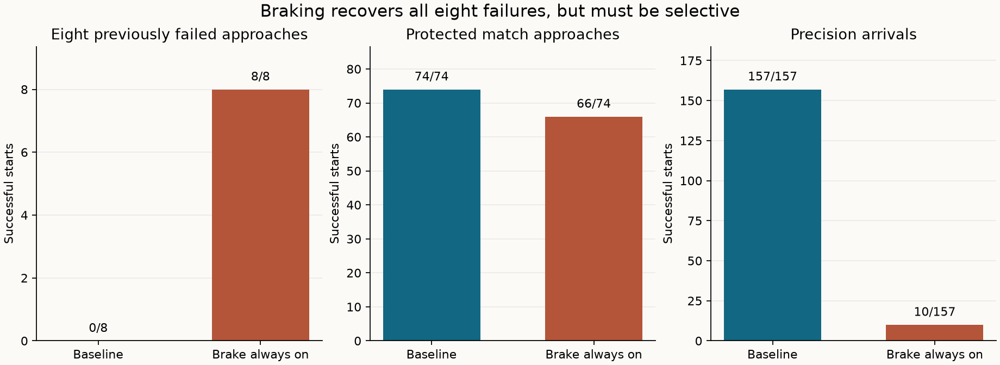

# Focusing evolution on unfinished approaches

This experiment tests whether progress rewards help more when they focus on
the remaining failures. It starts from the
[protected-match finalist](learned-guidance-protected-matches.md), which
completes 65 of 73 inspected approaches, all nine available fresh approaches,
and all 157 precision arrivals. Those 82 match starts are now inspected training
data: 74 successes to protect and eight failures to improve.

Focusing progress rewards on those eight failures improves the selected model
to **76/82 inspected approaches**, compared with **74/82** under unchanged
scoring. Both runs improve fresh approaches from **12/16 to 14/16**, preserve
every baseline match success, and retain **157/157 precision arrivals**. The
focused candidate still fails six inspected and two fresh starts, so neither
run qualifies for live match integration.

## Results

| Controller | Protected / 74 | Remaining / 8 | All inspected / 82 | Fresh / 16 | Precision / 157 |
| --- | ---: | ---: | ---: | ---: | ---: |
| Ordinary handwritten mission | 70 | 8 | 78 | 12 | — |
| Arrival reference | 71 | 6 | 77 | 14 | 157 |
| Retained baseline | 74 | 0 | 74 | 12 | 157 |
| All starts earn progress | 74 | 0 | 74 | 14 | 157 |
| Remaining starts earn progress | **74** | **2** | **76** | **14** | **157** |

The focused run first recovers seed 2027 P1 in generation 15 and retains both
dirt shapes through generation 24. Its final candidate completes each after
75 ticks, applying brake for 25 and thrust for 16. The control run adds no
inspected successes. Each run evaluates 338 unique genomes; 100 of the focused
run's 384 candidate evaluations retain all precision and protected starts,
compared with 63 for the control.

Both final candidates also recover seed 619 P1 in both shapes on fresh
validation. The control completes these after 63 ticks, applying brake for 27;
the focused candidate completes them after 61 ticks, applying brake for 20.
Neither loses a baseline success in either the inspected or fresh cohort.
These paired shape results are correlated cases, rather than independent
replicates of the training method. This single evolution seed and budget show
an inspected-case benefit from focused scoring, with no demonstrated fresh-case
advantage over the control.

The selected candidate follows the ordered fitness; population medians and
middle-50% bands include candidates that fail retention. Both runs contain a
candidate that completes all eight remaining starts while losing precision.
The best fully retained candidates reach zero additional starts in the control
and two in the focused run. The
[machine-readable results](data/learned-guidance-focused-progress-v1-results.json)
retain every generation's population summaries and per-case comparisons.

Training takes **4m37s** for the control and **4m39s** for the focused run,
**9m17s** combined. Recorded execution phases, including preflight, diagnostic,
resume overhead and final evaluation, total **13m02s**. Manual pauses, analysis,
plotting and packaging are outside that timing.

## Brake intervention

Forcing this finalist's brake on recovers **all eight remaining failures** with
its existing steering and thrust. It also loses eight protected match starts
and reduces precision completion from **157/157 to 10/157**. The intervention
demonstrates a useful control change on the failed starts; its broader results
require selective braking.

| Controller | Protected / 74 | Remaining / 8 | Precision / 157 |
| --- | ---: | ---: | ---: |
| Retained baseline | 74 | 0 | 157 |
| Brake always on | 66 | 8 | 10 |

The only genome change is the final layer's brake row: eight zero weights and
bias +1. Hidden activations, steering and thrust outputs are identical on
identical inputs. Subsequent trajectories diverge after different braking
actions. The intervention is a diagnostic artifact, never an evolution seed.

The repaired approaches complete after 19 ticks for seed 42 P1, 89 for the
longer seed 42 P2 start, 112 for the longer seed 10101 P2 start, 56 for seed
2027 P1, and 58 for seed 1021 P2. Paired dirt shapes have the same results.
The protected losses are both shapes of seed 4093 P1 and seed 307 P2 (timeouts),
seed 8191 P2 (a route detour), and seed 131071 P2 (sun avoidance).

## Matched training recipe

The [frozen recipe](data/learned-guidance-focused-progress-v1-plan.json) declares
two runs that differ only in the scope of their two match-progress terms:

- **All:** final speed and target distance over all 82 inspected match starts.
- **Remaining:** the same measurements over the fixed eight unfinished starts.

Both runs evaluate every physical episode. Their fitness ranks completed
precision arrivals first, then protected match successes, then additional
match successes. Only after those counts does match progress affect selection.
Precision position/velocity quality and spare ticks retain their original
meaning. Membership of the eight-case progress set stays fixed throughout
training, including after a candidate succeeds on one of those starts.

The scores use the existing integer progress formula and eligible outcomes:
`floor(1000 * clamp(1 - value / scale, 0, 1))`, with scale 70 for speed and 100
for marker distance, for arrived, timeout and host-preempted approaches.
Raw progress totals have different scopes and should not be compared between
the two runs. Their completion counts use identical cases and definitions.

Each run starts with the same retained finalist and the same 15 random
networks. Configuration remains seed 1, population 16, 24 generations, two
elites, tournament size three, 5% per-parameter mutation probability, mutation
scale 0.15, initial scale 0.5 and parameter limit 8. All 107 parameters can
evolve; there is no crossover. Each candidate evaluates 157 precision and 82
match starts: 91,776 training episodes per run, 183,552 total.

The first generation is saved in each run. Its 16 genome IDs and all fitness
fields other than the two progress terms must match. Both runs then resume from
their own checkpoints with the frozen executable. Each final-generation winner
is retained before reserved evaluation; validation cannot select a different
generation or extend training.

## Validation cohort

Native-only preflight scans a predeclared ordered list of 12 unused seeds. It
selects the first four worlds having an eligible approach for both players in
both dirt shapes. Partial worlds, if encountered, stay in the discovery audit;
component outcomes never influence selection. This measures performance
conditional on those native approaches existing, rather than unconditional
success across arbitrary matches.

The first four seeds—619, 2381, 4919 and 10037—each provide all four starts,
so the frozen validation cohort has 16 starts and no missing requests. The
remaining eight reserve seeds are unscanned. All selected physical starts and
the discovery record are frozen before training and reconstructed against the
same receipt for subsequent modes.

The gate requires all 157 precision starts, all 82 inspected match starts and
all 16 reserved starts. The nine validation starts from the previous experiment
are training data here; the seven missing requests from that earlier run remain
in its historical record.

## Remaining failures and next step

All six inspected failures and both fresh failures of the focused candidate
are `host_preempted` with native goal `launch`. Every brake logit remains
negative throughout these attempts, so the network never applies brake before
the native host orders a safety climb.

| Approach | Shapes | Scored ticks | Highest brake logit |
| --- | --- | ---: | ---: |
| Seed 42 P1, short start | Angular and Round | 52 | -0.3013 |
| Seed 42 P2, longer start | Angular | 37 | -0.6124 |
| Seed 10101 P2, longer start | Angular | 38 | -0.7290 |
| Seed 1021 P2 | Angular and Round | 44 | -0.2935 |
| Fresh seed 10037 P1 | Angular and Round | 43 | -0.1827 |

The historical `train-42-p1-d65` case name denotes an actual 17.57-unit entry
distance, preserved in the recipe. The two formerly fresh seed 1021 failures
were already inspected training cases at the start of this experiment.

The subsequent [brake-bias diagnostic](learned-guidance-brake-bias.md) tests
all 98 starts using this finalist. It confirms that all eight failures, including
the two new seed 10037 starts, recover under a braking intervention. None of its
tested uniform bias shifts both adds successes and preserves all 90 successful
match starts and 157 precision arrivals. Precision settling regresses before
the first match recovery. The next training comparison should therefore test
selective braking while protecting those retained successes. The subsequent
[graded-braking comparison](learned-guidance-graded-braking.md) does so: it
reaches 92/98 inspected and 16/16 fresh starts, retaining every prior success
and all 157 precision arrivals. Six inspected failures remain. Its report
records the current candidate and next investigation.

## Reproduction

The ignored test `learned_guidance_focused_progress` accepts
`SPACEWARS_FOCUSED_MODE=preflight|diagnostic|train-all|train-remaining|resume-all|resume-remaining|evaluate`.
`SPACEWARS_FOCUSED_MODEL` identifies the exact baseline file;
`SPACEWARS_FOCUSED_OUT` must be fresh except for resume. Later modes require
`SPACEWARS_FOCUSED_PREFLIGHT`; final comparison uses `SPACEWARS_FOCUSED_RUNS`,
containing completed `all/` and `remaining/` runs. The shared training helper
uses `SPACEWARS_RETENTION_STEPS` to limit candidate batches before a pause.

Build with Rust 1.89.0, locked offline dependencies, optimized `ci` profile and
`RUST_MIN_STACK=16777216`. The retained `run.py prepare` checks preflight and
diagnostic parity; `run.py train` performs the matched first generation, resumes
both runs and freezes both selections before comparison. Workers use Auto at
75% total-machine CPU. Scheduling is outside fitness and mutation streams.

This is test-only training. The nine observations, action decoder, native host
priority, safety checks, precision tolerances, physics and production bot
defaults retain their existing behavior.

## Verification and retained evidence

All 17 targeted guidance tests pass, including progress-scope isolation on
physical episodes, complete-world selection and the frozen recipe's case and
episode counts. Formatting and whitespace checks pass. All 82 reused match
starts and 157 precision starts match the prior receipt. The initial generation
contains the same 16 genomes in both runs, with identical fitness fields except
for the two progress terms. Both checkpoints resume in separate processes, and
recomputed finalist fitness agrees with each frozen selection.

The diagnostic and final comparison contain 654 match episodes and 1,002
original-suite endpoint reports. The original suite has 167 named entries but
157 distinct starts; the precision totals above count distinct starts. All
328 reused match traces are byte-identical, and all 501 reused precision
endpoint reports match apart from runtime. All 628 traced precision replays
match their ordinary endpoints. The retained traces verify 41,007 match
decisions and 25,170 precision decisions across 32 full precision traces.
The constant-brake diagnostic retains precision endpoints without full
precision traces. Both plots were visually checked. All 1,502 manifest-listed
files in the preceding three experiment packages remain unchanged.

The evidence directory is
`data/training-experiments/recovery-guidance-focused-progress-v1-20261017/`.
Its source patch includes the preceding local training harness work and this
experiment against `d9f1ee9d725fcb797f1a5271bcf49043217e375f`.

| Identity | SHA-256 |
| --- | --- |
| Recipe | `369844c403e9870d3c9b63485c54ea0fd99f589f430ceec41b3b7a9589bd3f1d` |
| Source patch | `3cde0941cdc60434956b91a398906a4ffa1d4990ad693079ed782ae80096d4dc` |
| Preflight | `ba8760f0c2d90a1f1ba2da579874bfa81336f62c9cdfd31dbcae1bec5113fbdb` |

| Selected artifact | All progress | Remaining progress |
| --- | --- | --- |
| Genome ID | `069e1189e8e95bb1d0fea1f1746b2cd32909b7a347deb8b038e7d5942414ee21` | `9ba26f93021d1c2ec7ca97288d81f47d33645965822680ea8d5ec26cfdadf705` |
| File SHA-256 | `cc3db5694dd0f33f47bd9a32ae45de954a3823d7e2d436a63bb964f4ba6e1fe7` | `3eca0ae862f9f8e28518c5bc73dd0b3252bf9cc654fbdac3d8a599dc26f1724f` |
| Checkpoint SHA-256 | `e30bd63d4d63b2b6aee8a8925b0638158f7c971f03e04550921bae07223c0a3b` | `ecf8522edc580c34008199fc902ed32b3d1ece80cb1e155cffc9302c69888b72` |

The frozen runtime is
`diagnostic_v1/linux/x86_64/e08a2fa26bca113246ca4d3a54caf12a545dccfb85db5ede6cb51769f4808626`.

The archive is
`data/training-experiments/recovery-guidance-focused-progress-v1-20261017.tar.gz`
(37,248,671 bytes), SHA-256
`95b2d2e4ba7c45a340b763d0832b6f0190ec1d76d713b9f115fdfb81ac3cbc41`.
All 747 members were verified against retained files. The frozen executable is
retained separately from the archive.
