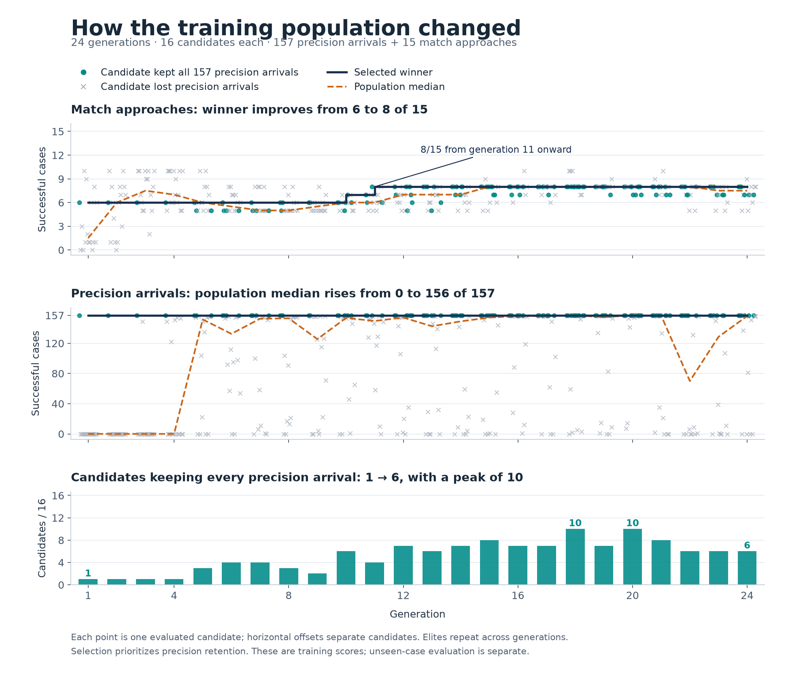

# Match training with complete precision retention

This experiment tests whether the arrival network can improve match braking
while retaining every older precision arrival. Selection now evaluates all
**157 distinct original starts**, followed by the same 15 match approaches used
in v2. A lost precision arrival ranks below every possible improvement in match
completion or progress.

The [failure diagnostic](learned-guidance-failure-diagnostic.md) found that the
v2 network's five precision timeouts reach the distance-and-speed window but do
not sustain its 30-tick dwell. Forcing braking completes all 43 inspected match
starts while breaking 148 older arrivals. Those results call for coordinated
control; neither a constant-brake override nor a looser success threshold is
part of this experiment.

Preflight found **14 of 16 requested validation starts**. Player 1 in seed 8191
never reached eligibility: the Angular run reached the 10,800-tick prefix limit,
and the Round match finished at tick 7,083. Both remain missing, so this run
cannot pass the full integration gate. Training still tests whether the network
can improve match approaches while preserving the complete precision suite;
the missing cases are neither substituted nor removed from acceptance.

All 55 reused starting-state records and all 157 practice starts match the
earlier evidence. The 14 new starts have initial relative speeds of
20.04–34.63 units/s. Eight fixture tests passed before freezing the source and
executable, including serial/parallel episode equality.

## Population history

Training finished all 24 generations, with 16 candidate evaluations per
generation. The checkpoint retains every candidate's genome ID and ordered
fitness terms, plus each generation's selected genome. Historical full populations
are not all retained; the final population and the generation winners are.

The selected winner improved from **6/15 to 8/15 match approaches**, reaching
eight in generation 11 while retaining **157/157 precision arrivals** throughout.
Its completion count then plateaued, although lower-priority fitness terms kept
improving. Across the whole population, median precision completions rose from
**0 to 156 of 157**. The number of candidates keeping all precision arrivals
rose from **1/16 to 6/16**, peaking at **10/16** in generations 18 and 20.



Gray candidates sometimes completed more match approaches than the selected
winner, but lost precision arrivals and therefore ranked lower. These are
training-case measurements, including repeated elites, rather than independent
validation trials. The plot separates the fitness terms instead of combining
them into one scalar score.

The reproducible plot script and derived `population-history.json` are in
`data/training-experiments/recovery-guidance-match-learning-v3-20261016/`.
They read the saved `run/checkpoint.json` without evaluating or altering genomes.
The ordinary [Training view](managed-training.md) already shows winner and median
progress for its managed recipes; this experimental match-training recipe runs
through the separate harness and is not a managed UI job.

## Frozen recipe

The [v3 recipe](data/learned-guidance-match-training-v3-plan.json) keeps the same
retained parent, 9–8–3 network, nine inputs, action decoder, mutation settings,
fitness order, and 24-generation budget as
[v2](learned-guidance-match-retention.md). It changes the precision retention
curriculum from 28 starts to the complete 157. The unchanged parent is the only
seed; the other 15 initial genomes are independently randomized by the existing
evolutionary runner. Neither rejected finalist nor the brake intervention is
seeded.

Each of 384 candidate batches evaluates 157 practice cases and 15 match starts:
**66,048 training episodes**. All cases count, including failures. Four independent
workers evaluate practice cases and return results in declared order; serial
and parallel episode equality is checked before the experiment. Match episodes
keep their existing execution path.

Fitness ranks retained completions first, then match completions, match speed,
match position, practice position, practice speed, and unused successful ticks.
Practice success still requires distance at most 2 units, target-relative speed
at most 1 unit/s, and 30 uninterrupted ticks within both limits, before the
1,200-tick deadline. Match approaches keep the 300-tick deadline, physical failure
checks, common neutral tick, and native capture handoff. No settling bonus is
added to selection: each protected success already requires that continuous dwell.

Development contains all 24 prior development approaches and the 16 inspected
v2 validation approaches. Its 40 short starts overlap 12 training starts; together
with the three earlier training starts, they cover all 43 inspected physical
starts. These are development evidence, including the formerly reserved worlds.

New validation uses seeds **211, 1021, 8191, and 131071**, both seats, and both
dirt shapes. Initial-state discovery follows the unchanged first-eligible direct
approach rule within 35 units during the first 180 seconds. A missing requested
start remains missing. No component continuation is evaluated during preflight.

After the fixed budget, evaluate ordinary mission guidance, the arrival
reference, the parent, and the final generation's winner on the same executable
and physical starts. Acceptance requires all 15 training, 40 development, and
16 new validation approaches, plus every older arrival. Results cannot select a
different generation or extend training.

For each component controller, also replay all 157 unique practice starts with
tracing, assert exact endpoint equality with ordinary evaluation, and record
the longest continuous dwell and total time within both tolerances. Keep full
traces for the eight diagnostic precision cases and every failure. These
post-selection measurements distinguish settling from endpoint proximity and
never enter selection.

## Running the experiment

Select version 3 explicitly in each mode; version 1 remains the harness default.
Use Rust 1.89.0, the locked offline dependencies, the ci profile, and
`RUST_MIN_STACK=16777216`. The ignored test is
`learned_guidance_match_training` with `--ignored --nocapture`.

```sh
RUST_MIN_STACK=16777216 \
SPACEWARS_APPROACH_LEARNING_VERSION=3 \
SPACEWARS_APPROACH_LEARNING_MODE=preflight \
SPACEWARS_APPROACH_LEARNING_OUT=/tmp/match-learning-v3-preflight-NEW \
cargo +1.89.0 test -p engine-client --bin engine-client \
  --locked --offline --profile ci learned_guidance_match_training \
  -- --ignored --nocapture
```

Freeze the source, executable, lockfile, recipe, and preflight receipt before
training. Every subsequent mode requires
`SPACEWARS_APPROACH_LEARNING_PREFLIGHT` pointing at that executable's receipt.
`train` uses a fresh output directory, `resume` uses the existing run, and
`SPACEWARS_APPROACH_LEARNING_STEPS` can pause after a declared number of candidate
batches. `evaluate` requires a complete run through
`SPACEWARS_APPROACH_LEARNING_RUN` and a fresh output directory.

The complete checkpoint is saved after each candidate batch and checked through
the on-disk resume path. Learned control in ordinary matches remains subject to
the [integration plan](design/learned-guidance-match-v1.md).
