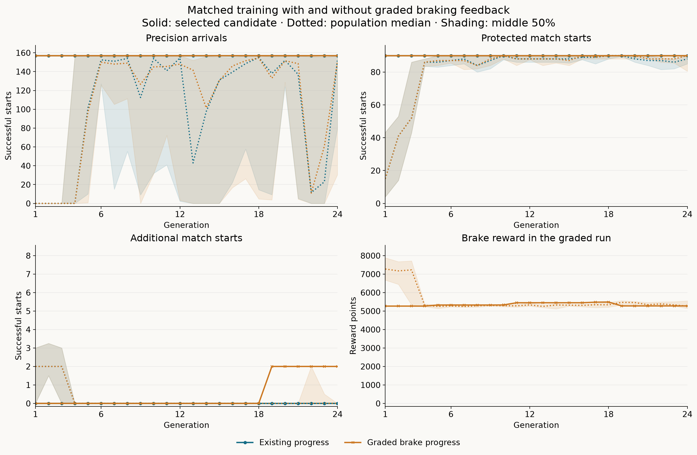
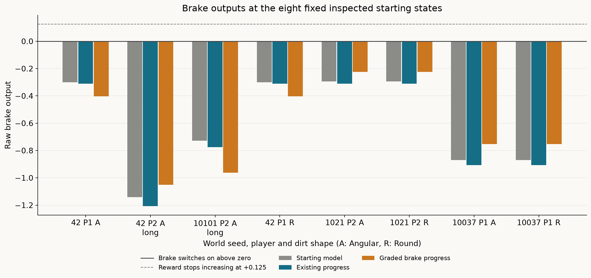

# Training selective braking with graded feedback

The graded run improves inspected match approaches from **90/98 to 92/98**
and fresh validation from **14/16 to 16/16**, retaining all 157 precision
arrivals and every previous match success. Its matched control adds no
recoveries. Six inspected failures remain, so the learned component still
does not qualify for live integration.

This comparison tests whether feedback below the brake's on/off threshold helps
evolution recover the remaining match approaches. The
[brake-bias diagnostic](learned-guidance-brake-bias.md) established that all eight
failures can recover with changed braking, while uniform bias shifts that recover
them also regress precision arrivals. Both runs start from the unchanged
[focused-progress finalist](learned-guidance-focused-progress.md), with 90/98
inspected match successes and 157/157 precision arrivals.

## Results

| Controller | Protected /90 | Additional /8 | Inspected /98 | Fresh /16 | Precision /157 |
| --- | ---: | ---: | ---: | ---: | ---: |
| Ordinary mission guidance | 84 | 6 | 90 | 16 | — |
| Handwritten arrival reference | 85 | 6 | 91 | 16 | 157 |
| Starting model | 90 | 0 | 90 | 14 | 157 |
| Existing progress control | 90 | 0 | 90 | 14 | 157 |
| Graded brake progress | **90** | **2** | **92** | **16** | **157** |

The graded run first adds the seed 10037 player 1 approaches in both shapes at
generation 19. The same final-generation model also recovers the previously
unseen seed 16411 player 1 approaches in both shapes. No baseline success is
lost in any partition. These are two shape pairs, not four independent worlds.

Both arms evaluate 384 candidates, including repeated elites, and encounter
338 unique genomes. The control has 78 evaluations retaining all 157 precision
and 90 protected starts; the graded arm has 76. Neither arm finds a candidate
that retains those counts and recovers every additional start. This is one
matched evolution seed and budget, not evidence that the recipe will reliably
produce the same improvement across independent searches.

Training and checkpoint saving take 313.91 seconds for the control and 285.63
seconds for the graded arm, **9 minutes 59.55 seconds combined**. Preflight,
source reconstruction and final comparison bring the recorded execution phases
to **13 minutes 25.31 seconds**, excluding compilation, analysis and archiving.

The compact results (`docs/data/learned-guidance-graded-braking-v1-results.json`, in git history)
retain population distributions, per-case outcomes, probe values and validation
counts. The [trace inspection](data/learned-guidance-graded-braking-v1-inspection.json)
records the newly successful and remaining failed continuations.

## What changed in the behavior

All eight fixed initial brake outputs remain negative, including the two
recovered inspected starts. The model learns to brake later in those paths:

| Recovered player 1 approach | Shapes | First braking decision | Braking ticks | Native handoff tick |
| --- | --- | ---: | ---: | ---: |
| Inspected seed 10037 | Angular and Round | 40 | 32 | 72 |
| Fresh seed 16411 | Angular and Round | 47 | 29 | 76 |

Ticks above are one-based within each scored continuation, after the common
neutral preparation tick. Both baseline and control apply no brake on these
paths and lose control to the native safety climb. The graded model's highest
brake outputs are +0.1878 on seed 10037 and +0.1273 on seed 16411. The whole
network evolves, so steering and thrust also change; these observations do not
isolate braking as the sole cause of the improved trajectories.

The selected candidate's reward rises from 5,267 to 5,488 before the first
recovery, then drops to 5,277 at generation 19. That drop is expected: two
completed recoveries outrank reward points. It also shows why this reward is a
search aid rather than a direct measure of successful guidance or proof that
braking immediately is the right policy.

All six remaining failures still apply no brake before `host_preempted` with
native goal `launch`:

| Approach | Shapes | Scored ticks | Highest brake output |
| --- | --- | ---: | ---: |
| Seed 42 P1, short start | Angular and Round | 53 | -0.4030 |
| Seed 42 P2, longer start | Angular | 33 | -0.3534 |
| Seed 10101 P2, longer start | Angular | 28 | -0.8986 |
| Seed 1021 P2 | Angular and Round | 40 | -0.2241 |

The graded finalist is a better development parent on the inspected evidence,
but its gate remains failed. The next investigation should preserve its 108
successful match starts across the inspected and now-observed validation
cohorts, together with all 157 precision starts, and examine the six remaining
brake-off failures before choosing another search change. Any subsequent
training comparison needs a new frozen validation cohort; these 16 starts are
now inspected evidence.

The subsequent [brake-neighborhood diagnostic](learned-guidance-brake-neighborhood.md)
examines that retained set. None of 108 individual brake-parameter changes adds
a recovery with full retention. Increasing one brake weight recovers five of
the six failures while keeping all 108 match successes, but loses 44 precision
arrivals. The traced precision losses brake early and fail to pursue moving
targets. The subsequent [joint brake-readout fit](learned-guidance-brake-joint-fit.md)
finds no candidate that preserves every successful reference brake decision
while requesting initial braking at the failures. A bounded repair judged by
successful outcomes is the next proposed test; this finalist remains the
reference.

The subsequent [longer-budget experiment](learned-guidance-graded-long.md)
tests 240 generations of this same recipe before changing the search. It
reproduces all first 24 generations, solves all known failures by generation
135 and retains 114/114 inspected starts plus 157/157 precision arrivals at
generation 240. Fresh results remain 12/16 with two gains and two regressions,
so generalization remains open.

## Matched recipe

The [frozen recipe](data/learned-guidance-graded-braking-v1-plan.json) gives both
runs the same 98 inspected match starts and all 157 distinct precision starts.
The 90 match successes form the protected set; the eight failures remain the
additional set throughout training, including after a candidate succeeds on one.
Both use physical speed and position progress only on that fixed additional set.

The control uses the existing fitness order. The graded run inserts one field
after all three completed-arrival counts and before physical progress:

1. Completed precision arrivals, out of 157.
2. Completed protected match starts, out of 90.
3. Completed additional match starts, out of eight.
4. Brake-output progress, zero in the control.
5. Remaining-match speed and position progress, precision position and velocity
   quality, and spare ticks, in their existing order.

The new term sums
`floor(1000 * clamp((raw_brake + 2.0) / 2.125, 0, 1))` over eight fixed input
vectors. Each vector is the first actual component observation for one failed
start, after the shared neutral tick and with the ordinary frozen-bearing marker.
The reward reaches its cap at raw brake output +0.125. It provides progress while
the output is still negative and stops rewarding larger positive values. The
baseline earns 5,267 of 8,000 possible points; this number is a search reward,
not a probability or success rate.

The eight probes contain five distinct input vectors: the shape pairs for
42 P1, 1021 P2 and 10037 P1 share their initial inputs. Each physical case
keeps its declared weight, so these pairs contribute twice to the reward.
The paired starts are not independent samples.

This is a preference for braking at eight diagnosed starting states. It does
not supply ideal actions along future trajectories or during precision settling.
Each candidate still runs every physical episode, and completed-arrival counts
take priority over the preference. Elitism and the initially complete retention
counts preserve all 90 protected starts and 157 precision arrivals in each
generation's selected candidate.

Both runs begin with the same baseline and the same 15 random networks. The
configuration remains evolution seed 1, population 16, 24 generations, two
elites, tournament size three, 5% per-parameter mutation probability, mutation
scale 0.15, initial scale 0.5 and parameter limit 8. All 107 parameters of the
9–8–3 network can mutate; there is no crossover. Each run evaluates 384
candidates and 97,920 training episodes, for 195,840 episodes combined.

The first generation is retained and compared across runs: all 16 genome IDs
and every fitness field except brake progress must match. Each run then resumes
from its own checkpoint. Both final-generation winners are frozen before any
reserved model continuations. Validation cannot select another generation or
extend either run.

## Fresh validation

Native-only preflight scans an ordered list of 12 predeclared seeds and selects
the first four worlds exposing eligible approaches for both seats in both dirt
shapes. The frozen cohort contains 16 starts from seeds **16411, 32803, 65539
and 262151**. Seed 131101 supplies only player 1 approaches; player 2 lacks an
eligible start in both shapes after the 10,800-tick search. That world's
available and missing starts remain in the discovery audit. The remaining seven
seeds are unscanned.

Selection uses native eligibility alone. This is validation conditional on
those approaches existing, rather than unconditional success over arbitrary
matches. The first eight reserve seeds appeared in the previous recipe but had
never been scanned. All 16 former validation starts are inspected training data
in this comparison.

The directed gate requires all 157 precision starts, all 98 inspected match
starts and all 16 reserved starts. Passing it would still leave the host-control
and paired-match checks in the
[integration plan](design/learned-guidance-match-v1.md).

## Reproduction

The ignored test `learned_guidance_graded_braking` accepts
`SPACEWARS_GRADED_MODE=preflight|train-control|train-graded|resume-control|resume-graded|evaluate`.
`SPACEWARS_GRADED_MODEL` identifies the exact baseline;
`SPACEWARS_GRADED_PRIOR` supplies the inspected physical-state receipt from the
brake-bias diagnostic. `SPACEWARS_GRADED_OUT` must be fresh except for resume.
Subsequent modes require `SPACEWARS_GRADED_PREFLIGHT`; final evaluation also
requires `SPACEWARS_GRADED_RUNS`, containing completed `control/` and `graded/`
runs. `SPACEWARS_RETENTION_STEPS` optionally bounds candidate batches before a
pause.

Build with Rust 1.89.0, locked offline dependencies, optimized `ci` profile and
`RUST_MIN_STACK=16777216`. The retained `run.py prepare` freezes and verifies the
physical starts and reward inputs. `run.py train` compares first generations,
resumes both runs, freezes their selections and performs the final comparison.
Workers use Auto at 75% total-machine CPU. Scheduling does not enter mutation
streams or fitness.

The change is confined to the test harness. The nine observations, action
decoder, native priorities, physics, admission rules, physical failure conditions,
precision tolerances and production bot defaults keep their existing behavior.

## Verification and retained evidence

All **23 targeted guidance tests pass**, including completion priority,
subthreshold reward and cap behavior, fixed-probe parity with the first physical
decision, unchanged base fitness, and recipe membership. Formatting and
whitespace checks pass. All 98 reused physical match starts and 157 precision
starts match the preceding receipt. Both runs' first generations contain the
same 16 genomes and identical non-reward fitness fields. Each checkpoint resumes
in a separate process; recomputed finalist fitness matches its frozen selection.

The comparison retains 570 match traces and 668 original-suite endpoint reports.
The original suite has 167 named entries but 157 distinct physical starts.
All 294 historical match traces are byte-identical, and all 334 historical
precision endpoint reports match native values apart from runtime identity.
All 628 traced precision replays match their ordinary endpoints. Verification
covers 30,839 match decisions and 23,600 precision decisions across 32 retained
full precision traces. All 24 baseline/control/graded reward probes match the
actual first component decision. Both plots were visually checked. All 3,691
manifest-listed files in the five preceding experiment packages remain
unchanged.

The evidence directory is
`data/training-experiments/recovery-guidance-graded-braking-v1-20261017/`.
`analyze.py` verifies the histories and endpoints; `inspect_traces.py` measures
brake timing on the gains and failures; `plot.py` renders the figures. The source
patch includes the preceding local harness work against
`d9f1ee9d725fcb797f1a5271bcf49043217e375f`.

| Identity | SHA-256 |
| --- | --- |
| Recipe | `e5e26e68d91af42d13bebea31fde3a6b99dcbbde6b54a44f3a558dc4840a04f2` |
| Source patch | `8bdf79cf2917ff75f2ef1abe3a8c67fd4013a8e0f1bc35ddc01fc244038b9516` |
| Preflight | `e213b440f20709fbe140b1a5f34f476a49c72035dd85f99ce8662920896a96e6` |

| Selected artifact | Existing progress control | Graded brake progress |
| --- | --- | --- |
| Genome ID | `f28145b48f42942db24835b94f4a484e24688d0d00608a60acb5b37bd972b4ce` | `6ff82f329388dae5957dd77187520dc4f3322c4f2965fd8c88580b3569a4ad1e` |
| File SHA-256 | `3284b3f093a622f9558340e95f27b16114757fbd5ec3f33411d15a00ae3f4f0d` | `6648b1a9c32efa8625b0c79825e7fedc44be29f47ce506c5100e4e5878d5c548` |
| Checkpoint SHA-256 | `ad0057c469c6257ee967166defd820307dd262991d1cc009ffea03b617e10638` | `b4234bd212503daf9d0c168e48b2f9e3bff93307a62ed78497b1f08c5f647001` |

The frozen runtime is
`diagnostic_v1/linux/x86_64/d28994ce010880ccc617b98aa155e92894e444e995b3c144f9349cd99ddd2ff2`.

The archive is
`data/training-experiments/recovery-guidance-graded-braking-v1-20261017.tar.gz`
(31,713,499 bytes), SHA-256
`ddf051656f23128b8d2fb3d0b60f02b75be9c528f17f76016aa605ae50d27b0e`.
All 664 members were verified against retained files. The frozen executable is
retained separately from the archive.
