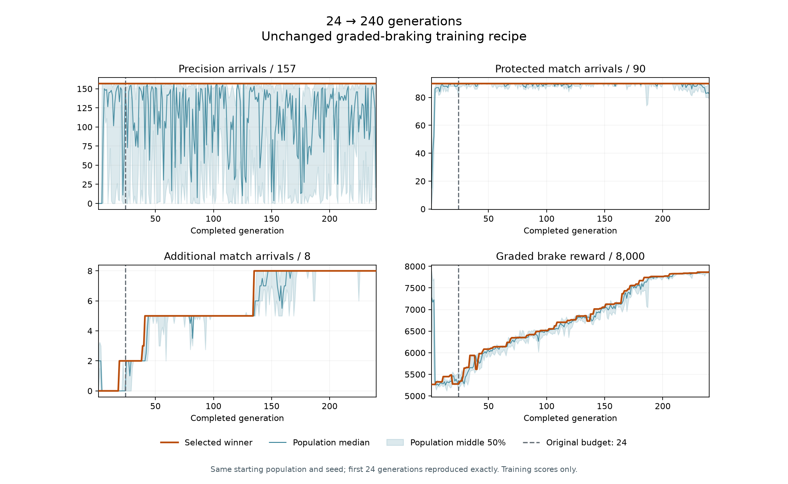
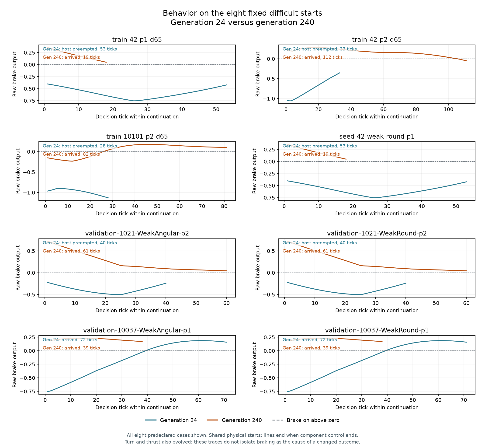

# Ten times the graded-braking training budget

Increasing the unchanged [graded-braking recipe](learned-guidance-graded-braking.md)
from **24 to 240 generations** solves all six remaining known approach failures.
The final model completes **114/114 previously inspected match starts** and
retains **157/157 precision arrivals**. It first solves every training case at
**generation 135**.

Fresh performance stays at **12/16** for both the old and new models, with two
gains and two regressions. Longer training was enough to solve the known cases
with this architecture and recipe, but it did not remove the generalization
gaps. The directed integration gate remains failed.

## Results and learning history

| Evaluation set | Generation 24 | Generation 240 |
| --- | ---: | ---: |
| Precision arrivals, used in training | 157/157 | 157/157 |
| Protected match starts, used in training | 90/90 | 90/90 |
| Additional match starts, used in training | 2/8 | **8/8** |
| Previously inspected starts outside selection | 16/16 | 16/16 |
| All previously inspected match starts | 108/114 | **114/114** |
| Fresh starts on four newly selected worlds | 12/16 | 12/16 |

The first **24 generations reproduce exactly**: all 384 candidate IDs and
scores, and every selected winner genome. The later improvement therefore
comes from continuing the same evolutionary sequence. The starting parent,
population, seed, mutation settings, training cases and scoring stay fixed.

| First generation reaching a new success count | Additional starts completed |
| --- | ---: |
| 1 | 0/8 |
| 19 | 2/8 |
| 39 | 3/8 |
| 41 | 5/8 |
| 135 | 8/8 |

It takes another 94 generations to advance from 5/8 to 8/8. The braking reward
continues to improve during much of that interval. From generation 135 through
240, every selected winner completes all 255 training episodes. The final
reward is 7,869/8,000; ordered fitness still improves at generation 240, so this
run does not establish convergence.

The population contains **3,346 unique genomes** across 3,840 evaluations,
including repeated elites; 877 evaluations retain all 157 precision and 90
protected match successes. Population medians and spreads include unsuccessful
mutants. They are not the performance of the selected model.

Training plus checkpoint saves takes **50 minutes 50.96 seconds**. The recorded
preflight, source reconstruction, training and final comparison phases total
**53 minutes 31.80 seconds**, excluding compilation, analysis and archiving.
Ten times the generation budget is the controlled change; elapsed time also
depends on the shared machine's load and the candidate trajectories.

## Behavior and fresh regressions

The generation-24 model never brakes in the six known failed continuations and
loses control to the native launch policy. The generation-240 model recovers
all six. Five begin braking on the first component decision; seed 10101 player
2 begins at decision 26 and completes its approach at tick 82. The seed 42
player-1 shape pair completes at tick 19, seed 42 player 2 at tick 112, and the
seed 1021 player-2 pair at tick 61.

The plots retain all eight fixed additional cases, including the two that
already succeeded. Ticks are one-based within the scored continuation, after
the common neutral preparation tick. Steering and thrust also evolve; these
traces do not isolate braking as the sole cause of the recovered approaches.

The fresh score hides a swap in which starts work:

| Fresh start, both dirt shapes | Generation 24 | Generation 240 |
| --- | --- | --- |
| Seed 710006, player 1 | Launch preemption at tick 24; no braking | Arrives at tick 45; brakes on 44 ticks |
| Seed 710006, player 2 | Arrives at tick 43; brakes on 42 ticks | Launch preemption at tick 70; brakes on 11 ticks |
| Seed 710003, player 2 | Sun-avoidance preemption at tick 13; no braking | Sun-avoidance preemption at tick 12; brakes on 12 ticks |

All other fresh cases retain success. The two gains and two regressions are
shape pairs on one world, not four independent worlds. The common sun-avoidance
failures remain a separate integration concern from the swapped launch
failures. Full per-case outcomes, control timing and host reasons are in the
[verified results](data/learned-guidance-graded-long-v1-results.json).

The current development candidate solves more inspected cases overall, but is
not a strict improvement over the older model on the enlarged evidence set.
Next, diagnose the fresh regression pair while retaining all 114 known starts
and precision coverage. These 16 fresh cases are now inspected evidence;
another qualification comparison needs a new frozen cohort. This result
supports continuing with the existing network before an architecture change,
without treating one evolution seed as a reliability estimate.

## Frozen recipe and evaluation

The [frozen plan](data/learned-guidance-graded-long-v1-plan.json) declares
16 candidates per generation, 3,840 candidate evaluations and 979,200 physical
training episodes. Every candidate evaluates the same 157 precision arrivals
and 98 inspected match starts. The original 90 protected match successes
retain priority over the eight additional starts. All 107 network parameters
remain mutable.

This repeats the original random sequence rather than seeding a new population
from its final winner. After generation 24, the runner compares every
population ID, fitness and winner genome against the retained checkpoint. It
continues for another 216 generations only if that prefix is identical.

The fixed final choice is generation 240. Its comparison model is the retained
generation-24 winner, `6ff82f329388dae5957dd77187520dc4f3322c4f2965fd8c88580b3569a4ad1e`.
Both are evaluated on all 114 previously inspected match starts, all 157
precision starts, and 16 newly frozen native-eligible starts. The old validation
cases remain outside training selection but are now inspected evidence.
Fresh model continuations run only after the generation-240 artifact is frozen.

Native preflight selected seeds **710001, 710002, 710003 and 710006**, in both
seats and dirt shapes, from the declared ordered reserve. Rejected-world
discovery is retained. This measures generalization conditional on native
approaches being available; the four shape/seat combinations from one world
are correlated. One evolution seed does not establish recipe reliability.

## Observation and retained evidence

The [checkpoint observer](design/training-observability.md) updates a local
fitness page every ten seconds during training at
`data/training-observation/graded-long-20261017/index.html`. It reports completed
generations separately from the current partial population. The final snapshot
and the complete 240-generation history remain available. The comparison
retains outcome/control traces for successes, failures and all changed cases.

The evidence directory is
`data/training-experiments/recovery-guidance-graded-long-v1-20261017/`.
`run.py all` performs preflight, the 24-generation reproduction check, the
remaining training and final evaluation. `run.py train` can resume an interrupted
compatible training checkpoint. `analyze.py` audits generation selection,
unchanged control traces and precision endpoints, then compares cases;
`plot.py` marks the original budget on the learning curve, and `plot_behavior.py`
compares braking on every fixed additional start. Existing experiment packages
remain unchanged.

The test-only adapter reuses the existing graded evaluator. It adds no change
to the production bot, physics, observation/action contract, native priorities
or success tolerances. All **30 targeted guidance tests pass**, including a
recipe check that only the training generation budget changed. Formatting and
whitespace checks pass. Both final models' recomputed fitness matches the
saved generation selection. All 114 short-model match traces are byte-identical
to the preceding package, and all 167 original precision endpoint entries match
apart from runtime identity. The suite contains 157 distinct precision starts.
All 314 traced precision re-evaluations match their ordinary endpoints. The
audit checks 260 match traces, 13,661 match decisions, and 13,515 decisions in
16 retained precision traces. Both plots were visually checked.

All **5,216 manifest-listed files in eight preceding packages remain
unchanged**. The verified package retains source, executable, plan, checkpoints,
winner genomes, histories, physical receipts and replay evidence.

| Identity | Value |
| --- | --- |
| Final genome | `dba8538c878c39d07aa2a48e85552c0ad131adfdab080bc80f53b04cefebb872` |
| Final genome file SHA-256 | `60175633343b1d343853601b69b1933ed62eac5947c9a9d6f42585eb427c911d` |
| Final checkpoint SHA-256 | `9b1fd9faff2db9a8d4c91ec85385576d5c88d30b432e3379da75b4a1c2a0f6cf` |
| Frozen plan SHA-256 | `71bf5d795e5106c18f886e362cd7c87d38ff94c2e4c23b3876b8ac18d6052ed5` |
| Runtime executable SHA-256 | `89ab627d001347c263a7df8643dab364cdf85ae07d2274bfd518e0d11835ad20` |
| Evidence archive SHA-256 | `b701b797adf9fb825a2b803d2185ecedcef1f9e8e98df18ae6715a180bcbc55b` |

The adjacent `recovery-guidance-graded-long-v1-20261017.tar.gz` is 15,275,480
bytes. All 325 archived members were checked against the retained files; the
executable is retained separately. The completed package is immutable.
