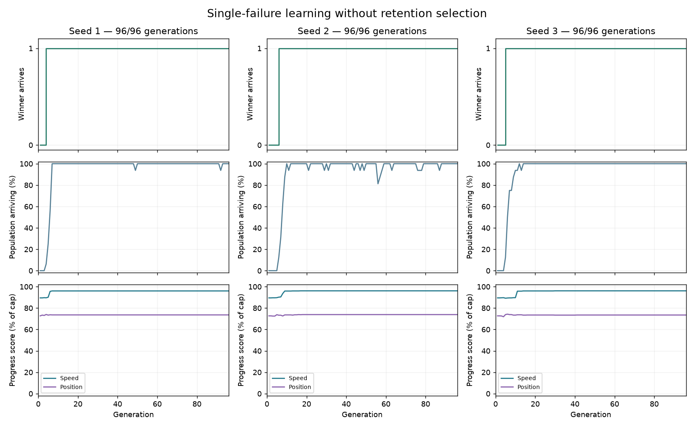
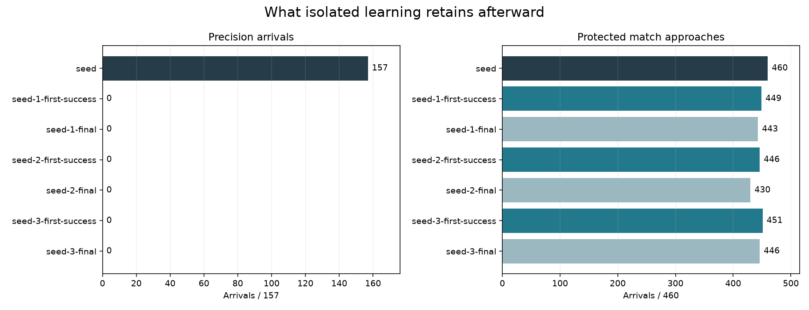
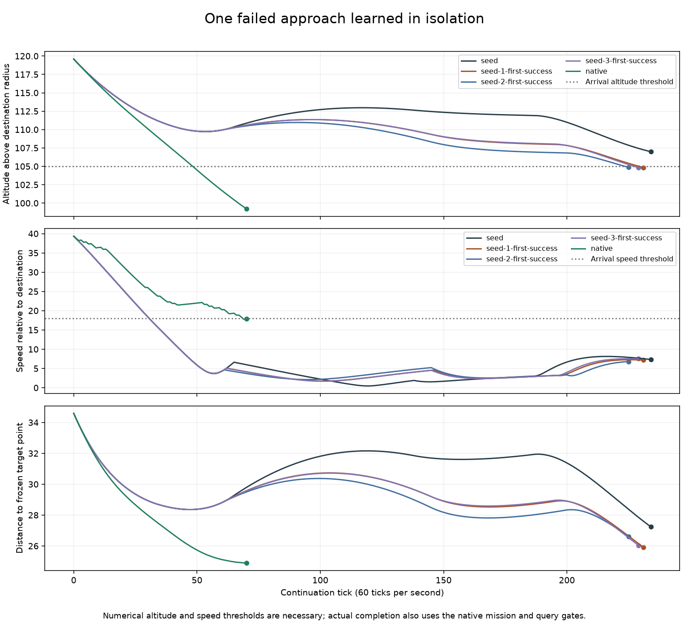

# Learning one failed approach in isolation

The existing nine-input network learns the retained sun-route failure in all
three isolated searches, first arriving at generations **4, 6 and 5**. Each
solution also completes the round-terrain version checked after training.
However, every first-success and final artifact loses **all 157 precision
arrivals**, along with some protected match approaches. These models establish
single-case learnability, not a usable replacement for the starting model.

The immediate problem is acquiring this behavior while retaining precise stopping.
The retention-first score correctly rejects the particular solutions found here.
This does not establish that the two skills are incompatible within one network.
It also identifies an objective worth revisiting: successful approaches receive
more reward for lower terminal speed even when they take much longer to arrive.

## What was tested

The [frozen recipe](data/learned-guidance-isolation-v1-plan.json) starts from the
selected small-step generation-24 model in the
[mutation-scale comparison](learned-guidance-mutation.md). Only world 750008,
player 2, in angular terrain enters breeding. Three evolution seeds each run
96 generations with population 16, two elites, tournament size three, mutation
probability 0.05 and mutation scale 0.05. All initial slots contain the starting
model, so every later candidate descends from it. Inputs, network structure,
actions, physics and host gates remain unchanged.

The objective uses the existing approach formulas: arrival first, terminal speed,
terminal position and spare ticks. Precision episodes, protected matches, other
added approaches and unrelated brake probes do not contribute to breeding. This
focuses several parts of the objective at once, so it is not a matched causal
test of removing retention alone.

Each run freezes its first successful generation winner and final winner.
Only after all three runs finish are those six artifacts checked against the
157 precision cases, 460 protected approaches, 14 added approaches and eight
separate diagnostics. No retention result or round-shape continuation selects
the artifacts. The round shape was previously inspected and repeats the same
approach geometry; it is not a fresh-world generalization test.

The searches use 4,608 training episodes and take 284.7 seconds in total. The
subsequent source reconstruction and retention evaluation take 195.3 seconds.

## Learning and retention results

| Artifact | First successful generation | Angular arrival tick | Round arrival tick | Precision / 157 | Protected matches / 460 | Added approaches / 14 |
| --- | ---: | ---: | ---: | ---: | ---: | ---: |
| Starting model | — | Failed at 234 | Failed at 234 | 157 | 460 | 2 |
| Seed 1 first success | 4 | 231 | 231 | 0 | 449 | 4 |
| Seed 2 first success | 6 | 225 | 225 | 0 | 446 | 4 |
| Seed 3 first success | 5 | 229 | 229 | 0 | 451 | 4 |
| Seed 1 final | — | 168 | 168 | 0 | 443 | 4 |
| Seed 2 final | — | 179 | 179 | 0 | 430 | 6 |
| Seed 3 final | — | 172 | 172 | 0 | 446 | 4 |

Native control arrives at tick 70 in both shapes. The first learned solutions
retain the two previously gained approaches and add the focal pair. Final seed 2
adds another pair but loses 30 protected match approaches. All eight separate
diagnostic cases remain unsuccessful for every learned artifact.

The first successful artifacts lose 9–14 protected match approaches; their final
versions lose 14–30. The precision losses are larger: each artifact has 139–148
timeouts and 9–18 exits from the permitted flight region. There are no
invalid-model outcomes in that set. Precision arrival requires distance at most
2, relative speed at most 1 and 30 consecutive qualifying ticks. For example,
the starting model completes `stationary_radial` with a 30-tick dwell; seed 1's
first successful match model times out on it with zero dwell, distance 5.33 and
relative speed 2.23.

## Behavior and scoring

The starting model crosses below the match arrival speed threshold of 18 at tick
31, while still outside the arrival altitude. It nearly stops at tick 119, with
speed 0.46 and altitude 112.96. It never reaches altitude below 105 before the
host requests a sun route at tick 234. Native control crosses the altitude
threshold at tick 49 and the speed threshold at tick 69, then completes at tick
70. Numerical thresholds are necessary; the native query and mission conditions
also determine the actual handoff.

The first successful learned models still brake early and linger outside the
arrival region. Their changed paths eventually cross the altitude threshold at
acceptable speed. Thus solving the binary case does not mean learning native
control's efficient approach.

The speed reward is `floor(1000 * clamp(1 - terminal_speed / 70, 0, 1))` and
outranks position and elapsed-time rewards after completion count ties. Native
control earns 744 speed points on its 70-tick arrival. Seed 1's first solution
earns 896 points on its 231-tick arrival. Every isolated first-success and final
artifact therefore ranks above native control under this objective, despite
taking substantially longer. Native arrival still outranks the failing starting
model because completion comes first; the objective does not prefer that failure
over native success.

This comparison identifies a preference for extra slowdown after acceptable
arrival speed is already achievable. It does not prove that speed priority is
the sole cause of the earlier training plateau. The isolated searches also
removed other cases and retention terms, and their solutions regress badly.

[Replay all eight controllers](data/learned-guidance-isolation-v1-replay.html)
on both shapes. Displayed speed is relative to the destination planet, matching
the score and behavior plot. The complete results (`docs/data/learned-guidance-isolation-v1-results.json`, in git history)
retain lost-case lists, exact model identities, scores and trajectory metrics.

## Implications and next test

There is no evidence here requiring a larger network or different inputs to
solve this particular approach. There is clear evidence that unconstrained
specialization destroys the precision skill. Keep the original successful model
and all acceptance gates; none of these isolated artifacts qualifies for use.

The next bounded test should ask whether the skills can be combined. Start from
the first successful artifact with the fewest protected-match losses, seed 3,
keep the focal arrival in the objective and reintroduce a small declared set of
stationary and moving precision cases. Then measure the full retention suite.
This tests recovery of the lost skill before another broad search. A separate
controlled objective comparison can test whether rewarding prompt successful
handoff rather than ever-lower terminal speed improves the learned approach.
Keep these interventions separate so the next result remains interpretable.

## Verification

All 34 focused Rust tests passed. Preflight reproduces the two starting-model
and two native traces byte for byte. The evidence audit verifies 570 copied
elites, 636 repeated-genome scores, 33 training-observation traces, 3,374
post-training match traces and 1,099 precision endpoints. All 482 starting-model
match traces remain byte-identical to the previous experiment. Stored physical
sources remain unchanged after evaluation.

Browser checks pass for playback, case switching, all 16 replay terminal states
and a narrow viewport. Desktop and mobile captures were inspected at 1× scale.
The retained package is
`data/training-experiments/recovery-guidance-isolation-v1-20261018/` and includes
the frozen executable, source, recipe, checkpoints, traces and verified archive.
Production controls are unchanged.
