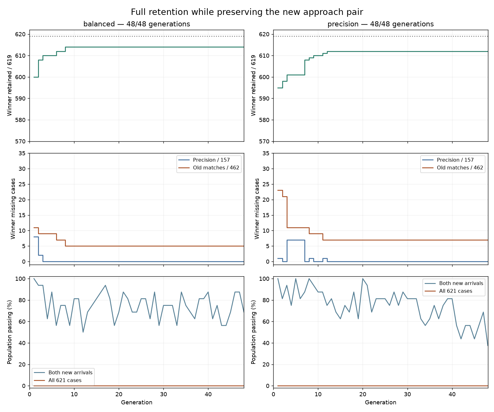
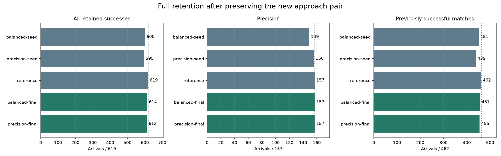
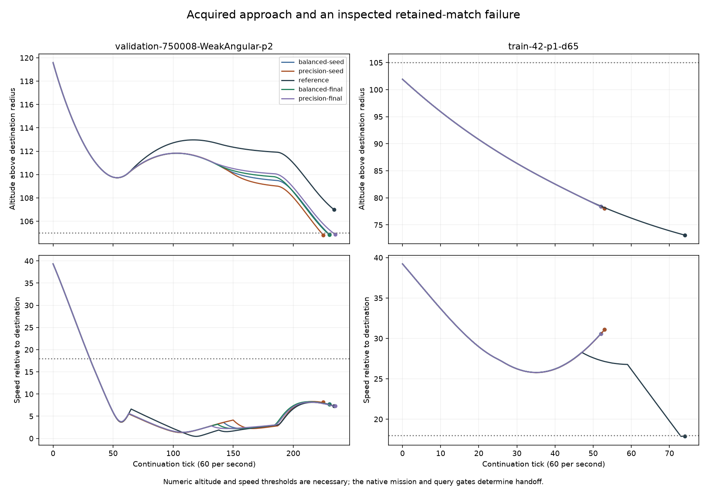
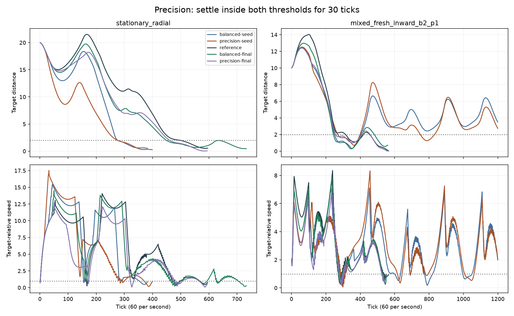

# Restoring full retention after precision repair

This experiment continues two models from the
[precision-repair diagnostic](learned-guidance-repair.md). Both can perform the
new match approach and precise stopping. Selection now includes all previously
successful cases, so losses on established match approaches count directly
against a candidate.

Both 48-generation continuations improve retention without losing any final
success of their own starting model. The balanced arm recovers 14 cases and
finishes at **614/619** retained successes; the precision arm recovers 17 and
finishes at **612/619**. Both preserve all **157 precision cases** and the new
approach in both terrain shapes. Neither meets the all-621-case gate.

The better model's five remaining match failures cover three distinct initial
flight observations. All five fail to brake before the host requires a climb.
This provides a narrow next target; it does not establish a need to redesign
the network or justify a production replacement.

## Frozen recipe

The [plan](data/learned-guidance-joint-retention-v1-plan.json) declares two starts:

| Arm | Starting artifact | Precision / 157 | Retained matches / 462 | Total retained / 619 | New approaches / 2 |
| --- | --- | ---: | ---: | ---: | ---: |
| Balanced | Repair seed 3, first joint success, generation 8 | 149 | 451 | 600 | 2 |
| Precision | Repair seed 2, final, generation 96 | 156 | 439 | 595 | 2 |
| Original reference, evaluation only | Small-step validation selection, generation 24 | 157 | 462 | 619 | 0 |

The 462 retained matches consist of 460 protected approaches and the two
previously added world-770055 player-2 successes. The new pair is world 750008,
player 2, with Angular and Round terrain. All these cases and model outcomes
were inspected previously.
The two new cases have identical initial flight observations and different
world hashes. They check terrain variants of one approach, not two independent
skills; the total is a count of successful episodes.

Each arm starts with 16 exact copies of its own model and uses evolution seed 1:
48 generations, two elites, tournament size three, mutation probability 0.05,
mutation scale 0.05 and parameter limit 8. The network, features, episode score
formulas, physics and handwritten host gates are unchanged. This is one
exploratory search per starting model, not a multi-seed comparison of their
reliability.

Selection ranks candidates in this order:

1. Complete both new approaches.
2. Maximize total retained arrivals across 157 precision cases and 462 matches.
3. At equal totals, prefer more precision arrivals.
4. Compare the existing precision position and velocity scores, approach speed
   and position scores, and spare ticks.

Both new arrivals therefore remain mandatory for the selected winner, and its
total retained count cannot fall. Equal-total trades between precision and
match cases are allowed. Acceptance requires all **621** cases; a high total
with even one missing case does not pass.

The fixed budget is **953,856 training episodes**: 2 arms × 48 generations × 16
candidates × 621 cases. Observation, preflight and post-training episodes are
additional. The searches continue to generation 48 even if full success occurs
earlier. The first full-success winner, if any, and each final winner are saved
under that rule, with identities frozen before post-training evaluation.

Full evaluation repeats all 157 precision cases and 482 match states for the
two parents, original reference and selected artifacts. Ten other additional
approaches and eight host diagnostics remain outside breeding. They are known
development cases, not fresh qualification worlds. All displayed replay cases
are in this experiment's training set.

## Results

| Model | Retained / 619 | Precision / 157 | Retained matches / 462 | New approaches / 2 | New approach ticks, both shapes |
| --- | ---: | ---: | ---: | ---: | ---: |
| Balanced parent | 600 | 149 | 451 | 2 | 230 |
| Precision parent | 595 | 156 | 439 | 2 | 225 |
| Original learned reference | 619 | 157 | 462 | 0 | Failed at 234 |
| Balanced final, generation 48 | **614** | **157** | **457** | **2** | 230 |
| Precision final, generation 48 | **612** | **157** | **455** | **2** | 235 |

The balanced arm gains eight precision cases and six matches relative to its
parent. The precision arm gains one precision case and 16 matches. Neither
final loses a parent success. Both retain the original two added world-770055
player-2 successes; the new pair brings their additional-approach total to
4/14. None of the ten other additional cases or eight separate diagnostics
succeeds. Every evaluated case was previously inspected development data.

The balanced arm reaches its final retention count at generation 8; its last
ordered-score improvement is generation 22. The precision arm reaches its
final count at generation 12, then improves lower-priority scores through
generation 45. No candidate passes all 621 cases. Across the 658 non-elite
slots after initialization in each arm, 464 balanced offspring and 469 precision
offspring preserve the focal pair. These counts include unchanged offspring;
they do not count the two copied elites.

The precision run temporarily trades precision completions for more match
completions: generation 3 has 150 precision plus 451 matches, improving its
total to 601. By generation 12 it has all 157 precision cases and 455 matches.
This is the declared count-first selection working as intended; individual
categories need not improve monotonically while total retention increases.

The training loops take 1,250.8 and 1,465.9 seconds, or 45.3 minutes combined.
Including match-state reconstruction and initial observations, the training
runner takes 2,848.0 seconds. Post-training reconstruction and evaluation take
145.7 seconds. CPU sharing affects elapsed time; candidate budgets are equal.

## Remaining failures

The balanced model's missing cases group into three identical-initial-observation
sets. The Angular/Round pairs still have different physical world hashes.
All five recorded failures use zero braking, with negative brake outputs
throughout. Their endpoints satisfy the existing native climb condition:
`altitude < 70 + falling_speed² / 50`.

| Retained start | Variants | Failure tick | Target-relative speed | Altitude / climb boundary | Original reference arrival / brake ticks |
| --- | --- | ---: | ---: | ---: | ---: |
| World 42, player 1, d65 | Angular and Round | 52 | 30.59 | 78.37 / 78.38 | 74 / 26 |
| World 10101, player 2, d65 | Angular | 46 | 47.95 | 111.09 / 111.23 | 100 / 51 |
| World 770054, player 1 | Angular and Round | 57 | 28.96 | 74.47 / 74.64 | 73 / 19 |

Geometry is reconstructed from recorded state using float64 arithmetic; the
saved host decision is authoritative. It agrees with the climb guard in
`crates/spacewars-ai/src/mission_pilot.rs`. In all three examples the original
learned reference succeeds from the same initial state and uses braking. This
supports a missing braking response rather than an unexplained host transition.
It does not show that a uniform brake-output shift would retain the other skills.

The precision final misses these same five cases and world-750008 player 1
in both shapes. On that additional pair it brakes for four ticks, then loses
control at tick 16. The balanced final completes that pair at tick 22 with
21 braking ticks. These player-1 starts are distinct from the acquired player-2
approach in that world.

The new approach still takes 230 or 235 ticks. Success on the inward-moving
precision case returns, but precision paths still vary substantially: on
`stationary_radial`, the balanced final takes 733 ticks versus its parent's 382.
Completion and lower-priority endpoint scores do not guarantee faster behavior.
No time-efficiency reward was changed in this experiment.

## Observability

[Open the synchronized replay](data/learned-guidance-joint-retention-v1-replay.html)
to compare all five fixed models on the ten declared cases.

The live observer reports total retention, separate precision and match deficits,
and population completion. Replays include both parents, the original reference
and the latest saved snapshot from each arm. Snapshots are saved at generations
0, 1, every eight generations, and first full success; their labels distinguish
them from an unsaved current winner.

The ten frozen replay cases include both new approaches, two retained match
starts, five basic precision tasks and the inward-moving precision case that
the precision parent failed. Precision requires distance at most 2 and
relative speed at most 1 for 30 consecutive ticks. Match success requires the
native mission handoff. Recorded paths do not render terrain or the full world.

## Next controlled question

Keep the balanced final as a research starting point and retain the original
reference. There is still a five-case loss against that reference, so this is
not a replacement candidate. The present evidence does not justify changing the
network or simply extending the same recipe again.

A focused comparison can test progress rewards on the three remaining failed
starts while requiring retention of the currently demonstrated successes. The
current tie-breakers optimize precision endpoint quality before match progress,
even after all precision cases succeed. Giving the remaining match failures
more direct influence is a hypothesis to test against an unchanged control,
not an established explanation of the plateau. Freeze that scoring change,
budget and selection rule separately. Full retention plus the new pair remains
the prerequisite for fresh-world qualification; efficient handoff is a separate
question.

## Evidence and verification

Preflight reproduces 1,446 prior match traces byte for byte and all 471 precision
endpoints for the three reference models. Eighteen saved precision traces agree
with their nontraced endpoints, and all 482 reconstructed physical sources
match the previous package. The focused checks pass 36 Rust tests and 14
observer tests.

The evidence audit verifies 188 copied elites, 228 repeated-genome scores,
64 training match traces, 96 training precision traces, 2,410 post-training
match traces, 785 precision endpoints and 30 post-training precision traces.
All 1,446 post-training reference match traces are byte-identical to preflight.
Model scores agree across breeding, saved observations and the final evaluation;
physical source records remain unchanged.

The final replay passes playback, case switching, all 50 terminal-state checks,
precision dwell display checks and narrow-screen overflow checks. All four plots
and desktop/mobile replay captures were inspected at 1× scale. The
[machine-readable results](data/learned-guidance-joint-retention-v1-results.json)
include exact model identities, case gains/losses, histories, timings, trajectory
metrics and the failure-geometry inspection.

The package is
`data/training-experiments/recovery-guidance-joint-retention-v1-20261018/`.
It retains the frozen recipe, source patch, executable, checkpoints, traces,
analysis scripts and verified archive.
Production controls remain unchanged. A full retained-case pass would justify
a separately frozen fresh-world comparison; it would not itself qualify a
model for ordinary matches.
