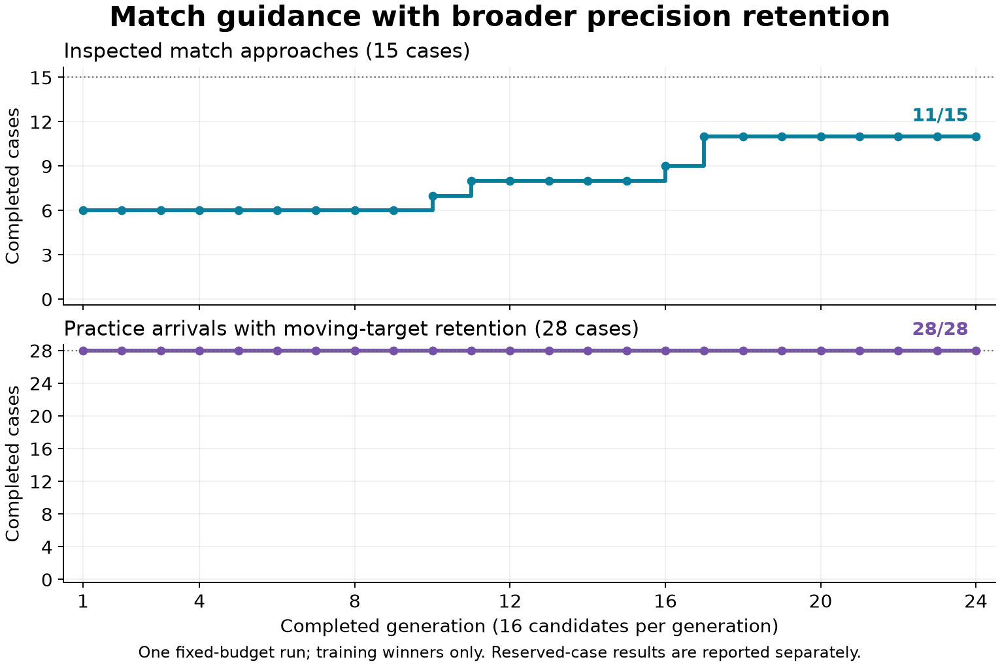

# Match guidance with broader precision retention

The second curriculum experiment improved the nine-input arrival network to
**16/16 new validation approaches**, compared with the parent's 10/16. It
retained all 28 protected practice arrivals but regressed five other older
arrivals, leaving the full original suite at **152/157**. The candidate still
fails the acceptance gate and does not qualify live match integration.

The [first continuation](learned-guidance-match-training.md) improved match
approaches but lost three older moving-target arrivals. This experiment added
those cases and their neighboring profiles to selection, together with the
inspected match starts. The previous result and evidence remain unchanged.

## Results and remaining failures

All 24 generations completed: 384 candidate batches and 16,512 training
episodes. Every generation's winner retained all 28 protected practice cases.
Approach completions increased from six to seven at generation 10, eight at
11, nine at 16, and eleven at 17. The final generation selected its winner
before any reserved continuation evaluation.

| Controller | Training approaches | Inspected development approaches | New validation approaches | Original arrival suite, unique starts |
| --- | ---: | ---: | ---: | ---: |
| Ordinary mission guidance | 14/15 | 22/24 | 16/16 | — |
| Arrival reference | 12/15 | 24/24 | 16/16 | 157/157 |
| Retained parent | 6/15 | 10/24 | 10/16 | 157/157 |
| Trained finalist | 11/15 | 20/24 | 16/16 | 152/157 |

The 24 development approaches comprise the original eight, where the finalist
completed 6/8, and the previous experiment's 16 validation approaches, where it
completed 14/16. The latter are now inspected training/development evidence.
New validation covered four different world seeds at initial speeds of
26.51–35.48 units/s. Both seats and dirt variants share worlds; these 16 successes
are a bounded capability result, not a general reliability estimate.



The finalist repaired seed-17 P1, braking throughout its 62 owned ticks before
native capture at tick 63. The previous finalist had released its brake and
required a climb. On the new worlds, this finalist added successful handoffs
for P2 in seeds 73, 509, and 65537, in both dirt shapes. It retained every
parent success on the training, development, and new validation approach sets.

Four training approaches still fail: the seed-42 P1 short start, the earlier
seed-42 P2 and seed-10101 P2 starts, and the seed-2027 P1 short start. Each ends
when the native host requires a climb. All four use no brake; the two short
failures maintain thrust through all 52 and 30 owned ticks respectively. The
short failures and their Round variants account for the four development
failures. The arrival reference completes both short starts. Its three earlier
training timeouts remain unchanged, and ordinary mission guidance completes
those starts; each match start is solved by at least one handwritten comparator.

The original moving-target group improved from the previous finalist's 13/16
to 16/16, including all three previously failed precision cases. Five different
cases now time out in the 96-case original development partition:

| Case | Final distance (units) | Final relative speed (units/s) |
| --- | ---: | ---: |
| `qualification_target_motion_b1_p0` | 2.585 | 1.069 |
| `qualification_target_motion_b2_p0` | 2.571 | 0.974 |
| `qualification_target_motion_b3_p0` | 2.596 | 1.015 |
| `qualification_combined_a0_b1_p0` | 2.063 | 0.439 |
| `qualification_combined_a1_b0_p0` | 2.114 | 0.497 |

All five reach the 1,200-tick deadline without the required dwell. The first
three share a moving-target profile at different bearings; the other two add
initial inward/lateral motion. Their endpoint measurements establish missed
precision requirements; this comparison does not retain their full trajectories.
The [machine-readable results](data/learned-guidance-match-training-v2-results.json)
include their measurements and every approach outcome.

The subsequent [braking and precision diagnostic](learned-guidance-failure-diagnostic.md)
added tested support for retaining the complete 157-start original suite. It
also found that the five precision failures enter the joint success window but
cannot sustain its 30-tick dwell. Forcing the finalist's brake on completes all
43 distinct inspected match approaches but loses 148 older arrivals. The next
training recipe needs full-suite retention and coordinated braking/settling,
with the same nine-input contract and success thresholds. These results do not
yet justify a match selector or a default change.

All 220 match trials ended at 100 health. The 117 parent/reference/mission
traces on reused starts are byte-identical to the previous run. All 13,897
component decisions match their physically applied controls, with no missing
post-step observations. All three original-suite evaluations used the same
executable as the match comparison and recorded zero feature saturation. Four
fixture tests, checkpoint round trips, explicit pause/resume, formatting, and
the frozen-source checks passed.

The selected genome is
`7895c85cce3cc0a156393d23355a1d62f90cddc964b9c125ba5eec9826bf1073`.
No production adapter, bot default, or device changed.

## Frozen curriculum and budget

The [recipe](data/learned-guidance-match-training-v2-plan.json) keeps the same
retained parent, 9–8–3 network, action decoder, fitness order, initialization,
mutation settings, and 24-generation budget. The first continuation's rejected
finalist is not a seed. This comparison changes the curriculum.

Each of 384 candidates runs 43 episodes, for **16,512 training episodes**:

- The 12 original mixed-arrival training cases.
- All 16 previously inspected moving-target cases, including the three failed
  precision cases and their neighboring profiles and bearings.
- All seven previous match training starts, including the three earlier
  approaches within 65 units.
- All eight Angular starts from the previous validation set, including its
  successes and failures.

Completed practice arrivals rank first, then completed native match handoffs,
then the same bounded speed, position, and unused-time terms as before. The
practice requirement remains distance at most 2 units, relative speed at most
1 unit/s, and a continuous 30-tick dwell within 1,200 ticks. Match approaches
retain the 300-tick limit, common neutral tick, physical failure checks, and
native capture handoff. No case is removed because a comparator fails it.

The development comparison contains all eight original match approaches and all
16 previously inspected validation approaches. Its 12 Angular starts overlap
training; the remaining 12 are their Round variants. These are correlated
development results, not new validation.

New validation uses seeds **73, 509, 4093, and 65537**, both seats, and both dirt
shapes. For each requested start, preflight finds the first eligible direct
approach within 35 units during 180 seconds or earlier native finish. The common
neutral tick must retain eligibility. Preflight inspects initial states only;
missing starts remain missing and cannot be replaced.

After the fixed budget, compare ordinary mission guidance, the arrival
reference, the parent, and the last generation's training winner on identical
cloned starts. **Acceptance requires all 15 training approaches, all 24
development approaches, all 16 new validation approaches, and every original
arrival case.** The original suite contains 167 partition entries and 157 unique
starts. Evaluation cannot extend the budget or select a different finalist.

## Reproduction

The test-only harness retains version 1 as its default. Select this experiment
with `SPACEWARS_APPROACH_LEARNING_VERSION=2`; the other controls follow the
[first experiment's instructions](learned-guidance-match-training.md#running-and-retaining-the-experiment).

```sh
RUST_MIN_STACK=16777216 cargo +1.89.0 test -p engine-client --bin engine-client \
  --locked --offline --profile ci guidance_approach -- --nocapture

RUST_MIN_STACK=16777216 \
SPACEWARS_APPROACH_LEARNING_VERSION=2 \
SPACEWARS_APPROACH_LEARNING_MODE=preflight \
SPACEWARS_APPROACH_LEARNING_OUT=/tmp/match-learning-v2-preflight-NEW \
cargo +1.89.0 test -p engine-client --bin engine-client \
  --locked --offline --profile ci learned_guidance_match_training \
  -- --ignored --nocapture
```

Freeze the exact source, executable, lockfile, plan, and preflight receipt before
training. Set version 2 in every mode. `train` starts a fresh run directory;
`resume` continues its checkpoint. Both require
`SPACEWARS_APPROACH_LEARNING_PREFLIGHT` pointing at the same executable's
preflight receipt. `SPACEWARS_APPROACH_LEARNING_STEPS` optionally pauses after
a declared number of candidate batches. `evaluate` requires a completed run in
`SPACEWARS_APPROACH_LEARNING_RUN` and a fresh output directory.

The selected mission memory remains held during component trials. Live mission
bookkeeping, match control ownership, fallback, and device qualification remain
separate work in the [integration plan](design/learned-guidance-match-v1.md).

## Retained evidence

The local archive is
`data/training-experiments/recovery-guidance-match-learning-v2-20261016.tar.gz`
(9,664,087 bytes), SHA-256
`7db99dfe2b70d31ff8b35bc57c7ba301ce8e6318f95cf0baf636ee640c14408a`.
All 252 members were verified. It includes the source patch against
`1df24f2b574400a7b9ae78145c67402721aae907`, source/preflight/finalist freezes,
the complete checkpoint and resume receipt, all 220 approach traces, original
arrival reports, analysis and plot scripts, and validation receipts.

The comparison runtime is
`diagnostic_v1/linux/x86_64/9aba22668b087f5cc618433d786deacef5ce2c40c909289cb296e6ba9ca94359`.
The genome file SHA-256 is
`67ca642c3b5499c66d72a57c93f03c53c6d6bdad458960edf47df3a7723f1028`.
