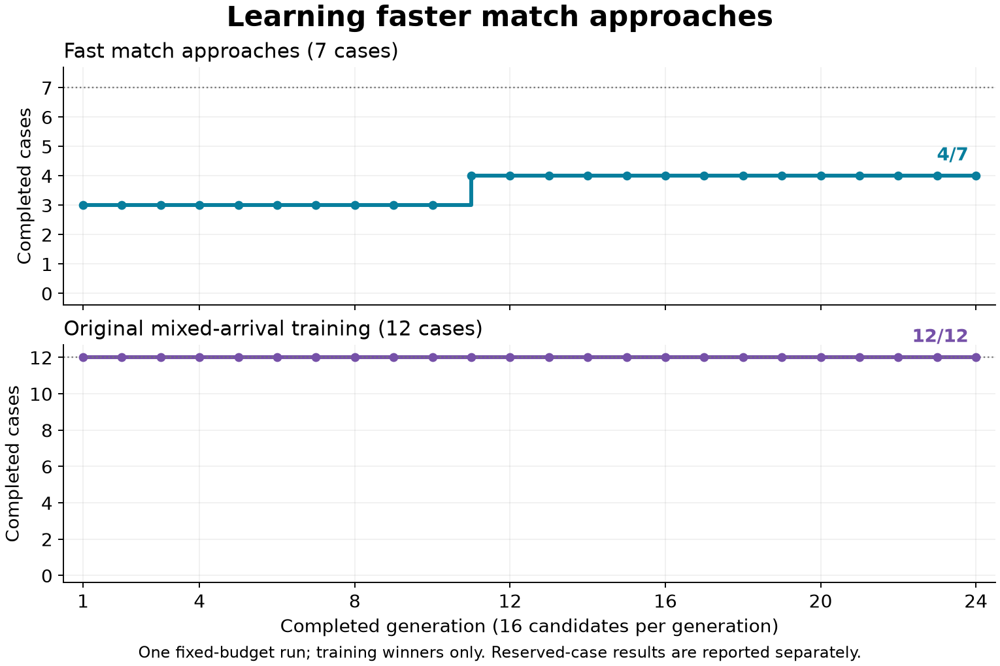

# Training guidance on fast match approaches

The trained finalist improved the original approach set from **4/8 to 6/8**
and the reserved match set from **6/16 to 12/16**, but failed the acceptance
gate. It still missed fast approaches and regressed three older moving-target
arrivals. Keep the retained network; this result does not qualify live match
integration.

This experiment continued the mixed-arrival seed-1 network after the
[first approach comparison](learned-guidance-approach-probe.md). Training added
actual moving-planet approaches at roughly 25–50 units/s while preserving all
12 old training arrivals. The nine inputs, 107-parameter network, action
decoder, physics, and native handoff gates stayed fixed.

The [recipe](data/learned-guidance-match-training-v1-plan.json) declares the
cases, selection rule, budget, and acceptance criteria before training or
reserved-case continuation outcomes. This is one bounded continuation run.

The subsequent [broader retention experiment](learned-guidance-match-retention.md)
protects the inspected moving-target cases and adds these match starts to
selection. Its separate recipe, new validation worlds, and results preserve
this first run unchanged.

## Results and remaining failures

All 24 generations completed: 384 candidate batches and 7,296 training
episodes. Every generation's winner retained the 12 old training arrivals.
The first improvement in approach completions appeared at generation 11;
the final winner completed 4/7, compared with the parent's 3/7.

| Controller | Training approaches | Original approaches | Reserved approaches | Original arrival suite, unique starts |
| --- | ---: | ---: | ---: | ---: |
| Ordinary mission guidance | 6/7 | 6/8 | 16/16 | — |
| Arrival reference | 4/7 | 8/8 | 16/16 | 157/157 |
| Retained parent | 3/7 | 4/8 | 6/16 | 157/157 |
| Trained finalist | 4/7 | 6/8 | 12/16 | 154/157 |

The original suite has 167 partition entries covering 157 distinct starts.
The finalist retained every partition except the former fresh moving-target
group, which fell from 16/16 to 13/16. Its three timeouts were
`mixed_fresh_moving_b0_p0`, `b1_p0`, and `b2_p0`: at the 20-second deadline,
distance remained 2.87–2.90 units against a 2-unit requirement, with relative
speed 0.82–0.85 units/s. Protecting the 12 old training cases did not protect
that broader precision behavior.



The finalist repaired the seed-10101 P2 short approach, reaching native capture
in 71 ticks instead of requiring a climb at tick 33. On reserved worlds, it
added successful handoffs for seed-17 P2, seed-2027 P2, and seed-9001 P1 in
both dirt shapes. The remaining four reserved failures are two distinct starts
with their dirt variants. Seed-2027 P1 never brakes; seed-17 P1 brakes for nine
ticks, then releases it for seven while maintaining full thrust. Both still
require a native climb. The original seed-42 P1 failure also remains.

All 124 match comparisons ended at 100 health. Every failed finalist approach
ended at the native climb requirement. The arrival reference timed out on the
three earlier training starts within 65 units; ordinary mission guidance
completed those same starts. Each training start was completed by at least
one handwritten controller, while both handwritten controllers completed all
16 reserved short approaches. Their complementary results are retained in the
[machine-readable report](data/learned-guidance-match-training-v1-results.json).

The 24 parent/reference/mission traces on the original approach set are
byte-identical to the previous experiment. All 7,790 component decisions match
the physically applied controls; none lack a post-step observation. The fixture
tests, checkpoint round-trip and resume checks, formatting, and frozen-source
checks pass. All three original-suite evaluations used the same executable as
the match comparison and recorded zero feature saturation.

The next curriculum should add the inspected short approaches as development
examples, including the remaining failures, and protect moving-target precision
with a broader retention set. Keep the nine inputs: the arrival reference
already solves every original and reserved short approach with them. Freeze
new validation worlds for the next run. Preserve this failed result and its
budget rather than extending training after inspecting evaluation outcomes.

The finalist is
`1393d113323180ad6de3eb6aa8dc8a45397faddc19fb1cf0c101014ceb443a46`.
Its genome, complete checkpoint, initial-state receipts, all approach traces,
and regression results are retained with the experiment. No default, live
adapter, or device rollout changed.

## Training and selection

Seven distinct match snapshots come from the inspected census: the first
unassisted direct approach within 65 and 35 units of the entry, for both seats
in seeds 42 and 10101 with Angular dirt. One source serves both thresholds,
so it is included once. These starts retain the ships' actual heading, spin,
planet motion, terrain, other bot, and mission context. No motion is rewritten.

Every candidate runs all seven approaches and all 12 original mixed-arrival
training cases. The approach evaluator uses the previous five-second limit,
common neutral tick, fixed-bearing target, native capture handoff, and physical
failure checks. A native climb or other preemption remains a failed approach.
The selected mission memory is held during component trials; this experiment
does not implement a live match adapter.

| Setting | Frozen value |
| --- | --- |
| Parent | Mixed-arrival seed 1, genome `693447c6df8315017a67f8dba8809568cf08f3ec66131302bfd026fa49f343fb` |
| Run seed | 1 |
| Budget | 16 candidates × 24 generations × 19 cases = 7,296 episodes |
| Initial population | One unchanged parent and 15 independent random genomes, parameters in [-0.5, 0.5) |
| Selection | Two unchanged elites; tournament size three; genome hash then slot break ties |
| Mutation | Per-parameter probability 0.05; uniform addition in [-0.15, 0.15), clamped to [-8, 8] |
| Finalist | The final generation's training winner |

Ranking first preserves completed arrivals on the 12 old training cases, then
maximizes native approach handoffs. Ties compare bounded final speed progress,
then position progress, then the old position and velocity scores, and finally
unused successful ticks. Progress cannot displace an additional completed
arrival. Physical failures earn no approach progress; healthy timeouts and
native preemptions can supply a gradient toward improved braking.

The speed and position terms are `floor(1000 × clamp(1 − value/scale, 0, 1))`,
with scales 70 units/s and 100 units respectively. They use speed relative to
the planet center and distance to the frozen-bearing target. They do not reward
a prescribed brake button or copy reference actions. The shared evolutionary
runner retains ancestry, every score, generation winners, and resumable state.

## Reserved evaluation and acceptance

Initial states are discovered in world seeds **17, 113, 2027, and 9001**, with
both seats and Angular/Round dirt: 16 requested starts. For each, take the first
unassisted direct transfer within 35 units of the entry during the first
180 seconds or earlier native finish. Finite unsaturated features, the flight
envelope, direct transfer, and distance limit must survive the common neutral
tick. Preflight inspects initialization only. A missing start stays missing;
another seed cannot replace it.

After all 24 generations, compare the finalist, unchanged parent, arrival
reference, and ordinary mission guidance on identical cloned starts. Report
the seven training approaches, original eight development approaches, and
16 reserved approaches separately. Four development approaches overlap the
training set; the other four are their dirt variants. Dirt variants and seats
share worlds, so their outcomes are correlated.

The finalist, parent, and arrival reference also replay all six partitions of
the original mixed-arrival suite. **Acceptance requires every original arrival
case, all seven training approaches, all eight development approaches, and all
16 reserved approaches to succeed.** Missing cases and reference failures do
not relax that gate. Evaluation cannot select another generation, extend the
budget, or choose another run seed. Once inspected, reserved cases become
development evidence for subsequent experiments.

A passing result would support further component integration work. Full-match
ownership, fallback, reliability, and device qualification remain in the
[integration plan](design/learned-guidance-match-v1.md).

## Running and retaining the experiment

Build and test the fixture, then preflight with a fresh output directory:

```sh
RUST_MIN_STACK=16777216 cargo +1.89.0 test -p engine-client --bin engine-client \
  --locked --offline --profile ci guidance_approach -- --nocapture

RUST_MIN_STACK=16777216 \
SPACEWARS_APPROACH_LEARNING_MODE=preflight \
SPACEWARS_APPROACH_LEARNING_OUT=/tmp/match-learning-preflight-NEW \
cargo +1.89.0 test -p engine-client --bin engine-client \
  --locked --offline --profile ci learned_guidance_match_training \
  -- --ignored --nocapture
```

Freeze source, executable, recipe, lockfile, and preflight hashes before training.
Use the same executable for every subsequent mode:

```sh
RUST_MIN_STACK=16777216 \
SPACEWARS_APPROACH_LEARNING_MODE=train \
SPACEWARS_APPROACH_LEARNING_PREFLIGHT=/tmp/match-learning-preflight-NEW/preflight.json \
SPACEWARS_APPROACH_LEARNING_OUT=/tmp/match-learning-run-NEW \
cargo +1.89.0 test -p engine-client --bin engine-client \
  --locked --offline --profile ci learned_guidance_match_training \
  -- --ignored --nocapture

RUST_MIN_STACK=16777216 \
SPACEWARS_APPROACH_LEARNING_MODE=evaluate \
SPACEWARS_APPROACH_LEARNING_PREFLIGHT=/tmp/match-learning-preflight-NEW/preflight.json \
SPACEWARS_APPROACH_LEARNING_RUN=/tmp/match-learning-run-NEW \
SPACEWARS_APPROACH_LEARNING_OUT=/tmp/match-learning-evaluation-NEW \
cargo +1.89.0 test -p engine-client --bin engine-client \
  --locked --offline --profile ci learned_guidance_match_training \
  -- --ignored --nocapture
```

`SPACEWARS_APPROACH_LEARNING_STEPS=N` pauses training after N candidate batches;
`resume` continues the existing run directory and validates the exact runtime,
source-state receipt, parent, recipe, and budget. Every candidate saves a
checkpoint. Evaluation requires a completed run and retains full approach
traces, original-suite results, and the finalist genome. Training omits trace
serialization; a parity test checks identical traced and untraced outcomes.

## Retained evidence

The local archive is
`data/training-experiments/recovery-guidance-match-learning-v1-20261016.tar.gz`
(5,704,981 bytes), SHA-256
`05fab66414def5cc5f14cecc3c41a3112d1ad317cbe0557608becbae4a7ecf02`.
All 154 members were verified against their checksums. It includes the source
patch against `1df24f2b574400a7b9ae78145c67402721aae907`, preflight and finalist
freezes, checkpoints, complete comparisons, analysis and plot scripts, and
validation receipts. The comparison runtime is
`diagnostic_v1/linux/x86_64/a78cd50b54fdbfa04dae0a0bdc6509476d09987117af7eddb00ae25a9a38b924`.
