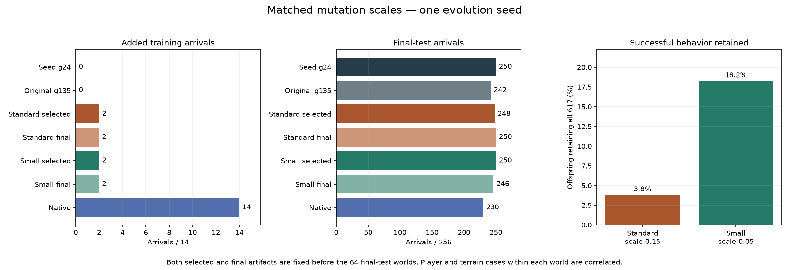
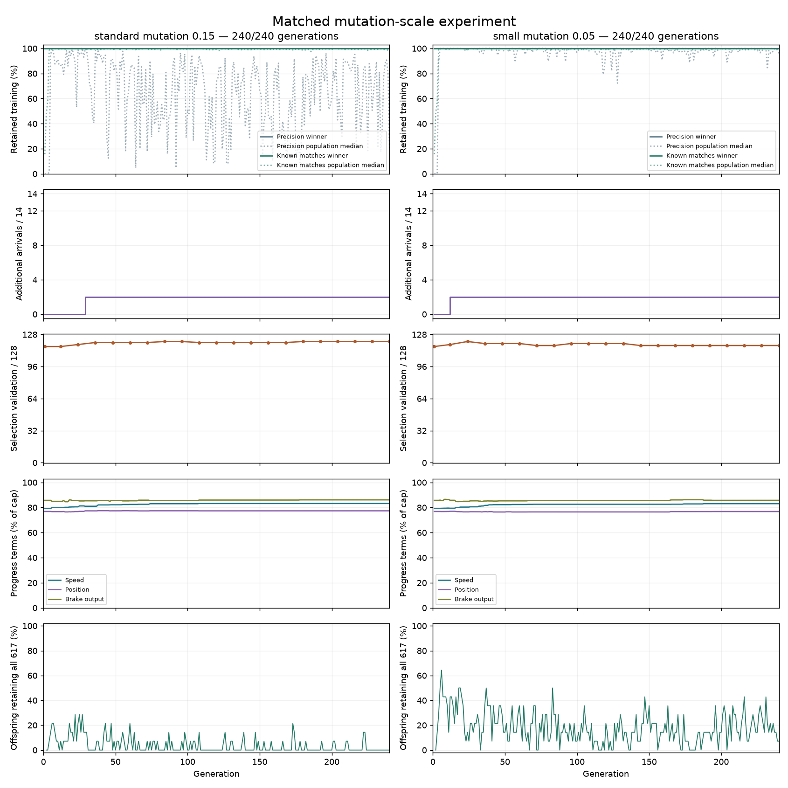

# Matched mutation-scale experiment

Both 240-generation runs and final evaluation completed in about four hours.
Smaller mutations preserve existing skills much more often, but do not break
the training plateau. Both arms add the same two arrivals out of 14, representing
one player/world situation in both terrain shapes. Neither selected model
improves the starting model's completion count on the 64 final-test worlds.

Keep the small-step generation-24 checkpoint as a research candidate alongside
the starting model. It improves known failures and selection validation while
matching the starting model's final-test count, but swaps four successes for four
failures. It is not an unambiguous upgrade and has not qualified for production.

## What changed

| Controller | Protected successes / 617 | Added / 14 | Selection validation / 128 | Final test / 256 | Complete final worlds / 64 |
| --- | ---: | ---: | ---: | ---: | ---: |
| Starting model | 617 | 0 | 116 | 250 | 61 |
| Standard steps, selected generation 84 | 617 | 2 | 121 | 248 | 60 |
| Standard steps, final generation 240 | 617 | 2 | 121 | 250 | 61 |
| Small steps, selected generation 24 | 617 | 2 | 121 | 250 | 61 |
| Small steps, final generation 240 | 617 | 2 | 117 | 246 | 59 |

Both selected models gain the same five validation starts without losing any
starting-model validation successes. On the separate final test, standard
selection gains four starts and loses six; small-step selection gains four and
loses four. These are paired changes in identical physical states. Equal totals
do not mean identical behavior.

Standard mutation preserves all 617 established successes in 126/3,346 offspring
(3.77%). Small mutation does so in 610/3,346 (18.23%), about 4.8 times as often.
Small mutation reaches two added arrivals at generation 12; standard reaches them
at generation 29. Neither exceeds two during the remaining budget. Most offspring
still fail at least one protected case, even under the smaller mutation scale.

The two added arrivals are world 770055 player 2 in angular and round terrain.
The starting model leaves the angular approach for another host mode at tick 137;
selected standard and small models arrive at ticks 71 and 134 respectively.
Native control arrives at tick 89. The retained world-750008 player-2 sun-route
failure remains: selected small control exits at tick 234, while native arrives
at tick 70. Smaller mutations made useful offspring more common without solving
that delayed-approach behavior.

## Reading the training plots

The solid lines at 100% in the top row show the winner retaining all established
successes. They are expected under retention-first selection and copied elites;
they do not mean every offspring succeeds. The dotted population medians and
bottom-row offspring counts show how disruptive mutations are. Small steps are
less disruptive in this run.

The purple second row is the clearest measure of new training skill: both runs
reach 2/14 and plateau. The fourth row's small speed, position and brake-score
changes are lower-priority rewards, not additional completed approaches. Training
fitness continues improving through generation 178 with standard steps and 237
with small steps without adding another arrival.

The validation row uses a full 0–128 axis, making five-start improvements and
four-start regressions look small. Small steps peak at 121/128 at generation 24
and end at 117/128. Validation is not part of breeding, so later training winners
can lose validation successes while improving their training score. Keeping the
earlier checkpoint preserves a better result: 250 final-test arrivals versus 246
for its final generation. Standard selection also shows the limit of the rule:
its earliest 121/128 checkpoint scores 248 on the final test, while its final
checkpoint scores 250. Validation helps choose candidates but cannot guarantee
unseen retention.

The replay of all seven controllers (`docs/data/learned-guidance-mutation-v1-replay.html`) and the
complete paired results (`docs/data/learned-guidance-mutation-v1-results.json`) are in git history.
The replay shows recorded target-relative paths and controls; it does not render
terrain or the full world.

## Fixed comparison

Both arms start from the physical-progress-first generation-24 artifact from the
[reward-priority experiment](learned-guidance-priority.md). Its
[64-world evaluation](learned-guidance-broad-evaluation.md) retained every parent
success but showed no fresh completion advantage.

| Setting | Standard steps | Smaller steps |
| --- | ---: | ---: |
| Mutation scale | 0.15 | 0.05 |
| Mutation probability per parameter | 0.05 | 0.05 |
| Population | 16 | 16 |
| Elites | 2 | 2 |
| Tournament size | 3 | 3 |
| Evolution seed | 1 | 1 |
| Generations | 240 | 240 |
| Candidate evaluations | 3,840 | 3,840 |
| Training episodes | 2,423,040 | 2,423,040 |

The [frozen plan](data/learned-guidance-mutation-v1-plan.json) changes only mutation
scale between arms. Each candidate receives 631 episodes: 157 precision arrivals,
460 protected match approaches and 14 additional approaches where native control
demonstrates that arrival is possible. Eight other known failures remain separate
diagnostics. Previously inspected worlds are development evidence.

Fitness first preserves precision arrivals, then protected match arrivals, then
rewards additional arrivals. Ties use additional-case speed and position progress,
the eight original brake probes, precision position and speed, and spare ticks.
The same ordering and formulas apply to both arms. A winner must preserve all
617 established successes. Population plots also include unsuccessful offspring;
the offspring-retention plot excludes the two copied elites and generation 1.

## Checkpoint selection and final comparison

Selection validation uses 128 starts from 32 new worlds, comprising both players
in angular and round terrain. Discovery accepts the first complete worlds in
fixed seed order based only on start availability. It scanned 35 worlds to obtain
32. Generation 0, generation 1 and every 12th generation receive complete
validation traces. Validation selects a saved checkpoint without affecting
breeding or the fixed budget.

Eligible checkpoints retain all 157 precision and 460 protected arrivals. Choose
the most validation arrivals, then the most additional training arrivals, then
the earliest generation and lexicographically smallest genome ID. Both selected
and generation-240 models are frozen before discovering 64 final-test worlds.

The final comparison evaluates seven controllers on the same states: the
generation-24 seed, the original generation-135 parent, both selected checkpoints,
both final checkpoints and native control. It reports paired gains and losses,
world-level completion, known failures and trace integrity. The original parent
completes 242/256 final starts and native control 230/256. Native control completes
all 14 deliberately selected feasible failures. These are bounded component
continuations; a host mode change is not a failed full match. One evolution seed
cannot establish a general advantage for either mutation scale; player and terrain
cases from a world are correlated.

## Preflight evidence

All 33 focused Rust tests passed. The retained executable then reproduced all
482 previous seed-model approach traces byte for byte and all physical source
states exactly. The seed retains 157 precision and 460 match arrivals; it completes
none of the 14 additional approaches. Native control completes all 14.

The source, executable, inputs, plan, preflight receipt and verification are
retained under
`data/training-experiments/recovery-guidance-mutation-v1-20261018/`.
Training uses the frozen executable and verifies source and input hashes before
each phase. No final-test worlds were discovered during preflight. This remains
a bounded approach experiment; production bot controls are unchanged.

Both arms begin with identical population identities and raw scores. The final
audit verifies 956 copied elites, 1,004 repeated-genome score comparisons, 5,632
validation traces, 6,062 final match traces and 942 precision endpoints. All 482
seed traces remain byte-identical to preflight. Browser checks cover all 6,062
terminal states, playback, case switching and a narrow viewport; desktop and
mobile captures were inspected at 1× scale. The final cohort takes 68 scanned
worlds to obtain 64 complete worlds, with no outcome filtering.

## Next investigation

Smaller steps are the better-supported search setting for further local work,
but another long continuation is not the next useful test. Inspect a remaining
failure beside native control and the selected small-step model, checking whether
the progress rewards favor slowing or stopping before completing the approach.
Then test a narrowly targeted scoring or action intervention while measuring
its cost on all retained successes. Do not change the observation contract or
network size without evidence that the present representation prevents success.
Any later checkpoint selection needs new final-test worlds; these worlds are now
inspected development evidence.
