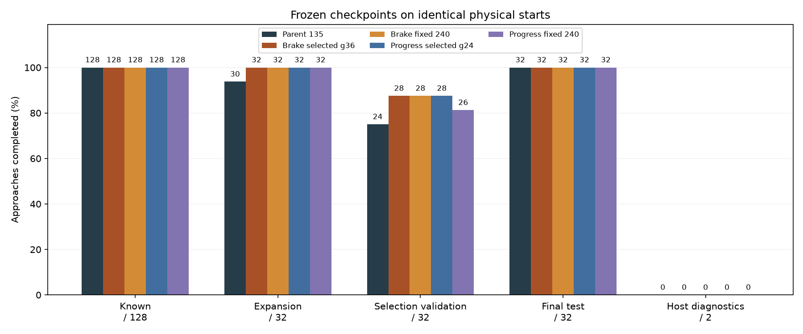
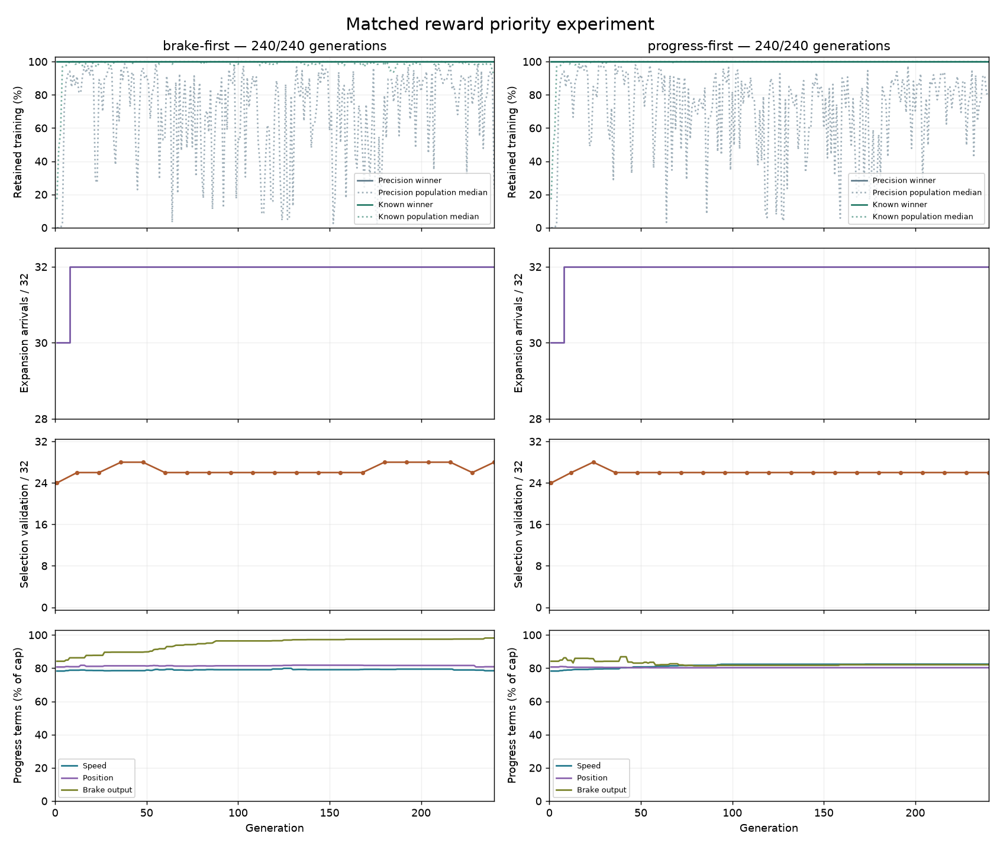
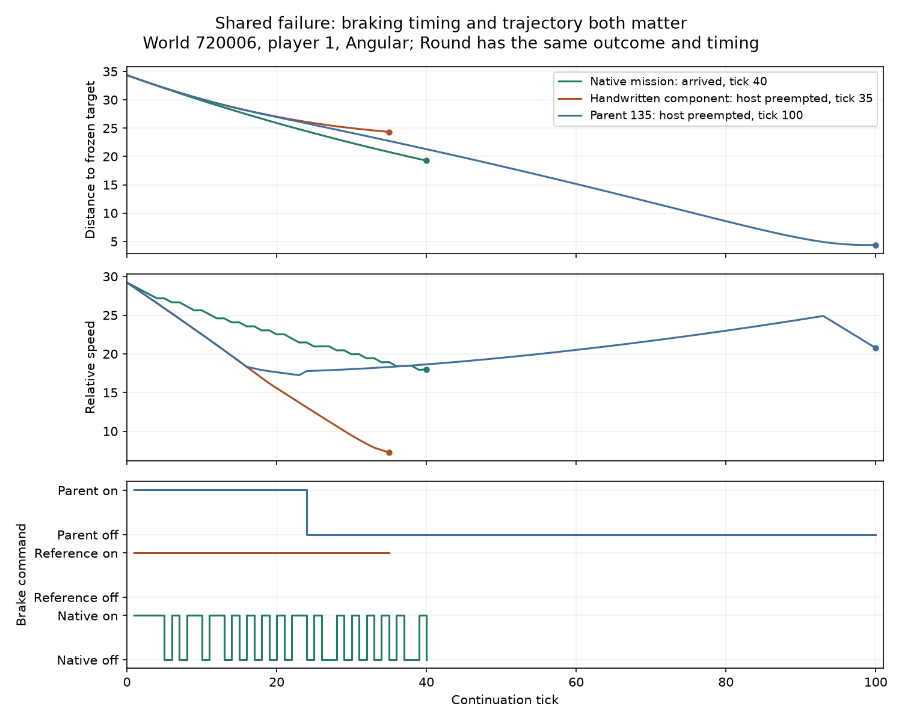

# Reward priority and validation checkpoint selection

Moving physical approach progress ahead of the braking reward produced **no
completion-rate advantage in this matched run**. Both arms recovered the two
expansion failures while retaining every established training success. Their
validation-selected checkpoints each complete **28/32 validation starts and
32/32 fresh final-test starts**. The original parent also completes all 32 final
starts, so this final cohort cannot distinguish the models by completion count.

Keep the existing score order for the next comparison and retain explicit
validation checkpoint selection. The selected unchanged-scoring artifact is
generation 36; it is a research candidate, with live integration still gated.

## Results

Every model below retains **157/157 precision starts and 128/128 known match
approaches**. Both selected models have the same successful validation cases.
All five identities were frozen before their final-test continuations.

| Model | Expansion / 32 | Selection validation / 32 | Fresh final test / 32 | Host diagnostics / 2 |
| --- | ---: | ---: | ---: | ---: |
| Original generation 135 parent | 30 | 24 | 32 | 0 |
| Brake first, selected generation 36 | 32 | 28 | 32 | 0 |
| Brake first, fixed generation 240 | 32 | 28 | 32 | 0 |
| Physical progress first, selected generation 24 | 32 | 28 | 32 | 0 |
| Physical progress first, fixed generation 240 | 32 | 26 | 32 | 0 |

Against the parent, both selected models gain world 720006 player 1 in both
shapes during training, plus world 750006 player 2 and world 750008 player 1 in
both shapes during validation. They lose no successes across the measured
groups. Both solve every observed validation case in six of eight worlds,
compared with five of eight for the parent. Every model solves all four final
starts in each of the eight final worlds.

The four remaining validation failures are world 750001 player 2 in both
shapes, where all models and native control take damage, and world 750008 player
2 in both shapes, where the models trigger sun avoidance. Native control arrives
on the latter pair after 70 ticks. The separate world-710003 host diagnostics
remain unresolved; these results do not establish that recovery is impossible.

[Open the synchronized replay](data/learned-guidance-priority-v1-replay.html)
to inspect all five models on all 226 match starts. It includes case groups,
playback, speed, scrubbing, controls and exact identities. It shows recorded
flight paths relative to the target; terrain and other world geometry are not
rendered. The [complete results](data/learned-guidance-priority-v1-results.json)
include case-level gains, losses and verification counts.

## Training and checkpoint choice

Both arms reach all **317/317 training successes at generation 8**, before their
generation winners first differ at generation 10. Their populations first differ
at generation 5. Recovering the shared expansion failure therefore does not
require the changed reward order in this run.

Control validation rises from 24 to 26 and then 28 by generation 36. It falls
to 26 at generation 60, returns to 28 at 180, falls to 26 at 228, and finishes
at 28. Physical-progress-first validation reaches 28 at generation 24, then
falls to 26 at generation 36 and stays there. The declared selection rule
preserves the earlier 28/32 checkpoints. The equal final-test results do not
demonstrate a generalization advantage for that selection rule on this cohort.

The last ordered-fitness improvements occur at generations 235 and 173. Each arm
evaluates 3,840 candidates, covering 1,217,280 training episodes and 3,346 distinct
genomes. There are 6,543 distinct genomes across the matched pair. The enclosing
training phases take 46m 31s and 60m 52s, including source reconstruction; final
evaluation takes 1m 51s. Both runs use the same adaptive 75% CPU target. Shared
machine load varies, so these durations are not a controlled throughput comparison.

## Matched recipe

The [frozen recipe](data/learned-guidance-priority-v1-plan.json) starts both arms
from the exact original generation-135 genome. All 16 initial genomes and their
complete raw fitness vectors match. Both use the same 107-parameter network,
seed 1, population 16, two elites, tournaments of three, mutation probability
0.05, mutation scale 0.15, initial scale 0.5 and parameter limit 8. Both run for
240 generations, with identical training states, reward formulas and eight
braking probes. Only the priority of the existing progress terms changes:

| Priority | Brake first | Physical progress first |
| --- | --- | --- |
| 1–3 | Precision, known and expansion completions | Same |
| 4–6 | Brake output, approach speed, approach position | Approach speed, approach position, brake output |
| Remaining | Precision position, precision velocity, spare ticks | Same |

Physical progress applies to the fixed 32 expansion cases, including those
already completed. Both arms use the same graded braking reward. An inherited
sentence in the frozen recipe, “Control uses zero,” describes an older experiment
and does not apply here. The eight probes retain their original membership and
now belong to protected known cases. The [recorded clarification](data/learned-guidance-priority-v1-plan-clarification.json)
preserves the original recipe bytes; neither training nor selection changed.

Validation uses 32 starts from eight fresh worlds. Eligible candidates are the
parent and generation winners at 1 and every 12 generations, requiring all 157
precision starts, all 128 known approaches and at least 30 expansion arrivals.
Selection maximizes validation arrivals, then expansion arrivals, then prefers
the earliest generation and ascending genome ID. Validation never changes
breeding, mutations or the fixed budget. The final test uses another eight
worlds after both selected and both fixed-final models are frozen. This is one
evolution seed; seat and shape observations within each world are correlated.

## Physical behavior

Preflight reproduces the parent's shared failure traces byte for byte. On world
720006 player 1 in both shapes, it is interrupted after 100 ticks. Native control
arrives after 40; the handwritten component brakes throughout but is interrupted
after 35. More braking alone is therefore not an established repair.

The selected control subsequently arrives on that case after 93 ticks; the
selected physical-progress-first model arrives after 48. Timing differs without
a uniform winner across cases. In a [post-hoc timing comparison](data/learned-guidance-priority-v1-timing.json),
the latter is faster on four final-test cases, slower on twenty, and tied on
eight, while using fewer total ticks across those 32 cases: 1,852 versus 1,959.
These timing observations did not affect checkpoint selection.

## Verification and next work

All 32 focused Rust tests and 12 observer tests pass. The evidence audit verifies
1,408 validation traces, 1,130 final match traces, 785 precision endpoints and
40 precision traces. The parent's 162 retained match traces remain byte-identical.
All 956 elite copies retain their scores, and 1,137 repeated-genome evaluations
match exactly. Browser checks cover all 1,130 replay terminal states, playback,
case switching and a narrow viewport without page overflow; desktop and mobile
captures were inspected at 1× scale.

The next useful check is a broader fixed-model world comparison, alongside a
focused replay of the feasible world-750008 sun interruption. The current final
cohort is at its completion ceiling. A separate smaller-mutation experiment is
also justified: only 219 and 220 of each arm's 3,346 offspring slots preserve
all 317 training successes, about 6.6% combined. That suggests testing finer
steps; it does not establish that smaller mutations will learn better.

The retained package is
`data/training-experiments/recovery-guidance-priority-v1-20261018/`, with the
source patch, executable, frozen inputs, checkpoints, selection receipts,
traces, analysis and replay. The sibling archive has a verified file manifest.
Production controls and defaults are unchanged.
