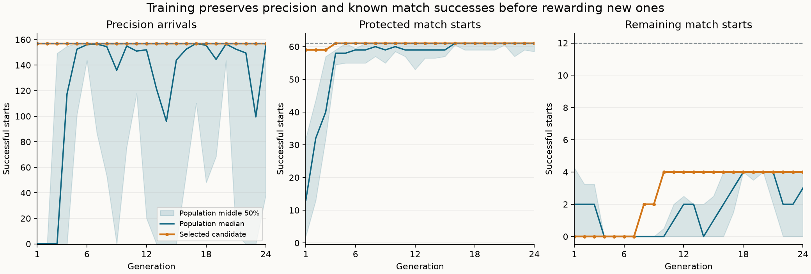
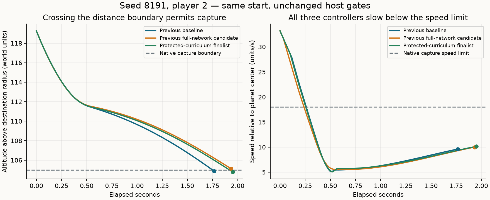

# Protecting learned match successes

This continues the [brake-readout comparison](learned-guidance-brake-readout.md).
The experiment uses the existing nine-input, 107-parameter arrival network and
the unchanged native host. Its purpose is to retain known match successes while
learning the remaining inspected approaches. It does not enable learned control
in ordinary matches.

The completed finalist retains all **61 protected match successes**, solves
**four additional starts**, and preserves **157/157 precision arrivals**. It
also completes **9/9 available fresh approaches**. Eight inspected failures and
seven missing reserved starts keep live integration unqualified.

## Results

| Controller | Protected / 61 | Additional / 12 | All inspected / 73 | Available fresh / 9 | Precision / 157 |
| --- | ---: | ---: | ---: | ---: | ---: |
| Ordinary handwritten mission | 59 | 12 | 71 | 7 | — |
| Arrival reference | 58 | 10 | 68 | 9 | 157 |
| Previous v3 baseline | 55 | 0 | 55 | 9 | 157 |
| Previous full-network candidate | 59 | 0 | 59 | 9 | 157 |
| Protected-curriculum finalist | **61** | **4** | **65** | **9** | **157** |

The finalist recovers seed 8191 P2 in both shapes and adds seed 17 P1 and seed
65537 P2 in both shapes. It loses no previous candidate success. On the prior
named partitions, it reaches 11/15 training, 48/54 development and 16/16 old
validation starts; those partitions are all inspected training data now.

Complete protection first appears in generation 4, two additional successes in
generation 8, and four in generation 10. The fixed run ends after generation
24; its 384 evaluations contain 338 unique genomes. Training takes **4m11s**;
preflight, the separate resume process and final comparison bring the full
execution to **7m05s**. Analysis, plotting and packaging are outside that timing.

The population distributions include candidates that fail retention. The
selected candidate maximizes the ordered fitness, so it can have fewer new
successes than another population member that loses precision or protected
matches. [Machine-readable results](data/learned-guidance-match-retention-v1-results.json)
retain every generation's population summaries and per-case comparisons.

## Why the two sun-detour regressions happened

Both failures were seed 8191, player 2, under the two dirt shapes. The recorded
ship trajectories, inputs and actions are identical between shapes; these are
correlated cases, not two independent demonstrations of generalization.

Native capture requires the destination frame, altitude below 105 world units
above the planet radius, speed below 18 units/s relative to the planet center,
and ready queries. The baseline entered capture after 106 scored ticks. The
newer full-network candidate still had altitude 105.133 at tick 116, when the
native route planner requested a sun detour. Its relative speed was already
9.995. This was a late arrival at the capture boundary, not damage or a failure
to apply the brake.

The newer candidate starts thrust five ticks earlier and applies brake for
three more ticks than the baseline. Their first physical divergence is at
absolute tick 1897. Both slow below the native speed limit within 16 ticks;
the subsequent paths reach the distance boundary at different times. These
traces identify the missed handoff window, without isolating an individual
weight or action as its cause. No host priority or capture threshold changes.

At the old failure's absolute tick 2011, the new finalist has altitude 104.904
and relative speed 10.068. Native capture therefore takes priority over route
planning. Its neutral handoff completes after 117 scored ticks. The baseline
is still faster at 106 ticks; this finalist successfully crosses the boundary
before its native host requests a detour.

## Frozen curriculum

The [recipe](data/learned-guidance-match-retention-v1-plan.json) combines all
previously inspected match starts. After verifying that every field except
case name agrees, 85 named entries collapse to 73 distinct starts. Names and
prior partition aliases remain recorded. All 73 are now training data.

The protected set contains the 61 starts completed by at least one of the prior
baseline, full-network or brake-only candidates. The previous full-network
candidate completes 59 of them; the baseline completes 55. Neither completes
any of the remaining 12 starts. The fitness orders candidates by:

1. Completed precision arrivals, across all 157 distinct original starts.
2. Completed protected match starts, out of 61.
3. Completed additional match starts, out of 12.
4. Existing match speed/position quality, precision quality, and spare ticks.

This is a selection priority. Below 61/61, equal counts could still exchange
which protected cases fail. Once a candidate reaches all 61, elitism and the
ordering preserve that complete set while precision remains at 157/157.

The initial population contains the previous full-network candidate and the
baseline, followed by 14 independent random networks. The mutation settings
remain unchanged: seed 1, population 16, 24 generations, two elites, tournament
size three, 5% per-parameter mutation probability, mutation scale 0.15, initial
scale 0.5, and parameter limit 8. There is no recombination. Each candidate
evaluates all 230 starts exactly once: 384 candidate evaluations and 88,320
training episodes. The final generation's winner is frozen before reserved
continuations run.

The expanded training set, protection priority and second initial seed change
together. This experiment tests whether that recipe works; it does not isolate
which of those changes produces an improvement.

## Reserved worlds

Seeds 431, 2017, 32771 and 524309 were declared before the run and were absent
from previous match recipes. The same first-eligible rule searches both seats
and dirt shapes for up to 10,800 ticks. Only nine of 16 requested starts were
available. Both seats/shapes of seed 431 ended before an eligible approach;
seed 2017 Round P2 and seed 524309 P1 in both shapes were also missing. They
remain missing rather than being replaced after inspection.

The integration gate still requires all 157 precision starts, all 73 inspected
match starts and all 16 requested reserved starts. Missing coverage prevents
passing even if every available episode succeeds.

## Remaining failures and next step

All eight remaining cases are `host_preempted` with native goal `launch`.
Their brake outputs stay negative throughout the attempt and they apply no
brake before the host orders a safety climb:

| Approach | Shapes | Scored ticks before preemption |
| --- | --- | ---: |
| Seed 42 P1, short start | Angular and Round | 53 |
| Seed 42 P2, longer start | Angular | 32 |
| Seed 10101 P2, longer start | Angular | 36 |
| Seed 2027 P1 | Angular and Round | 34 |
| Seed 1021 P2 | Angular and Round | 40 |

The historical `train-42-p1-d65` name describes a 17.57-unit entry distance;
the recipe retains its actual measured state. The two newly solved approach
pairs apply brake for 42 ticks (seed 17 P1) and 32 ticks (seed 65537 P2).
Ordinary mission guidance completes all eight remaining cases, establishing
successful native continuations from those physical starts.

The [focused-progress experiment](learned-guidance-focused-progress.md) now
targets these brake-off approaches while protecting all 65 inspected successes,
the nine available fresh successes and all 157 precision starts. Its native-only
preflight establishes 16 new validation starts from a predeclared reserve list.
Focusing progress rewards on the eight unfinished starts recovers seed 2027 P1
in both shapes, reaching 76/82 inspected approaches and 14/16 fresh approaches
without losing a baseline success. Its matched control reaches 74/82 and 14/16.
The current run's seven missing cases remain in its historical record. These
results demonstrate further progress with the current inputs; live integration
still needs the remaining failures resolved.

## Reproduction

The ignored test `learned_guidance_match_retention` accepts
`SPACEWARS_RETENTION_MODE=preflight|train|resume|evaluate`.
`SPACEWARS_RETENTION_SEEDS` points to a directory containing the exact
`candidate.json` and `baseline.json` files identified in the recipe.
`SPACEWARS_RETENTION_OUT` must be fresh except for resume; later modes require
the byte-identical receipt through `SPACEWARS_RETENTION_PREFLIGHT`.
`SPACEWARS_RETENTION_RUN` names the completed run for comparison.
`SPACEWARS_RETENTION_STEPS` optionally bounds candidate batches before a pause.

Build with Rust 1.89.0, locked offline dependencies, the optimized `ci` profile
and `RUST_MIN_STACK=16777216`. The retained `run.py` freezes source and genome
identities, checks all reused physical starts, pauses after one generation,
resumes with the same executable, and freezes the final selection before
evaluation. Workers use Auto with a 75% total-machine CPU target. Scheduling
does not enter fitness or mutation streams.

The harness remains under the test-only guidance module. Observations, output
decoding, physics, host priority, failure rules, arrival tolerances and production
bot defaults are unchanged.

## Verification and retained evidence

All 14 targeted guidance tests pass, including the priority ordering, unchanged
physical episode quality and separation of training from reserved seeds.
All 73 reused match starts and 157 precision starts match the previous receipt.
The first generation survives checkpoint save/reload and a separate resume
process unchanged. Finalist fitness is recomputed before comparison and matches
the stored selection exactly.

The final comparison contains 410 match episodes and 668 original-suite
endpoint reports. All 292 historical mission/reference/baseline/candidate match
traces are byte-identical. All 501 reused precision endpoint reports match
apart from runtime. All 628 traced precision replays match their ordinary
endpoints. The retained traces verify 24,939 match decisions and 26,185 precision
decisions across 32 full precision traces. Both plots were visually checked.
All 1,018 manifest-listed files in the preceding two experiment packages remain
unchanged.

The evidence directory is
`data/training-experiments/recovery-guidance-match-retention-v1-20261017/`.
Its source patch includes the preceding local brake-readout harness and this
experiment against `d9f1ee9d725fcb797f1a5271bcf49043217e375f`.

| Identity | SHA-256 or genome ID |
| --- | --- |
| Recipe | `177fc909c382e121dc8202bfcb995695cba1353298d8671483303d0b7591d0c8` |
| Source patch | `1c65b83315b872c24ef26e92212eca285eed480c8468db933f9ee179c0215bd3` |
| Preflight | `87133d3b7bc6ceb3d7d90a00a1f6c65d224a94b5cd845e24496a8c086f699f4f` |
| Finalist genome | `f68d4d800b7bc06aa35883916286dfe6ddc7572edab83e5d43cdb403ba619e82` |
| Finalist file | `cf8ab7915d6f4e4e58ca3cf4f8e4fb6ef3d921d96ba3da9cd6dc176fd422e90c` |
| Checkpoint | `ef9d47bdb2dbdddc0fd57ed13ce8f26823e7a4e47c57a15a81ab915a3263d05a` |

The frozen runtime is
`diagnostic_v1/linux/x86_64/1feed76fd380ea94676f95f2d2e45de5f4413f82953c753ee8c373bc97e19be9`.

The archive is
`data/training-experiments/recovery-guidance-match-retention-v1-20261017.tar.gz`
(27,288,380 bytes), SHA-256
`125d54e3b6156d25e9815b8bd602e48085e42030b876bc61ecb6b8b9b86d30c0`.
All 485 members were verified against retained files. The frozen executable is
retained separately from the archive.
