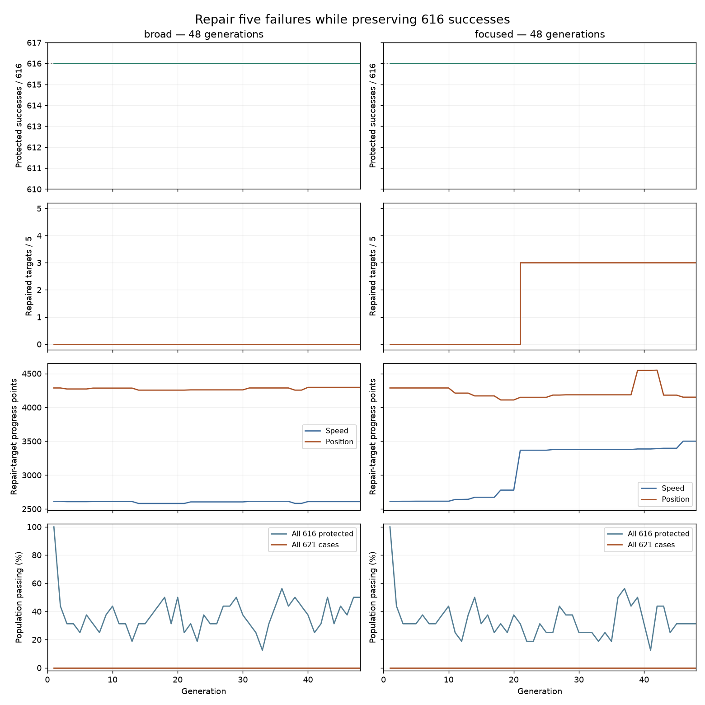
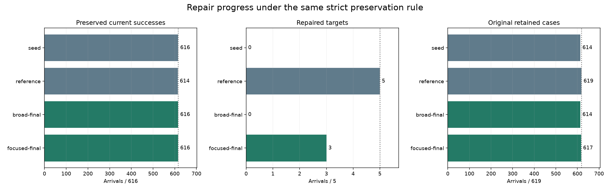
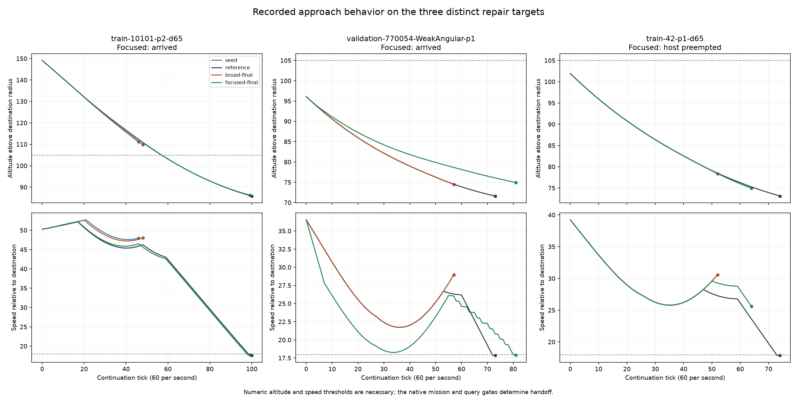
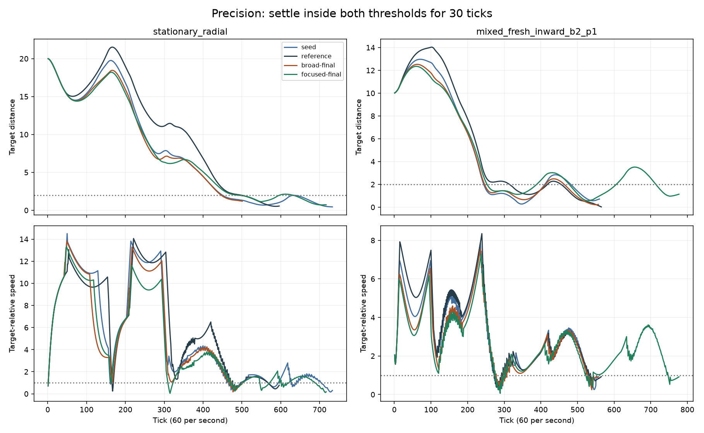

# Focused progress rewards for the remaining recovery failures

Prioritizing progress on the five unresolved approaches repairs **three of them
without losing any of the starting model's 616 successes**. The focused final
passes **619/621** known training cases; the equal-budget broad control remains
at **616/621**. Both run for 48 generations from the same model. The first repair
gain occurs at generation 21.

This is evidence that progress priority matters for this search. It is one
paired experiment on known development cases, not a generalization result or
proof that the recipe is reliable across seeds. Two world-42 shape variants
still fail, so the full-retention gate remains unmet.

There is also a useful unselected near miss: one recorded candidate passes
**620/621**, including all match cases, but loses one precision task. The strict
preservation rule correctly rejects it. Identifying that one regression is a
more specific next diagnostic than another open-ended training run.

## Results

| Model | Starting successes /616 | Repaired targets /5 | All known cases /621 | Original retained cases /619 | Precision /157 | Newer approach pair /2 |
| --- | ---: | ---: | ---: | ---: | ---: | ---: |
| Common seed | 616 | 0 | 616 | 614 | 157 | 2 |
| Original learned reference | 614 | 5 | 619 | 619 | 157 | 0 |
| Broad final, generation 48 | 616 | 0 | 616 | 614 | 157 | 2 |
| Focused final, generation 48 | **616** | **3** | **619** | **617** | **157** | **2** |

The focused final gains world 10101 player 2 and world 770054 player 1 in both
Angular and Round. It loses no common-seed success. It still misses two original
reference successes, while preserving the newer pair that the reference misses.
The equal total of 619 for reference and focused therefore covers different
cases; the focused model does not replace the reference yet.

Both initial populations and their scores are identical through generation 2.
Population and winner identities first diverge at generation 3. The focused
winner's repair count rises from zero to three at generation 21 and stays there.
Its last ordered-score improvement is generation 46; the broad arm's is 47.
Every generation winner preserves all 616 starting successes.

There are 658 non-elite offspring slots after initialization in each arm,
including unchanged mutations. Of these, 179 broad and 150 focused offspring
preserve all 616 successes. No broad offspring both preserves them and repairs
a target; 80 focused offspring do. No candidate passes all 621 cases.

Neither final completes any of the ten excluded additional approaches or eight
separate host diagnostics. Their four additional successes are the same two
previously acquired pairs. These excluded cases were already known development
data and do not measure fresh-world performance.

## What the repairs do

| Repair target | Variants | Seed outcome / tick | Focused final outcome / tick | Focused brake ticks | Original reference arrival tick |
| --- | --- | --- | --- | ---: | ---: |
| World 10101, player 2 | Angular | Host preempted / 46 | **Arrived / 99** | 52 | 100 |
| World 770054, player 1 | Angular and Round | Host preempted / 57 | **Arrived / 81** | 18 | 73 |
| World 42, player 1 | Angular and Round | Host preempted / 52 | Host preempted / 64 | 14 | 74 |

All five seed failures use zero braking. The focused final brakes in all five.
The world-42 pair ends at target-relative speed **25.58**, down from **30.59**, but
still triggers the native climb guard. Recorded altitude is 74.911 against a
reconstructed climb boundary of 74.964, using `70 + falling_speed² / 50`.
Float64 reconstruction agrees with the recorded host decision; it is not a
controller-reset experiment. The original reference completes these cases with
26 braking ticks, compared with the focused final's 14.

Snapshots distinguish behavioral progress from the final result. At generation
16 the world-770054 pair brakes for four ticks and fails at tick 75. At generation
24 it completes at tick 92. Generation 40 completes it at tick 32, but the selected
final takes 81 ticks. The reward ranks endpoint speed before spare ticks, so it
does not guarantee monotonically faster completion. The generation-40 model is
not substituted for the declared final selection.

The newer world-750008 player-2 pair remains successful and takes 222 ticks in
the focused final, versus 230 in the seed and 233 in the broad final. Precision
completion remains 157/157, but timing varies: the inward-moving replay case
rises from 560 to 777 ticks, and `moving_right` from 940 to 1,054. Faster match
recovery is not a claim of uniformly faster precision behavior.

## The 620-case near miss

The focused population contains 26 offspring that complete all five repair
targets. The closest is generation **42**, slot **9** (zero-based), genome
`6e582a44d403aec5899a1ffcdde3a89b64d09c68edca7976385c99cf659b52ad`.
It completes all 462 original matches, both newer approaches and 156 precision
cases. Its score is therefore 615 protected successes plus all five repairs:
620/621 overall. It is ineligible because one original precision success is lost.

This is a recorded population score, not an additional post-training model
selection or independently replayed result. The history retains its identity
and fitness, but it was neither a saved winner nor in the final population.
Recover its genome by replaying deterministic evolution with the recorded
fitness values, verify the exact identity, then rerun the cases to identify the
single precision regression. A bounded repair can then test that specific
failure while protecting its other 620 successes, with the 619-case focused
final retained as a control. Freeze that follow-up separately.

The current result supports continued work with the existing network and inputs.
It does not establish that more capacity is necessary. Full 621-case retention
and a separately frozen fresh-world comparison remain prerequisites for live
integration.

## Frozen comparison

The [plan](data/learned-guidance-repair-focus-v1-plan.json) starts both arms
from the better final model in the [joint-retention continuation](learned-guidance-joint-retention.md).
That model completes 614 of the original 619 cases and the two newly acquired
approaches. Both arms strictly preserve those 616 successes before rewarding
any other improvement. This stricter preservation rule is new in both arms;
the broad arm is a control under that rule, not an unchanged rerun of the prior
count-first recipe.

Each arm uses evolution seed 1, 16 exact copies of the common model, 48
generations, two elites, tournament size three, mutation probability 0.05,
mutation scale 0.05 and parameter limit 8. The architecture, inputs, action
decoding, episode formulas, physics and native host gates are unchanged.
The model still has nine inputs, eight tanh hidden units and three linear
outputs: 107 parameters, with no recurrent memory. One paired search does not
estimate reliability across evolution seeds.

The common completion priorities are: preserve all 616 current successes,
then recover as many of the five remaining failures as possible. The existing
focal, total-retention, precision and match completion counts follow. The arms
then differ in their progress priorities:

| Arm | First progress rewards | Later progress rewards |
| --- | --- | --- |
| Broad | Precision position and velocity; all-match speed and position; spare ticks | Speed and position on the five repair targets |
| Focused | Speed and position on the five repair targets | Precision position and velocity; all-match speed and position; spare ticks |

Every candidate receives the same 13 numeric fitness fields. Only their
comparison order changes. The five repair targets remain a fixed set even if
some become successful; the score is not recomputed over a changing failure
subset. Speed points are the sum of `floor(1000 × clamp(1 − speed/70, 0, 1))`,
using speed relative to the destination planet at the recorded endpoint.
Position points use distance to the frozen moving target and a scale of 100.
Only arrivals, timeouts and host-preempted episodes receive these progress
points; other outcomes receive zero.
These rewards do not directly specify when to brake or optimize arrival time.

The five targets represent three initial flight states: world 42 player 1
in Angular and Round, world 10101 player 2 in Angular, and world 770054 player 1
in Angular and Round. Paired shapes have identical initial flight observations
but different physical world hashes. They retain equal episode weight, rather
than being deduplicated into three weighted examples.

All 621 training cases are known development data: 157 precision tasks, 462
originally successful matches and the newer approach pair. The fixed budget
is 953,856 training episodes, plus preflight, observations and final evaluation.
Both searches continue through generation 48. The first winner completing all
621 cases, if one exists, and each final winner are saved, with identities
frozen before the post-training evaluation.

Final evaluation repeats all 157 precision tasks and 482 match states. Ten
other additional approaches and eight host diagnostics remain outside breeding.
They were inspected previously, so they are not fresh qualification data.
A full known-case pass is required before a separately frozen fresh-world
comparison; it would not itself qualify a production replacement.

## Observability and reproducibility

The live graph separates preservation of the 616 successes, recovery of the
five targets, progress scores on those targets, and population completion.
The synchronized replay includes the common seed, original reference and latest
saved snapshot from each arm. Snapshots are saved at generations 0, 1, every
eight generations and first full success. Labels make the snapshot cadence
visible rather than implying an unsaved current winner.

The 15 fixed replay cases include the newer approach pair, all five repair
targets, two other retained matches and six precision tasks. Precision requires
distance at most 2 and target-relative speed at most 1 for 30 consecutive ticks.
Match success uses the native mission handoff. The replay plots recorded flight
paths relative to the moving target; it does not render terrain or the full world.

The package is
`data/training-experiments/recovery-guidance-repair-focus-v1-20261018/`.
It retains the frozen plan, source patch, executable, checkpoints, traces,
analysis scripts and archive. Production controls remain unchanged.

[Open the final synchronized replay](data/learned-guidance-repair-focus-v1-replay.html)
to compare the four fixed models on all 15 declared replay cases.

## Evidence checks

The focused checks pass **37 Rust tests** and **15 observer tests**. Preflight
reproduces 964 prior match traces byte for byte, all 314 precision endpoints
and 12 full precision traces across the common seed and original reference.
All 482 reconstructed physical sources match the prior package.

The final audit verifies 188 copied elites, 254 repeated-genome scores,
144 training match traces, 96 training precision traces, 1,928 final match
traces, 628 precision endpoints and 24 final precision traces. All 964 final
seed/reference match traces match preflight byte for byte. Rust independently
reconstructs fitness from the reported episodes and checks it against training
evaluation. Source states remain unchanged.

The replay passes playback, case switching, all 60 terminal-state checks,
precision dwell checks and narrow-screen overflow checks. All four plots and
desktop, precision and mobile replay captures were inspected at 1× scale.
The [machine-readable results](data/learned-guidance-repair-focus-v1-results.json)
include model identities, per-case gains and losses, snapshot behavior, the
unselected near miss, timing and integrity receipts.

The training loops take 1,316.1 seconds for broad and 1,187.2 seconds for focused
(41.7 minutes combined). Reconstruction and initial observations bring the
training runner to 2,639.3 seconds. Final reconstruction and evaluation take
142.7 seconds. CPU sharing differs over time; the comparison uses equal
candidate budgets, not elapsed-time efficiency.
