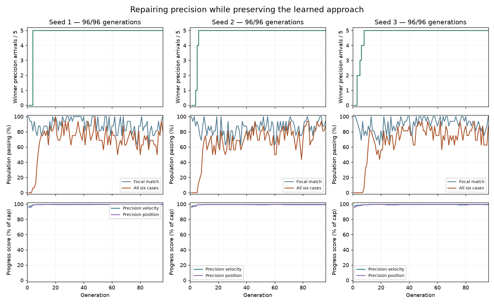
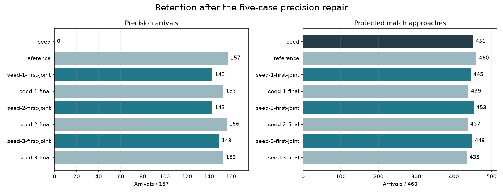
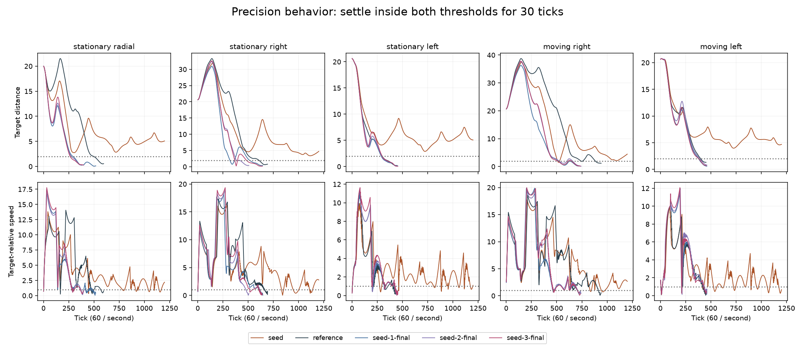
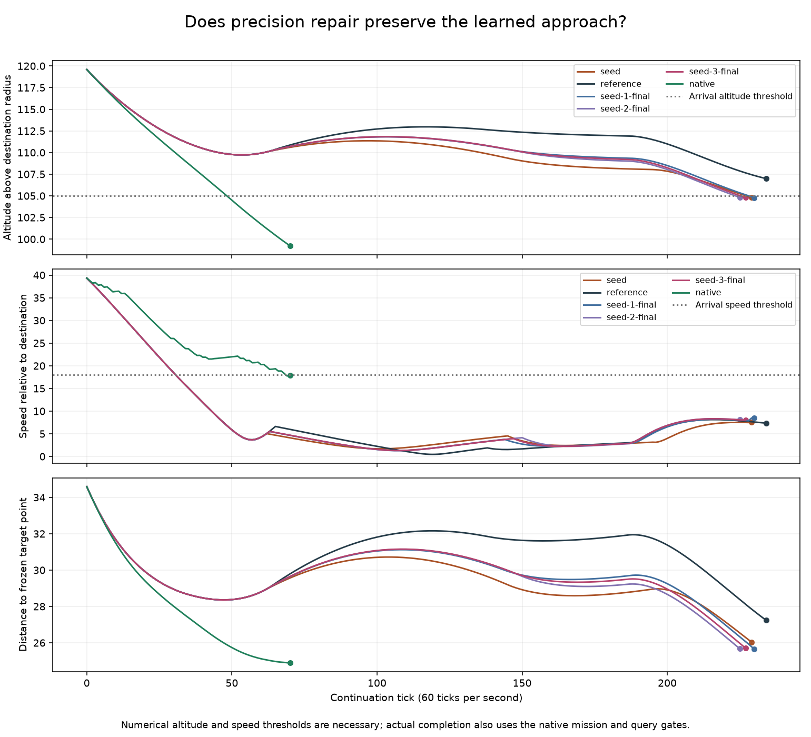

# Repairing precision while keeping the new approach

The existing network can perform the newly learned match approach and precise
stopping together. All three repair searches complete the approach and all five
precision training cases by generations **4, 6 and 8**. The saved models also
complete the Round version of the approach. This resolves the narrow capability
question raised by the [isolation diagnostic](learned-guidance-isolation.md).

Most precision behavior transfers beyond the five training cases: the repaired
models pass **143–156 of 157** precision cases, compared with zero for the repair
seed. Protected match retention remains incomplete. None of these artifacts
qualifies to replace the original model or enter live matches.

## Recipe and selection

The [frozen recipe](data/learned-guidance-repair-v1-plan.json) starts from isolation
seed 3's first successful model, generation 5. That model had the fewest protected
match losses among the three first-success artifacts. This choice used inspected
development results; it is not an independent validation selection.

Each search starts with 16 identical copies, then runs 96 generations with two
elites, tournament size three, mutation probability 0.05 and scale 0.05. The
network, inputs, episode scoring formulas, physics and host gates are unchanged.
Only the training curriculum and score ordering change:

1. Complete the Angular world 750008 player-2 approach.
2. Complete the five precision cases: `stationary_radial`, `stationary_right`,
   `stationary_left`, `moving_right` and `moving_left`.
3. Improve their existing position and velocity scores.
4. Improve approach speed, approach position and total spare ticks.

Elitism therefore preserves the focal arrival. Precision cases can trade off
while their completion count ties; after all five succeed, the winner retains
all six training successes. Every generation winner preserves the focal arrival.
Protected match episodes do not enter breeding in this diagnostic.

Each run freezes its first winner completing all six cases and its final winner.
All six model identities are frozen before evaluating the full 157-case precision
suite, 460 protected approaches, 14 additional approaches and eight diagnostics.
The five trained precision cases are included in the 157; the other 152 are
untrained in this experiment but previously inspected. Round is also an inspected
shape check. There is no fresh-world generalization claim.

The searches use **27,648 training episodes**, taking 499.1 seconds in total.
Full evaluation, including reconstructing the saved match states, takes 167.3
seconds. Additional observation and verification episodes are outside that
training count.

## Results

| Artifact | Repair generation | Trained precision / 5 | Other precision / 152 | Protected / 460 | Additional / 14 | Focal arrival tick, both shapes |
| --- | ---: | ---: | ---: | ---: | ---: | ---: |
| Original precision reference | — | 5 | 152 | 460 | 2 | Failed at 234 |
| Repair seed | 0 | 0 | 0 | 451 | 4 | 229 |
| Seed 1 first joint success | 4 | 5 | 138 | 445 | 4 | 229 |
| Seed 2 first joint success | 6 | 5 | 138 | 453 | 4 | 231 |
| Seed 3 first joint success | 8 | 5 | 144 | 449 | 4 | 230 |
| Seed 1 final | 96 | 5 | 148 | 439 | 4 | 230 |
| Seed 2 final | 96 | 5 | 151 | 437 | 4 | 225 |
| Seed 3 final | 96 | 5 | 148 | 435 | 4 | 227 |

Every repaired artifact retains the original two additional successes and the
new focal pair. No other additional approach is gained. All eight separate
diagnostics remain unsuccessful. The original reference still passes every
precision and protected case but fails the focal pair.

More generations improve precision retention in each search, while protected
match retention falls. For example, seed 2 improves from 143 to 156 precision
arrivals but falls from 453 to 437 protected matches. Those match outcomes were
absent from breeding, so the training objective did not penalize the losses.
This is evidence of missing coverage in the small repair curriculum, not proof
that a single network cannot retain the full set.

The best precision artifact, seed 2 final, has one precision timeout:
`mixed_fresh_inward_b2_p1`, ending at distance 2.75 and relative speed 2.05 with
zero dwell. Its 23 protected failures all end with the host taking control in
the `launch` goal. Seed 2's first joint success has seven such match failures
and 14 precision timeouts, mostly inward-target cases. These are recorded
terminal categories, not a diagnosis of the cause of the host transition.

## Inspecting the behavior

Precision success requires distance at most 2 and target-relative speed at most
1 for 30 consecutive ticks. The saved traces verify that dwell. On
`stationary_radial`, the repair seed times out at tick 1200 with distance 5.09;
seed 1's first joint model arrives at tick 524 with distance 0.92 and speed 0.32.
Its match approach still arrives at tick 229.

The repaired match paths retain the early braking and lingering behavior. They
take 225–231 ticks on the focal approach, compared with native control's 70.
This experiment establishes completion and partial retention, not efficient
approach behavior. It does not test a new speed or elapsed-time reward.

[Open the synchronized replay](data/learned-guidance-repair-v1-replay.html) to
compare all saved models on the five precision tasks and both approach shapes.
It shows target distance, target-relative speed, dwell, controls and terminal
outcome. The precision target circle has radius 2. Match arrival uses the native
handoff conditions, not distance to that plotted point alone. The player shows
recorded trajectories; full world geometry is not rendered.

## Next experiment

Keep the current network and restore the full retained curriculum to selection,
while keeping the new focal arrival mandatory. The small curriculum has answered
its capability question; further refinement on those five cases alone does not
address the protected match losses.

A bounded comparison can start from seed 3's first joint model, which retains
600 of the original 619 successes, and seed 2's final model, which retains 595
but is only one precision case short. These are complementary development
starting points, not qualified candidates. Freeze the score order, equal budgets
and checkpoint selection before those searches. Acceptance still requires every
original precision and match success plus the new arrival; only then reserve
fresh worlds for qualification. Efficient handoff scoring remains a separate
controlled question.

## Evidence and verification

All 35 focused Rust tests and 13 observer tests pass. Preflight reproduces four
match traces byte for byte and the five precision endpoints. The full evidence
audit verifies 570 copied elites, 636 repeated-genome scores, 35 training match
traces, 175 training precision traces, 3,856 post-training match traces, 1,256
precision endpoints and 40 post-training precision traces. All 964 match traces
for the two reference models are byte-identical to the preceding experiment.
Physical source records remain unchanged after every model evaluation.

The replay passes playback, case switching, all 58 terminal-state checks,
precision dwell display checks and narrow-screen overflow checks. Plots and
desktop/mobile captures were inspected at 1× scale. The
[machine-readable results](data/learned-guidance-repair-v1-results.json) retain
model identities, lost/gained case lists, scores, timing and trajectory metrics.

The retained package is
`data/training-experiments/recovery-guidance-repair-v1-20261018/`, with the frozen
executable, source patch, recipe, checkpoints, traces and verified archive.
Production controls are unchanged.
