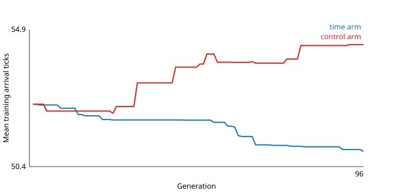

# Ranking arrival guidance by time against native control

**Status: complete (2026-10-18).** Milestone 1 of the
[match hybrid plan](design/learned-guidance-match-v1.md#milestones).

Ranking by arrival time made the network faster without losing completions,
on fresh starts as well as known ones. It did not make the network faster than
native control. On fresh starts both complete, native control still arrives
about six ticks sooner. See the [results](#results).

## Question

Does ranking candidates by match arrival time, right after completions, make
the nine-input network faster than native control without losing completions?
Training has never rewarded beating native control; see the plan's
[objective](design/learned-guidance-match-v1.md#objective-beat-native-control).

## Starting point

Genome `e0f25b68492df8d1a2e334b2b30da2a5fa8a45bfde8d7dd674cb7ee655c46de1`
against native control from identical starts:

| | Candidate | Native control |
| --- | ---: | ---: |
| Training approaches completed | 464/464 | 430/464 |
| Fresh approaches completed | 222/238 | 218/238 |
| Median ticks, 430 shared training successes | 51 | 47 |
| Median ticks, 210 shared fresh successes | 54 | 48 |

On the shared training successes, the candidate is slower on 242 starts,
faster on 175 and tied on 13. The preflight reproduced these numbers on the
frozen executable.

Total time saved against native control is +6,047 ticks on the training set,
even though the candidate is slower on most shared starts. Each of native
control's 34 failures counts as the full 300 ticks, so the total mostly
measures completions. Speed is read from the shared successes instead.

## Design

Both arms start from 16 copies of `e0f25b68` and evaluate the same 621 known
cases: 157 precision arrivals and 464 match approaches.

**Time arm.** Candidates are ranked, in order, by:

1. Completions: every known success kept, then precision and match counts.
2. Total match arrival ticks, lower first, counting a failed start as the
   300-tick attempt bound.
3. Gentle arrival: precision position and velocity points, then match speed
   and position points.
4. Precision spare ticks.

**Control arm.** Today's ranking, which puts gentle arrival and all spare
ticks after the completions. It separates the effect of the ranking from the
effect of more training. Exact ties on the combined spare ticks fall to match
spare ticks, which keeps the order consistent with equality.

Native control's times are fixed for each start, so ranking by total ticks is
the same as ranking by total time saved against native control. Its times are
used for reporting only.

**Reports.** For `e0f25b68`, both arm finals and native control, on the known
cases and on a newly frozen set of unused worlds:

- completions and native successes lost;
- median ticks on shared successes;
- starts faster, slower and tied against native control;
- total time saved against native control.

**Settings.** The [frozen plan](data/learned-guidance-time-ranking-v1-plan.json)
uses evolution seed 1, 16 candidates, 96 generations per arm, two elites,
tournament size three, mutation probability 0.05 and mutation scale 0.05, as
in the [repair-focus run](learned-guidance-repair-focus.md) but twice as long.
Each arm evaluates 953,856 training episodes. The fresh set uses world seeds
95000001–95000064, which appear in none of the 1,753 earlier plan, input and
source files scanned.

**Checks.** Before training, the preflight rebuilds all 482 known match
states and must reproduce native control's recorded outcomes, the candidate's
recorded episodes and precision arrivals, and the earlier runs' fitness values
from the new ranking code. The evaluation also rediscovers the fresh check's
starts and must match its recorded states and episodes.

**Reading the result.** If the time arm beats native control's time on the
fresh set without losing completions, the time ranking becomes the default for
later training. If it is faster only on known cases, the speedup does not
generalize, and that informs the perception training in milestone 6.

## Progress

- [x] Objective and milestone recorded in the plan (2026-10-18).
- [x] Freeze the plan: settings, fresh world seeds and the novelty scan.
- [x] Implement the ranking, native baselines and reports, with tests.
- [x] Preflight: reproduce `e0f25b68`'s known results and native control's
  recorded outcomes. On the release build it passed in 28 seconds: 482/482
  native and 482/482 candidate match episodes, 157/157 precision arrivals
  and the earlier fitness values all match exactly, so release reproduces
  the `ci` results.
- [x] Run both arms on the release build: 26 minutes for the time arm and 31
  for the control arm.
- [x] Evaluate on the fresh set, in 73 seconds.
- [x] Write the results and update the plan's scoreboard.

## Results

The time arm's final is genome
`e03d3e2900722539e1a05838c4134a4b01bc33451582e795c37f53b502885b42` and the
control arm's is
`acca47e5a22719958070ea4d7844706cb839fa61b88672cbff1dc9eabb3f7b27`. The 64
fresh worlds give 239 available approaches. Inspected approaches are the 238
from the earlier fresh check, which were examined after that check and so are
no longer a holdout.

### Completions

| Approaches | Native control | `e0f25b68` | Time arm | Control arm |
| --- | ---: | ---: | ---: | ---: |
| Training | 430/464 | 464/464 | 464/464 | 464/464 |
| Excluded | 10/18 | 0/18 | 2/18 | 0/18 |
| Inspected | 218/238 | 222/238 | 224/238 | 222/238 |
| Fresh | 209/239 | 221/239 | 221/239 | 217/239 |

Native successes lost on fresh starts are 8, 8 and 12 for `e0f25b68`, the time
arm and the control arm, and on inspected starts 8, 6 and 8. All three models
complete 20 of native control's 30 fresh failures. The time arm loses no
approach that `e0f25b68` completes in any set; the control arm loses four fresh
ones. All three keep 157/157 known and 96/96 inspected precision arrivals.
The only fresh failures that are not host preemptions are two starts in world
95000001, one per shape, which end in contact or damage for every controller.

### Arrival time against native control

Mean ticks on the starts all four controllers complete:

| Approaches | Starts | Native control | `e0f25b68` | Time arm | Control arm |
| --- | ---: | ---: | ---: | ---: | ---: |
| Training | 430 | 46.9 | 53.5 | 51.8 | 55.6 |
| Inspected | 210 | 50.3 | 53.4 | 52.8 | 53.7 |
| Fresh | 197 | 48.5 | 55.5 | 54.5 | 55.5 |

Each model against native control on the starts both complete:

| Approaches | Model | Faster / slower / tied | Median ticks (native) | Time saved |
| --- | --- | ---: | ---: | ---: |
| Training | `e0f25b68` | 175 / 242 / 13 | 51 (47) | +6,047 |
| | Time arm | 185 / 227 / 18 | 51 (47) | +6,769 |
| | Control arm | 170 / 244 / 16 | 52 (47) | +5,136 |
| Inspected | `e0f25b68` | 98 / 106 / 6 | 54 (48) | +423 |
| | Time arm | 98 / 106 / 8 | 53 (48) | +1,013 |
| | Control arm | 94 / 110 / 6 | 52 (48) | +351 |
| Fresh | `e0f25b68` | 80 / 117 / 4 | 55 (47) | +1,656 |
| | Time arm | 80 / 113 / 8 | 54 (47) | +1,864 |
| | Control arm | 84 / 111 / 2 | 53 (47) | +781 |

Time saved counts every failure as 300 ticks, so it mostly measures
completions. The control arm's lower medians come from fewer shared
successes. On the starts all four complete, it is as slow as `e0f25b68` or
slower.

### Against the seed

Each arm's final against `e0f25b68` on the approaches both complete:

| Approaches | Time arm: faster / slower / tied | Mean change | Control arm: faster / slower / tied | Mean change |
| --- | ---: | ---: | ---: | ---: |
| Training | 231 / 33 / 200 | −1.56 | 164 / 164 / 136 | +1.96 |
| Inspected | 103 / 21 / 98 | −0.51 | 96 / 76 / 50 | +0.32 |
| Fresh | 124 / 18 / 79 | −0.94 | 91 / 68 / 58 | −0.08 |

The time arm's speedup holds on fresh starts: it is faster on 124 of the 221
approaches both complete and slower on 18. The gain is about one tick of the
seven by which native control led `e0f25b68` on fresh starts.

### Where native control gains time

On the 197 fresh starts all four complete, native control reaches capture at
a mean relative speed of 16.7, close to the limit of 18. `e0f25b68` and the
time arm both arrive at about 14.2, and the control arm at 15.0. The time arm
kept its seed's gentle arrival, the habit that earlier rankings rewarded.

### Precision

Precision time ranks last in the time arm, yet its mean on the 157 known cases
fell from 633 to 590 ticks, against 602 for the control arm. On the 96
inspected cases the mean fell from 564 to 537, though 57 of the 96 got slower.

### Training

The chart shows the best candidate's mean arrival over all 464 training
approaches. The time arm fell from 52.43 to 50.88 ticks and was still
improving at generation 96, with its last two gains at generations 90 and 96.
The control arm rose to 54.39, trading time for gentler arrival. Both kept all
621 known cases in every generation. The control arm ran slower because other
work on the machine lowered the adaptive worker count, to about 525 episodes
per second against 625.

### Reading

The frozen reading named two outcomes, and this result falls between them.
The speedup generalizes, since the time arm beats its seed on fresh starts.
But it does not beat native control's time, so the condition for making the
time ranking the default is not met as written.

- **Keep the time ranking for later training.** Against the control ranking
  it is faster on every set and keeps more completions.
- **It is not enough on its own.** Small mutations of the nine-input network
  found about 1.5 ticks in 96 generations on known cases, where native control
  still leads by about five.
- **Why the network keeps arriving gently is open.** One untested possibility
  is that the same weights must also stop precisely in the 157 precision cases.
- **The time arm's final dominates `e0f25b68`.** It completes every case
  `e0f25b68` completes, in all four sets, and arrives sooner, so it can replace
  `e0f25b68` as the warm start for later training.

## Code and evidence

- **Module.** [`time_ranking.rs`](../crates/engine-client/src/client_scenarios/surface_sortie/mission/guidance_approach/time_ranking.rs)
  sits beside the frozen `training` lineage instead of inside it. Its
  training helpers are copies, so the fresh-check package's 58 pinned source
  files stay unchanged and that package still verifies.
- **Package.** `data/training-experiments/recovery-guidance-time-ranking-v1-20261018/`
  holds the copied inputs, the novelty scan, the frozen executable and source
  patch, and every stage's output. From that directory,
  `python3 -I run.py verify` checks the package. `python3 -I run.py <stage>`
  runs `preflight`, `train-time`, `train-control` or `evaluate`, and rerunning
  a training stage resumes from its checkpoint.
- **Build.** Stages run from a release build (opt-level 3, fat LTO). A first
  attempt on the `ci` profile passed its preflight, reached generation 44 of
  the time arm in 880 seconds and was then stopped. It is kept in
  `ci-attempt/` and does not enter the results. Release generations ran about
  25–30% faster on an idle machine.
- **Analysis.** `python3 -I analyze.py <svg-path>` prints the tables above,
  writes `analysis.json` and draws the training chart. The
  [results file](data/learned-guidance-time-ranking-v1-results.json) is a copy
  of `analysis.json`.
