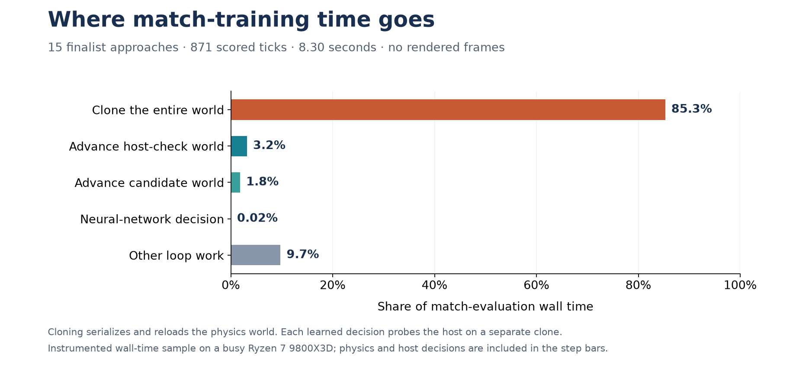

# Headless guidance training performance

World copies now use Rapier's in-memory clone operations instead of a snapshot
round trip. Immutable collision shapes are shared through Rapier's copy-on-write
API; bodies, contacts, joints, stable IDs, and mutable simulation state are copied.
Each copy has its own pipeline and event collector. Current contacts are rebuilt
with the previous clone semantics, and the compound CCD dispatcher is retained.
The serialized snapshot format is unchanged.

The original match-training harness spent most of its time cloning worlds for
the native host check. In the baseline finalist evaluation, cloning consumed
**85.3% of match time**; advancing both worlds consumed **5.0%**, and neural
decisions consumed **0.021%**. Rendering is never called.

These measurements use the completed [full-retention experiment](learned-guidance-full-retention.md):
157 precision arrivals and 15 match approaches per candidate. The hardware is
an AMD Ryzen 7 9800X3D with eight physical cores and sixteen hardware threads.
Other builds were active. The executable uses Rust 1.89.0 and the existing
optimized `ci` profile, including debug assertions and overflow checks.

## In-memory copy results

A repeat ran the preserved snapshot-copy executable followed by the optimized
executable with the same profiler, historical genomes, case order, and worker
counts. Each column below uses four finalist batches with four precision workers
and serial match cases. Copy duration comes from each executable's separate
stage-profile sample.

| Measurement | Snapshot copy | In-memory copy |
| --- | ---: | ---: |
| Average complete scenario copy | 7.79 ms | 0.527 ms |
| 15 match approaches, median | 9.518 s | 0.998 s |
| Complete candidate, median | 10.084 s | 1.517 s |
| Complete candidate, scored ticks per second | 8,274 | 55,193 |
| 157 precision arrivals, median | 0.545 s | 0.524 s |

This repeat gives **14.8× faster copies, 9.5× faster match evaluation, and 6.6×
faster complete candidate evaluation**. An earlier optimized run compared with
the original baseline gave 4.4× for the complete candidate (7.31 s to 1.65 s).
Other builds remained active: the repeat's candidate durations ranged from
7.38–10.55 s before and 1.40–1.71 s after. Treat these as measured workload
improvements, not a promised speedup for an entire future training run.

In the repeat's stage profile, copies fell from 85.1% to 43.7% of match time.
The host check and its extra physics step remain intact. Parallelizing independent
match cases is still a separate opportunity. Precision arrivals do not perform
this per-tick copy, and their throughput is approximately unchanged.

The [comparison data](data/learned-guidance-clone-performance.json), preserved
executables, source overlays, logs, and timing scripts are under
`data/training-experiments/training-profile-20261017/clone-optimization/`.

## Baseline simulation throughput

Every scored tick advances 16,666,667 ns of game time, approximately 1/60 second.
The diagnostic directly calls the simulation, without a window, GPU submission,
frame generation, audio playback, or real-time wait. Throughput below counts
scored ticks divided by the complete evaluation wall time, including world setup
and host checks. Practice throughput is aggregate across its workers.

| Workload using the finalist | Scored ticks per wall second | Wall duration |
| --- | ---: | ---: |
| 157 precision arrivals, one worker | 57,155 | 1.442 s |
| 157 precision arrivals, four workers | 193,094 | 0.427 s |
| 157 precision arrivals, eight workers | 275,229 | 0.299 s |
| 15 match approaches, serial | 127 | 6.860 s |
| Complete candidate, four practice workers | 11,399 | About 7.3 s |

These are medians of two one-worker, four four-worker, and two eight-worker
finalist samples. The separate uninstrumented control before stage profiling is
included in the four-worker figures. Its match evaluation slowed to 9.829 s;
the four-worker match range was 89–132 scored ticks/s. The complete-candidate
throughput range was 8,109–11,913 ticks/s. Parent and unsuccessful-mutant batches
were also measured and reproduced their saved fitness.

The mixed rate is roughly 190 times real time in aggregate. A match continuation
itself advances only about twice real time because its host check is expensive.
Each finalist batch scores 82,391 precision ticks and 871 match ticks. A mutant
that times out in precision cases performs more work, so neither this rate nor
this candidate duration is an exact average for all 384 historical evaluations.
The original run saved fitness and wall duration but did not count every failed
episode's elapsed ticks; its exact aggregate tick rate cannot be recovered from
those scores alone.

## Baseline match evaluation cost



The profiled match sample took 8.301 s. Each learned decision first clones the
scenario and steps the handwritten host on that clone to check priority and
native arrival. If delegation continues, it separately steps the candidate
world. Fifteen initial episode clones plus 878 host probes produced **893 world
clones**, averaging **7.93 ms each**. The host and candidate advanced 1,741
physical steps for 871 scored continuation ticks; successful handoffs use the
already-stepped host clone.

| Disjoint measured work | Time | Match share |
| --- | ---: | ---: |
| Complete scenario cloning | 7,078 ms | 85.26% |
| Host world step, including sensing and planning | 262 ms | 3.16% |
| Candidate world step, including the other bot | 151 ms | 1.82% |
| Learned controller decision | 1.75 ms | 0.021% |
| Other loop work and destruction of temporary worlds | 809 ms | 9.74% |

The final row is the uninstrumented remainder, not an isolated measurement of
destruction. Rapier stepping accounts for 197 ms within the two world-step rows;
it must not be added again. The model has 107 parameters and is a small fraction
of this workload.

The former [`PhysicsWorld::clone`](../crates/engine-rapier/src/world.rs) serialized its
complete Rapier state and stable mappings, deserialized them, restored the query
dispatcher, reconstructed lookup maps, and rebuilt contact events when enabled.
[`probe`](../crates/engine-client/src/client_scenarios/surface_sortie/mission/guidance_approach.rs)
copies a world on every learned match tick. Practice episodes do not use this
per-tick host probe.

## Remaining headless work

Skipping drawing does not skip all presentation state. The client scenario still
updates camera tracking after each match step. Shared simulation code advances
thruster trails, particles, landing-gear animation and pilot gait. Those remain
inside the measured world steps; removing them cannot explain away the dominant
cloning cost. Any headless simplification must preserve physics, observations,
controls and deterministic random draws.

The precision replay's 82,391 identical scored steps spent 1,341 ms in scenario
stepping, including 774 ms in Rapier, versus 33.5 ms in network decisions and
44.2 ms creating its 157 worlds. These serial stage timings exclude trace
generation and equality assertions, and are separate from the uninstrumented
throughput measurements.

Reconstructing the 15 match training starts took 2.499 s for 15,531 ordinary
prefix ticks plus initialization and neutral checks. A completed 202,284-byte
checkpoint took 16.6 ms per atomic encode/save over 32 repetitions. That is
about 0.23% of a baseline candidate evaluation. Normal training also
reconstructs development and validation starts once per process; those are not
included in this training-source setup measurement.

## Optimization order

1. **Make world cloning cheaper — implemented.** The direct in-memory copy
   preserves the current host probe. Regression checks compare it against
   snapshot restoration, including contacts, sleeping bodies, joints, sensors,
   pending edits, shape copy-on-write, and compound CCD with reused handles.
2. **Parallelize match cases.** They currently run serially, while only precision
   cases use four workers. Keep case order, score aggregation and deterministic
   outcomes stable. After the clone optimization, match cases take about 1.0 s
   of a 1.5 s candidate evaluation. An ideal four-way match split would reduce
   the combined duration to about 0.77 s, or almost 2× faster, before thread
   overhead, load imbalance, and host contention. That is an estimate to test,
   not a measured result. Increasing precision workers from four to eight saved
   about 0.13 s in the original baseline samples.
3. **Reuse deterministic fitness for unchanged genomes.** The completed run has
   384 evaluations but only 338 unique genomes: 46 repeats, or 12% of evaluations.
   A cache must include the exact runtime and task identity. Evaluation count
   savings are not automatically the same percentage of wall time.

Future run progress should retain scored ticks, probe ticks, evaluation duration,
and cache hits alongside candidate/generation counts. This makes an actual
whole-run simulation rate available and separates it from UI preview speed.

## Verification and reproduction

The [summary data](data/learned-guidance-training-performance.json) records all
rates and stage totals. Raw measurements, scripts, resource usage, and the
original frozen training executable are under
`data/training-experiments/training-profile-20261017/`.

The test-only
[`performance` harness](../crates/engine-client/src/client_scenarios/surface_sortie/mission/guidance_approach/training/performance.rs)
checks exact starting-world/controller hashes, saved candidate fitness under
each worker count, profiled versus ordinary match episodes, and every control
and observation across 82,391 precision replay ticks. Checkpoint encoding also
matches the original bytes. The optimization changes physics-world copying;
candidate policy, physics integration, training selection, deployed bot, and
defaults are unchanged. No new training run has started.

All 1,332 regression tests pass: 163 physics, 619 Spacewars gameplay, 451 AI,
91 training framework, and eight guidance fixture tests. The new
[`historical replay check`](../crates/engine-client/src/client_scenarios/surface_sortie/mission/guidance_approach/training/performance/parity.rs)
also reproduced all **276 saved match episodes** across mission, reference,
parent, and finalist controllers and all three partitions. All **20,479 tick
traces were byte-identical**, including controls, observations, handoffs, and
serialized-world hashes; final episode results matched too. The profiler's
82,391-tick precision replay and original saved fitness checks also pass.
Formatting and whitespace checks pass.

The profiler uses elapsed-time spans and existing engine counters. Kernel
`perf` events are unavailable with this host's `perf_event_paranoid=4`; no system
security setting was changed. Stage timers are nested where named as such.

```sh
RUST_MIN_STACK=16777216 \
SPACEWARS_TRAINING_PROFILE_INPUT="$PWD/data/training-experiments/recovery-guidance-match-learning-v3-20261016" \
SPACEWARS_TRAINING_PROFILE_OUT=/tmp/spacewars-training-profile-NEW \
cargo +1.89.0 test -p engine-client --bin engine-client \
  --locked --offline --profile ci learned_guidance_training_profile \
  -- --ignored --nocapture
```

Use a fresh output directory. The profiler reads historical genomes and scores;
it does not resume a checkpoint with a different executable identity.

To compare against the saved complete evaluation, use the same input variable,
a different fresh output directory, and the test filter
`learned_guidance_clone_trace_parity`. It requires the historical
`evaluation/results.json` and trace directories. These checks read existing
training evidence; the original checkpoint and finalist are unchanged.
