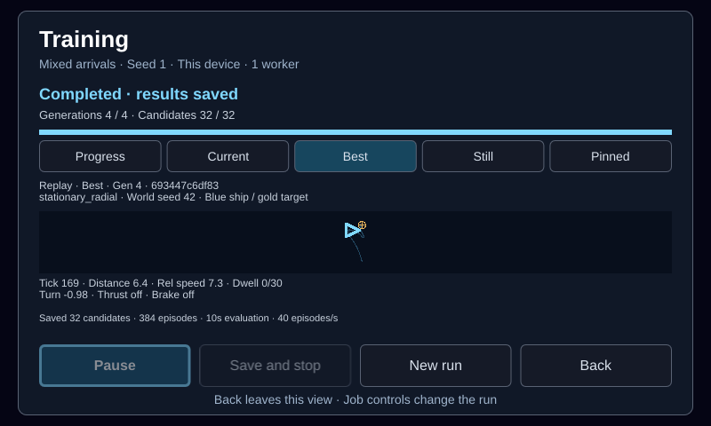
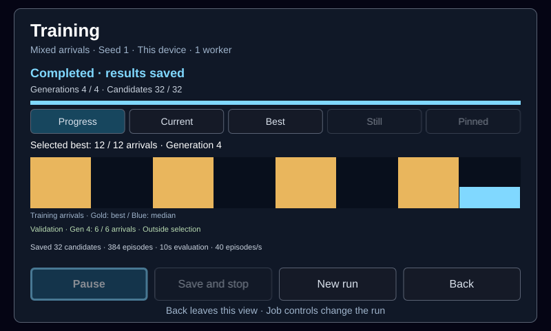

# Local Training setup and progress

The launcher now has a **Training** destination backed by one local worker.
It runs the existing ship-guidance experiments, reports progress, and saves
enough state to continue after leaving the screen or restarting the app.
This is the first job/UI slice of the
[evolutionary training plan](design/evolutionary-training.md).

## Using it

Open **Training** from the launcher footer. Choose a curriculum, population,
generation budget, and run seed, then select **Start training**. Touch, keyboard,
and the shared gamepad menu actions use the same commands. Up/Down selects a
field or action; Left/Right changes a field; A/Enter activates; Back/Esc leaves
the view. The controller's Start action does not launch a job.

| Curriculum | Evaluated cases | Initial population | Initial UI budget |
| --- | --- | --- | --- |
| Stationary | Four stationary arrivals | Random genomes | 32 candidates × 48 generations |
| Mixed arrivals | Four stationary, four moving, four inward arrivals | One retained stationary genome, remaining slots random | 32 candidates × 32 generations |

The mixed seed is the original successful stationary genome
`6c0ef53fb27e190243c84903855544a2cb9b97f4f32c92499dd37e541bbc41fb`,
as in the [mixed experiment](ship-mixed-training-experiment.md). The run seed
controls initialization and mutation; it does not change the fixed physical
case list. Both recipes evolve the same 107-parameter Guidance v1 network;
the ship, world, ordinary controls, and surrounding task remain fixed.

The [Genomes view](genome-browser.md) can instead supply one selected compatible
genome. Setup displays its ID and the number of random slots. The **Initial
genomes** arrows restore the recipe default. A selected seed starts a fresh
evaluation; it does not inherit the original run’s fitness or resume state.

The UI offers populations 8/16/32/64, generation budgets 1/4/8/16/32/48/64,
and seeds 1–99. These finite starting presets reproduce the earlier experiments;
they are not a claim that every selected seed or smaller budget will learn a
successful controller. Changing curriculum restores its initial generation
budget. The core API accepts populations 4–64, generations 1–64, and any `u64`
seed. Its line-mover recipe remains an automated diagnostic, outside the menu.

Progress shows completed generations, evaluated and saved candidates, total
episodes, evaluation time, and throughput. Gold bars show the selected winner's
arrivals in each completed generation; blue bars show the lower median arrival
count across that generation. These are **training-case results**. Selection
also uses the recipe's ordered fitness terms, including stationary retention
first for mixed training. The structured snapshot includes those terms and the
selected genome ID. Evaluation time excludes pauses and checkpoint I/O.

The **Progress**, **Current**, and **Best** tabs keep job progress and controls
visible. Current replays a sampled candidate from the published population;
Best replays the selected candidate from a saved generation. Both are labelled
replays, with the exact genome ID, generation, case, and world seed. They show
the ship in blue, the target in gold, distance, relative speed, arrival dwell,
and applied turn/thrust/brake. They do not display the evaluator's live world.

Playback cycles through **1×**, **2×**, **4×**, and **Still** independently of
training. **Follow** samples a new candidate and cycles training cases after
each replay; **Pinned** repeats the same retained candidate and case. Pinning
also discards an already-running replacement replay. Leaving the view stops
playback and new preview requests; reopening retains the selection. Starting
a different run clears the previous replay, including stale worker replies.

One independent preview worker retains at most two 1,200-tick traces, with one
evaluation in flight and at most one new replay per second. Rendering is capped
at 15 updates per second and stops when the displayed frame is unchanged. No
preview traces are written to disk. Training, preview, and genome practice can
each have one worker; this can reduce evaluation throughput on a small device.

After generations 1, 4, 8, and so on, and at the final generation, the training
worker checks the saved winner on **six fixed validation cases**. These cover
two stationary, two moving, and two inward arrivals. The cases are excluded
from both training recipes, and their results never affect selection, mutation,
or random draws. They come from previously inspected experiment cases; this
monitoring suite is not a new untouched qualification set. Progress reports
its latest result separately from training arrivals. The structured snapshot
and checkpoint retain every scheduled result, exact case, outcome, tick count,
distance, relative speed, generation, and genome ID. Evaluation throughput
excludes validation time. A pending validation resumes before another candidate
is evaluated; a final training generation is complete only after its validation
has been saved.

| Action | Behavior in this implementation |
| --- | --- |
| Pause | Finish the current candidate or validation batch, save, and wait. |
| Resume | Continue the same population and deterministic evolution state. |
| Save and stop | Finish the current batch, save, and stop evaluating; the job remains resumable. |
| Back | Leave training running; the launcher shows **Training · Active**. |
| New run | Open setup; starting creates a new run ID and retains older files. |
| App exit | Finish the current batch, save, and join the worker. |
| App restart | Offer the latest compatible unfinished job as paused. Never resume automatically. |

An active local job or an open Training view suppresses the idle auto-start
countdown. Explicitly launching another scenario does not stop the worker.
The worker evaluates private worlds and cannot step or alter the live match.
Use Pause if a foreground scenario needs the CPU. Completed jobs restore as
completed and cannot be resumed.

## Saved state and failure handling

Storage is `training/` beside the app's settings file:

- `run-<time>-<pid>.json`: versioned metadata and the full evolution checkpoint.
- `run-<time>-<pid>.best.json`: the selected genome from the most recent
  completed generation, exported after the checkpoint is committed.
- `latest`: the most recently started job ID.
- `worker.lock`: an OS lock allowing one writer to this store.
- `genomes/<id>.json`: immutable model and first training provenance, saved from
  each completed generation’s selected winner.
- `trials/<id>/<receipt>.json`: compact practice results from the separate
  genome-browser worker.
- `assemblies/<id>.json` and `assemblies/names/<id>.json`: saved practice-brain
  definitions and separate display names, managed through the browser.
- `assembly-trials/<id>/<receipt>.json`: practice results pinning a complete
  saved assembly and its exact component, case and runtime.

Each candidate batch is followed by an atomic checkpoint write. Checksums cover
the job metadata and the inner checkpoint. An unsuccessful write does not
advance the displayed saved-candidate count. A derived genome-export failure
is reported separately from how much checkpointed progress is durable. A crash
can lose the current unsaved batch; restoring re-evaluates it from its recorded
initial cases. No physical world needs serialization midway through an episode.

Continuation checks the executable/platform identity, recipe, configuration,
network architecture, seed artifacts, and saved progress. Rebuilding can block
exact resume even when the new binary still understands the genome contract.
Incompatible or corrupt saves remain on disk and show an error; an explicit
new run can still be started. A second app using the same store reports Training
unavailable. Closing that app and reopening after the owner exits retries the
lock. There is no automatic deletion or library retention policy yet.

The implementation lives in
[`engine-agent::training_job`](../crates/engine-agent/src/training_job.rs), with
[`training_controls`](../crates/engine-client/src/training_controls.rs) connecting
bounded snapshots and commands to Slint. There is one pending command slot,
one evaluation worker, and at most 64 generation summaries. The UI polls every
100 ms without waiting for evaluation or filesystem I/O.

## UI control interface

The screen ID is `launcher.training`. The existing CLI can open it and activate
the controls reported by `ui state`:

```sh
spacewars-cli ui activate launcher.training --expect-screen launcher.main
spacewars-cli ui state --json
spacewars-cli ui activate training.start --expect-screen launcher.training
spacewars-cli ui activate training.pause --expect-screen launcher.training
```

Setup exposes `training.{recipe,population,generations,seed}.{previous,next}`
and `training.initial.reset` to restore the recipe’s initial population.
Job actions are `training.start`, `training.pause`, `training.resume`,
`training.stop`, `training.new`, `training.current`, and `training.back`, when
enabled on the current page. Read-only `training.status` contains the state
code; `training.snapshot` contains a JSON-encoded snapshot in its control value.
Command acceptance is asynchronous: poll status for the completed transition.
Replay controls are `training.preview.{progress,current,best,speed,follow}`.
Read-only `training.preview.{id,tick,detail}` identify the displayed replay.
The job snapshot's `validation` array retains the monitoring history.

## Verification and remaining work

Tests cover deterministic continuation across a generation boundary, both ship
recipes, metadata/configuration rejection, single-writer exclusion, pause and
stop, restart without automatic work, and failed writes preserving durable
progress. The UI test drives a real background job through keyboard, touch,
stable control IDs, leaving/reopening, restart, and a short stationary run's
completion/export. These tests check lifecycle correctness, not learning quality.

Rendered setup, first-generation progress, paused progress, and errors are
checked at 800×480, 1024×768, and 480×800, at 1× scale. Footer touch targets and
incremental versus full menu repaints are covered. Local screenshots can be
retained by setting `SPACEWARS_TRAINING_ARTIFACTS` when running the client tests.
`SPACEWARS_PREVIEW_ARTIFACTS` retains the animated-replay and validation screens.
The replay workflow test compares the full evolution checkpoint and validation
history against an unobserved control, while exercising speed, Still, pinning,
leaving/reopening, and starting a new run. A separate worker test restores a
checkpoint with validation pending and rejects mismatched validation identities.

Local validation on 2026-10-14 used Rust 1.89.0 and the locked, offline `ci`
profile: 693 client tests passed (four existing ignores), plus 84 agent,
38 CLI, and 38 control tests. Formatting and strict Clippy for the agent/CLI/
control packages passed with `--no-deps`. Client Clippy completed with existing
warnings outside the training changes; dependency-wide strict linting is
blocked by the existing `engine-rapier::spaceling` nested-conditional warning.
Logs and screen fixtures are retained locally under `target/training-ui/`.

On 2026-10-14, the release/GPU bundle was built with the Yocto toolchain and
installed on `spacewars.local`. Through the runtime UI controls, the retained
mixed seed `693447c6df83…` completed a moving-target practice trial and seeded
an 8-candidate, 4-generation mixed run. The run completed all 384 training
episodes; its selected genome retained 12/12 training arrivals and 6/6 fixed
validation arrivals at generations 1 and 4. Current/Best playback, pinning,
Still, pause/resume, and leaving/reopening worked on the device at 1×. This is
a seeded workflow smoke test, not evidence of new learning or a physical
gamepad playtest. The device returned to automatic Clock mode, its settings
file was byte-identical, and the installed hashes matched the bundle with no
service restarts after installation. The [device receipt](data/training-observation-device-v1.json)
records source/binary identities and results; full local evidence and the frozen
binary pair are under `target/training-ui/device/`.





This prototype hosts the worker in the client process. A separate persistent
runner, tick-level pause, configurable worker pool, and survival after client
exit remain planned. The first [component browser](genome-browser.md), single
saved-seed selection, fixed practice trials, Current/Best animated replays,
and periodic validation now work. General scenario assignment, saved
hybrid-brain composition, tick stepping, and validation-history browsing remain
to be delivered. Only the latest job is available
in Training; older checkpoints and genome exports are retained on disk.
