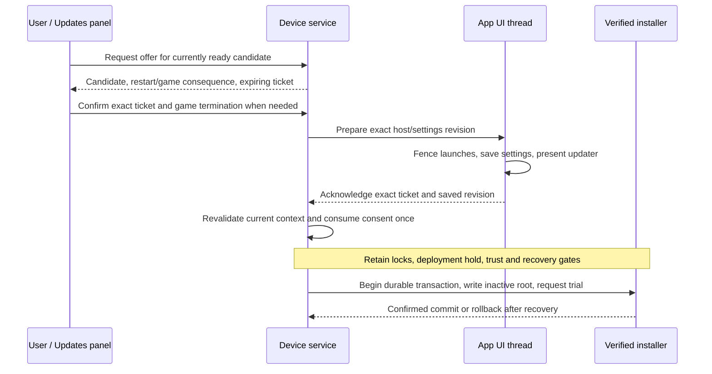

# Manual installation handoff

The manual handoff for #264/#266 now includes shared messages, the service
coordinator, bounded Unix sockets, the running-app adapter and an Updates panel
in App Settings. Preparation uses the real ordered settings writer and completed
kiosk page flips. Startup and lost-acknowledgement recovery now consult the
durable handoff and recovery journals through an authenticated root worker.
The native manual writer is connected to these gates. Installation remains
**unavailable on unqualified devices**: ordinary recovery admission requires
retained, owner-approved physical evidence, and no device approval has been
provisioned. There is no runtime switch to bypass that gate.

The contract lives in
[`spacewars-control::install`](../crates/spacewars-control/src/install.rs) and
[`engine-os-manager::install_handoff`](../crates/engine-os-manager/src/install_handoff.rs).
The model does not perform disk writes, HTTP, radio or reboot operations. Its
adapters live in `install_service.rs`, `install_transport.rs` and the client's
`updates_linux.rs`. The coordinator reads random bytes once for its incarnation.

## Transaction and authority

The user approves one exact verified image and its restart consequence. An
active or paused game additionally requires explicit end-session consent.
Checking for updates, downloading, selecting a channel or reading status cannot
create that consent.

The native adapter connects the existing writer and trial protocol to the two
durable journals. `ManualAuthorization` is a non-cloneable, non-serializable consent value;
it is **not** a write permit or a `RecoveryCapability`. It cannot enable the
owner-only supervised admission bypass. Normal service installation must retain
the qualified boot/watchdog capability gate and all signed-image checks.

## Binding and lifetime

An offer binds the verifier's complete candidate identity, channel-selection
generation, boot, kiosk PID/start time/systemd invocation, host revision and
settings-document revision. `Ready` can only be constructed from a
`VerifiedCandidate`; request JSON cannot supply a trusted descriptor.

Tickets contain a random service-incarnation identity and an increasing sequence.
They are public correlation identities, not bearer secrets. Service restart,
including within the same boot, requires fresh consent. Host observations must
be no older than two seconds, with no future or backwards clock observation.

An offer lasts at most five minutes. An unchanged repeated offer returns the same
ticket and deadline. Confirmation starts a preparation allowance of at most
thirty seconds, capped by the offer's original deadline. Retries never renew it;
expiry is inclusive. These are handoff bounds, not a timeout for a root write.

Any observed candidate, selection-generation, host, revision or maintenance
change before consumption aborts that ticket permanently. Restoring the old
conditions cannot revive it. A stale ticket or wrong peer cannot consume or
cancel a newer handoff. The coordinator keeps an abort available while the host
reports its fence, so losing an abort response does not force a new transaction.

## App serialization and uncertain outcomes

The UI adapter must serialize every scenario launch, autostart, setup transition,
settings mutation and unrelated input with `HostGate`. Relevant changes advance
the host revision. The confirmation input and handoff's own updater transition
retain the selected revision. A paused game remains a game.

`prepare` establishes the fence before saving. A successful receipt for the exact
settings-document revision and a presented updater screen are both required
before acknowledgement. The adapter must associate the actual `SettingsWriter`
receipt with that document revision; queueing a save or receiving an older
receipt is insufficient. A failed save, pre-acknowledgement input or expired
preparation releases the fence and prevents acknowledgement. Retired tickets
cannot be revived by delayed prepare messages.

Acknowledgement is the app-side handoff boundary. From then on, a lost response,
timeout or service disconnect cannot release the fence: the service may already
have consumed consent and started a transaction. Live cancellation can release
it only through an authenticated exact-ticket abort before consumption. After
consumption, cancellation returns too-late. Restart reconciliation can also
produce a durable abort when the unchanged recovery baseline proves no
transaction began; otherwise the existing recovery transaction determines the
outcome. Reboot requested, SSH lost and write finished are not success signals.

After service or app restart, the app reconciles the durable recovery journal
and any acknowledged fence before admitting launcher/autostart gameplay or
requesting a new offer. The native writer's final admission uses the same
journal. A fresh in-memory gate does not
prove that a previously acknowledged installation ended.
Unknown old tickets are not evidence of cancellation. The in-memory coordinator
does not persist, replay, resume or retry an installation. The separate journal
below records an association and decisions, never replayable consent.
Each `HostGate` is bound to one service incarnation. Replace it for a new service
only after reconciling and releasing any old fence; reconnecting alone cannot
discard retired-ticket history or an uncertain acknowledged handoff.

## Connected service and app adapters

The service creates `/run/spacewars-system/install.sock` beside its status socket
under the existing exclusive service lock. The kiosk creates
`/run/spacewars-kiosk/install.sock` in its systemd runtime directory. Host eligibility
uses the `pi-kiosk` build feature and a valid process/systemd invocation identity;
it is independent of the direct-launch `--kiosk` CLI flag. A full UI request
queue reports a visible busy result so reopening Updates cannot wait forever.
No new privileged helper, owner-only installation bypass or device path is exposed.

Frames are newline-delimited JSON, capped at 4 KiB, with strict schemas and a
two-second request-frame deadline. Each listener admits at most four clients;
the UI and service work queues are bounded. Clients authenticate `SO_PEERCRED`
before sending command bytes and bound the complete exchange, including connect.
The app accepts root only. The install-command socket accepts root and the kiosk
UID; reconciliation accepts the live kiosk only. The service's host adapter
samples the active systemd PID/invocation and `/proc` start ticks before
and after the exchange, and requires the connected peer to be that PID/UID.
Test fixtures inject private temporary sockets and their test-process identity;
production paths and credentials are fixed.

Offer/confirmation work runs off the request handler. A confirmation returns
`preparing` before waiting for the app. Status and cancellation can run during
that wait. The coordinator retains the exact abort decision for a lost reply;
the worker delivers it to the host after an unsuccessful preparation. Consumed
consent cannot be cancelled or consumed again. The production backend offers only
a currently verified candidate on a device with qualified recovery admission.

Updates is reachable from launcher and paused-game App Settings using touch,
keyboard, gamepad or the existing guarded UI control interface. It displays the
exact channel, generation, build and image identity, with an explicit
**Install & restart** or **End game, install & restart** confirmation. Desktop
installation remains unavailable. The UI does not claim write progress or
success from an in-memory acknowledgement.

The app listener hands requests to the UI thread. It records the full settings
snapshot, scene and input revisions, establishes a launch/input fence, and asks
`SettingsWriter::save_exact` for an ordered barrier receipt. Ordinary saves may
still coalesce; this exact document cannot be replaced by a newer queued save.
A valid launcher draft is included and retained in memory when preparation
starts. Settings changes, other queued saves, scene changes, focus loss and
preparation expiry revoke an unacknowledged handoff. A failed save cannot ack.

Acknowledgement additionally requires two completed DRM page flips after the
updater screen was published. This excludes a frame already in flight at
publication. UI timers and redraw requests alone do not satisfy presentation;
a renderer without that observation reports the host unavailable. During the
fence the scenario loop discards pending controls/input, manual and automatic
launches are rejected, and diagnostic mutation routes are blocked. The Updates
controls and read-only health/status/screenshot routes remain available.

After acknowledgement, a lost reply or service disconnect leaves the updater
and fence in place. Only an authenticated exact-ticket abort or confirmed
terminal recovery result can release it.

## Startup and outcome reconciliation

The service additionally exposes
`/run/spacewars-system/install-reconcile.sock`. Its separate bounded worker owns
the installation/recovery/handoff locks and filesystem work; a delayed check
does not take the live handoff coordinator mutex or block status/time handling.
There is one queued request and at most four socket clients. Each client exchange
is bounded by six seconds, with a five-second handler wait. Request/reply frames
remain limited to 4 KiB. The worker does not start another writer or restart the
recovery service when a request times out.

The app authenticates root before sending its process identity, a nonce and any
held ticket. The service checks the caller's kernel PID/UID and the actual kiosk
systemd invocation/start ticks. It repeats the instance observation after its
decision. Replies bind the nonce, host and current service epoch. Extra fields,
wrong identities/nonces, disconnects and errors cannot release a fence.

Pi kiosk builds fence launch/input immediately, defer initial launch and startup
settings writeback, and render Updates while querying the root worker. Missing
runtime identity or an unavailable host listener keeps that fence. The existing
health challenge and presentation redraw continue, allowing the independent
trial recovery service to observe the app before permitting gameplay. This
requires the matching device-service binary and a valid systemd kiosk invocation;
an older service or a standalone Pi launch cannot silently bypass startup
reconciliation. Desktop builds keep their existing startup behavior.

The worker acquires the shared install lock, opens both journals and checks
native boot/maintenance evidence before releasing a provisioned kiosk. Busy
locks wait, including locks held by downloads or operator maintenance. An active
or unmatched transaction remains held until recovery resolves it. When the lock
proves no writer survives and the current boot is the normal known-good root,
the worker settles an associated abandoned transaction through the ordinary
recovery state machine, including quarantine. Candidate trial health and
promotion remain with the independent recovery service. Neither path replays
a write or trial reboot. An unprovisioned
device can start only when both recovery and handoff directories are absent and
the app holds no ticket. Missing contents in an existing directory fail closed.

The UI accepts Clear only with no held preparation. An acknowledged fence needs
its exact abort/finished ticket. A successful decision binds the gate to the new
service epoch while preserving retired history within the same epoch, so delayed
old Prepare messages cannot revive it. Confirmed outcomes remain visible while a
follow-up query lets the service observe the unfenced host and retire the durable
decision. Opening Updates also reconciles before requesting an offer. Pending
confirmations keep polling even before the app receives Prepare. A matching Clear
from a new service incarnation retires the old unheld offer so Back and reopening
Updates work after an early service restart. A delayed Clear for an earlier offer
cannot discard a newer offer, and Clear never releases a held preparation.

## Durable association library

[`install_journal.rs`](../crates/engine-os-manager/src/install_journal.rs)
implements a separate root-owned journal at
`/data/spacewars-system/install-handoff`. Both startup reconciliation and native
writer admission use it. It does not change the
existing recovery journal format, so fallback images retain their current
recovery protocol.

The native worker retains the shared installation lock through these steps:

1. Persist the exact Prepare message, boot, channel-selection generation,
   recovery-record fingerprint and deployment hold capability before requesting
   that hold or asking the app to fence and acknowledge. A lost admission reply
   cannot leave an unidentified hold.
2. Revalidate the candidate and obtain an ordinary qualified recovery plan using
   `BootController::plan_install`. This reads the fixed physical-qualification
   approval and retained reports under the shared lock; it writes nothing and
   cannot substitute supervised admission when evidence is missing. Recheck the
   selected candidate, live app and original deadline, then consume the one-use
   authorization under the short coordinator lock.
3. Call `Journal::begin`. It first persists the exact planned transaction ID,
   then commits the existing recovery plan. Only a successful recovery commit
   returns a write action. The read-only `Plan::installation` association does
   not itself authorize a write.
4. Retain the lock and all native guards while the existing writer and trial
   protocol execute. After the reboot request is acknowledged, retain the lock
   until service shutdown so reconciliation cannot mistake a queued reboot for
   an abandoned writer. Status handling takes no journal lock and filesystem or
   host I/O never holds the in-memory coordinator mutex.

After a crash, the replacement worker must acquire the same installation lock,
open both journals, and validate native boot evidence before reconciling. A
surviving worker that still holds the lock prevents a conflicting abort decision.
An unchanged recovery fingerprint proves a prepared or armed handoff never
started its recovery transaction; the journal durably records an exact-ticket
abort. This also covers consumed consent lost before recovery commit. A matching
active transaction remains in progress. Only its recorded Committed or RolledBack
phase produces a finished result. On the normal known-good root, reconciliation
can quarantine an interrupted transaction; candidate trial recovery remains
independent. No write or reboot is retried here.

Missing/corrupt state in an existing directory, a different transaction, changed
candidate/origin boot, regressed outcome or uncertain persistence blocks a
decision. Both journals must be reopened after a failed commit. The shared
bounded store checks ownership, permissions, lock/file identity and checksum,
and uses file sync, rename and directory sync. Terminal decisions remain until
a new authenticated host observation made after the decision proves the fence
is gone; stale tickets and cached pre-decision observations cannot clear them.

The [native recovery admission contract](ota-recovery-qualification.md#ordinary-native-admission)
binds owner-approved physical reports to the exact board/firmware/media, layout,
boot assets, profile, kernel and recovery protocol. It returns an ordinary plan
only after fresh boot and file checks. The live install worker calls it before
app preparation and again before consuming consent. The supervised owner's
separate admission path cannot be used to
manufacture tryboot/watchdog qualification for this service.

## Native worker and deployment lifetime

The update runtime lends the exact verified candidate and channel-selection
revision to one install session. The claim is serialized with scheduler decisions
and queued channel/check commands. New checks and channel changes are refused
until the session drops its claim; the update worker continues publishing its
heartbeat. Final admission still checks usable time, expiry and that exact claim.

Dropping the claim blocks new offers until the update worker revalidates retained
trust locally under the installation lock. This preserves a staged candidate
after cancellation even though installer preflight rewrote the trust store.
Boot/data, recovery and staging evidence must remain unchanged, and the retained
signed feed must still authorize the same image at the current usable time.
Changed or expired evidence drops readiness. Lock contention waits for maintenance
to finish; this revalidation makes no network request and consumes no update check.

`engine-ota::native_install::Session` holds the native boot, recovery, trust and
staging guards. It revalidates signed metadata and the full staged payload before
app preparation, then rechecks boot/layout/data, qualification and metadata after
the acknowledgement. The existing fixed-target writer checks the opened payload
again, writes and flushes the inactive root, reads it back and verifies its ext4
identity. Metadata/time and boot/data are checked again before trial preparation.
The shared sealed trial permit consumes the durable reboot allowance before the
bounded logind/PID 1 request. Missing or uncertain replies cannot be replayed.

The root-owned handoff journal retains the deployment capability; public status
and Debug output never expose it. The writer renews it during progress and before
reboot. Independent reconciliation renews it after service restart, including
while the recovery service holds the install lock or the kiosk is unavailable.
Renewal restores bounded reconnect protection for a possible rollback boot.
The capability is released only after a terminal decision and a fresh unfenced
host observation, before clearing the journal. Failed release or journal writes
retain the decision for retry. Old journals without a hold remain readable.

The Updates panel reports payload checking, writing, flushing, readback,
filesystem checking, reboot requested and recovery required. These messages do
not release the app fence. Only the exact durable abort or confirmed recovery
outcome can do that. Independent recovery polling preserves live writer progress.

The system service unit permits `/boot` writes, USB SCSI block access and
`CAP_SYS_ADMIN` for block flushing and logind's fixed reboot parameter. It retains
RTC access and `CAP_SYS_TIME`; device policy is closed, namespaces are restricted
and mount syscalls are denied. This requires a coordinated device-service/app/unit
image update, not copying just the service executable onto an older image.

## Integration still required

1. Add the equally explicit candidate-bound install CLI. The current diagnostic
   UI interface can navigate Updates, but is not a privileged install shortcut.
2. Complete the physical recovery matrix and owner approval, then qualify the
   coordinated image's systemd permissions, actual DRM presentation, write/readback,
   trial commit/rollback, worker failure and service/app restart on the device.
   Local socket/Slint tests do not replace those checks.

Ask/Automatic preferences and overnight admission follow this manual path; they
must reuse the same writer, locks, recovery and final app handoff.

## Validation scope

Contract tests cover exact consent, games, save/presentation gates, cancellation,
candidate/channel/host/maintenance changes, one-use consumption, lost replies,
deadlines, clock discontinuities and service restart.

Socket tests exercise actual Unix listeners and peer credentials, rejection
before request disclosure, bounded frames/exchanges, delayed acknowledgement,
responsive cancellation, lost abort replies and stale consent after restart.
The client tests run the actual Slint panel and app socket with the real ordered
settings writer, a temporary settings file, blocked/failed saves, rendered
software frames, changed settings, expiry and a lost service reply. The software
renderer supplies the test presentation counter; physical DRM flips and native
installation are not claimed by those tests.

Journal tests reopen real files at prepare/acknowledgement/admission/outcome
boundaries and inject failures before and after rename/directory sync. A signed
feed fixture exercises real verification and both durable journals: association
or recovery persistence failure returns no write action, while an interrupted
committed admission is quarantined by the existing recovery protocol. Synthetic
recovery views cover each nonterminal/terminal phase and mismatched identities.
These tests do not open native block devices, change boot selection or qualify
tryboot/watchdog hardware.

Startup tests use real local sockets and the rendered Slint UI to cover late
service availability, wrong nonce/host responses, busy/blocked decisions, deferred
initial launch, failed host binding, a lost acknowledgement, service-epoch change
and a confirmed rollback followed by cleanup. Protocol tests reject unknown
fields even on empty decision variants. A stalled reconciliation worker leaves
the separate live install status socket responsive. Native systemd identity,
boot evidence, shared-lock wait time and DRM health during the startup fence
still require physical qualification.

Native-writer integration coverage adds a signed-candidate selection lease,
scheduler/command exclusion, stale-time/expiry refusal, final-admission cancellation,
responsive writing status, progress rendering while reconciliation waits, durable
hold retention/redaction, request-independent maintenance and abandoned-write
quarantine on the normal good root. The existing signed ext4 writer, reboot request
failure and recovery fixtures remain the lower-level evidence. These workstation
tests do not execute the fixed native path against a Pi block device or establish
physical recovery qualification. No approval was provisioned or device changed.

Regression coverage also exercises a service restart before Host Prepare, stale
cancellation, rejection of a mismatched recovery nonce and delayed old Prepare,
then Back and reopening Updates. Signed-feed tests reproduce the installer's trust
rewrite and restore readiness while rejecting payload/recovery replacement,
candidate revocation and expiry. Runtime tests cover maintenance contention and
reoffering after cancellation without another scheduled check or network hold.
