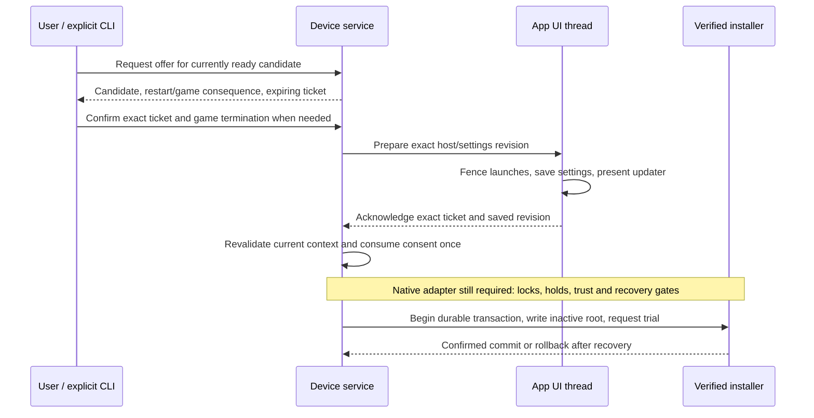

# Manual installation handoff

This is the first implementation slice for #264/#266: shared wire types, the
service consent coordinator and the app-side handoff state machine, with
deterministic cross-component tests. The live socket operations, settings-writer
adapter, Updates screen and privileged install worker are **not connected yet**.
No new install command or runtime privilege is enabled by this change.

The contract lives in
[`spacewars-control::install`](../crates/spacewars-control/src/install.rs) and
[`engine-os-manager::install_handoff`](../crates/engine-os-manager/src/install_handoff.rs).
It does not depend on Slint or make HTTP, filesystem-write, radio or reboot calls.
The coordinator reads random bytes once to identify its service incarnation.

## Transaction and authority

The user approves one exact verified image and its restart consequence. An
active or paused game additionally requires explicit end-session consent.
Checking for updates, downloading, selecting a channel or reading status cannot
create that consent.

The last two steps remain existing backend responsibilities and future adapter
work. `ManualAuthorization` is a non-cloneable, non-serializable consent value;
it is **not** a write permit or a `RecoveryCapability`. It cannot enable the
owner-only supervised admission bypass. Normal service installation must retain
the qualified boot/watchdog capability gate and all signed-image checks.

## Binding and lifetime

An offer binds the verifier's complete candidate identity, channel-selection
generation, boot, kiosk PID/start time/systemd invocation, host revision and
settings-document revision. `Ready` can only be constructed from a
`VerifiedCandidate`; request JSON cannot supply a trusted descriptor.

Tickets contain a random service-incarnation identity and an increasing sequence.
They are public correlation identities, not bearer secrets. Service restart,
including within the same boot, requires fresh consent. Host observations must
be no older than two seconds, with no future or backwards clock observation.

An offer lasts at most five minutes. An unchanged repeated offer returns the same
ticket and deadline. Confirmation starts a preparation allowance of at most
thirty seconds, capped by the offer's original deadline. Retries never renew it;
expiry is inclusive. These are handoff bounds, not a timeout for a root write.

Any observed candidate, selection-generation, host, revision or maintenance
change before consumption aborts that ticket permanently. Restoring the old
conditions cannot revive it. A stale ticket or wrong peer cannot consume or
cancel a newer handoff. The coordinator keeps an abort available while the host
reports its fence, so losing an abort response does not force a new transaction.

## App serialization and uncertain outcomes

The UI adapter must serialize every scenario launch, autostart, setup transition,
settings mutation and unrelated input with `HostGate`. Relevant changes advance
the host revision. The confirmation input and handoff's own updater transition
retain the selected revision. A paused game remains a game.

`prepare` establishes the fence before saving. A successful receipt for the exact
settings-document revision and a presented updater screen are both required
before acknowledgement. The adapter must associate the actual `SettingsWriter`
receipt with that document revision; queueing a save or receiving an older
receipt is insufficient. A failed save, pre-acknowledgement input or expired
preparation releases the fence and prevents acknowledgement. Retired tickets
cannot be revived by delayed prepare messages.

Acknowledgement is the app-side handoff boundary. From then on, a lost response,
timeout or service disconnect cannot release the fence: the service may already
have consumed consent and started a transaction. Only an authenticated abort
decision for that exact ticket, made before consumption, can release it. After
consumption, cancellation returns too-late and the existing recovery transaction
determines the outcome. Reboot requested, SSH lost and write finished are not
success signals.

After service or app restart, the future native adapter must reconcile the
durable recovery journal and any acknowledged app fence before accepting new
work or admitting launcher/autostart gameplay. A fresh in-memory gate does not
prove that a previously acknowledged installation ended.
Unknown old tickets are not evidence of cancellation. This module deliberately
does not persist, replay, resume or retry an installation.
Each `HostGate` is bound to one service incarnation. Replace it for a new service
only after reconciling and releasing any old fence; reconnecting alone cannot
discard retired-ticket history or an uncertain acknowledged handoff.

## Integration still required

1. Add bounded fixed socket operations for offer, confirm, cancel and status.
   Authenticate the service as root, and acknowledgements against the actual
   systemd kiosk PID, start time and invocation. A caller-provided PID or UID is
   not evidence. Messages reject unknown fields and exceed no 4 KiB frame;
   no command accepts a path, URL, device, executable or systemd-unit name.
2. Connect the UI-thread gate to every launch/input route, the real settings-save
   receipt and updater presentation. Add the manual confirmation and progress
   UI, plus an equally explicit candidate-bound CLI operation. Desktop clients
   keep device installation unavailable.
3. Serialize channel/ready invalidation and final handoff with the worker. Hold
   the shared install lock and reboot-capable maintenance protection, recheck
   signatures/expiry, staged file identity and hashes, boot/layout, generation,
   recovery capability and data compatibility, then begin the existing durable
   journal transaction before disk mutation. Slow work stays outside status and
   UI handling. Record the handoff-to-transaction association for reconciliation.
4. Expose durable progress and confirmed commit/rollback. Qualify socket peer
   rejection, actual host races, worker failure/restart and installed kiosk
   permissions before a supervised device trial. Keep the owner helper separate.

Ask/Automatic preferences and overnight admission follow this manual path; they
must reuse the same writer, locks, recovery and final app handoff.

## Validation scope

The contract tests cover exact consent, games, both save/presentation gates,
failed/old save receipts, cancellation, candidate/channel/host/maintenance
changes, one-use consumption, lost replies, abandoned offers, deadline boundaries,
clock discontinuities and service restart. They use in-memory state and fake
authenticated observations. They do not establish socket authorization, Slint
presentation, native installation or physical-device qualification.
