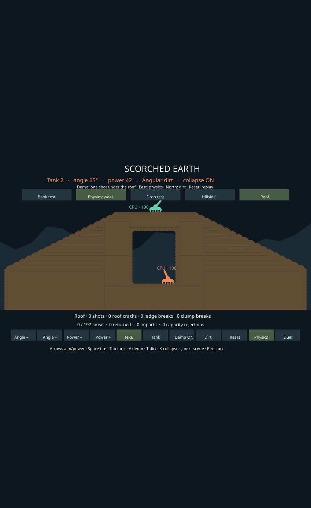
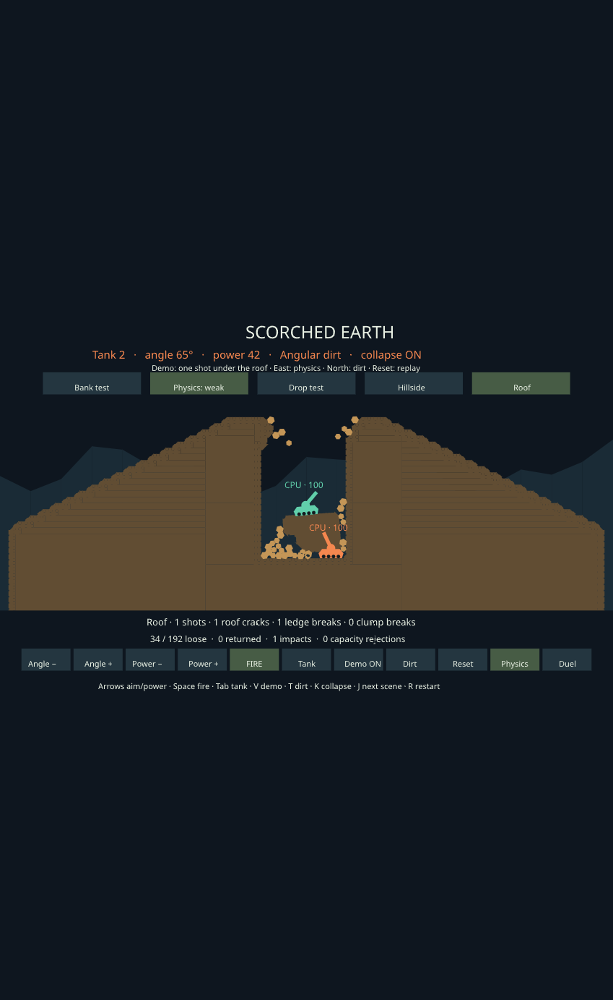

# Roof and bridge collapse

The shared terrain layer now recognizes short spans with bearings at both ends.
An ordinary shot can thin a roof without cutting it completely. Weak material
then cracks at its most overloaded column; the attached sides become ledges and
can fall through the existing cantilever rule. Strong material can retain the
same damaged roof. The falling fragments use the existing collision, impact
chipping, actor support and deposition paths in both games.





## Try it

In **Scorched Earth**, choose the upper **Roof** button, or use **J / left
shoulder** after Hillside. Demo fires one normal tank shell after two seconds.
**Physics / K / right face** cycles Weak → Strong → Off and resets the scene;
**Dirt / T / top face** switches Angular/Round. **Reset / R** replays. Turn Demo
off to aim and fire manually. The initial roof holds even with Weak selected.
The status line counts roof cracks, subsequent ledge breaks and impact breaks
separately. A tank above the weak roof rides the falling chunk.

Space Wars has the matching headless `init_roof_fixture` cannon encounter on a
rotating planet. The fixture uses normal radial gravity, spin and weapon damage;
its short bridge has thinner end sections. One cannon shot makes the weak span
crack and then releases both remaining ledges. Strong retains the damaged span.
This fixture is a development scene, not an additional launcher entry. The shared
rule is also active wherever the existing dirt preset enables cohesion in either
game; it does not depend on a fixture flag.

```sh
cargo +1.89.0 run --locked --release -p scenario-scorched-earth \
  --example scorched_benchmark -- --roof --cohesion weak --shape angular \
  --seconds 30 --diagnostics --replay --require-roof

cargo +1.89.0 run --locked --release -p scenario-spacewars \
  --example destruction_benchmark -- --roof --strength weak --shape angular \
  --seconds 30 --diagnostics --replay --require-roof
```

Use `round` for the other shape and `strong` or `off` for comparisons. Omit
`--require-roof` when testing a setting that should hold. Scorched Earth's proof
also requires deposition. The Space Wars proof requires the shot, crack, later
ledge release and impact chipping, with conservation/replay checks; it does not
require the rotating rubble pile to settle within 30 seconds.

## Shared mechanics and limits

`Terrain::roof_span` traces the same connected column intervals used for
irregular cantilevers. Both bearing faces and the whole perimeter must be
observed. Unit-density cell weights and the sampled gravity vector determine
two bearing reactions. Each column's bending moment is compared with
`strength × thickness² / 6`. The most utilized section is chosen in a stable
field order, independent of which underside cell initiated a uniform-gravity
query. Strength is the existing experimental beam threshold, separate from
blast hardness.

Only the selected crack column becomes grains. Normal connectivity deals with
any disconnected material; attached sides can fail in later bounded scans.
A connected cave floor can keep both banks in the original terrain body, so the
first crack needs no fragment slot. Release still checks actual grain/fragment
capacity before changing terrain, IDs or bodies. Grains and fragments preserve
cell durability and inherit the source's translation and spin. Capacity refusals
retain material and retry. Existing scenario registries and collision geometry
are refreshed by the ordinary release transaction.

The limits remain 16 columns, eight cells per column, 32 candidates per scan,
a half-second yield delay and at most one cohesion transaction per 0.1 seconds.
Unknown edges, unobserved branches, oversized roofs and tensile bearing
reactions are retained. Dynamic fragments are not fractured by uniform
free-fall acceleration. This is a local simply supported beam approximation:
there is no arch action, accumulated fatigue, actor-weight loading, general
stress propagation or integration of varying gravity across a whole span.

## Verification — 2026-10-08

- **836 tests passed** across terrain, Rapier integration, Scorched Earth,
  Space Wars and Terrain Lab. New coverage includes intact/thinned roofs,
  strength/thickness/gravity scaling, rotation, deterministic seam selection,
  unknown geometry, capacity refusal/retry, free-fall exclusion, inherited
  motion, damage/material conservation, both weapons and both grain shapes.
  The control test also checks that holding the strength button changes the
  preset once.
- Shared terrain/Rapier/Scorched Earth pass strict Clippy. Space Wars has the
  same 17 distinct pre-existing Clippy warning locations.
- **64 benchmark executions / 104 scene runs** across desktop and Raspberry
  Pi 4 Model B Rev 1.4. Each host ran 12 roof cases: two games × two shapes ×
  Off/Weak/Strong, each with replay at every one-second checkpoint.
- **52 cross-host scene results match.** All **40 existing before/after scene
  comparisons match**, including observation hashes and Space Wars motion
  hashes where reported. The baseline is the prior compound CCD pruning pass.
- Existing benchmarks cover 120-second barrages with 60 seconds of firing,
  30-second hillside/quarry/curved encounters, and both default and combined
  six-scene Space Wars benchmark runs. The desktop and Pi release examples use
  Rust 1.89.0; Pi examples are statically linked for aarch64.

### Weak roof scenes

Whole-scenario update times in milliseconds, over 30 simulated seconds:

| Host | Scene / shape | Mean | p95 | Max | Deposited cells |
| --- | --- | ---: | ---: | ---: | ---: |
| Desktop | Scorched / Round | 0.109 | 0.258 | 1.438 | 9 |
| Desktop | Scorched / Angular | 0.134 | 0.317 | 1.422 | 8 |
| Desktop | Space Wars / Round | 0.582 | 0.708 | 2.546 | 1 |
| Desktop | Space Wars / Angular | 0.698 | 0.798 | 2.925 | 0 |
| Pi 4 | Scorched / Round | 1.244 | 3.027 | 12.255 | 9 |
| Pi 4 | Scorched / Angular | 1.520 | 3.364 | 11.693 | 8 |
| Pi 4 | Space Wars / Round | 6.246 | 7.701 | 21.591 | 1 |
| Pi 4 | Space Wars / Angular | 6.912 | 8.465 | 26.134 | 0 |

Each weak run cracks one roof. Scorched releases one subsequent ledge; Space
Wars releases two. Strong and Off produce no strength-driven fractures in either game,
with either shape, on either host. The shapes generate different later
contact workloads, so these measurements do not establish a universal winner.

### Existing Pi workloads

Mean update time before → after, with identical final hashes:

| Workload | Round | Angular |
| --- | ---: | ---: |
| Barrage | 4.151 → 4.115 | 2.156 → 2.165 |
| Hillside | 1.195 → 1.188 | 1.281 → 1.286 |
| Quarry | 3.823 → 3.823 | 4.329 → 4.338 |
| Curved planet | 6.438 → 6.686 | 8.073 → 8.250 |

These are single samples per case, not statistical speedup claims. The curved
planet averages were 2–4% higher in this run. Rendering, observations, audits
and replay are outside the update timer. The existing loose-terrain benchmark
reports its separate render timing in the raw data. None of these results is a
60 FPS guarantee: the roof cannon run still reaches 22–26 ms on the Pi, and
existing combined match runs reach about 42–45 ms.

### Remaining behavior to improve

The narrow, rotating Space Wars cave retains a busy rubble pile. At 30 seconds,
Weak Angular has zero deposits; a separate 90-second development run also had
zero, with 65 of 81 grains still classified as moving. Round deposits one cell
in the 30-second comparison. This is retained in the report, and no settling
thresholds or scene-specific deposition exceptions were added. Investigating
contact motion and packing in that confined pile is a useful next step.

Measurements, executable/source hashes and per-second traces are in
[`data/dirt-roof-20261008.json`](data/dirt-roof-20261008.json) and
[`data/dirt-roof-traces-20261008.jsonl.gz`](data/dirt-roof-traces-20261008.jsonl.gz).
The local scripts, source snapshots, binaries and raw output are retained in
`target/dirt-roof-review/`. The Picade application was deployed with the fast
update path; its installed hashes and service health are recorded in the data.

## Follow-up: rotating rubble jitter

The [gravity integration pass](loose-gravity-integration.md) fixes the persistent
velocity noise noted above. In the same Weak cave, late moving-grain samples
fall from roughly 87–90% to 0–2%. The pile still has packing obstructions and
repose rejections; the update does not force moving or obstructed grains into
terrain. The measurements above retain the original roof-pass baseline.

The subsequent [packing investigation](packing-preview-reuse.md) captures the
quiet groups, identifies actor and rubble obstructions, and reduces repeated
preview work without changing their placement decisions.

The [scoped exhaustive follow-up](cave-packing-oracle.md) finds no safe deposits
in six complete group searches, or among one-, two-, and three-grain deposits
in the other four groups. It adds small Round/Angular regression captures and
keeps the runtime rules unchanged. Larger coordinated deposits remain outside
the proven scope.
