# Scorched Earth

Choose **scorched-earth** in the launcher, or launch directly:

```sh
cargo run --locked --release -p engine-client -- --scenario scorched-earth --seed 42
```

This first playable slice of [#25](https://github.com/aortez/space-wars/issues/25)
puts two physical tanks on seeded hills with downward gravity. Aim and fire at
the opponent, or undermine its footing. The other tank returns fire every five
seconds. The first tank reduced to zero health loses; **Reset** starts again on
the same hills. A simultaneous destruction is a draw.

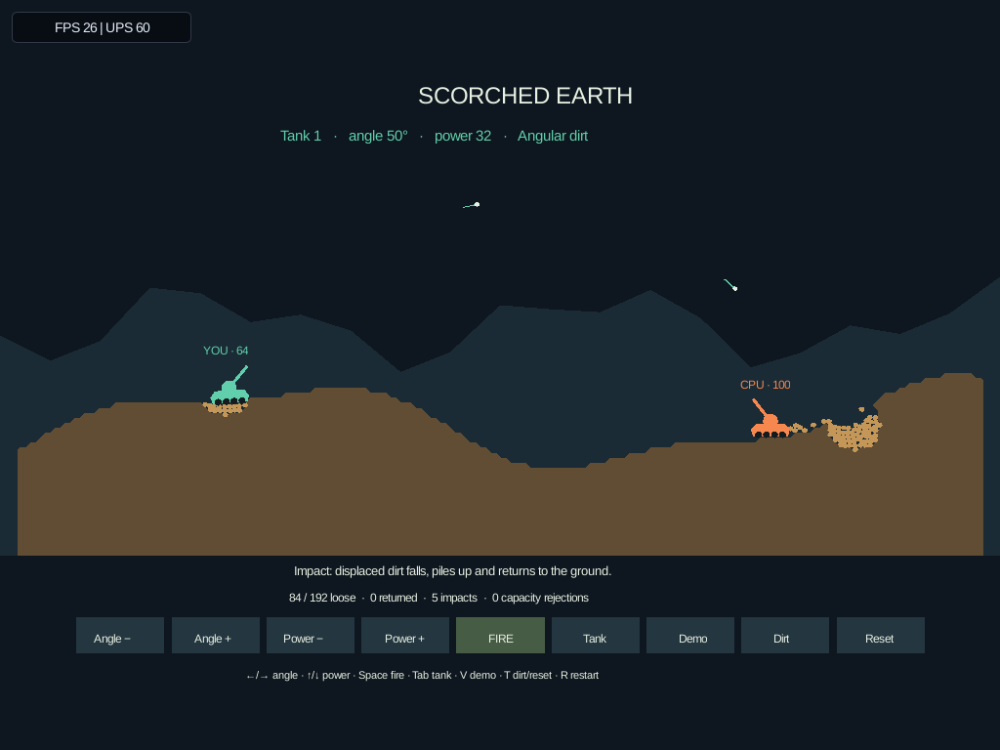

## Controls

| Action | Keyboard | Controller |
| --- | --- | --- |
| Lower / raise elevation | Left / Right, A / D | D-pad left / right, right-stick X |
| Lower / raise power | Down / Up, S / W | D-pad down / up, right-stick Y |
| Fire (hold to repeat) | Space | Bottom face, right trigger |
| Take control of the other tank | Tab | Left face |
| Toggle the scripted CPU duel | V | Right shoulder |
| Switch Angular / Round dirt and reset | T | Top face |
| Toggle surface collapse; strength in bank/drop, physics in hillside/roof | K | Right face |
| Cycle duel / barrage / bank / low drop / high drop / hillside | J | Left shoulder |
| Open / leave bank test | Tab + T | Hold left + top face |
| Cycle combined physics; strength only in bank/drop | Tab + K | Hold left + right face |
| Reset current setup | R | On-screen Reset |
| Pause | Esc | Start |

The on-screen controls also adjust aim/power, fire, select a tank, toggle Demo,
switch dirt, and reset. The on-screen **Reset** retains the current dirt shape
and Demo, collapse, scene and strength choices. Camera framing fits the entire battlefield in landscape and
narrow windows. The host provides the normal launcher, pause, and renderer controls.

**Angular** is the initial dirt choice. **Demo** drives both tanks with the same
seeded aiming sweep used by the headless runner. It estimates ballistic range
but varies its aim; intervening terrain and loose grains can intercept shots.
Power is muzzle speed (12–48 world units/s); elevation ranges from 5° to 85°.
Human shots have a 1.25-second cooldown. The tanks currently cannot drive.

## Roof comparison

Choose **Roof** in the upper button row, or cycle with **J / left shoulder**
after Hillside. A tank waits on a bridge above a cave. Demo fires one ordinary
shell from below after two seconds. **Physics / K / right face** cycles weak,
strong and off on the same roof and shot; **Dirt / T / top face** switches
Angular and Round. **Reset / R** replays. Turn Demo off to aim and fire manually.

The initial weak roof holds its own weight. After the shot thins it, the shared
beam rule cracks one column, then the long remaining ledge falls. The upper
tank falls with it; the chunk can chip on impact and dirt can return to terrain.
Strong material holds the damaged roof. Off keeps blast deformation without
strength-driven cracks. The status line separates roof cracks, ledge breaks,
and clump breaks. Details and headless commands: [roof comparisons](roof-collapse.md).

## Bank-collapse comparison

**Collapse** (K / right face) enables the shared bank-yield prototype and resets
on the same seed. It starts **off**. **Barrage** (J / left shoulder) resets into
60 seconds of falling shells, one every two seconds, followed by unlimited rest.
It keeps firing after tank deaths. The same scene button next opens **Bank test**,
then **Low drop**, **High drop**, **Hillside**, **Roof**, and **Duel**; **Demo** returns isolated tests to the duel and switches hillside/roof between demo/manual. Switching dirt or collapse restarts the current comparison.
The header shows the choices; the status line shows time and released bank cells.

For a packing comparison, choose **Angular**, leave **Collapse off**, then **Barrage**.
Watch the ground during the quiet tail and repeat with Round dirt. Enable collapse
separately to compare crater-rim shedding. These changes alter later impacts and
pile shapes, so equal seeds do not imply identical contact workloads.

The shared layer peels exposed tops with a steep adjacent drop in the direction
of gravity. It watches a two-cell neighborhood of material release/deposition,
waits 0.35 seconds, and can release up to four cells from one field per 0.1 seconds.
It checks at most 64 queued candidates per scan and tracks at most 4,096.
Automatic shedding pauses if it would take the total loose population above 48;
impacts retain access to the normal 192-grain pool. Refusals retain the dirt and
retry later. Removed cells inherit the source's velocity and spin without a kick.

The 50° repose setting is a grid-sampled threshold, not a measured soil angle.
This surface-shedding prototype applies equally to eligible materials. The separate
optional bank-strength experiment below handles short undercut ledges. It leaves undisturbed terrain alone. Blocked deposits
can still leave piles permanently loose. Collapse
is optional because it can increase obstruction, saturation and update cost.

The same `LooseTerrain::slump` call is wired into Spacewars' existing edit boundary,
using its point/spherical gravity solver and body poses. Released grains and
fragments join the ordinary actor/query registries; base/flag support is reconciled
with the new geometry. Spacewars enables it through `LooseTerrainConfig::slumping`
and the headless runner's `--slumping` switch. The launcher now offers combined
Weak/Strong presets while plain grains retain their existing behavior. Terrain Lab
retains the default with collapse off.

```sh
cargo run --locked --release -p scenario-scorched-earth --example scorched_benchmark -- \
  --shape round --seconds 120 --bombardment-seconds 60 --slumping --replay --diagnostics
cargo run --locked --release -p scenario-spacewars --example loose_terrain_benchmark -- \
  --mode angular --scene combat --seconds 60 --slumping --diagnostics
```

Omit `--slumping` to compare the existing behavior. The bombardment runner reports
active and tail timings separately, with per-second samples on stderr. The tail
begins when launches stop; an already airborne shell can still land in it.
Slumping diagnostics include pending checks, releases, tracking overflow and
cumulative capacity/fragment refusals; rejection counts are attempts, not lost cells.
All auditing, hashing and replay remain outside the timed update.

## Hillside encounter and shared physics presets

The **Hillside** button opens a filled, uneven hillside with the current dirt shape
(initially Angular) and Weak physics. **J / left shoulder** also reaches it after the high-drop test.
The right tank aims into the slope below the left tank. Demo fires ordinary
shells at 2, 10 and 18 seconds, followed by a quiet tail. There is no initial
tunnel or supporting pier: successive circular craters excavate the undercut.
With seed 42 and Weak physics, the early hits hold before an irregular section
fails, falls and chips. Nothing cuts terrain or spawns fragments on a timer.

**V / right shoulder / Demo** switches to manual play and resets the encounter.
The right tank remains selected and pre-aimed: use Fire, or change angle/power.
Demo recalculates its ballistic aim from the tank's current pose before each
shot; manual play retains the player's chosen angle and power.
**K / right face** cycles Weak → Strong → Off and restarts the same encounter.
**T / top face** changes Round/Angular grains; Reset repeats the current setup.
Weak demonstrates bank failure, falling-clump chipping and deposition. Strong
and Off provide comparisons; Off still retains ordinary conserved blast debris.
The status line counts shots, bank breaks and clump breaks separately.

The upper **Physics** button (Tank + Collapse / Tab + K) applies the combined
preset to ordinary hills and barrage too. Their separate Collapse toggle still
controls surface shedding; a nonmatching combination is labelled Custom.
Isolated Bank and Drop tests keep their existing strength-only controls.
Spacewars exposes the same combined thresholds under **Settings → Dirt physics
(trial)**, with Round/Angular choices; see [shared settings](shared-loose-terrain.md).

The Scorched benchmark has `--hillside`. The companion Spacewars quarry uses
an ordinary cannon hit on a rotating material planet, with another ship on the
uneven ledge. Both use the production terrain lifecycle. `--require-lifecycle` makes a
run fail unless a weapon hit, bank failure, impact chipping and some deposition
all happen. It is intended for the Weak comparison, not the holding controls.

```sh
cargo +1.89.0 run --locked --release -p scenario-scorched-earth --example scorched_benchmark -- \
  --hillside --cohesion weak --shape angular --seconds 30 --replay --diagnostics --require-lifecycle
cargo +1.89.0 run --locked --release -p scenario-spacewars --example destruction_benchmark -- \
  --strength weak --shape angular --seconds 30 --replay --diagnostics --require-lifecycle
cargo +1.89.0 run --locked --release -p scenario-spacewars --example destruction_benchmark -- \
  --curved --strength weak --shape angular --seconds 30 --replay --diagnostics --require-undercut
cargo +1.89.0 run --locked --release -p scenario-spacewars --example loose_terrain_benchmark -- \
  --destruction weak --seconds 30 --diagnostics
```

Use `--shape round` for the other contact shape, `--cohesion strong|off` for
Scorched and `--strength strong|off` for the quarry (omit the lifecycle requirement).
The Spacewars quarry is a development fixture; ordinary launcher worlds keep
their existing terrain generation. Counts and replay checks run outside timing.
The curved fixture starts with filled terrain and fires at 0, 8 and 16 seconds.
Its short crater roofs are inspected but can hold under low radial gravity;
`--require-undercut` requires actual irregular-overhang inspection, rather than
requiring every crater to collapse. Both fixtures retain the normal grain cap.
The updated hillside and quarry workloads are version 2; their geometry differs
from the October 6 measurements below.

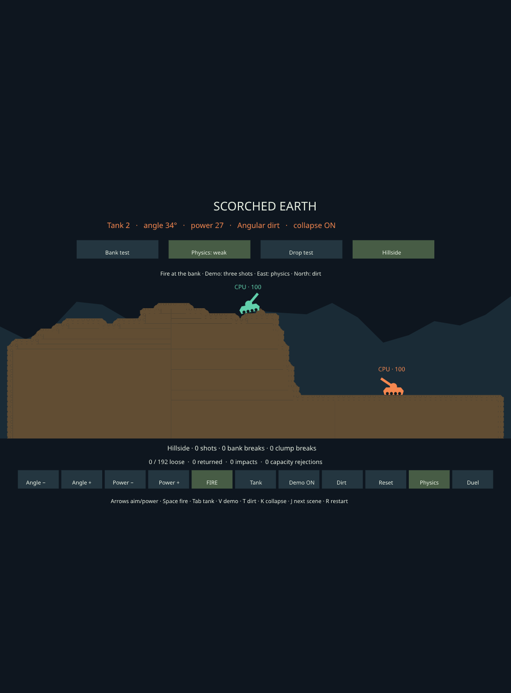

[Undercut after two shots](screenshots/dirt-overhang/local-angular-undercut.png) ·
[Angular collapse after the third shot](screenshots/dirt-overhang/local-angular-collapsed.png) ·
[Round collapse](screenshots/dirt-overhang/local-round-collapsed.png) ·
[Strong bank holding after three shots](screenshots/dirt-overhang/local-round-strong.png).

### Irregular overhang review — 2026-10-08

The shared query follows stepped and tapered undersides and uses the full
sampled gravity vector when calculating the root moment. Its limits remain
16 columns and eight cells per column, with a complete perimeter check and
conservative retention of additional supports and unknown geometry. See
[the shared model and its limits](shared-loose-terrain.md#local-bank-strength).

Seed 42 with Weak physics breaks one irregular bank in both games and both
grain shapes. The hillside releases 32 bank cells, then chips another 8 / 12
cells (Round / Angular). The quarry releases 51 bank cells and chips 11 / 14.
At 30 seconds, cumulative deposition from all releases is 59 / 103 cells in
the hillside and 3 / 3 in the quarry. Strong and Off retain their banks.
The curved-planet case creates and inspects irregular crater roofs, which
hold under the sampled load. Its three ordinary cannon hits also exercise
material-capacity refusal. All material remains accounted for.

Picade whole-scenario step timing, mean / p95 / maximum in milliseconds:

| Weak physics, 30 seconds | Round | Angular |
| --- | --- | --- |
| Filled hillside | 1.16 / 2.55 / 20.44 | 1.26 / 2.50 / 20.78 |
| Uneven rotating quarry | 3.84 / 4.79 / 47.65 | 4.31 / 5.26 / 48.93 |
| Curved planet, three shots | 6.37 / 9.70 / 17.64 | 7.87 / 10.81 / 23.17 |

These are one sample per configuration, with rendering, audits and replay
outside the timer. The shapes produce different contact workloads. Fracture
spikes still exceed a 16.7 ms frame budget, especially in the quarry. The
filled hillside/quarry are workload v2, so their earlier v1 measurements below
describe different geometry.

The unchanged 120-second barrage reproduces its prior hashes; mean step cost
is 4.120 → 4.142 ms for Round and 2.165 → 2.186 ms for Angular. The existing
Spacewars combat/match benchmarks, both plain/slumping and combined Weak,
also retain every prior state hash. Their mean timings remain close; for
combined Weak match, Round is 7.809 → 8.027 ms and Angular 8.045 → 8.185 ms.
The kiosk was paused during headless timing.

The subsequent [compound CCD optimization](compound-ccd-pruning.md) reduces
the quarry impact spike while preserving these workloads and their physical
results. It applies through the shared physics world in both games.

Validation covers 822 engine/scenario tests, 60 benchmark executions representing
100 scene results, 48 replayed scenarios, 28 preserved baseline scene hashes,
and 50 matching desktop/Pi scene hashes (plus quarry/curved physical-motion
hashes). Hillside seeds 7 and 91 add repeatability/conservation checks; changing
the hill or grain shape can leave a bank holding after the same three shots.
Strict core/Scorched Clippy passes; Spacewars retains the same 17 existing warnings.

[Raw measurements, source/binary hashes and validation](data/dirt-overhang-20261008.json) ·
[per-second traces](data/dirt-overhang-traces-20261008.jsonl.gz) ·
[local runtime commands and status](data/dirt-overhang-local-live-20261008.txt).

### Gameplay comparison on the Picade — 2026-10-06

Historical results and screenshots for the earlier rectangular ledges:

30-second runs, shared Weak preset, seed 42. Whole-scenario simulation step,
mean / p95; rendering, audits and replay excluded:

| Encounter | Round | Angular |
| --- | --- | --- |
| Hillside | 2.10 / 3.79 ms | 1.39 / 3.32 ms |
| Rotating-planet quarry | 3.59 / 4.86 ms | 3.87 / 4.97 ms |

Both shapes broke one bank in each encounter. The hillside chipped 10 Round or
9 Angular cells; the quarry chipped 11 Round or 10 Angular cells. By 30 seconds,
the hillside had returned 27 / 20 cells and the quarry 4 / 1 cells (Round / Angular).
These are cumulative returns from all releases, not only the chipped patches.
Some piles remain loose. Strong and Off held their banks in all four comparisons.

Angular was faster in this hillside; Round was slightly faster in the quarry.
The shapes produce different evolving contact workloads, and each configuration
has one timing sample. These measurements do not establish a universal winner.
The kiosk was paused for headless timing. A mid-run device sample read 70.1°C
and 1.5 GHz; throttle status was unavailable.

[Raw runs and validation](data/dirt-gameplay-20261006.json),
[per-second traces](data/dirt-gameplay-traces-20261006.jsonl.gz).

The installed kiosk was also exercised through its ordinary menus and controller
input: Spacewars Weak/Angular, combat Weak/Round, hillside demo in both shapes,
a manual shot, and Strong holding the ledge. Live hillside samples were roughly
25–31 submitted FPS and 60 UPS at raster scale 2; these are separate from the
headless simulation timings above. [Live command log](data/dirt-gameplay-picade-live-20261006.txt).
The prior Spacewars dirt selection was restored. The device is left paused in
Weak/Angular hillside before the first demo shot; Resume starts the encounter.


## Clump-drop comparison

**J / left shoulder** cycles duel → barrage → bank → low drop → high drop → hillside → duel.
The on-screen **Drop test** button also cycles low/high/off. Each drop uses the
same 32-cell clump above a flat floor, holds it for two seconds, then releases it
with zero starting velocity. Low is a 0.3-unit gap; high is a 12-unit gap.

In a bank or drop test, **K / right face** cycles weak/strong/off strength and
restarts; **T / top face** switches Angular/Round dirt and restarts. The on-screen
**Reset** repeats the same choices. Compare **high + weak** with **high + strong**,
then use the low drop to check a gentle landing. Weak high drops chip locally;
low drops and strong high drops retain the clump. The status line reports chipped
cells. Entering Bank test also enables impact breakup of the fallen ledge.

Both scenarios use the [shared contact lifecycle](shared-loose-terrain.md#clump-breakup-on-impact).
Incoming speed and solver impulse must both qualify. No artificial kick is added
when a patch becomes grains. Strong/weak are prototype uniform thresholds;
chipping does not guarantee that all resulting loose material will redeposit.

```sh
cargo +1.89.0 run --locked --release -p scenario-scorched-earth --example scorched_benchmark -- \
  --shape angular --seconds 15 --drop high --cohesion weak --breakup --replay --diagnostics
cargo +1.89.0 run --locked --release -p scenario-scorched-earth --example scorched_benchmark -- \
  --shape angular --seconds 15 --undercut --cohesion weak --breakup --replay --diagnostics
cargo +1.89.0 run --locked --release -p scenario-spacewars --example loose_terrain_benchmark -- \
  --seconds 30 --slumping --cohesion 500 --impact-yield-speed 6 --diagnostics
```

Use `--drop low`, `--cohesion strong`, or `--shape round` for the corresponding
comparison. `--breakup` is separate from `--cohesion` in the runner so the earlier
bank experiment remains reproducible in isolation. Spacewars launcher defaults
are unchanged; its adapter and headless workload accept the shared opt-in.

### Impact comparison measurements — 2026-10-06

[Run data and executable/source hashes](data/dirt-impact-20261006.json) and
[per-second traces](data/dirt-impact-traces-20261006.jsonl.gz) retain 38 executions
and 68 scene results across desktop and Picade. All 34 corresponding scene hashes
match across hosts; the 16 before/after checks of existing scenes retain their
hashes with impact breakup disabled. All 28 Scorched replays pass. Tests pass for
812 core/scenario cases and three client input/render cases. Strict Clippy passes
for engine-rapier and Scorched; the broader Spacewars check reports 17 pre-existing
warnings in code unchanged by this pass. Its full test suite passes.

These Picade fixtures simulate 15 seconds, including the two-second hold. Numbers
are whole simulation-step mean/P95 milliseconds, excluding rendering, diagnostics,
conservation auditing and replay. Each configuration has one timing sample.

| Fixture, breakup enabled | Round mean / P95 | Angular mean / P95 |
| --- | ---: | ---: |
| Low drop, weak | 0.142 / 0.435 | 0.145 / 0.403 |
| High drop, weak | 0.498 / 1.046 | 0.315 / 0.879 |
| High drop, strong | 0.121 / 0.366 | 0.117 / 0.322 |
| Undercut bank, weak | 1.018 / 2.717 | 1.258 / 3.117 |

The high weak drop chips 12 cells once, while low and strong drops chip none.
Angular returns all 12 chipped cells by the end; Round returns two and retains ten
loose. In the bank test both roots fail once; the fallen clump then chips six cells
with Round or seven with Angular. The remaining loose totals are one and 34,
respectively. This is not a general packing improvement: the existing deposition
constraints still decide where individual grains can return.

The existing 120-second barrage (60 seconds firing, 60 resting, slumping on)
measures 4.292/15.036 ms for Round and 2.277/6.536 ms for Angular with breakup off.
With weak bank strength and breakup enabled it measures 4.322/15.256 and
2.278/6.582 ms. The existing 30-second Spacewars match averages 8.325 ms Round and
8.390 ms Angular with both strength rules off, versus 8.424 and 8.545 ms with both
on. These scenes produce **zero impact fractures** at the weak threshold; they
measure checking overhead, not the cost of repeated fragmentation. Small timing
differences are noise, not a speedup claim. The bank/drop fixtures and a rotating
planet integration test cover actual fracture and ordinary registry updates.

The kiosk stayed paused during headless timing; desktop timing finished before
the Yocto build started. A mid-run Picade probe measured 80.8°C and 1.5 GHz;
`vcgencmd` was unavailable, so this does not establish absence of throttling.
No timed case overflowed contact scanning or skipped a second fracture candidate.

### Impact comparison on the Picade

The final client is deployed to `sw-picade.local`, with the high drop paused
1.4 seconds before release, weak strength and Angular dirt selected. Resume to
watch it, use **right face** to compare strength, **top face** to compare shape,
and **left shoulder** to cycle fixtures. The [live record](data/dirt-impact-picade-live-20261006.txt)
covers both drop heights, both strengths and both shapes, bank breakup, and an
ordinary Spacewars launch/render smoke check with existing launcher settings.

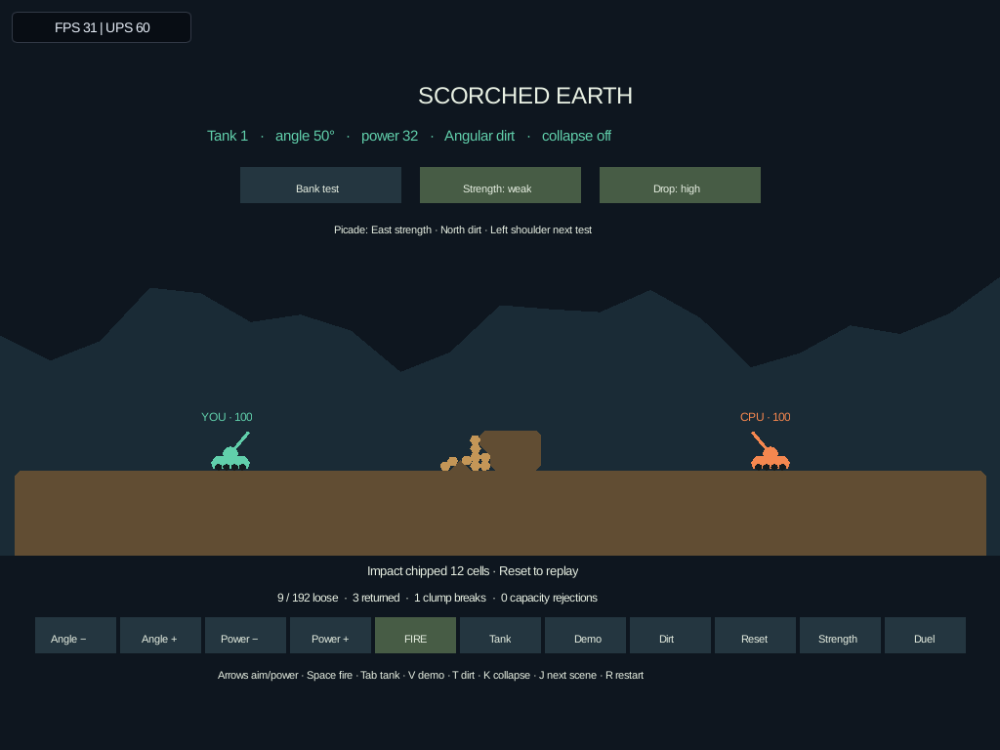
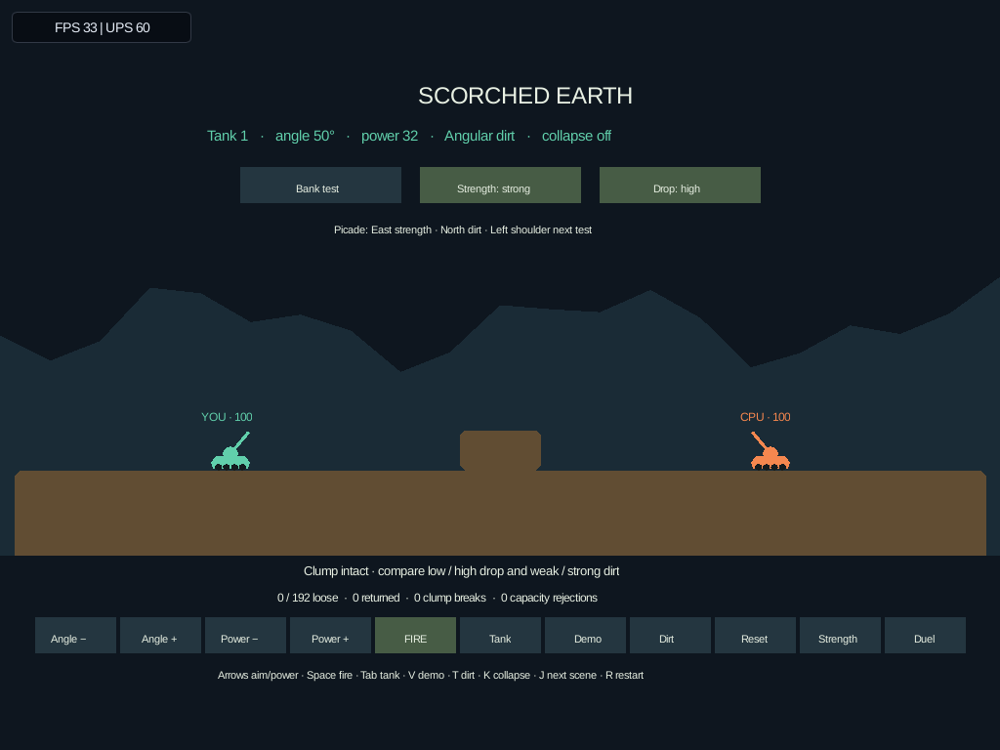

Live drop scenes submitted roughly 30–32 FPS at about 60 simulation updates/sec;
the broken bank submitted 25.5 FPS at 59.8 updates/sec with the existing 2× raster
scale. These short live samples include rendering; headless timing above does
not. The client SHA-256 is
`b3bd23221d4cbbc3d6586a1711031910213159866f562f408327efe54e9b6ecb`;
the installed CLI is
`970fb7c88423601fef4889226ba5d8f88fc258054b2e855c1375424ccee5fae5`.
The service is active with zero restarts. After timing, only drop-view labels
changed to show clump breaks/refusals and the Bank test button; the exact
presentation-only patch and final source hashes are retained in the run data.

## Undercut banks and strength

Choose **Bank test** (click **Hills**, hold Tab+T / left+top face, or press
J / left shoulder twice from the duel). The orange outline marks a support that
is cut after two seconds. The same 33 cells are released and ejected at every
strength; the retained bank receives no blast impulse. This fixture uses one-unit
cells so the ledge is visible at the normal camera scale.

**Strength** cycles **weak → strong → off** and resets the same fixture. In this
scene K / right face does the same thing; T / top face still changes Round/Angular
dirt. Weak strength releases four root cells as grains and the remaining 44 ledge
cells as one falling chunk. Strong strength holds the same 48-cell ledge. Off
keeps the ordinary connectivity-only behavior. The on-screen **Reset** replays
the current comparison; the host's Pause → Restart returns to launch defaults.

Strength is also available on the normal hills and barrage through the upper
button or Tab+K / left+right face. Surface **Collapse** and bank **Strength** are
independent experiments. Bank test initially disables surface shedding to isolate
cohesion. Normal launch defaults remain strength off and collapse off.

This is a bounded cantilever model, not a full soil stress solver: one-sided,
fully observed ledges up to 16 cells long and eight cells thick are considered.
Unknown geometry, arches supported at both ends, and dynamic fragments are
retained. Strength is uniform and separate from blast hardness. Actor weight,
centrifugal loading, fatigue, and solid-fragment merging are not modeled here.
The falling chunk remains an ordinary collidable terrain body; loose samples use
the existing settling/deposition path.

```sh
cargo run --locked --release -p scenario-scorched-earth --example scorched_benchmark -- \
  --undercut --cohesion weak --shape angular --seconds 15 --replay --diagnostics
# Repeat with --cohesion strong or off, and --shape round.
```

The [2026-10-06 results](data/dirt-cohesion-20261006.json) contain 30 benchmark
executions (60 scene results), with all 30 desktop/Picade pairs matching hashes.
All 20 Scorched replays and 807 core/scenario/client tests pass. With cohesion off,
all eight existing scene hashes per host match the pre-change binaries.

Picade whole-update timings below exclude rendering. Bank runs last 15 seconds;
barrage runs last 120 seconds (60 firing, 60 resting), with surface collapse on.
These are single samples, so small timing differences are measurement noise.

| Picade case | Round mean / P95 | Angular mean / P95 |
| --- | ---: | ---: |
| Weak bank, ledge falls | 0.882 / 2.437 ms | 1.028 / 2.509 ms |
| Strong bank, ledge holds | 0.530 / 1.684 ms | 0.544 / 1.760 ms |
| Existing barrage, strength off | 4.286 / 15.005 ms | 2.250 / 6.522 ms |
| Same barrage, weak strength | 4.302 / 15.270 ms | 2.269 / 6.682 ms |

The standard barrage and Spacewars runs did not produce eligible cantilever
failures at strength 500; they measure checking overhead. Spacewars match means
were 8.281 / 8.309 ms (Round / Angular) with strength off, versus 8.283 / 8.276 ms
with it enabled. The bank fixture exercises actual fracture. Its weak Angular
case still has 32 loose cells after 15 seconds, versus one for Round; the fallen
chunk stays solid, and existing packing limits can keep material loose. This
pass does not force deposits or merge solid fragments into the fixed field.

Per-second [diagnostic traces](data/dirt-cohesion-traces-20261006.jsonl.gz) include
cohesion load/resistance, failures, held checks, capacity denials and pending work.

The deployed Picade comparison is captured with [weak Angular strength](screenshots/dirt-cohesion/picade-bank-weak-angular.png),
[strong Angular strength](screenshots/dirt-cohesion/picade-bank-strong-angular.png),
and [weak Round strength](screenshots/dirt-cohesion/picade-bank-weak-round.png).
[Live checks](data/dirt-cohesion-picade-live-20261006.txt) showed 60 UPS and roughly
27–29 FPS at raster scale 2; these display timings include the existing render
cost and are separate from the headless table. The kiosk is left paused in a
fresh weak/Angular bank test, before its cut. Resume to watch it.

## Saturated craters and capacity — 2026-10-06

Scorched Earth and Spacewars now apply each blast's impulse to existing loose
dirt and solid fragments even when the new crater will not fit. Admission still
retains the entire refused material transfer: no partial crater, lost material,
new IDs or forced deposits. Accepted releases receive the impulse once as before.
Scorched tank damage and Spacewars mining keep their independent behavior.
The shared `LooseTerrain::commit` failure contract itself is unchanged; the
scenario applies the impulse separately at the existing lifecycle boundary.

`saturated_crater` fixtures fill the pool exactly, then repeat with one free
slot. They cover both shapes, nearby and distant grains, multiple impacts on
rotating Spacewars surfaces, material/ID conservation and clone continuation.
Both fixtures fail on the previous implementation and pass with the fix.
An additional Scorched case checks that accepted grains receive one impulse.
All 794 tests across the shared terrain/physics crates and three scenarios pass.
Strict Clippy for the shared crates and Scorched, format/diff checks, and native
and static AArch64 release builds also pass.

Both runners now report current `available_slots` and the most recent
`last_capacity_rejection: { requested, available }`, alongside settling reasons.
The refusal snapshot is historical: it need not equal current headroom.
For example, the Round/collapse-on seed-42 barrage first requests 39 grains
with 38 slots free, and later requests 33 with zero free. At 192 its final
18 loose grains are obstructed; at 256 its final 18 fail the collapse repose
rule. These are retained material, not missing cells.

**Keep the default at 192.** A 256-grain pool reduces refused releases in these
stress cases but does not eliminate them or solve blocked/repose-limited returns.
It increases Spacewars match cost and also costs more on the second seeded
Angular Scorched terrain. Capacity stays configurable for experiments; automatic
eviction or deposition through actors is not part of the policy.

[Full measurements](data/dirt-capacity-20261006.json) and
[per-second traces](data/dirt-capacity-traces-20261006.jsonl.gz) retain all
56 executions (26 desktop, 30 Picade), source/binary identities and audits.
All 40 Scorched runs pass a complete replay outside timing. Corresponding
desktop/Picade hashes agree across 48 configurations; repeated Picade
outcomes agree too. Loose-enabled runs conserve material and pass their audits.
No-refusal controls retain their previous hashes. The Round Scorched stress
case intentionally changes: disturbing the existing pile changes later contacts,
and at 192 refused blasts rise from three to six. This fix restores the physical
response; it does not promise fewer refusals at the same capacity.

Picade, seed 42, collapse on: Scorched runs 60 seconds of barrage plus 60 seconds
of rest; Spacewars runs 30 seconds of heavy asteroids every second. Each capacity
has three repetitions, with order alternated. Columns show **192 → 256**; mean
and P95 are medians of the run statistics, worst is the largest observed update.
Changing capacity changes later impacts and piles, so this is a whole-scenario
cost comparison rather than an equal-work microbenchmark. Combat and seed-42
Angular Scorched never use the extra slots; their small timing differences are
run variability. Profiling is off;
rendering, audits and replay are outside update timings.

| Scene | Shape | Mean (ms) | P95 (ms) | Worst (ms) | Refused blasts | Final loose |
| --- | --- | ---: | ---: | ---: | ---: | ---: |
| Scorched | Round | 4.292 → 4.363 | 15.273 → 15.305 | 44.894 → 47.158 | 6 → 1 | 18 → 18 |
| Scorched | Angular | 2.274 → 2.331 | 6.542 → 6.821 | 30.122 → 34.739 | 0 → 0 | 50 → 50 |
| Combat | Round | 1.040 → 1.018 | 3.554 → 3.449 | 11.211 → 10.392 | 0 → 0 | 35 → 35 |
| Combat | Angular | 1.887 → 1.841 | 6.719 → 6.580 | 30.290 → 26.913 | 0 → 0 | 1 → 1 |
| Match | Round | 8.591 → 9.562 | 19.979 → 24.419 | 53.981 → 51.604 | 2 → 1 | 104 → 156 |
| Match | Angular | 8.583 → 9.465 | 20.314 → 25.048 | 46.577 → 58.596 | 2 → 0 | 53 → 90 |

The existing collapse-off and loose-disabled controls also ran, plus Scorched
seeds 4242 and 777 on desktop. At seed 4242, Angular's refusals drop from three
to zero with 256, while its update mean rises from 0.386 to 0.451 ms; seed 777
and the other unaffected shape/configurations receive no additional releases.
Some Picade updates exceed 16.7 ms at either capacity. The kiosk was paused
before/after every headless measurement; temperature endpoints were 73.0–81.8°C,
CPU0 frequency endpoints 1.5 GHz and undervoltage alarms zero. These endpoints
do not describe every intervening clock change.

Reproduce the fixtures and capacity comparison with:

```sh
cargo +1.89.0 test --locked --profile ci -p scenario-scorched-earth -p scenario-spacewars \
  --lib saturated_crater
cargo +1.89.0 run --locked --release -p scenario-scorched-earth --example scorched_benchmark -- \
  --shape round --limit 256 --seconds 120 --bombardment-seconds 60 --slumping --replay --diagnostics
cargo +1.89.0 run --locked --release -p scenario-spacewars --example loose_terrain_benchmark -- \
  --limit 256 --seconds 30 --slumping --diagnostics
```

Repeat with `--limit 192`; use `--shape angular` for Scorched's other grain shape.
The Spacewars command includes both shapes and loose-disabled controls in both
combat and match. Omit `--slumping` for the collapse-off comparison.

The Yocto client build is deployed and verified on `sw-picade.local`.
Live checks cover Spacewars combat with loose dirt/heavy asteroids and both
Scorched shapes. The live Round barrage completes all 30 impacts without a
refusal on the launcher's current terrain; the seeded on-device benchmark and
saturated-crater fixtures exercise refused releases.
[Installed hashes, service state and live captures](data/dirt-capacity-picade-live-20261006.txt)
record the check. Combat settings are restored and a fresh Round/collapse-on
barrage is paused for review. PR #174 remains unchanged.

## Packing spike reduction — 2026-10-06

Spacewars' block terrain now queries all possible candidate cuboids in one
scan of current colliders. It retains every blocker per cell, then excludes
exactly the grains being retired by each alternative plan. Dropped grains
block again; unknown collider identities always block. Evidence lasts only
for that immutable packing query, including bodies moved before a physics
step. Final surface clearance remains independent. Matching also sorts its
fixed cell priorities once per assignment and reuses visited-grain storage
instead of repeatedly allocating search sets. Placement order, movement limits,
repose, the eight-plan/64-grain budgets and the 192-grain pool are unchanged.

Two new Spacewars fixtures preserve the difficult 27- and 37-grain block-terrain
queries. Together with the five existing Scorched comparisons, all seven reports
remain byte-identical before/after on desktop and Picade: 560 repeated inspections
across 14 host/case pairs. The larger Spacewars query's median enclosing packing
time on Picade is 24.433 → 6.394 ms; this includes inspector work. Production workloads
below have profiling disabled. New tests compare batched clearance with live
individual queries for every excluded subset, including rotated/offset colliders,
collision groups, sensors, disabled shapes, unflushed movement and replacements.
Unknown blockers and invalid query geometry stay conservative.

[Full record](data/dirt-packing-cost-20261006.json),
[workload traces](data/dirt-packing-cost-traces-20261006.jsonl.gz), and
[stage summaries with worst ticks](data/dirt-packing-cost-profiles-20261006.jsonl.gz)
record the immediately preceding deployed runtime and this pass's source/binary
identities. There are 36 unprofiled benchmark executions: 20 desktop and 16 Picade.
All 48 paired scene outcomes match, including final hashes and material/work
counters; corresponding desktop/Picade hashes agree. All 24 Scorched runs pass
full replay and conservation, and loose-enabled Spacewars retains material.
The 261 relevant tests, strict Clippy, format/diff checks, native/static-AArch64
release builds and Yocto client build pass.

Picade, seed 42, collapse enabled, 30-second Spacewars workloads. Each build
has three repetitions with build order alternated. Mean and P99 columns are
medians of the three run statistics; worst is the largest update over all three.
These timings exclude rendering and are not a maximum-latency guarantee.

| Scene | Shape | Mean before → after (ms) | P99 before → after (ms) | Worst before → after (ms) |
| --- | --- | ---: | ---: | ---: |
| Combat | Round | 1.063 → 1.006 | 7.081 → 5.597 | 24.756 → 13.896 |
| Combat | Angular | 2.436 → 1.823 | 48.467 → 14.218 | 125.404 → 27.058 |
| Match | Round | 8.312 → 8.278 | 31.523 → 30.173 | 64.685 → 51.852 |
| Match | Angular | 8.331 → 8.269 | 29.626 → 28.587 | 55.539 → 46.520 |

A separate profiled comparison isolates the same Angular combat tick, 1,593:
block-cell clearance falls from 56.425 → 0.486 ms, and enclosing packing from 87.725 → 20.091 ms.
These inclusive diagnostic spans are not included in the unprofiled table and
must not be added together. The remaining spike includes assignment work and
the ordinary physics step.

The large gain is in block-terrain combat packing. Match means remain close;
this is not a claim that every scene is substantially faster. Scorched's two
shapes and collapse-off controls also ran as single pairs on Picade, while
desktop adds Scorched seeds 4242 and 777. Their physical outcomes are unchanged.

Scorched, seed 42, 60 seconds of barrage plus 60 seconds of rest; these single
pairs also show why an isolated worst tick is not evidence of a universal speedup:

| Shape | Collapse | Mean before → after (ms) | Worst before → after (ms) | Final loose, unchanged |
| --- | --- | ---: | ---: | ---: |
| Round | Off | 1.180 → 1.185 | 29.247 → 27.341 | 0 |
| Round | On | 3.679 → 3.517 | 52.775 → 44.306 | 21 |
| Angular | Off | 1.445 → 1.435 | 21.358 → 27.598 | 0 |
| Angular | On | 2.290 → 2.267 | 29.096 → 27.204 | 50 |

The kiosk was paused before/after every measurement. Temperature endpoints were
71.1–81.3°C and CPU0 frequency endpoints 1.1–1.5 GHz; undervoltage alarms were zero.
The first baseline began at 1.1 GHz, and endpoints cannot rule out intervening
frequency changes. All repetitions are retained, including that slower run.
Angular combat's three baseline maxima span 93–125 ms, versus 24–27 ms after.
Some updates still exceed 16.7 ms, and full-match physics/rendering remains
separate work. Capacity is unchanged: the Round Scorched stress case still
retains material from three refused releases at the 192-grain limit.

The verified client is deployed to `sw-picade.local`. Live checks exercised
Spacewars' combat duel with loose dirt and heavy asteroids, followed by both
Scorched grain shapes with collapse and barrage enabled. Combat settings were
restored; a fresh Round/collapse-on barrage is left paused for review.
[Deployment and live samples](data/dirt-packing-cost-picade-live-20261006.txt)
record the installed hashes, service state and screenshots. PR #174 is unchanged.

## Destruction cost — 2026-10-06

Opt-in [stage timings](shared-loose-terrain.md#optional-stage-timings) identify
repeated surface reconstruction as a large part of Round's bombardment spikes:
about 27% of active update time in the Picade trace, and 35–36 ms on several
of its worst ticks. Collider publication is comparatively small. Block terrain
in Spacewars has a different hot path: repeated candidate-cell clearance.

The shared preview now reconstructs each owner's polygons once per immutable
field, and retains the unchanged source's clipped tiles across alternatives in
one packing query. Block-cell clearance also reuses results for the exact same
retiring grain group; omitted grains still become obstacles. The caches end
with the query. Patch order, clipping arithmetic, placement order, clearance,
repose, the eight-plan/64-grain bounds, and the 192-grain pool are unchanged.

The existing four Scorched snapshots, the tank-omitted comparison, and two
fresh Spacewars block-terrain captures produce byte-identical inspection
reports before/after. Each is repeated ten times per build on desktop; the five
Scorched comparisons are repeated on Picade too. The new regression revisits
overlapping proposals, chunk seams and field edges to check that proposed
geometry never contaminates the immutable source cache. All 259 relevant
tests pass, including actor movement, repeated blasts, conservation and replay.
Strict Clippy passes for terrain, Rapier and Scorched with `--all-targets
--no-deps -- -D warnings`; format and diff checks pass.

[Full record](data/dirt-performance-20261006.json),
[per-second workload traces](data/dirt-performance-traces-20261006.jsonl.gz), and
[per-second stage summaries with worst ticks](data/dirt-performance-profiles-20261006.jsonl.gz)
retain source/executable identities, commands and telemetry. There are 40 final
runner executions: 20 desktop and 20 Picade. Timings below have profiling off.
Both Scorched shapes have three paired Picade repetitions, with build/shape
order alternated; the table reports median run statistics and the worst
individual update over all repetitions. Scorched runs 60 seconds of barrage
plus 60 seconds of rest. All measured before/after outcomes match exactly,
including every paired material/work counter, final state hash, and corresponding
desktop/Picade hash. This pass changes cost, not which dirt returns to terrain.

Picade, seed 42, collapse enabled; times in milliseconds per update:

| Shape | Whole-run mean before → after | Bombardment P95 before → after | Worst update before → after | Final loose, unchanged |
| --- | ---: | ---: | ---: | ---: |
| Round | 3.904 → 3.501 | 26.264 → 19.987 | 64.490 → 50.353 | 21 |
| Angular | 2.267 → 2.168 | 9.088 → 7.547 | 41.023 → 32.337 | 50 |

The existing Spacewars combat/match runner uses 30-second workloads, including
loose-off controls. These are single pairs, so small differences are not a
replicated performance claim. Collapse-enabled Picade results:

| Scene | Shape | Mean before → after | P95 before → after | Worst update before → after |
| --- | --- | ---: | ---: | ---: |
| Combat | Round | 1.003 → 1.015 | 3.337 → 3.362 | 17.236 → 16.240 |
| Combat | Angular | 2.373 → 2.368 | 6.440 → 6.367 | 98.203 → 95.028 |
| Match | Round | 8.438 → 8.050 | 18.230 → 17.277 | 55.330 → 49.258 |
| Match | Angular | 8.498 → 8.063 | 20.613 → 18.367 | 50.662 → 39.315 |

The kiosk was paused before/after each Picade run. Temperature endpoints were
79.4–82.3°C; CPU0 reported 1.5 GHz and undervoltage alarms were zero.
These endpoint readings cannot exclude intervening thermal throttling. The
measurements exclude rendering and do not establish rendered 60 FPS. Rare
packing spikes remain, particularly in Spacewars' Angular block-terrain case.

Capacity also remains separate from CPU headroom: Round seed 42 still refuses
three terrain releases at 192 grains, retaining their material. A separate
desktop 256-grain probe reduced that to one refusal, but mean update cost rose
from 0.358 to 0.437 ms (about 22%) against the optimized 192-grain workload.
Its changed trajectories also leave 18 rather than 21 grains. Increasing the
pool is not part of this deployment; the raw probe is in the measurement record.

The client and CLI were deployed to `sw-picade.local` and their hashes verified.
Live checks exercised Round through a full barrage and quiet tail, plus Angular
impacts. The device is left paused on a fresh Round/collapse-on barrage.
[Deployment and live samples](data/dirt-performance-picade-live-20261006.txt)
record the installed build and service state. PR #174 remains unchanged.

## Packing around actors — 2026-10-04

A small crater exposes a missed placement: the previous recovery could return
only two of three grains beside an actor, although exhaustive enumeration finds
room for all three. Recovery now spends unused search budget on narrower
exclusions around a blocked surface tile, keeping its earlier valid plan as a
fallback. Both smooth surfaces and grain shapes accept all three in the flat
and planetary-gravity tests. The eight-plan ceiling and movement limits remain
unchanged. Repeated identical surface checks within that query are reused;
final simulation hashes match the version without that reuse.

The tests also cover the opposite case: a narrow bay physically holds the
contact proxies but has no legal whole-cell placement, even for a subset. Those
grains remain loose. Moving the enclosing obstacles clears the space. Separate
simulation tests exercise a blocked grain returning after an actor moves, with
retained damage and cloned replay, for both shapes, all three surfaces and flat
or planetary gravity. Together with the existing game tests, 254 tests pass.
Strict Clippy passes with `--no-deps` for shared physics and Scorched; including
dependencies encounters an existing `nonminimal_bool` in unchanged
`engine-terrain/src/additions.rs`.

The [frozen inspector](shared-loose-terrain.md#frozen-packing-inspection--172) now
supports `--omit-body` and marks which attempted plan was actually selected.
The captured 50-grain Angular pile still accepts zero with tank 11 present,
and all 50 when that tank alone is omitted. That comparison proves the tank
influences the result; it does not prove there is no valid tank-present packing.
Large dense piles remain a limit of this bounded search.

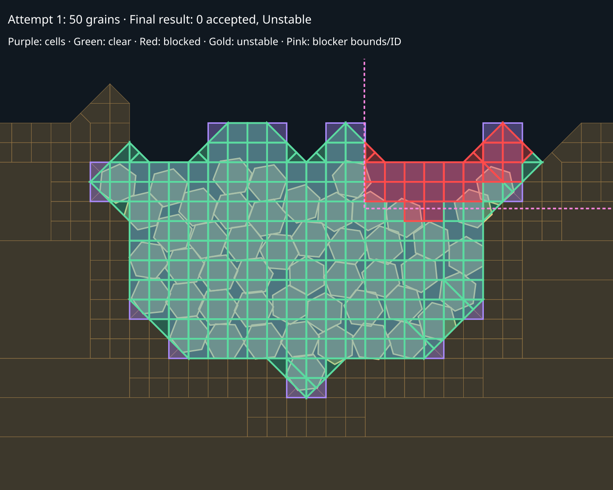

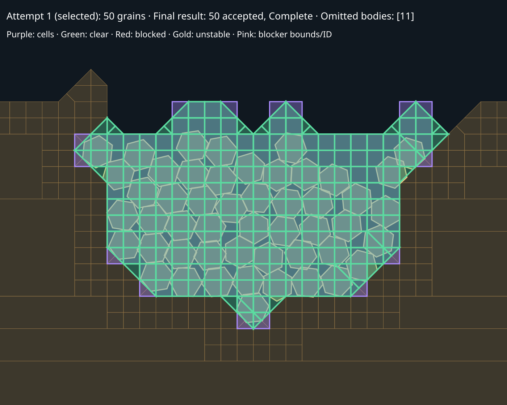

The baseline below is the immediately preceding supported-frontier/retry-cache
pass, rather than the older PR baseline. Desktop collapse-enabled loose counts:

| Seed | Round before → after | Angular before → after |
| --- | ---: | ---: |
| 42 | 17 → 21 | 85 → 50 |
| 4242 | 78 → 42 | 134 → 134 |
| 777 | 35 → 35 | 46 → 46 |

Small-case improvements do not guarantee better whole-scene outcomes: an earlier
deposit changes subsequent contacts and shell impacts. The Round seed-42 result
regresses, while Angular seed 42 and Round seed 4242 recover more space. All six
revised runs stop releasing further bank cells in their final 30 seconds.

[Full measurement record](data/dirt-actors-20261004.json) and
[per-second traces](data/dirt-actors-traces-20261004.jsonl.gz) retain 32 final paired
runner executions, source/executable hashes, and the separate comparison before
within-query reuse. These are single before/after workload runs, not repeated
performance distributions. Scorched uses 60 seconds of barrage plus 60 seconds
of quiet; Spacewars uses its existing 30-second combat and match cases.

Picade, seed 42, collapse enabled; times exclude rendering:

| Scorched shape | Loose before → after | Mean update ms before → after | P95 ms before → after | Quiet-tail mean ms before → after |
| --- | ---: | ---: | ---: | ---: |
| Round | 17 → 21 | 3.067 → 4.048 | 9.784 → 12.792 | 0.369 → 0.548 |
| Angular | 85 → 50 | 2.422 → 2.377 | 6.839 → 6.918 | 1.139 → 1.010 |

Round takes about 32% more average update time in this changed workload. Angular
returns more dirt with similar cost. This is not a general performance win.

Spacewars Picade results (the record also includes unchanged loose-off controls):

| Scene | Shape | Collapse | Loose before → after | Mean update ms before → after | P95 ms before → after |
| --- | --- | --- | ---: | ---: | ---: |
| Combat | Round | On | 35 → 35 | 1.063 → 1.055 | 3.425 → 3.470 |
| Combat | Angular | On | 1 → 1 | 2.404 → 2.461 | 6.734 → 7.307 |
| Match | Round | On | 104 → 104 | 8.437 → 8.431 | 20.119 → 20.107 |
| Match | Angular | On | 58 → 53 | 7.664 → 8.549 | 18.170 → 20.861 |
| Match | Angular | Off | 45 → 6 | 6.879 → 6.115 | 17.027 → 16.220 |

The kiosk was paused before/after each measured run. Temperature endpoints were
72.5–79.9°C, CPU0 reported 1.5 GHz and undervoltage alarms were zero. Endpoint
readings cannot exclude intervening throttling. All Scorched runs conserved
material and passed full replay; corresponding desktop/Picade final hashes
matched in both games. One completed runner was excluded after a transient DNS
failure prevented its post-run check; that final pair was rerun successfully.
Enabled-grain trajectories can change with collapse off as well as on. Collapse
remains optional, and these physics timings do not establish rendered 60 FPS.

The new client and CLI were deployed to `sw-picade.local`, with installed hashes
verified and the kiosk active with zero restarts. In the live Round check,
Rest 28s showed 47 loose grains, 922 returned cells, 30 impacts and zero capacity
rejections. The Angular barrage was checked too. These live captures are not
the headless seed-42 workload. Rendering remains a separate limit: the captures
show 32 FPS / 60 UPS at Round rest and 16 FPS / 56 UPS during Angular impacts.
[Deployment and live samples](data/dirt-actors-picade-live-20261004.txt) record the
fresh Round/collapse-on barrage left paused for review. PR #174 remains unchanged.

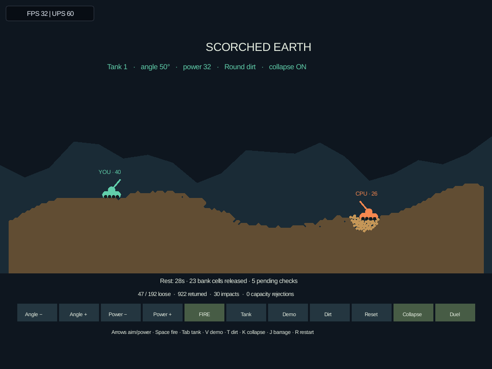

## Stable piles and retry cost — 2026-10-04

The next working-tree pass builds recovery proposals from cells that already
satisfy the collapse slope rule, then validates the complete added surface as
before. The frozen Round case now accepts 32 of 34 grains and the Angular case
accepts all 48, where both previously exhausted eight surface checks without a
deposit. Movement limits, the 64-grain allowance and the eight-check ceiling are
unchanged. Successful ordinary placements keep their original order.

Unchanged failed plans can also reuse their rejection instead of rebuilding the
same surface every half-second. Exact current collision dependencies, terrain
revision, gravity samples, group order and recovery eligibility all participate
in this check. Moving or removed blockers reopen the search. Successful plans
always run fresh clearance queries. [Shared behavior and counters](shared-loose-terrain.md#ownership-and-the-tick-boundary).

[Raw measurements and source/binary identities](data/dirt-stability-20261004.json)
and [per-second traces](data/dirt-stability-traces-20261004.jsonl.gz) retain 32
runner executions: 20 desktop and 12 Picade. The baseline is packing runtime
`5d02c6d`; the candidate is the uncommitted follow-up on `52f9e18`, identified by
the source manifest. These are single paired runs, with three desktop Scorched
seeds and seed 42 repeated on the Picade. Scorched uses 60 seconds of barrage and
60 seconds of quiet; Spacewars uses its existing 30-second combat/match cases.

Picade, collapse enabled, seed 42; times are milliseconds per physics update:

| Shape | Loose before → after | Mean before → after | P95 before → after | Quiet-tail mean before → after |
| --- | ---: | ---: | ---: | ---: |
| Round | 63 → 17 | 5.635 → 3.142 | 27.924 → 9.722 | 2.639 → 0.390 |
| Angular | 48 → 85 | 4.663 → 2.539 | 16.546 → 7.005 | 2.180 → 1.217 |

This is about 44–46% less average update time in these two runs. During their
quiet tails, 201 Round and 205 Angular group retries reused an unchanged failure.
Worst individual steps still reach 63.824 ms and 41.229 ms respectively. These
measurements do not include rendering. The kiosk was paused before/after each
run; endpoint temperatures ranged from 76.4–82.8°C, CPU0 read 1.5 GHz and the
undervoltage alarm read zero. Endpoint readings cannot rule out intervening
thermal throttling, so this is an observed device comparison rather than a
controlled-clock microbenchmark.

Desktop collapse-enabled final loose counts show why this remains an experiment:

| Seed | Round before → after | Angular before → after |
| --- | ---: | ---: |
| 42 | 63 → 17 | 48 → 85 |
| 4242 | 156 → 78 | 158 → 134 |
| 777 | 36 → 35 | 70 → 46 |

All six desktop cases cost less on average, and none releases more material
during its final 30 seconds. More loose grains in one case can still be more
expensive for contacts or reduce pool headroom; fewer packing retries alone do
not resolve every placement problem.

Spacewars consumes the same changes. Its Picade collapse-enabled results are:

| Scene | Shape | Loose before → after | Mean update ms before → after |
| --- | --- | ---: | ---: |
| Combat | Round | 35 → 35 | 1.086 → 1.129 |
| Combat | Angular | 72 → 1 | 2.638 → 2.566 |
| Match | Round | 66 → 104 | 9.217 → 9.021 |
| Match | Angular | 92 → 58 | 11.431 → 8.266 |

Its sampled work counters report no reused failures: exact motion invalidates
that evidence in these moving scenes. Supported recovery still changes packing,
with mixed outcomes. Collapse stays off by default.

Collapse-off state hashes are identical before/after in both games. All Scorched
runs conserve their starting material and pass full replay; corresponding
desktop/Picade hashes match in both games. Validation passed 126 shared-physics,
33 terrain, 61 Terrain Lab, 9 Scorched, 18 Spacewars terrain and 3 actor tests.
The actor checks cover walking, landing and flag destruction/reclaim in both
shapes and collapse settings. New tests compare memoized and uncached simulation
state and exercise blocker removal/movement, shape replacement, gravity changes,
terrain edits, cloning, stable additions and retained cell damage.
Strict Clippy passes for `engine-rapier` and Scorched Earth on Rust 1.94. The
broader Spacewars invocation reports ten existing lint findings in unchanged
files, including `unnecessary_unwrap`, `collapsible_if`, and
`field_reassign_with_default`; that strict check is not green. Rust 1.89 formatting
and release builds for desktop, AArch64 and the Yocto client pass.

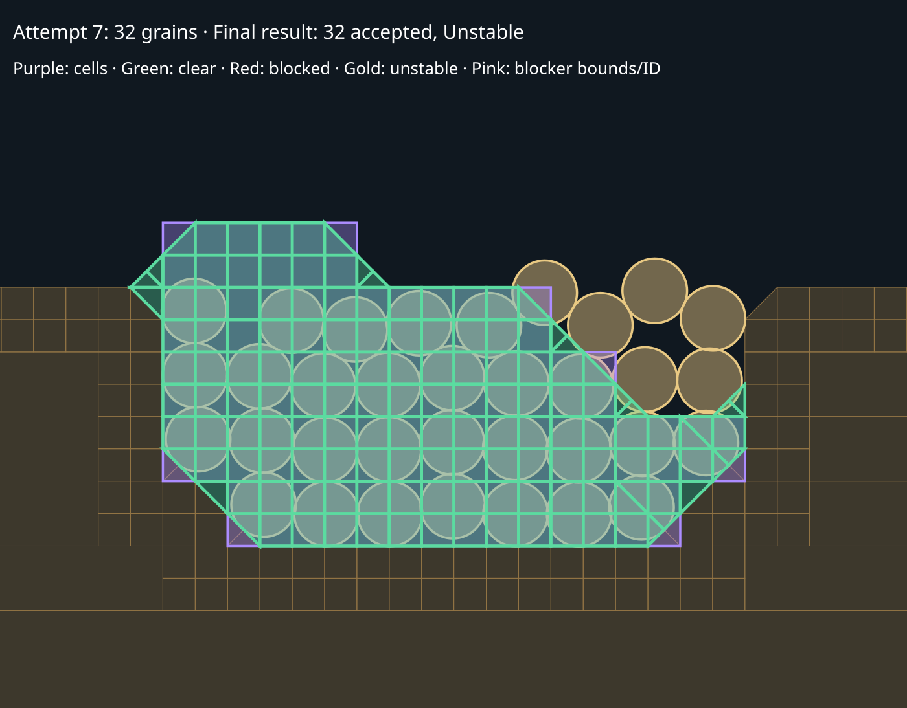

The candidate was deployed to `sw-picade.local` and exercised through a complete
Round barrage/quiet tail and an Angular barrage, both with collapse enabled.
The different live hills retained 87 loose grains at Rest 28s, with 903 returned,
30 impacts and no capacity rejections. The existing 2× raster renderer remains
well below 60 submitted frames/sec during these checks; simulation-update
improvements alone do not resolve rendering cost.
[Live samples and exact deployed hashes](data/dirt-stability-picade-live-20261004.txt)
record the active kiosk with zero restarts. The device was left paused at a fresh
Round/collapse-on barrage for review.

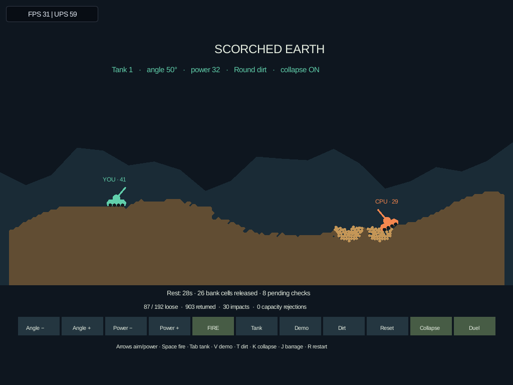

## Packing recovery measurements — 2026-10-04

[Full before/after runs and binary hashes](data/dirt-packing-20261004.json) and
[per-second traces](data/dirt-packing-traces-20261004.jsonl.gz) cover 54 executions.
The comparison is PR #171 runtime `b1c6a58` versus packing runtime `5d02c6d`, with
Rust 1.89.0/release and the same seed-42, 60-second barrage plus 60-second tail.
Desktop Scorched values use three serial repetitions; Picade and other benchmark
timings are single-run comparisons. The kiosk was paused during device timing.

After #171 merged, this work was rebased onto `main` at `08e730f`; its runtime
commit is now `e0a262a`. The shared physics/terrain crates and the Scorched Earth,
Spacewars, and Terrain Lab source trees are unchanged by that rebase. These
measurements and the Picade deployment retain their original build revisions
and binary hashes.

Successful ordinary placements are preserved. A failed group that remains quiet
for 1.5 seconds can try bounded alternative cells; an eight-surface-check limit
caps work for that group. With collapse enabled, new deposits must also satisfy
its local gravity/repose rule. That prevents a deposit/release cycle, but changes
which piles can pack. [Shared-layer details and frozen inspection commands](shared-loose-terrain.md#frozen-packing-inspection--172).

Picade whole physics-update measurements, milliseconds; all rows conserve 10,393
cells and pass full replay with hashes matching the desktop:

| Shape | Collapse | Loose before → after | Mean before → after | P95 before → after | Quiet-tail mean before → after |
| --- | --- | ---: | ---: | ---: | ---: |
| Round | Off | 36 → 0 | 2.429 → 1.222 | 9.340 → 4.418 | 0.871 → 0.203 |
| Angular | Off | 52 → 0 | 2.602 → 1.475 | 8.745 → 5.065 | 1.386 → 0.103 |
| Round | On | 0 → 63 | 2.690 → 5.591 | 9.740 → 27.756 | 0.163 → 2.596 |
| Angular | On | 163 → 48 | 5.152 → 4.461 | 20.082 → 15.516 | 4.805 → 2.061 |

The collapse-off desktop means also improve: Round 0.223→0.112 ms and Angular
0.252→0.138 ms. Standard packing is better in these scenes; collapse remains a
mixed experiment. Round/collapse regresses, and the new collapse-on tails retain
grains whose recovery searches hit their work limit. It would be incorrect to
call this complete settling for all scenes or a general performance win.
Worst Picade steps still reach 36.445 ms (Round/off), 32.616 ms (Angular/off),
73.145 ms (Round/on), and 65.846 ms (Angular/on). These are physics-update costs,
not rendered frame timings, and no 60-fps guarantee follows from the mean.

Spacewars uses the same recovery planner. In its 30-second three-planet match,
collapse-off leftovers improve from 105→64 Round and 87→45 Angular; ordinary
combat retains 26 and 17. With collapse on, combat changes 66→35 Round and 9→72
Angular, while the match changes 110→66 and 48→92. All retain their material and
match desktop/Picade hashes. Existing terrain, fragment, mining, impact, and
Spacewars terrain runners preserve all non-timing results in 22 desktop cases;
the eight repeated-edit/Spacewars terrain cases also match on the Picade.

The captured regression below isolates packing around a tank and excluded grains.
Its original shrinking plan accepted none; the bounded recovery accepts 22 of
64 without expanding through another body. The first attempted surface is shown
above the later accepted subset. Pink boxes
identify blockers; the actual added polygons determine clearance.

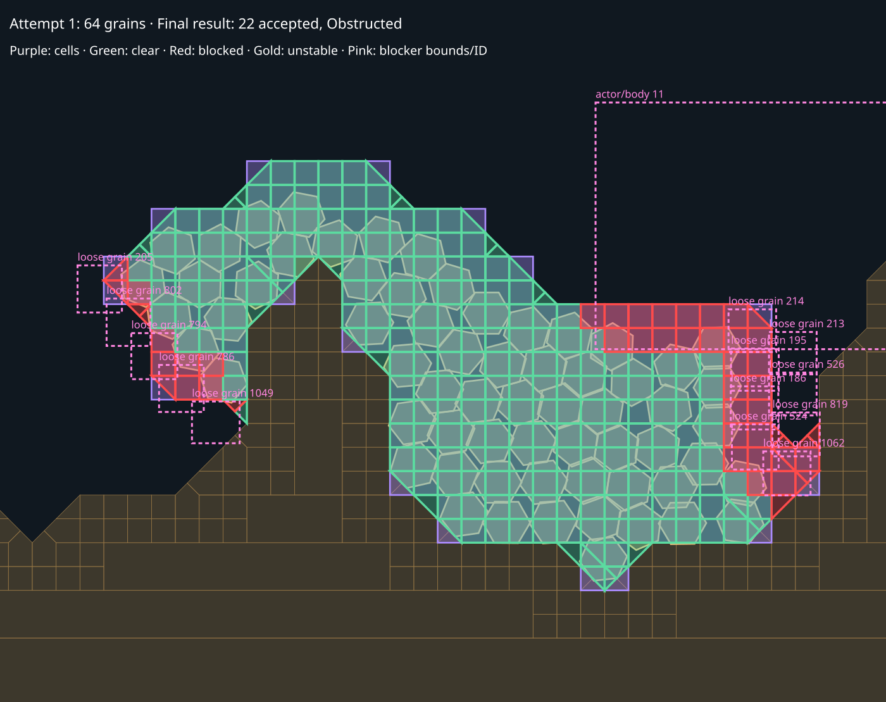
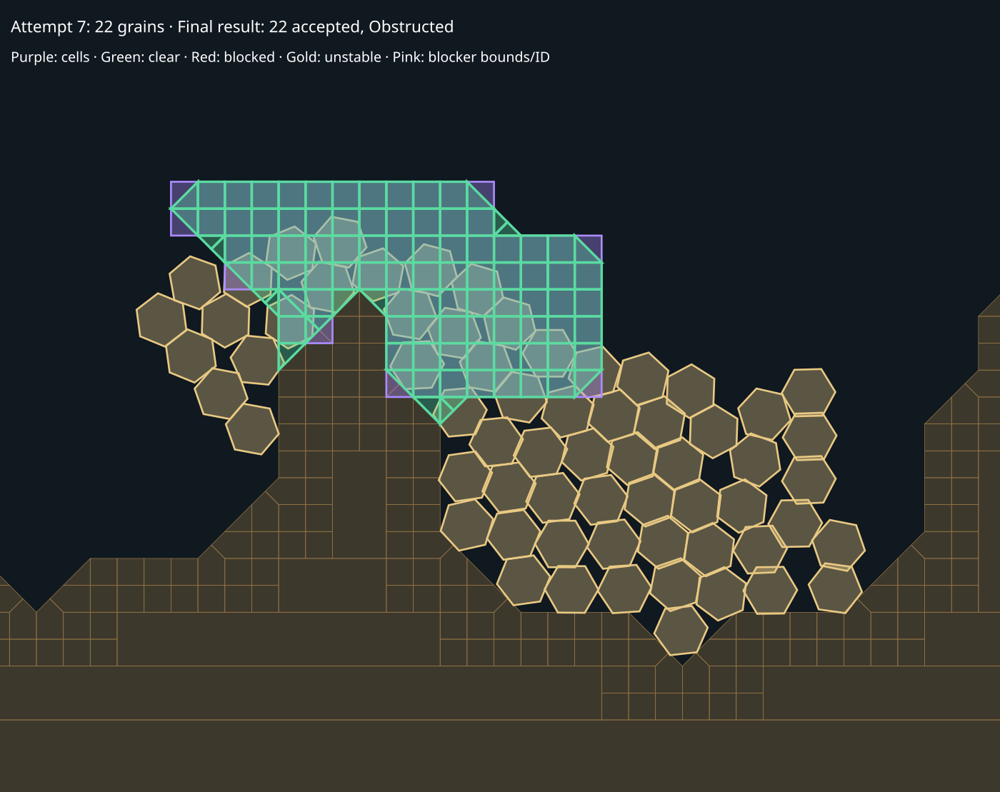

Remaining work is better search under the repose constraint and fewer repeated
checks of unchanged blocked piles. Keep the current work and grain limits while
using the frozen cases to distinguish genuine lack of room from search failure.

Runtime `5d02c6d` was deployed to `sw-picade.local` for this comparison. The live check exercised both
shapes, collapse on/off, a complete barrage, ordinary firing, and restart with
the existing 2× raster renderer. Its different hills retained four loose grains
18 seconds into the quiet tail; complete recovery above is a benchmark result,
not a promise for every scene. [Live status samples and deployed hashes](data/dirt-packing-picade-live-20261004.txt).
The device was left paused at a fresh Angular/collapse-off barrage for review.

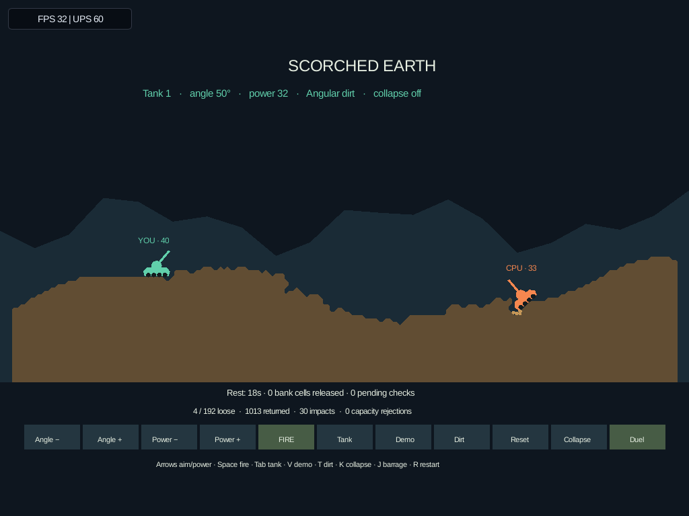

## Collapse measurements — 2026-10-04

[Raw data, binary hashes and paused-device checks](data/dirt-slumping-20261004.json)
and [per-second diagnostic traces](data/dirt-slumping-traces-20261004.jsonl.gz)
retain 35 runner executions from runtime `b1c6a58`, with pre-slumping comparison
source `9327948`. Both use Rust 1.89.0/release/fat LTO; the Pi runner uses the static
CRT command below. Scorched Earth runs seed 42 for 120 seconds: 60 seconds of
bombardment and 60 seconds of rest, with full replay. Desktop values are medians
of three serial runs (worst is the largest step); Picade values are single-run
smoke measurements. All times are milliseconds per simulation update.

| Host | Dirt | Collapse | Runs | Mean | P95 | Worst | Tail mean | Final loose |
| --- | --- | --- | ---: | ---: | ---: | ---: | ---: | ---: |
| Desktop | Round | Off | 3 | 0.226 | 0.879 | 5.043 | 0.087 | 36 |
| Desktop | Round | On | 3 | 0.247 | 0.805 | 6.719 | 0.015 | 0 |
| Desktop | Angular | Off | 3 | 0.252 | 0.793 | 3.687 | 0.142 | 52 |
| Desktop | Angular | On | 3 | 0.518 | 2.313 | 5.831 | 0.501 | 163 |
| Picade | Round | Off | 1 | 2.261 | 8.249 | 40.745 | 0.824 | 36 |
| Picade | Round | On | 1 | 2.543 | 8.597 | 54.996 | 0.152 | 0 |
| Picade | Angular | Off | 1 | 2.491 | 7.668 | 28.936 | 1.329 | 52 |
| Picade | Angular | On | 1 | 4.946 | 19.436 | 47.022 | 4.628 | 163 |

All four modes conserve 10,393 cells and reproduce their final hashes on desktop
and Picade. Round with collapse sheds 45 bank cells, returns 1,030 cells in total
(including cells released more than once), and finishes with no loose material.
Angular sheds 23 bank cells, returns 801, and finishes with 163 obstructed grains
and nine pending bank checks. It rejects one impact; the other modes reject none.
Neither enabled mode releases further bank cells in the final 30 seconds. Angular
therefore exposes a packing/clearance stall rather than perpetual yielding. The
48-cell shedding ceiling defers 412 Round and 920 Angular transactions across the
run; those are retry counts, not material loss.

This is useful visual and diagnostic progress, **not a general performance or
settling win**. Angular's Picade P95 exceeds the 16.7 ms update budget; peak steps
reach 55 ms even for Round. Changed terrain also changes subsequent impacts and
contacts, so these are whole-workload comparisons, not isolated grain-shape costs.
Collapse remains off by default. Next tuning should address obstructed angular
packing and impact/edit spikes without growing the grain budget or deleting dirt.

Spacewars' existing 30-second combat/match runner also conserves material with
both shapes and both settings. In the combat case, collapse changes final loose
counts from 26→66 (Round) and 17→9 (Angular); in the match case, 105→110 and 87→48.
Its Picade mean/P95 changes from 0.581/2.038→0.713/2.201 ms for Round combat,
1.172/4.539→0.965/3.514 for Angular combat, 7.671/17.957→7.214/15.947 for Round
match, and 7.330/18.287→8.992/19.022 for Angular match. These single runs reinforce
that the tradeoff depends on the evolving scene. Full rows and diagnostics are
in the raw data; these timings exclude frame rasterization.

With collapse disabled, all non-timing results match the pre-change build in
28 desktop cases across repeated edits, fragments, mining, impacts, existing
Spacewars terrain and loose-terrain benchmarks. The eight repeated-edit and
Spacewars terrain cases repeated on the Pi also match. Single-run timing noise
prevents a strong unchanged-performance claim. Pi temperature endpoints span
70.1–76.9°C, reported CPU0 frequency stays at 1.5 GHz, and undervoltage reads zero;
endpoint probes do not exclude intervening throttling. The kiosk stayed paused.

Validation passed: 120 engine-rapier tests, 61 Terrain Lab tests, nine Scorched
Earth tests, 18 Spacewars terrain tests, three actor/flag lifecycle tests with
collapse both on and off, three client tests, and the display test on both
renderers. Strict Clippy for engine-rapier/Scorched Earth and workspace formatting
passed. Bank tests cover local gravity, source motion, damage conservation,
fragment/pool admission, bounded tracking, clone continuation and a quiet tail.

## Current Picade review build

Runtime `b1c6a58` is deployed to `sw-picade.local`, verified after the live checks
with service PID 2346, active state and zero restarts. Client SHA-256:
`9bf8925b0672c6e8151394ecbb164c6c8ce43ec03b37927e9c22f52d07bcf3f1`;
CLI SHA-256: `970fb7c88423601fef4889226ba5d8f88fc258054b2e855c1375424ccee5fae5`.

The live pass exercised both shapes, collapse and barrage, a completed barrage
and resting tail, return to the ordinary duel, and host restart. It leaves a
fresh **Round / collapse on / barrage** comparison paused; Resume starts it.
Changing shape/collapse restarts the same scenario seed. Host Restart restores
the defaults. [Paused review state](screenshots/scorched-earth/picade-collapse-ready.png)
and [return to the ordinary duel](screenshots/scorched-earth/picade-collapse-off-duel.png)
are captured too.

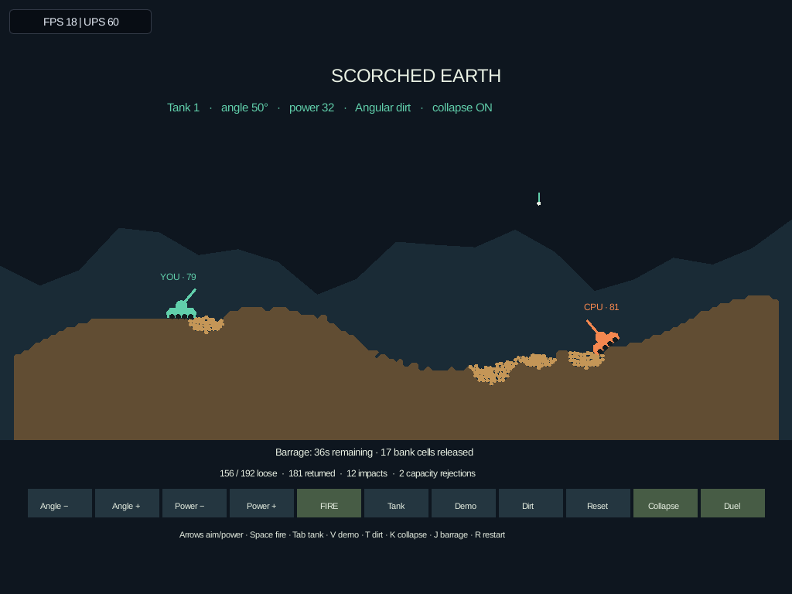

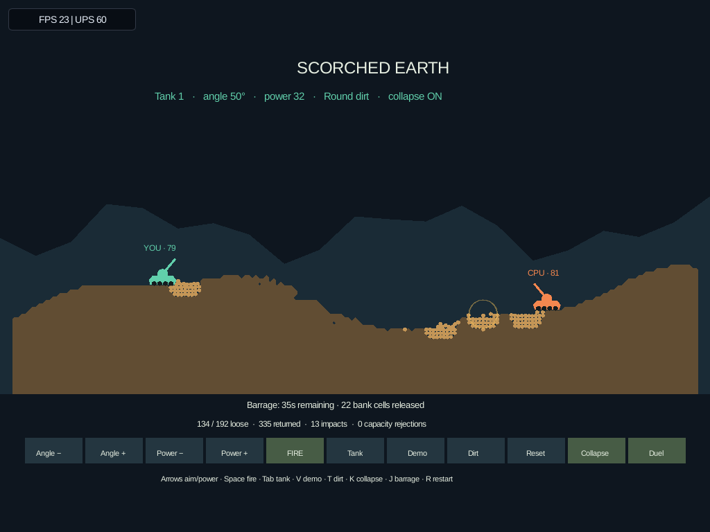

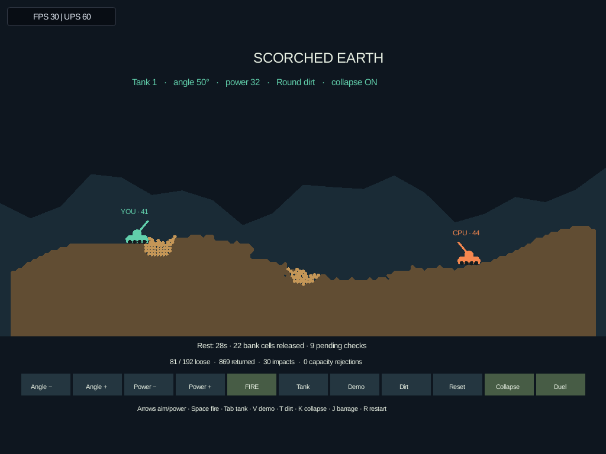

The live smoke run uses launcher-selected terrain, without pinning the headless
benchmark seed. It still has 81 loose cells after 28 seconds of rest: complete
settling is not a general result. The existing 2× raster setting is retained;
[three live status snapshots](data/dirt-slumping-picade-live-20261004.txt) report
17.9, 19.4 and 28.3 submitted FPS during Angular fire, Round fire and Round rest,
respectively, at 59.6–60.1 simulation updates/sec. These short snapshots
include rendering and are distinct from headless timings. Rendering and blocked
packing both remain follow-up work.

## Shared mechanics

The scenario owns hills, gravity, tanks, shell trajectories, health and controls.
It calls the existing [shared loose-terrain layer](shared-loose-terrain.md):

1. A shell sweeps through the canonical physics world each fixed update, so
   fast shots collide with terrain, tanks and loose grains.
2. At impact, `PreparedRelease` plans the affected fields before changing them.
   Admission covers the complete event. `LooseTerrain::commit` transfers removed
   cells into conserved grains and detached material fields.
3. `RadialImpulse` throws nearby loose material and kicks tank hulls. Rapier
   supplies gravity and contact response in the same world as the terrain.
4. `LooseTerrain::settle` returns eligible quiet groups to existing terrain
   through the ordinary deposit boundary. Published geometry and collision
   shapes update together, with actor clearance checked by the shared layer.

There is no second soil solver or Scorched-specific deposition algorithm. New
improvements to the shared layer can benefit this scene, the lab and Spacewars.
The flat scene is also a small consumer to exercise before adding the Clock
event in [#132](https://github.com/aortez/space-wars/issues/132).

The default pool is 192 grains; the headless runner accepts 1–512. Detached fields
are capped at 64. A release that cannot fit is rejected atomically and reported
on screen. Existing material is retained, including offscreen dirt. Combat damage
and tank knockback still apply, so a full pool does not make tanks invulnerable.

This is bounded rigid-grain behavior, not a calibrated soil model. Whole-cell
deposition can leave ledges, a settled pile may remain loose, and sustained fire
can exhaust the pool. Cohesion, stress-based slope failure, shock propagation, compression,
fluids and napalm remain later work. Tank traction/driving, weapons, sound and
broader round progression are also outside this first slice.

## Repeatable development

```sh
cargo test --locked --profile ci -p scenario-scorched-earth
cargo test --locked --profile ci -p engine-client --bin engine-client \
  client_scenarios::scorched_earth
cargo test --locked --profile ci -p scenario-spacewars deposited_flag_footing

cargo run --locked --release -p scenario-scorched-earth \
  --example scorched_benchmark -- --shape angular --seconds 30 --seed 42 --replay
cargo run --locked --release -p scenario-scorched-earth \
  --example scorched_benchmark -- --shape round --seconds 30 --seed 42 --replay

SPACEWARS_KEEP_FUNCTIONAL_ARTIFACTS=1 xvfb-run -a \
  cargo test --locked --profile ci -p engine-client --test ui_control_functional \
  scorched_earth_launch_pause_restart_and_both_renderers -- --ignored --nocapture
```

The duel runner emits JSON with whole-step mean/P95/maximum time, body/contact
and grain peaks, shots, impacts, rejected releases, deposition and material
balance. Audits, observation hashing, replay and rendering are outside the timer.
`--replay` repeats the full seeded run and compares observation hashes every
second. The result describes this workload; it is not a rendered FPS claim or a
guarantee of cross-platform physics lockstep. After a tank loses, existing shells
and material continue simulating but the tanks stop firing; a longer duration
therefore measures the same duel followed by settling, not endless combat.

Simulation tests cover both grain shapes, repeated release/deposition, clone
continuation, capacity rejection, loss of tank support, fast swept shells, reset,
bad input and the full `u64` seed range. Client tests cover keyboard/controller
parity, disconnection, narrow-window framing and both render paths. The display
test launches, fires, verifies visible displaced dirt, pauses, restarts and
returns to the launcher on both renderers.

The accompanying Spacewars regression completes the flag lifecycle from #51:
claim a deposited footing, blast it away, observe neutralization, let material
return, then require a fresh full claim. Returning dirt never restores ownership
by itself. Both Round and Angular exercise that path.

## Initial Picade deployment and presentation

The scene was deployed and exercised on `sw-picade.local` on 2026-10-04. Live
checks covered launcher selection, both grain shapes, repeated firing, taking
control of the second tank, aim/power, Demo, pause and restart. The final device
state is a fresh Angular round in the pause menu, with Demo off. The service was
healthy with zero restarts after deployment.

Runtime source is `43d1128`. The deployed client SHA-256 is
`e892a13133466a97f8bae911fb45e029a096acc57599cf67e25d701aa31731a3`;
the CLI is `970fb7c88423601fef4889226ba5d8f88fc258054b2e855c1375424ccee5fae5`.
The client was built before committing those sources, so its embedded revision
is `83a0fca0604c-dirty`; the deployed binary hash is the exact identity used for
these live checks.

The [live timing snapshot](data/scorched-earth-picade-live-20261004.txt) reports
26.1 submitted FPS and 59.9 simulation updates/sec at a 1024×768 viewport with
the existing **2× raster scale** (2048×1536 internal image). Its 120-sample window
averages 6.13 ms of simulation per callback (2.08 updates/callback), 1.01 ms of
scene creation and 16.16 ms of render preparation; these units differ from the
one-update headless measurements. Detailed KMS profiling was enabled on the
device. The screenshots and CLI checks are a short live smoke run, not a
steady-state rendered benchmark. This scene does not yet achieve 60 rendered
frames/sec with these settings; rendering and impact spikes remain work to do.


## Simulation baseline — 2026-10-04

[Raw results and build/host metadata](data/scorched-earth-20261004.json) retain all
16 runs. Both executables use Rust 1.89.0, release/fat LTO and one codegen unit
from source `43d1128`. Desktop is a Ryzen 7 9800X3D; the Picade is a Raspberry Pi
4 Model B Rev 1.4. The AArch64 runner uses static CRT linkage:

```sh
cargo +1.89.0 build --locked --release -p scenario-scorched-earth \
  --example scorched_benchmark
RUSTFLAGS='-C target-feature=+crt-static' cargo +1.89.0 build --locked --release \
  --target aarch64-unknown-linux-gnu -p scenario-scorched-earth --example scorched_benchmark
```

Each run simulates 30 seconds at 60 Hz with a 192-grain budget and replay enabled.
Seed 42 has three repetitions per host/shape, alternating Round/Angular order;
seed 4242 has one per host/shape. Runs are serial. The table reports the median
of run means and P95s, and the worst individual step across repetitions, all in
milliseconds. The one-run seed 4242 values are smoke measurements.

| Host | Seed | Shape | Runs | Mean | P95 | Worst step |
| --- | --- | --- | ---: | ---: | ---: | ---: |
| Desktop | 42 | Round | 3 | 0.266 | 0.720 | 4.922 |
| Desktop | 42 | Angular | 3 | 0.409 | 1.181 | 5.061 |
| Desktop | 4242 | Round | 1 | 0.396 | 1.430 | 4.391 |
| Desktop | 4242 | Angular | 1 | 0.471 | 1.958 | 4.008 |
| Picade | 42 | Round | 3 | 2.862 | 7.556 | 41.958 |
| Picade | 42 | Angular | 3 | 4.128 | 11.366 | 40.352 |
| Picade | 4242 | Round | 1 | 4.152 | 12.405 | 37.146 |
| Picade | 4242 | Angular | 1 | 4.738 | 16.374 | 35.040 |

The kiosk remained paused throughout the retained Picade runs, verified before
and after every run. Earlier measurements with an idle launcher were discarded:
its 30-second autostart policy could add bot-game load. Target temperature
endpoints were 67.7/73.5°C, CPU0 frequency 1.5 GHz, undervoltage alarm 0 at both
endpoints. These endpoint probes do not rule out intervening thermal changes.

All retained runs preserve every material cell, pass same-build replay, and
produce matching desktop/Picade final observation hashes for all four seed/shape
cases. None reject a blast in this 30-second workload. At seed 42, Round returns
159 cells and ends with 71 loose; Angular returns 135 and ends with 131 loose.
Both produce 11 impacts. Round costs less for this evolving duel, which does not
isolate per-contact shape cost: the piles and later collisions differ.

This workload is smaller than the existing multi-planet Spacewars stress run;
its lower mean is not evidence that the shared solver became faster. No shared
physics implementation changed in that initial Scorched Earth baseline. The earlier
[existing-benchmark comparison](shared-loose-terrain.md#picade-benchmark-comparison-2026-10-03)
remains the integration baseline. The Picade's occasional 35–42 ms steps and
the live rendering cost above are explicit follow-up performance targets.
