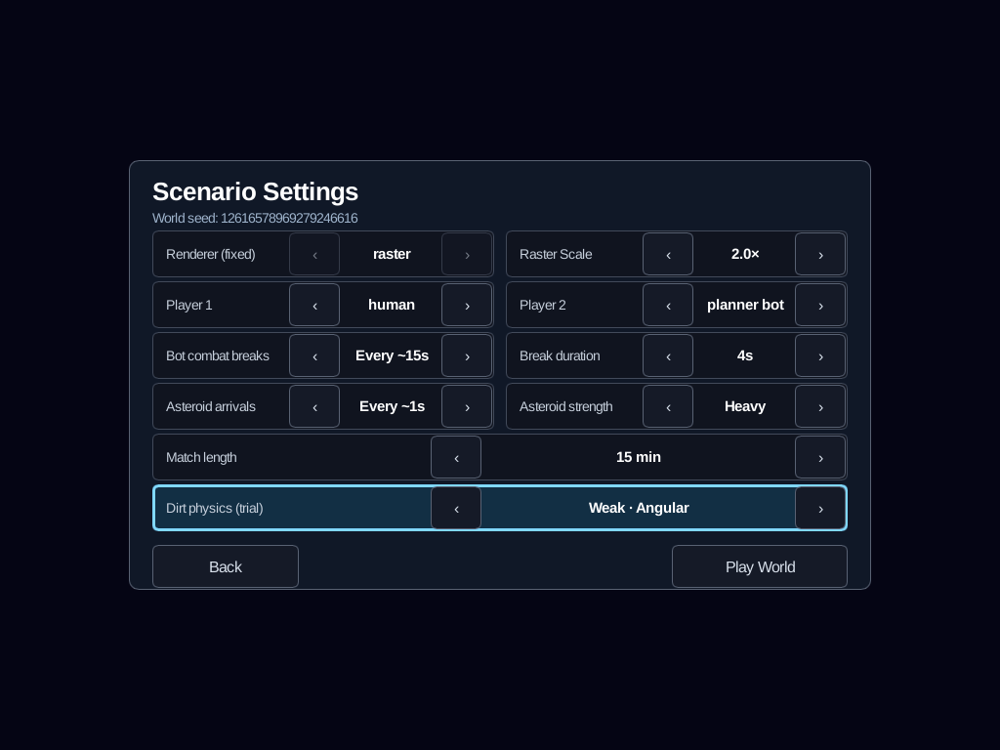
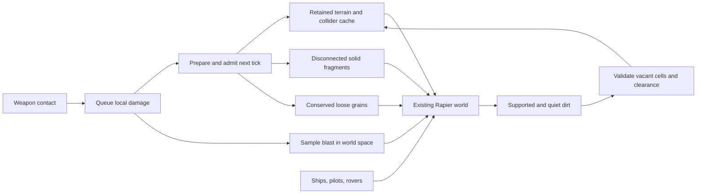

# Shared loose terrain — #165

Terrain Lab, Scorched Earth and Spacewars use the same material-release lifecycle.
In the launcher, choose **Space-Wars → Settings → Dirt physics (trial)**. The row
cycles Off, Round grains, Angular grains, Weak · Round, Weak · Angular,
Strong · Round and Strong · Angular. It also applies to combat/duel, travel and
arena scenarios. Choices persist across restart. Existing saves with loose dirt
on keep plain Round grains; old saves without the setting remain Off.

Plain grains enable conserved blast debris and deposition. Weak/Strong also
enable surface shedding, bank failure and clump impact chipping using the shared
`DirtStrength` preset. Weak uses bank strength 500 and impact yield speed 6;
Strong uses 4000 and 24. Both use the existing 50° surface repose rule. These
are comparison presets, not calibrated soil materials. Shape and a 192-grain
limit remain independent of the strength thresholds.

Use cannon impacts or enable asteroid arrivals to break ground into moving dirt.
Spacewars uses one-world-unit cells and grain friction 0.6.
The HUD shows `Dirt n/192` when no higher-priority actor message is needed.
The HUD also reports cumulative settled cells. Settling returns budget slots;
an impact that still cannot fit leaves its material intact.
Mining keeps its existing removal behavior. Lasers keep their existing rules.



The [playable hillside and cannon-quarry checks](scorched-earth.md#hillside-encounter-and-shared-physics-presets)
exercise a weapon undermining a bank, the falling clump chipping on contact, and
some debris returning to terrain. They also check tank/ship support and material
conservation. Ordinary Spacewars maps use their existing terrain generation.

## Ownership and the tick boundary



`engine-terrain::apply_releasing` runs the normal damage and surface-edit path.
Only cells whose attachment breaks leave the field. Their material, size and
durability immediately before the breaking hit move into `DetachedCell` samples.
For example, 160 work releases 100-hardness rock but leaves 180-hardness ore at
20 durability. A later breaking hit transfers that 20-durability ore sample.
Damage is a detachment threshold here; it does not consume the cell's material.

`engine-rapier::terrain::PreparedRelease` prepares ordered release/removal edits
and disconnects solid pieces once per source. `LooseTerrain::commit` checks
capacity, source freshness and destination IDs before publishing material,
geometry and bodies. Failed destination insertion removes unpublished bodies.
Every new body inherits the source's velocity at its release point, including
translation and rotation. The shared component owns the loose-body handles and
per-material quantities; it never steps physics, applies gravity or awards yield.

Spacewars groups the preceding tick's edits by their sampled source, preserving
order within each source. Over-capacity impact batches retain that field and
allocate no new bodies or IDs; independent mining edits still proceed.
After accepted releases, the adapter registers solid fragments and grains in
the existing material-body registry. Every queued blast then applies its bounded
radial velocity change once, whether or not its material transfer fitted.
Previously released dirt and fragments still react when the pool is full,
including direct shell hits. Source-local blast centers are sampled in world
coordinates before any impulses, including on translating/rotating planets.
Scorched Earth uses the same separation between atomic transfer and blast response;
its tank damage also remains independent of admission. The low-level
`LooseTerrain::commit` failure contract is unchanged: it never changes existing
motion. The scenario applies the impulse separately. Terrain Lab retains its
separate experimental pressure-pulse admission policy.
Gravity, collision queries, ships, spacelings and renderers use the same world.
Base/flag support is invalidated through the existing terrain lifecycle. No
additional solver or gravity step is introduced.

Diagnostics report solid cells, loose cells and removed cells separately:
`initial = solid + loose + removed`. Released cells are never also counted as
destroyed or mined. Observations include loose material, motion, settings and
queued impulses and settling timers, allowing clone continuation checks.

`Terrain::deposit_cells` is the representation-independent return boundary.
It admits whole cells of matching size into vacant coordinates, preserving
material and remaining durability. Invalid, duplicate or occupied destinations
reject the batch without changing the field. Interpolated surfaces get a fresh
midpoint sample for each added cell; adjacent geometry caches refresh normally.
An eventual MPM adapter can accumulate cell quantities and use the same API.

`LooseTerrain::settle` follows contact chains to terrain and requires 0.5 seconds
of low relative speed/spin, with little drift in the supporting body's local
frame. Translation and rotation are included in the reference velocity. Every
admitted grain needs a quiet contact path to that terrain; actors cannot provide
that path. Nearby grounded grains can pack together even when a small gap
separates their contact proxies.

At most 64 candidates are examined per tick, oldest attempt first. Placement
matches grains to distinct, face-connected vacant cells, moving each center at
most 1.75 cell widths in a group (1.25 for an isolated grain). This small local
redistribution accommodates the extra volume of square cells relative to their
inscribed contact proxies. Material and remaining durability stay with each
grain. Failed attempts retain quiet eligibility and retry after half a second.

A retry can reuse a failed decision when all its inputs are unchanged: ordered
grain membership, terrain revision/surface, recovery eligibility, gravity samples,
and the exact current poses and shape identities of nearby solid colliders.
The dependency query reads current parent poses, including edits made before the
next physics step. Moving, entering, removed or replaced obstacles invalidate it.
Successful placements always perform fresh clearance checks. This memoization
retains at most 64 failed groups and 256 nearby colliders per group; larger local
regions opt out. It keeps the normal half-second retry cadence and candidate
allowance, and clearing it does not change simulation results. Exact motion
comparison is intentionally conservative: rotating or still-moving scenes may
receive no reuse benefit.

Clearance checks the actual added surface against current colliders, including
edits already published at the same boundary. Contour/interpolated growth uses
a clipped polygon difference against the previous surface. If only part of a
group fits, omitted grains become obstacles again and the smaller plan is
revalidated. Successful ordinary placements are retained. If that plan fails and
the whole group has stayed quiet for 1.5 seconds, recovery can try up to three
alternative assignments, excluding cells implicated in rejected surface patches.
If that recovery is incomplete and has budget left, a second search excludes
only the closest edit to each blocked tile instead of its entire reconstruction
halo. It can try up to three alternatives and replaces an already valid recovery
only when it returns more grains. Every chosen surface still passes full clearance
and repose checks. Identical cell assignments with identical retiring grains reuse
their surface assessment within this immutable query, while still consuming a
plan slot. Nothing from that assessment survives the call.
Within that same call, `SurfaceAdditionPreview` retains the unchanged source's
clipped tiles across alternative proposals. Each immutable field reconstructs
an owner's polygons only once per preview, even when several tiles inspect it.
Proposed fields have separate caches; patch order and clipping arithmetic are
unchanged. Block terrain batches the possible candidate cuboids into one scan
of current colliders, retaining all blocking identities per cell. Each assignment
excludes exactly its retiring grains; dropped grains immediately block again.
Unknown collider identities always block. This evidence is reusable across
different grain memberships only within the immutable query. It does not use
the previous physics step's spatial index. All caches disappear when the query
returns. Cell priorities are sorted once per assignment; connectivity and the
visited grains of each augmenting path are still checked as the pile grows.
This avoids the cascade where each dropped grain blocks the next, smaller plan,
without rearranging a surface while ordinary settling can still finish. A group
gets at most eight surface-plan checks across the ordinary and recovery
passes. The 64-grain candidate budget and movement radius are unchanged; this is
still a bounded local search, not an exhaustive packing solver. Every accepted
cell and its retired grain publish together.
Dynamic destinations receive the grains' linear and angular momentum;
prescribed terrain retains its commanded motion. Deposits can be blasted loose
again, freeing and reusing the same bounded pool.

Very thin surface differences can collapse to lines or points when converted
back to single precision. Clearance encloses these patches in a tiny capsule;
it does not discard them or reject the entire group because a convex hull cannot
be built. The envelope is only a query shape and never contributes material or
changes the visible/collision surface. This also avoids the hull constructor's
degenerate-point panic. Actual obstructions still use the bounded retry policy.

`SettlingDiagnostics` partitions surviving grains into waiting, moving,
unsupported, no room, obstructed, unstable and deferred by a work budget. A rejection
remains visible while waiting for a retry. These counts exclude rigid fragments
and are available in both scenario adapters; the native lab displays them.

Both headless runners' `--diagnostics` output also reports `available_slots`
and `last_capacity_rejection: { requested, available }`. The latter is the
most recent failed request, sampled **before** its blast response, and remains
visible after slots become free. Spacewars reports the ordered per-source batch;
Scorched totals one impact's requests across all affected fields.
It is `null` until a grain-capacity refusal;
Scorched's separate solid-fragment limit does not populate it. Settling reasons
describe the latest completed settling pass, not the instant of that refusal.
These inspection fields do not drive physics or enter canonical state hashes.

The `saturated_crater` regression fixtures fill a five-grain pool exactly, then
repeat with one spare slot: the next crater still requires more than will fit.
They cover Round and Angular dirt, nearby/far motion, conserved material/IDs,
Scorched tank damage, Spacewars' three rotating surface representations and
multiple impacts in one batch, followed by clone continuation. Reproduce with:

```sh
cargo test --locked --profile ci -p scenario-scorched-earth -p scenario-spacewars \
  --lib saturated_crater
```

When collapse is enabled, proposed cells must also satisfy its repose rule.
Otherwise deposition can rebuild the bank that just yielded, repeatedly releasing
and redepositing the same dirt. `settle` samples the world's uniform gravity;
`settle_with_gravity` accepts a custom force law. Spacewars passes its canonical
point/spherical gravity law, sampling candidate cells in world coordinates and
testing the slope in the destination body's local frame. Samples are cached for
one group attempt, outside the solver. This gate is inactive when collapse is off.
Recovery builds its candidate frontier from cells that already satisfy that rule
against terrain and earlier selected cells. This fills supported vacancies before
committing to an overhanging top, while retaining the final whole-plan clearance
and slope checks. Successful ordinary placement retains its existing order.

`LooseTerrain::settling_work` separately reports actual attempted groups/grains
and reused failures for the latest call. Both scenario benchmark runners collect
these counters outside their timers; grain-reason diagnostics remain a partition
of the surviving loose pool.

The lab also uses `LooseTerrain`, while retaining its own fixture choices,
probe box, blast pulse and aggregate grain-plus-fragment budget. Scorched Earth
uses the same release, collapse and deposition APIs with downward gravity.

## Optional stage timings

Both game runners accept `--profile`, which emits one JSON record per tick to
stderr. It separates world stepping, release preparation/commit, settling,
support-graph construction, packing assignments (candidate filtering and cell
matching), batched block-cell clearance, surface preview, final surface clearance,
geometry refresh, collider synchronization,
and collapse. Scorched also reports Rapier's existing broad/narrow-phase and
solver counters. These spans are inclusive: packing belongs to settling, and
surface preview belongs to packing. Do not add all stage times together.

```sh
cargo +1.89.0 run --locked --release -p scenario-scorched-earth --example scorched_benchmark -- \
  --shape round --seconds 120 --bombardment-seconds 60 --slumping --replay --profile \
  > target/scorched-profile.json 2> target/scorched-profile.jsonl
cargo +1.89.0 run --locked --release -p scenario-spacewars --example loose_terrain_benchmark -- \
  --seconds 30 --slumping --profile \
  > target/spacewars-profile.csv 2> target/spacewars-profile.jsonl
```

Collection is opt-in and thread-local; disabled spans do not read a clock.
Formatting/writing the trace is outside the outer step timer, but enabled clock
reads and accumulation are inside it. Use separate runs without `--profile` for
before/after performance comparisons. Timings are diagnostic data, never part
of observations, snapshots, solver decisions or work budgets.

`packing_inspector --profile-repeats 10` repeats an identical frozen query,
asserts identical reports, and emits the same stage timings. Its enclosing
packing span also includes detailed inspection work; the named surface-preview
and assignment spans isolate those operations. Snapshot loading, drawing and
report comparison are outside those spans.

## Frozen packing inspection — #172

Capture a quiet pile after a benchmark without changing its world, timers, or
observations. Inspection and serialization run outside measured steps:

```sh
cargo run --locked --release -p scenario-scorched-earth --example scorched_benchmark -- \
  --shape angular --seconds 120 --bombardment-seconds 60 --slumping \
  --packing-dir target/packing/scorched
cargo run --locked --release -p scenario-spacewars --example loose_terrain_benchmark -- \
  --scene match --mode angular --seconds 30 --slumping \
  --packing-dir target/packing/spacewars

# This shared inspector accepts a capture from either game.
cargo run --locked --release -p scenario-scorched-earth --example packing_inspector -- \
  crates/engine-rapier/tests/fixtures/scorched-angular-pile.packing \
  --output target/packing-example

# Inspect exactly the same captured pile with tank 11 omitted from the query.
cargo run --locked --release -p scenario-scorched-earth --example packing_inspector -- \
  crates/engine-rapier/tests/fixtures/scorched-angular-actor.packing \
  --omit-body 11 --output target/packing-without-tank
```

The inspector writes JSON plus an SVG for each attempted placement. Purple marks
candidate cells, green/red marks clear/blocked added surface, gold marks cells
that would yield again, and pink identifies blocking bodies by their world-axis
bounds and stable IDs. JSON lists exact collider IDs for every blocked patch;
the bounds are identification aids, not the collision query geometry. Blocks
also report rejected square candidates. A no-room result can have no proposed
surface and thus no SVG; the JSON retains the reason and candidate grains.
`selected_attempt` identifies the chosen plan (a zero-based JSON index); later
exploratory attempts can fail while an earlier valid plan is retained. SVGs mark
the chosen attempt. `omitted_bodies` records any `--omit-body` comparison; unknown
IDs, the destination and selected grains cannot be omitted. Omitting an obstacle
changes only the offline query, never a running game.

The small crater tests enumerate all placements and subsets of three grains,
including actual surface clearance, connectivity, movement limits and optional
planetary repose samples. They distinguish a missed legal placement from a bay
with no legal whole-cell return. This exhaustive search is test-only. A runtime
`NoRoom` result still describes a bounded search, not a proof of impossibility.

```sh
cargo test --locked --profile ci -p engine-rapier small_crater_recovers
cargo test --locked --profile ci -p engine-rapier exhaustive_search_distinguishes
cargo test --locked --profile ci -p engine-rapier moving_an_actor_reopens
```

`LooseTerrain::capture_packing` captures up to the next 64 quiet, grounded grains,
ignoring retry and recovery delay for inspection only. The custom-gravity version matches
`settle_with_gravity`. The files contain terrain, selected grains, current physics
colliders and optional repose samples. They replay only the packing decision,
not the whole match or its future dynamics. These development files are tied to
the physics snapshot format; they are not a save-game compatibility promise.

## Limits and next work

This remains a trial: there is no field expansion, solid-fragment merging,
offscreen deletion or unlimited population fallback. A 192-grain limit can reject a batch before every
slot is filled. Disconnected solid fragments retain Spacewars' existing policy.
Contact circles have pore space; nominal cell quantity and mass are conserved,
not the exact area covered by collision proxies. The radial kick is a gameplay
parameter, not a calibrated blast-pressure model.

This implements the whole-cell return path for
[#51](https://github.com/aortez/space-wars/issues/51), including quiet piles.
Incompatible materials/sizes, field edges, larger dense groups and nearby actors
can still prevent packing. Blocked and orbiting grains remain physical and
continue counting against the budget. This is local cell redistribution, not
calibrated soil compaction or cohesion. The Spacewars trial remains Off by default.
Dense quiet patches larger than the 64-candidate batch can mutually obstruct
packing. Rebuilt craters can also leave ledges that the small pilot cannot walk
over; conserving material does not promise a traversable grade.

## Verification

```sh
cargo test --locked --profile ci -p engine-terrain -p engine-rapier \
  -p scenario-terrain-lab -p scenario-spacewars --lib
cargo run --locked --release -p scenario-spacewars --example loose_terrain_benchmark

# Select one scene or grain shape; default is both scenes and all three modes.
cargo run --locked --release -p scenario-spacewars --example loose_terrain_benchmark -- \
  --scene match --mode angular --seed 42 --seconds 60 --limit 192

# Three-minute repeated-impact run, with per-second settling reasons on stderr.
cargo run --locked --release -p scenario-spacewars --example loose_terrain_benchmark -- \
  --scene match --seconds 180 --diagnostics
```

Tests exercise real cannon and asteroid contacts, all three terrain surfaces,
moving/rotating sources, ore damage thresholds, mining mixed with release,
support loss, repeated hits on loose material, capacity rejection, conservation
and clone continuation. Deposition tests cover repeated release/settle/release
with a one-grain budget, damage retention, all three surfaces and both shapes,
stationary and translating/rotating ground, dynamic momentum, obstructed growth,
airborne/sliding rejection, registry retirement and real lab blast cycles.
Actor integration tests loosen and rebuild a shallow planetary surface, then
walk the canonical pilot across it and land a ship on its deposited cells. Both
grain shapes lose actor support correctly when that ground is blasted again;
pilot continuation also replays identically. Precision regressions use captured
three-planet slivers, including completely coincident points, and confirm that
even tiny newly inserted obstacles still block growth before a broadphase update.
A combined flag regression claims deposited ground, destroys the flag footing,
waits for material to return without restoring ownership, then requires a fresh
claim. Round and Angular both exercise the complete lifecycle.
Native functional checks exercise launcher settings,
restart/persistence and vector/raster rendering.

The benchmark defaults to 3,600 fixed updates per case (up to 10,800 with
`--seconds 180`) with seed 42 and heavy asteroids
arriving about once per second. The ordinary combat and three-planet match
scenarios include their actors; no bots are driven. It audits conservation and
world/cache ownership once per simulated second, outside the timing interval.
It stops at a match outcome and verifies that each timed call advanced a tick;
the steps column reports active updates. Modes are `off`, `round` and `angular`.
The grain comparison changes only the contact shape (circle or hexagon), with
the same friction, restitution, nominal cell size and population budget. The
final observation hash is reported outside timing to check repeatability.
Frame time measures primitive construction, not final rasterization/display.
On/Off cases diverge physically after the first release, so these are workload
costs rather than a controlled solver-only comparison.

## Crowded-world clearance check (2026-10-04)

The three-planet failures were often numerical: added-surface slivers collapsed
to duplicate or nearly collinear vertices, and one failed convex hull rejected
the entire deposit plan. Conservative capsule queries let those clear plans
finish and retire their grains, avoiding repeated false obstruction checks.
Real obstructions retain the existing half-second retry interval.

The same 1,800-update, seed-42, 192-grain workload on Picade now gives:

| Three-planet workload | Returned before → after | Mean update before → after | p95 before → after |
| --- | ---: | ---: | ---: |
| Round | 5 → 379 | 11.02 → 7.63 ms | 18.93 → 17.77 ms |
| Angular | 6 → 405 | 11.76 → 7.31 ms | 20.20 → 18.37 ms |

Round finishes with 105 loose grains and two rejected releases; Angular has 87
grains and one rejection, versus 177/176 grains and nine rejections before.
The more active worlds have larger worst updates: 37.64/41.74 ms, versus
29.42/28.02 ms before. This improves recycling and average cost, but is not a
60 Hz guarantee. Combat returns 200/217 cells with p95 1.95/4.53 ms. The
three-planet Off-mode observation hash is unchanged.

All nine ordinary sandbox cases and all nine 1,200-tick pile-cycle cases conserve
material and pass same-build replay. Ordinary sandbox returned totals match the
baseline, with p95 1.57–4.08 ms. The new actor/precision regressions bring the
four-crate library suite to 707 passing tests; the native launcher/pause/restart
workflow passes with both renderers. Clippy completes with nine existing
Spacewars warnings.

Both three-minute desktop and Picade cases finish 10,800 updates and recycle
2,221/2,111 cells, with no quantity loss and matching observation hashes between
desktop and target. Round/Angular end with 176/180 loose grains and 38 reported
release rejections each, so sustained bombardment can still saturate the pool.
Picade p95 updates are 25.72/25.68 ms, with maxima of 54.19/49.62 ms.

These are single workload runs, not repeated regression measurements. The
Round ran on a warm target (sampled at 80.8–81.3°C); the completed Angular run
followed a power cycle and warmed from 52.6 to 65.2°C. Frequency samples reported
1.5 GHz, with no firmware throttle telemetry. The small timing difference
between those soaks is not a controlled shape comparison. The
[measurement record](data/terrain-clearance-picade-20261004.json) preserves the
captured results, build hashes and measurement scope. The matching application
and CLI are deployed to `sw-picade.local`, with installed hashes verified and
the kiosk service healthy.

Live checks of [Round](screenshots/granular-terrain/picade-clearance-round.png)
and [Angular](screenshots/granular-terrain/picade-clearance-angular.png) each
returned all 74 initial grains to terrain, with zero loose/resting grains and
unchanged total material area. Spacewars gameplay was restored after the checks.

## Group settling check on Picade (2026-10-03)

The next pass addresses resting piles that could not pack one grain at a time.
704 library tests pass, including compact groups across all three surfaces and
both grain shapes, damage retention, actor clearance, unsupported passengers,
moving-ground replay and fair admission. The native launcher/pause/restart test
also passes with both renderers. Local surface previews avoid rebuilding chunks
for rejected plans; a shared clearance pass avoids checking the same growth
once per candidate.

All nine 1,200-tick blast/settle/reblast runs on Picade conserve material and
replay identically. After the first 600 ticks (ten simulated seconds), returned
grains are:

| Fixture | Round | Round + grip | Angular |
| --- | ---: | ---: | ---: |
| Flat | 74 / 74 | 74 / 74 | 74 / 74 |
| Slope | 65 / 69 | 65 / 69 | 69 / 69 |
| Moving planet | 63 / 64 | 63 / 64 | 63 / 64 |

The second blast is admitted in every case. The ordinary sandbox's three blasts
and box drop now return 79–184 cells cumulatively, versus 6–10 before this pass.
Its p95 update times span 1.58–4.15 ms, with a largest ordinary update of 12.59 ms.
Some dirt remains moving, outside ground contact, obstructed or without space;
the counters expose those distinctions. Returned totals can exceed the initial
release because later blasts can release the same material again.

The existing 1,800-tick Spacewars benchmark remains mixed:

| Workload | p95 before | p95 after | Returned before → after |
| --- | ---: | ---: | ---: |
| Combat, round | 5.36 ms | 1.99 ms | 23 → 200 |
| Combat, angular | 6.56 ms | 4.49 ms | 16 → 217 |
| Three planets, round | 15.31 ms | 18.49 ms | 3 → 5 |
| Three planets, angular | 16.38 ms | 19.77 ms | 9 → 6 |

Combat recovers capacity and finishes with 26/17 loose grains. The crowded
three-planet scene still has 177/176 grains and nine rejected releases; its p95
cost increases about 3 ms. That remains a limit of this opt-in trial. Off-mode
hashes are unchanged, with p95 approximately 0.35/1.63 ms.

These are single before/after workload runs, not a repeated regression study.
They use Rust 1.89.0, the same release/static-CRT configuration, seed 42 and limit
192, with the kiosk paused. Final-run temperature endpoints were 73.0/78.4°C and
sysfs reported 1.5 GHz; firmware throttle telemetry was unavailable. Commands,
binary hashes, all cases, replay flags and checkpoints are in the
[group-settling report](data/terrain-pile-settling-picade-20261003.json).

The deployed client also returned all 74 grains from the initial blast in live
[round](screenshots/granular-terrain/picade-pile-settling.png) and
[angular](screenshots/granular-terrain/picade-pile-settling-angular.png) checks.
The HUD showed zero loose/resting grains and 74 settled cells in each case.
The lab was returned to Round and paused after verification.

## Deposition check on Picade (2026-10-03)

697 library tests across the terrain, Rapier, lab and Spacewars crates pass,
including fair admission when blocked grains outnumber the per-tick budget.
The native granular launcher/pause/restart workflow passes with both renderers.
All nine 600-tick sandbox cases on Picade conserve material and reproduce their
observations on replay. They return 6–10 cells to terrain per run; dense piles
still retain most of their grains under the conservative clearance rule.
The deployed Picade client was also exercised with a blast and a box drop;
[the live capture](screenshots/granular-terrain/picade-deposition.png) shows five
returned cells and the new settled counter. The application was returned to
Spacewars and paused after verification.

A focused 1,800-tick comparison uses the prior archived binary and this return
path, Rust 1.89.0, the same release/static-CRT configuration, seed 42 and limit
192. The kiosk remains paused throughout. This is one run per version/case,
not a repeated regression study. Raw results, binary hashes and commands are in
[the deposition report](data/terrain-deposition-picade-20261003.json).

| Workload | p95 before | p95 with deposition | Cells returned | Rejected releases before → after |
| --- | ---: | ---: | ---: | ---: |
| Combat, round | 4.69 ms | 5.77 ms | 23 | 1 → 0 |
| Combat, angular | 5.37 ms | 7.17 ms | 16 | 2 → 1 |
| Three planets, round | 14.43 ms | 15.70 ms | 3 | 8 → 9 |
| Three planets, angular | 15.26 ms | 16.54 ms | 9 | 9 → 9 |

Deposition recycles capacity but is not yet a performance improvement. Changed
ground and accepted impacts also change subsequent solver work, so these deltas
do not isolate admission cost. The Off cases retain identical final hashes and
p95 remains approximately 0.42 ms / 1.68 ms. The post-run temperature was 80.3°C
and sysfs reported 1.5 GHz; no firmware throttle telemetry was available. Further
packing/performance work is needed before enabling the trial by default.

## Picade benchmark comparison (2026-10-03)

This earlier release-only comparison precedes the deposition change above.

The review ran on `sw-picade.local`, Raspberry Pi 4 Model B Rev 1.4, with the
kiosk running and its game already paused. Baseline `8d7427b` precedes the shared
release lifecycle; current `2d6aa96` includes it and the active-tick benchmark
guard, plus the archived shape-selection patch. Both use Rust 1.89.0, identical
`Cargo.lock`, release/fat LTO, aarch64 and static CRT linkage. Installed binaries,
application settings and service state were not changed.

There are three serial repetitions of each comparison, with model/shape order
rotated and baseline/current order reversed on repetition two. The 66 matrix
executions cover all eight existing terrain runners plus the soil and integrated
loose-terrain comparisons. Geometry has three inner repetitions per executable.
An additional 20 short terrain executions alternate builds on CPU 2 to follow up
the repeated-edit result. No benchmark executables overlap.

All times below are milliseconds. Tables report the median of each runner's
per-run statistic, not a pooled percentile. Parentheses show the observed range
across repetitions, not a confidence interval. The game table's worst step is
the largest single step observed across all three runs.

Temperature ranged from 76.9–84.7 °C. Linux `scaling_cur_freq` reported
1.5 GHz; 0 undervoltage-alarm samples were recorded.
This is a hot, shared cabinet measurement. `vcgencmd` is absent and access to the
hardware clock/firmware interface requires privileges unavailable to this
account. The reported frequency does not rule out firmware throttling; the
[firmware status bits](https://www.raspberrypi.com/documentation/computers/os.html#get_throttled)
are a separate diagnostic. Small timing differences should not be treated as
precise regression estimates.

### Round and angular grains in Spacewars

All six cases completed 3,600 active ticks per run. Every repeated final
observation hash and material counter matched. Both enabled modes retained all
material, with zero removed cells and no ownership/cache audit failures. The
limit is 192 grains; all other grain settings match between shapes.

| Scene | Dirt | Mean | p95 (run range) | p99 | Worst step | Frame p95 | Final grains | Rejected impacts |
| --- | --- | --- | --- | --- | --- | --- | --- | --- |
| combat | off | 0.33 | 0.66 (0.64–0.70) | 0.94 | 1.87 | 0.15 | 0 | 0 |
| combat | round | 3.60 | 6.50 (6.13–6.52) | 6.96 | 8.83 | 0.30 | 188 | 11 |
| combat | angular | 3.90 | 7.14 (7.00–7.52) | 7.95 | 22.23 | 0.33 | 188 | 15 |
| match | off | 1.44 | 1.88 (1.84–1.94) | 2.48 | 10.65 | 4.68 | 0 | 0 |
| match | round | 11.37 | 15.20 (14.62–15.54) | 18.42 | 50.56 | 4.36 | 182 | 30 |
| match | angular | 12.04 | 16.01 (15.51–16.47) | 17.12 | 29.40 | 3.90 | 182 | 30 |

Round grains have lower median mean and p95 cost in both scenes. Angular grains
have a lower match p99 (17.12 versus 18.42 ms) and smaller worst observed match
step (29.40 versus 50.56 ms). Both match configurations exceed the 16.67 ms
simulation budget in their tails before final rendering; neither establishes
sustained 60 FPS at the population limit.

Step timing includes the ordinary scenario's physics and terrain lifecycle.
Frame timing covers primitive construction, not rasterization/display. No bots
are driven. Off/round/angular trajectories differ after the first release, so
these are real workload costs, not an isolated shape-solver overhead. Rejected
impacts preserve material; they also bound the amount of continuing damage.

### MPM versus round grains in the soil lab

These are the existing ten-second pour, support-removal and repeated-blast
fixtures, on flat and moving planetary ground. Each experiment starts with the
same material samples/reservoir and external actions across models. Internal
friction, contact representation and solver stepping differ, as documented in
the [soil lab](soil-mpm-lab.md). These populations and cell sizes are different
from the 192-grain Spacewars trial.

| Fixture / experiment | Samples | MPM mean | MPM p95 (range) | Grains mean | Grains p95 (range) | Grains / MPM mean |
| --- | --- | --- | --- | --- | --- | --- |
| flat / pour | 288 | 2.54 | 3.14 (3.13–3.69) | 4.25 | 7.01 (6.32–7.14) | 1.67× |
| flat / bank | 494 | 4.93 | 5.59 (5.14–6.45) | 11.00 | 18.85 (18.68–19.63) | 2.23× |
| flat / blasts | 1024 | 9.32 | 10.42 (9.85–12.13) | 25.07 | 31.48 (31.35–32.60) | 2.69× |
| moving-planet / pour | 288 | 3.02 | 3.63 (3.23–3.82) | 4.64 | 7.59 (7.46–7.99) | 1.53× |
| moving-planet / bank | 494 | 7.80 | 8.38 (7.37–8.72) | 11.42 | 14.28 (13.84–14.41) | 1.46× |
| moving-planet / blasts | 1024 | 11.36 | 12.47 (11.09–13.38) | 28.45 | 45.92 (43.37–46.91) | 2.50× |

MPM is faster in all six cases. At 1,024 samples, its median mean cost is
9.32 ms on flat ground and 11.36 ms on the moving planet, versus 25.07 and
28.45 ms for grains: a 2.5–2.7× mean-cost advantage in these blast fixtures.

The zero-internal-friction MPM control was also repeated; its complete results
are in the archive and CSV. Every case retained its prescribed samples and
material mass, and repeated physical diagnostics exactly within each model.
These runs audit each step but omit playback/replay cost. MPM still uses
prescribed, one-way contacts here: terrain release/deposition, actor reactions
and two-way Rapier coupling are not measured. These results do not establish an
MPM game-frame cost or readiness to replace the integrated grain path.

### Existing terrain benchmarks before and after integration

The following p95 columns measure physics/scenario updates, except **Geometry**,
which measures geometry refresh after cuts. Each row's workload counters,
material hashes and other reported non-timing evidence match between revisions
and across repetitions. The archived CSV also includes editing, collider
synchronization, initial construction and frame-building timings.

| Benchmark | Case | Before p95 | After p95 | Change |
| --- | --- | --- | --- | --- |
| Edits | 1 / craters | 0.168 | 0.193 | +14.9% |
| Edits | 1 / tunnels | 0.167 | 0.289 | +73.1% |
| Edits | 0.5 / craters | 0.723 | 0.995 | +37.6% |
| Edits | 0.5 / tunnels | 0.907 | 0.995 | +9.7% |
| Fragments | equator / 20 | 0.137 | 0.135 | -1.5% |
| Fragments | blocks / 20 | 3.355 | 3.238 | -3.5% |
| Fragments | equator / 150 | 3.130 | 3.046 | -2.7% |
| Mining | Precision / 20 | 0.344 | 0.357 | +3.8% |
| Mining | Drill / 20 | 0.158 | 0.153 | -3.2% |
| Mining | Excavator / 20 | 0.153 | 0.145 | -5.2% |
| Mining | Precision / 150 | 4.686 | 4.646 | -0.9% |
| Mining | Drill / 150 | 4.714 | 4.751 | +0.8% |
| Mining | Excavator / 150 | 4.564 | 4.591 | +0.6% |
| Impacts | equator / 20 / false | 0.148 | 0.135 | -8.8% |
| Impacts | equator / 20 / true | 0.157 | 0.147 | -6.4% |
| Impacts | blocks / 20 / true | 4.241 | 4.172 | -1.6% |
| Impacts | blocks / 40 / true | 17.935 | 17.659 | -1.5% |
| Impacts | equator / 150 / true | 3.261 | 3.149 | -3.4% |
| Spacewars | fixture | 1.085 | 1.054 | -2.9% |
| Spacewars | tunnel | 2.117 | 1.988 | -6.1% |
| Spacewars | blocks | 8.749 | 8.520 | -2.6% |
| Spacewars | multi_planet | 3.019 | 3.028 | +0.3% |
| Geometry | 0 / Interpolated | 2.650 | 2.588 | -2.4% |
| Geometry | 1 / Interpolated | 18.484 | 18.639 | +0.8% |
| Geometry | 2 / Interpolated | 14.384 | 13.931 | -3.1% |
| Colliders | Blocks / Separate | 10.132 | 10.261 | +1.3% |
| Colliders | Blocks / ChunkCompound | 0.330 | 0.337 | +2.1% |
| Colliders | Interpolated / Separate | 168.861 | 173.466 | +2.7% |
| Colliders | Interpolated / ChunkCompound | 0.329 | 0.342 | +4.0% |

The ordinary Spacewars cases change by -6.1% to +0.3% in median step p95.
Mining, fragmentation, impacts and geometry remain close in these runs;
collider step p95 rises 1.3–4.0%. The initial repeated-edit fixture shows larger
increases, including 0.167 → 0.289 ms for one-unit tunnels and 0.723 → 0.995 ms
for half-unit craters. Those cases warranted a focused follow-up instead of a
blanket claim that the integration has no performance cost.

The short edit fixture times only 80 edits per case. Its fixed-core follow-up
uses ten runs per build with alternating order and the original measured
binaries; the paused kiosk and thermal limitations still apply.

| Cell size / edit | Before p95 (range) | After p95 (range) | Change |
| --- | --- | --- | --- |
| 1 / craters | 0.21 (0.17–0.27) | 0.19 (0.17–0.24) | -7.3% |
| 1 / tunnels | 0.23 (0.16–0.29) | 0.19 (0.17–0.30) | -17.0% |
| 0.5 / craters | 0.99 (0.81–1.08) | 0.99 (0.67–1.07) | -0.2% |
| 0.5 / tunnels | 0.94 (0.81–1.07) | 0.88 (0.82–1.00) | -7.3% |

The larger step-time increases do not reproduce on the fixed core: current
median p95 is similar or lower in every case, and all before/after ranges
overlap. Edit, geometry and collider-update ranges also overlap. This points
to substantial measurement sensitivity in the short fixture; it does not prove
which scheduling/cache/thermal effect caused it, or establish a code speedup.
No large, reproducible slowdown in the unchanged ordinary terrain path was
established by this review. Keep the short fixture when profiling future changes.

### Native granular sandbox workload changes

This runner uses 0.5-unit cells, a 192-body budget, three blasts and a dropped
box. Its second blast is aimed below the box's actual position. Each version
passed conservation, finite motion, matching-collider and same-build replay
checks in all nine cases; every repeated result within a version matched.

| Fixture / preset | Before p95 | After p95 | Before peak bodies | After peak bodies |
| --- | --- | --- | --- | --- |
| flat / Round | 3.28 | 2.93 | 159 | 149 |
| flat / Round + grip | 3.07 | 3.03 | 159 | 149 |
| flat / Angular | 3.74 | 3.61 | 161 | 162 |
| slope / Round | 2.74 | 2.97 | 139 | 154 |
| slope / Round + grip | 2.63 | 2.57 | 139 | 139 |
| slope / Angular | 4.07 | 4.10 | 174 | 178 |
| moving-planet / Round | 3.32 | 3.22 | 154 | 154 |
| moving-planet / Round + grip | 3.23 | 2.79 | 151 | 138 |
| moving-planet / Angular | 3.98 | 4.10 | 151 | 162 |

These rows are not an equal-trajectory speed comparison. The shared transaction
inserts destinations before synchronizing source geometry, allowing failed
destination insertion to roll back without changing the source. The former lab
path synchronized the source first. A desktop diagnostic found identical
released material and velocities before the first solve, followed by different
collision results. Changing only that publication order in an isolated
diagnostic worktree restored all 62 recorded initial/release/step samples per
fixture across three fixtures, and all reported physical results/final hashes
for the complete nine-case, 600-tick sandbox workload. That diagnostic patch is archived and was
not applied to production. Later box-targeted blasts therefore select different
cells, explaining the differing populations as well as trajectories.

### Reproduction and retained evidence

[All timing summaries](data/loose-terrain-picade-20261003.csv) include per-run
statistic medians and ranges. The [review archive](data/loose-terrain-picade-20261003.tar.gz)
contains command order, exit statuses, raw runner outputs, thermal samples,
analysis scripts, exact measured-source patches, executable SHA-256 values and
the publication-order diagnostic. Extract it and run `python3 analyze.py` to
rebuild the summary. Binaries remain under `target/terrain-benchmark-review/`;
the archive contains their hashes rather than executable files.

```sh
RUSTFLAGS='-C target-feature=+crt-static' cargo +1.89.0 build --locked --release \
  --target aarch64-unknown-linux-gnu -p scenario-terrain-lab \
  --example soil_mpm_lab --example granular_sandbox --example terrain_benchmark \
  --example fragment_benchmark --example mining_benchmark --example impact_benchmark
RUSTFLAGS='-C target-feature=+crt-static' cargo +1.89.0 build --locked --release \
  --target aarch64-unknown-linux-gnu -p scenario-spacewars \
  --example loose_terrain_benchmark --example spacewars_terrain_benchmark \
  --example surface_geometry_benchmark --example terrain_collider_benchmark
```

Use the archived job arguments and fresh output directories on the target.
Repeat the eight existing runners from a checkout of `8d7427b` for the baseline.
The final CLI also accepts short durations/tiny budgets that release no grains;
its end-of-run assertions still verify the configured limit and conservation.
Those assertion-only refinements are outside the timed regions and are stored
separately from the patch used to build the measured executable.

## Optional bank yielding (#170)

`LooseTerrainConfig::slumping = Some(SlumpingConfig::default())` enables the local
surface-yield prototype. Call `slump` at the existing material-edit boundary,
before `settle`, and register its `ReleaseCommit` exactly as an impact release.
The caller supplies world-space gravity samples, its shared identity allocator,
and remaining fragment capacity. The layer never steps physics or applies its
own gravity law. Release/deposition automatically enqueue nearby occupied cells;
`disturb` is available for an explicit caller-owned disturbance.

The queue, yield delay, work limits, headroom policy, and retry continuation are
cloned and included in `settling_hash`. With the option absent, the original
settling hash and physical path are retained. The unchanged lab consumer opts out.
Scorched Earth exposes a live toggle and health-independent barrage; Spacewars
registers yielded material through the same path as cannon releases, invalidates
material queries and reconciles support before actors observe the next world.

See [the comparison controls and limits](scorched-earth.md#bank-collapse-comparison)
for the grid-sampled slope rule, explicit bounds, and reproducible runners. This
is an opt-in approximation awaiting review, not a universal settling improvement.

## Local bank strength

The shared compound-collider sweep filter also reduces the cost of falling
terrain fragments contacting the ground. See [CCD profiling and pruning](compound-ccd-pruning.md)
for its conservative bounds, replay checks and desktop/Picade measurements.
It changes collision-query cost without changing this bank-strength model.

`LooseTerrainConfig::cohesion` independently enables `CohesionConfig`. The pure
`Terrain::cantilever` query recognizes short, fully observed one-sided ledges,
including stepped undersides and varying thickness. It follows connected cell
intervals in columns along the dominant local gravity axis, looking for one
downward bearing bank and one free end. A complete perimeter check rejects
second supports, unknown field edges and branches outside the selected ledge.
The earlier flat-underside query remains a fallback for shallow bearing banks.

The full sampled gravity vector now contributes signed cell torques about the
center of the root face. Their summed magnitude is compared with
`strength * height² / 6`; tangential gravity can load or relieve a sloping ledge.
Gravity is still sampled once per query, not integrated across the whole bank.
Strength is a uniform experimental beam threshold, not blast hardness or a
calibrated soil property. The query considers at most 16 unsupported columns and
eight cells of thickness; incomplete boundaries and extra attachments retain
material. It does not solve general arches, actor loads, or rotational loading.
Contour tracing needs a bearing interval thicker than eight cells and extending
below the adjoining ledge; irregular geometry without this observed bearing
is retained unless the flat query can independently prove a smaller ledge.
Both searches have fixed column/cell limits. This remains a local beam model,
not a general stress or arbitrary-angle fracture solver.

`Terrain::roof_span` uses the same bounded contour inspection for a span with
**two** observed, full bearing faces. It balances unit-density cell weights
against two reactions, then checks bending moment at each column center. The
column with the highest moment divided by thickness squared is the crack point;
strength uses the same section modulus as a cantilever. Equal sections resolve
in a fixed field order. Sampled gravity includes both local components. Unknown
attachments, oversized spans and geometry requiring a tensile bearing reaction
are retained. This is a simply supported beam approximation, not an arch model.

A roof failure releases only that column as grains. Normal connectivity handles
any resulting disconnected material; attached sides are inspected later as
cantilevers. A floor joining both banks can keep the source connected after the
first crack, so that transaction does not require a fragment slot. Actual
fragment or grain capacity failures are still atomic and retryable. The
`roof_failures` and `roof_held_checks` counters are subsets of the existing total
failure/held counters. See [roof comparisons](roof-collapse.md) for the tank and
rotating-planet cannon scenes, checks, and measurements.

The pool watches occupied cells within two cells of release/deposition edits;
Spacewars also notifies it of discarded mining cuts, including mixed impact/mining
batches. Defaults track at most 2,048 candidates, check at most 32 per scan, wait
0.5 seconds after disturbance, and publish at most one fracture per 0.1 seconds.
A held root is revisited so a change in sampled gravity can overload it. Geometry
outside the recognized local model is retained. Only fixed/kinematic fields are
eligible; dynamic fragments are not fractured by uniform free-fall acceleration.

Failure explicitly extracts a root seam as grains and the identified hanging
cells as a solid fragment. This retains the bearing bank even when it is smaller
than the ledge. The ordinary atomic release transaction checks grain/fragment
capacity and IDs, transfers cell durability, refreshes collision geometry, and
inherits source translation/spin. Refusals retain material and retry. Scenario
adapters register the result through their existing release paths before
settling/support reconciliation. No new solver or gravity step is introduced.
With contact breakup disabled, fallen chunks remain rigid terrain fragments;
their loose seam samples use the existing return path. The queue, timing and configuration participate in replay
hashes only when enabled; diagnostics do not control physics.

Scorched Earth's **Bank test** compares 500 (weak) and 4,000 (strong) using an
identical timed support cut. Spacewars exposes the same configuration to its
existing adapter and benchmark (`--cohesion 500`); its launcher default remains
off. Tests cover rotated gravity and moving sources, conservative boundaries,
strong/weak/thickness comparisons, conservation of damaged material, refusal and
retry, bounded work, clone continuation, and blast/mining integration with
Blocks and Interpolated planets.

The filled **Hillside** encounter now makes its undercut through three ordinary
tank shots. The rotating Spacewars quarry has an uneven lip, and the separate
`destruction_benchmark --curved` fixture fires three shots into an initially
solid, uneven circular planet. Short crater roofs can legitimately hold under
the planet's lower gravity. `irregular_failures` and `irregular_held_checks`
distinguish traced, non-flat undersides from the existing flat ledges; these
diagnostic counters do not drive simulation or enter its replay hash.


## Clump breakup on impact

`LooseTerrainConfig::impact_fracture` independently enables contact-local chipping
of dynamic terrain fragments. It defaults to `None`. Scorched Earth's bank/drop
controls enable it; Spacewars exposes the same option through its existing loose
terrain configuration and `loose_terrain_benchmark --impact-yield-speed 6`.
Launcher defaults and the Terrain Lab consumer remain unchanged.

The lifecycle brackets the **single existing physics step**:

1. `capture_impact_motion` records eligible source revisions/masses and incoming
   body motion. Position-driven supports use their prescribed timestep velocity,
   including rotation about the center of mass.
2. `sample_impact_contacts` consumes the world's deduplicated solver/CCD events.
   Incoming relative speed must exceed the material threshold before a contact
   contributes impulse. For each clump, severity is the smaller of maximum
   closing speed and summed normal impulse divided by source mass. Thus resting
   support/correction forces and fast, insignificant hits cannot qualify merely
   by having a large impulse or a large speed respectively.
3. `fracture_impacts` attempts one contact patch at the normal material boundary,
   before deposition. Scorched does this after the solve; Spacewars publishes on
   the following tick after queued blasts/mining. A changed source revision
   invalidates the old local hit. The cloned pool owns queued hits so transient
   CCD contacts survive a scenario clone even if the world rebuilds its contacts.

A qualifying hit cuts a radius-one-cell capsule up to three cells inward from
its strongest contact, releasing at most 16 cells by default. Any disconnected
pieces remain ordinary terrain fragments. The atomic `PreparedRelease` path
preserves cell durability, material quantity and post-collision point velocity;
it adds no explosion impulse. New geometry/IDs and scenario registries use the
same transaction as existing releases. A full grain pool or fragment registry
retains all material and consumes the hit: freeing capacity later cannot cause
a delayed fracture of a resting clump.

Defaults examine at most 512 sorted contact events, attempt at most one patch
(including refusals) per material boundary, and give the fractured source/new
fragments a 0.35-second cooldown. Other simultaneous candidates are consumed.
Diagnostics expose scan overflow, skipped candidates, refusals, stale hits and
released cells. Pre-step snapshots cover the existing world bodies only while
eligible fragments exist; connectivity work for the one patch can span its
source field. Configuration, pending hits and cooldowns participate in the
continuation hash only when enabled.

This is a bounded gameplay fracture model, with uniform thresholds of 6 (weak)
and 24 (strong) in the drop comparison. It is not an energy-conserving crack or
soil-stress solver. It does not chip fixed planets directly, accumulate fatigue,
model per-material fracture strength, or guarantee that released grains will
find a valid deposition slot. The bank self-weight rule remains independent.

## Gravity integration in Space Wars

Loose-material worlds distribute the existing per-tick gravity change as a
continuous Rapier force for both rubble and actors. This prevents resting ships
from continually shaking grain piles. Settling and packing criteria are
unchanged; worlds without a loose-material pool retain their prior integration.
See [the diagnosis, regression checks and benchmark results](loose-gravity-integration.md).

The [packing preview follow-up](packing-preview-reuse.md) adds frozen captures
for the quiet cave and curved-planet packing spike. Query-local caches reuse
identical surface tiles and geometric candidates while retaining placement and
clearance decisions.

A [test-only exhaustive cave search](cave-packing-oracle.md) now distinguishes
missed local assignments from obstructed geometry in small frozen captures.
Six complete searches and four searches limited to deposits of up to three
grains find no clear placement with the actual obstacles retained. Actor-removal
controls verify successful deposits and expose one counterfactual case where
the bounded planner accepts fewer grains than the oracle. Runtime packing is
unchanged; larger coordinated deposits remain unproven.

The [longer-match review](late-match-dirt-review.md) exercises ordinary combat,
mixed asteroid pressure, sustained bombardment, and capture with both grain
shapes across three seeds. The bot combat runner now accepts the launcher dirt
presets and audits loose material. Normal and mixed-pressure runs retain useful
capacity and physical recovery; extreme pressure can leave a bot blocked even
while dirt continues cycling. Runtime terrain rules remain unchanged.
