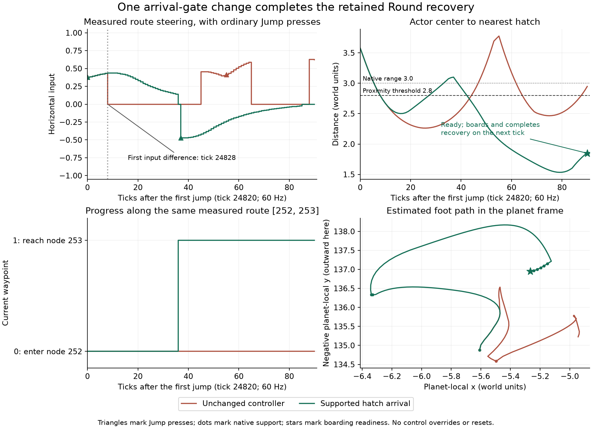

# Supported hatch arrival completes the retained Round recovery

**The live controller boards and completes recovery at tick 24911, 168 ticks
(2.8 seconds) after rebuilding.** It uses two native jumps and no get-up
attempts. Local terrain revision remains 182. The unchanged controller never
boards and spends the final 9,772 ticks blocked. This resolves the missed
recovery opportunity identified by the preceding
[ordinary-input witnesses](terrain-recovery-round-entry-results.md).

The candidate changes one arrival condition: proximity to the hatch no longer
stops an unsupported pilot's measured-route steering. It is independently
selectable through `hatch_supported_arrival`, remains disabled by default, and
does not change physics. This result supports keeping the change in the #178
integration candidate; it does not establish a win-rate improvement or justify
default promotion.

## Controlled continuation



The [prespecified comparison](terrain-recovery-hatch-arrival-plan.md) reconstructs
the seed-20202 Round/collapse-off candidate-P2 mission from tick zero to 24743.
Every preceding action, decision checksum and scenario checksum matches the
retained reference. The complete world, both controllers and host planning
queues are cloned. Only P2's hatch-arrival option changes; toggling it back
reproduces the original controller debug state exactly. The opponent remains
reactive, and both arms run to the native match end at tick 36000.

No diagnostic input, controller reset, boarding assistance or physical edit is
used. Unlike the earlier scripted early-fork trials, the real bot supplies the
required neutral release: controls are disarmed at 24743 and armed at 24744.

| Tick | Observed behavior |
| ---: | --- |
| 24820 | Both arms make their first native jump. |
| 24828 | First input difference: control selects Settle with zero horizontal input; candidate keeps route steering at approximately 0.435 while unsupported and close to the hatch. |
| 24830 | First difference in the public scenario checksum. |
| 24856 | Candidate advances from route waypoint zero to one. |
| 24857 | Candidate makes its second native jump, steering toward the next measured node. |
| 24910 | Native readiness reports Ready and the candidate presses Interact. |
| 24911 | Native boarding succeeds; recovery completes and the mission removes its recovery task. |

At boarding readiness the pilot is balanced and supported on its retained
planet, the ship is landed, hatch distance is 1.8483 units and planet-relative
speed is 1.6378 units per second. The independent auditor recomputes the normal
three-unit range and two-unit speed gates. The next state is aboard the full
ship, records `last_transfer = boarded`, and increments the transfer counter
once. Total completed recoveries increases from one to two.

The figure compares the same initial physical state and marks actual support,
steering, jumps and waypoint advancement. Foot positions are center-minus-up
estimates, not collider bottoms or a terrain rendering. Native actor counters
are differenced only within this recovery interval; later exits create new
actors and reset their counters.

## Mission follow-through and remaining failure

After completing recovery, P2 resumes launch, transfer, capture and combat. It
has no further blocked mission or recovery ticks through match end. The
tick-zero candidate reproduces all 11,257 action records from the retained
fork onward, including their decision and public scenario checksums, and its
full final snapshot is identical. Selecting the option earlier therefore
reproduces the retained-fork result in this case.

The changed battle also produces a new **opponent rebuild-route failure**.
P1 starts recovery at 26413 and blocks at 31347, spending 4,653 ticks blocked.
Its ground destination is a rebuild site, with waypoint one of the measured
route `[252, 253, 255, 257, 259, 261, 262]`, 12 jump requests and terrain
revision 195. It has not rebuilt; this is not a hatch-arrival failure. The
hatch option is not selected on P1. Its first blocked state, both controllers,
planner observations and complete preceding action trace are retained for a
separate investigation.

Both arms finish with a P1 time-limit win. Planet ownership is `[2, 1]` in the
control and `[2, 0]` in the candidate. Recovery success is useful, but the
changed reactive match is not uniformly better on every outcome. The new
opponent block must remain visible when judging integration readiness.

## Generated-world comparisons

All sixteen pairs finish. Each control exactly reproduces its retained mission
actions, decision checksums, public scenario checksums and full final snapshot.
Fifteen candidates preserve the control's game inputs and outcomes. Only the
known Round failure changes inputs, beginning at 24828.

Seven cases actually exercise a recovery task with a hatch destination on the
selected seat. Four preserve an existing successful recovery, one adds the
targeted recovery, and two preserve existing blocked outcomes. Only the
targeted case encounters an unsupported recovery pilot within the hatch's
2.8-unit arrival range. The other nine cases are compatibility checks, not
demonstrations of this arrival rule. Ordinary capture-return boardings are
counted separately from recovery completion.

The table reports selected-seat activity for each full match. Hatch ticks count
decisions with an active recovery ground task targeting a hatch, including
blocked decisions. Recovery totals are control → candidate.

| Seed | Shape | Collapse | Selected seat | Candidate recovery hatch ticks | Completed recoveries | First changed input |
| ---: | --- | --- | --- | ---: | ---: | --- |
| 10101 | Round | Off | P1 | 0 | 0 → 0 | Unchanged |
| 10101 | Round | Off | P2 | 72 | 1 → 1 | Unchanged |
| 10101 | Round | On | P1 | 0 | 0 → 0 | Unchanged |
| 10101 | Round | On | P2 | 0 | 0 → 0 | Unchanged |
| 10101 | Angular | Off | P1 | 101 | 1 → 1 | Unchanged |
| 10101 | Angular | Off | P2 | 0 | 0 → 0 | Unchanged |
| 10101 | Angular | On | P1 | 0 | 0 → 0 | Unchanged |
| 10101 | Angular | On | P2 | 75 | 1 → 1 | Unchanged |
| 20202 | Round | Off | P1 | 80 | 1 → 1 | Unchanged |
| 20202 | Round | Off | P2 | 260 | 1 → 2 | 24828 |
| 20202 | Round | On | P1 | 0 | 0 → 0 | Unchanged |
| 20202 | Round | On | P2 | 0 | 0 → 0 | Unchanged |
| 20202 | Angular | Off | P1 | 0 | 0 → 0 | Unchanged |
| 20202 | Angular | Off | P2 | 717 | 0 → 0 | Unchanged |
| 20202 | Angular | On | P1 | 0 | 0 → 0 | Unchanged |
| 20202 | Angular | On | P2 | 10163 | 0 → 0 | Unchanged |

In the changed full match, blocked recovery ticks for `[P1, P2]` move from
`[0, 14819]` to `[4653, 5047]`. P2's remaining 5,047 blocked ticks precede the
retained rebuild fork and are identical in both arms. The hatch fix removes
the later 9,772-tick block; it does not erase earlier failed recovery periods.
P1's new block is the rebuild-route failure described above.

## Validation and reproduction

Runtime source: `9c8285da49ccf09ffcb22899800dc12fbd9a375f`.
Frozen binary SHA-256:
`d2893134c5bc0bc3aec6d509716ca89b13811f92126a46a844eb52a64352c18d`.
Source-manifest SHA-256:
`ac76031ccbf06243ad3bbdc379168663484499545798d540af8bee2b084cf877`.

All seventeen paired diagnostic runs finish with exit zero on their first
execution. The first full independent audit passes: 2,430 source inputs,
1,226 case artifacts, 398,922 control decisions and 12,484 material samples.
The decision count includes the retained fork's reconstructed prefix as well
as the full-matrix controls. Native boarding gates, completed-task snapshots,
neutral input arming, material conservation and speed bounds pass. After the
freeze, only audit/report/figure/packaging code changes; the runtime and its
original simulation outputs remain unchanged.

**572 tests pass:** 452 AI library tests and 120 physical gameplay tests across
ground navigation, walking, jetpack, surface mission and surface recovery.
The library also retains 16 ignored diagnostics. Strict AI Clippy,
default-feature compilation and formatting pass.

Decision-contract coverage includes supported arrival, brief contact loss,
cached ticks, clone/reset, neutral rearming, dirty queries, missing routes,
existing time limits and native boarding priority. Flag claiming and rebuild
arrival retain their existing quiet-landing behavior. The option preserves
controller memory, route budgets and existing jump/get-up rules; it adds no
retry or route-generation policy.

Two pre-freeze setup failures are retained in the validation notes: the new
harness initially attempted to serialize a non-serializable surface action,
and a flag test fixture was outside its intended arrival tolerance. The harness
now records the canonical encoded action and the test uses an explicit
inside-range flag fixture. Neither correction followed frozen match outcomes.
Validation receipts distinguish observed command exits and logs from timing
values; no missing timings are inferred.

The [compact receipt](data/terrain-recovery-hatch-arrival-v1.json) includes all
paired outcomes, native boarding measurements, exposure counts, hashes,
validation and figure provenance. Raw evidence is in
`spacewars-handoffs/hatch-arrival-20261010`. The handoff package is
`spacewars-handoffs/terrain-recovery-hatch-arrival-20261010.tar.gz`; its incremental
source bundle requires `9800b9f` from the Round-entry package.

```sh
python3 tools/audit-terrain-recovery-hatch-arrival.py /path/to/hatch-arrival-20261010 --output /tmp/hatch-arrival-audit.json
```

Each case's `command.json` and `case.json` retain its exact invocation and
environment. Reproduce with the frozen `hatch-arrival-comparison` binary and
test `mission_pilot::terrain_recovery::qualification::hatch_arrival::retained_hatch_arrival_comparison`,
plus `--ignored --exact --nocapture`. Set `RUST_MIN_STACK=16777216`,
`SPACEWARS_MISSION_CASE` to its case specification,
`SPACEWARS_MISSION_REFERENCE` to its packaged reference directory,
`SPACEWARS_HATCH_FORK` to its recorded fork tick, and `SPACEWARS_RECOVERY_OUT`
to a new directory. The harness refuses to overwrite evidence. Both shapes,
collapse settings, seeds and selected seats are specified in `matrix.json`.

## Integration boundary

Carry this tested arrival condition into the explicit #178 recovery candidate,
then qualify that candidate against the final published #174 terrain source.
Keep the Angular enclosure, collapse-on placement-distance gate, placement
cost and newly retained opponent rebuild-route stall as separate questions.
None is evidence for adding a general blocked-task reset to this hatch change.
Device qualification remains pending.

Work is local on `bot-hatch-supported-arrival` in the frozen terrain integration
worktree. The original #178 checkout remains unchanged at `cada1eb`. No defaults,
deployment or GitHub state changed.
