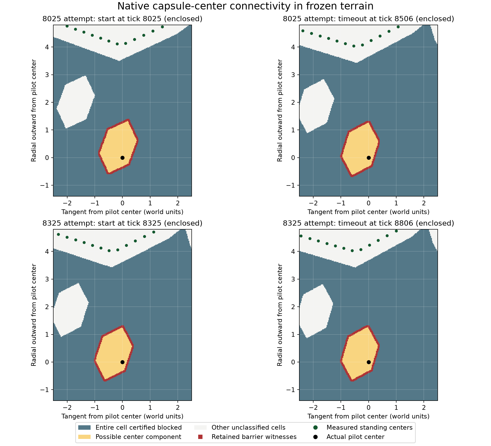

# Retained terrain encloses the Angular pilot

**All four inspected states contain a native terrain barrier around the pilot,
at all three prespecified resolutions.** The outer standing nodes are outside
that barrier. The preceding direction changes cannot create a collision-free
on-foot exit through this frozen geometry. Retain this Angular/collapse-off
case as an expected blocked case; do not use it to justify more blind recovery
retries, relaxed standing attachment, or promotion of the failed direction
selector.

This resolves the local exit question at the inspected states. It does not prove
that later terrain destruction cannot open a route, or decide whether native
rebuilding and boarding elsewhere could recover the pilot. No recovery-policy
or gameplay-physics change was made.

## Native evidence



The figure shows possible **pilot-center positions**, rather than rendered
terrain. Blue squares are certified blocked in their entirety for every capsule
orientation. Yellow is the overestimate of the component containing the actual
pilot center. Red cells carry the retained native solid-point witnesses. Green
points are centers above the measured outer standing nodes. White cells are
unclassified and deliberately treated as traversable. Each panel uses its own
pilot-centered radial frame; only a subset of the six-unit query window is shown.

| Retained state | Enclosed at 0.1 / 0.05 / 0.025 spacing | Fine-grid barrier cells | Nearest standing center | Standing centers in component |
| --- | --- | ---: | ---: | ---: |
| Early start, tick 8025 | Yes / yes / yes | 268 | 4.118 | 0 / 503 |
| Early timeout, tick 8506 | Yes / yes / yes | 268 | 4.072 | 0 / 503 |
| Late start, tick 8325 | Yes / yes / yes | 268 | 4.063 | 0 / 503 |
| Late timeout, tick 8806 | Yes / yes / yes | 268 | 4.072 | 0 / 503 |

Distances are world units from the actual actor center to the measured standing
center. They differ from the earlier foot-to-route-start distances. All states
retain terrain revision 16. The finest-grid possible component spans about
1.35–1.38 units tangentially and 1.93–1.95 units radially. These are conservative
bounds on possible centers, not measurements of usable walking room.

The [prespecified plan](terrain-recovery-pocket-connectivity-plan.md) queries only
this planet's actual retained terrain chunks. Native capsule collision groups
apply; other obstacles, sensors and the actor itself are excluded. Each native
capsule contains a 0.15-unit-radius disk regardless of orientation. The diagnostic
shrinks that disk by a 0.025 penetration allowance, then reserves a further
0.002 plus coordinate-scaled numerical margin.

For each cell, a native solid-point projection at distance `d` certifies the
whole square blocked only if `d + cell circumradius + margin < 0.125`. The
triangle inequality covers the complete cell; this is stronger than marking a
cell blocked because one sampled point collides. All uncertified cells and
diagonal passages remain open during flooding. The source cell is unblocked
in all twelve grids.

The independent auditor checks every retained frontier witness, then repeats
the flood with **only those witnessed cells blocked**. Each witness set still
separates the source from every edge of the query window. All 503 measured
standing centers lie outside each source component, including those beyond
the window. This supplies an orientation-independent enclosure certificate
within the stated numerical and penetration allowances. Solver tunneling,
shape changes, future destruction, and gameplay transitions that relocate the
actor are outside its scope.

## Reconstruction and checks

The runtime is frozen at `7f09b728ad4133aee426894f6255313a02e74973`, with binary
SHA-256 `74959ee89e02e33297a413201593ca971369dd15a300172f0580db19128e9676`.
The original mission prefixes and the prior target-direction candidate traces
reconstruct both attempts. The same three existing opt-in options are selected;
neither controller is reset. These are four states in one seed/settings case,
not four independent battles.

Both reconstructions pass on their first run. Every action, decision and public
physical-scenario checksum matches the retained reference: 17,314 decisions in
total. All four native physics fingerprints match. Both complete saved timeout
states also equal their preceding-experiment snapshots. The read-only inspection
leaves native physics bytes, public scenario state and both controllers unchanged.
There is no new match continuation after either retained timeout.

The auditor checks 2,418 frozen source inputs, 34 case artifacts, 287 material
conservation/speed samples, and 1,216,332 native queries supporting the twelve
certificates. The first audit passes. Its later added full-endpoint equality
check also passes. After freezing, only auditor handling of expanded f32 scalar
encodings and that additional equality check changed; no runtime or simulation
was changed or rerun.

**615 tests pass:** 161 engine, 451 AI and three native posture tests. Four new
engine tests cover closed/narrow/open rooms, rotated compound shapes, native
filters, invalid grids, source overlap, independent witness sufficiency, and a
coarse unresolved neck that remains open until finer measurement. An initial
fixture incorrectly expected the coarse neck to close; its correction and the
first failed validation receipt are retained. The algorithm was not loosened.

Strict AI Clippy, default-feature compilation and formatting pass. Engine Clippy
retains one existing warning in unchanged `spaceling.rs`; scenario Clippy retains
its seven existing warnings. The initial strict engine-lint failure and source
equality receipt are included. No new warning is introduced. The geometry code
is available only through the diagnostic feature and does not run in gameplay.

## Decision and handoff

Keep this case as an expected blocked recovery while its physical enclosure
persists. A usable opening must be demonstrated before spending another recovery
policy experiment on it. The next useful investigation is the separate Round
hatch stall, where a one-jump route was measured: reconstruct that failure,
inspect route execution, and establish a bounded ordinary-control witness before
changing the executor. The Angular/collapse-on replacement-distance gate and
placement cost remain separate. Final published #174 integration and device
qualification remain pending.

The [compact receipt](data/terrain-recovery-pocket-connectivity-v1.json) contains
hashes, all grid outcomes, validation and figure provenance. Raw evidence is in
`spacewars-handoffs/pocket-connectivity-20261010`; the verified package is
`spacewars-handoffs/terrain-recovery-pocket-connectivity-20261010.tar.gz`.
Its incremental source bundle requires `f876b9d` from the preceding
target-direction package. Audit from a checkout containing these results:

```sh
python3 tools/audit-terrain-recovery-pocket-connectivity.py /path/to/pocket-connectivity-20261010 --output /tmp/pocket-connectivity-audit.json
```

Reproduce with the frozen `pocket-connectivity-diagnostic` binary and ignored
test `mission_pilot::terrain_recovery::qualification::connectivity::retained_pocket_connectivity`.
Exact commands, input hashes and environment are in each case's `command.json`.
Use a new output directory; the harness rejects existing evidence. The package
includes PNG/PDF figures and plotting dependencies. Work remains local on
`bot-recovery-pocket-connectivity`; the original #178 checkout remains at
`cada1eb`. Defaults, deployment and GitHub are unchanged.
